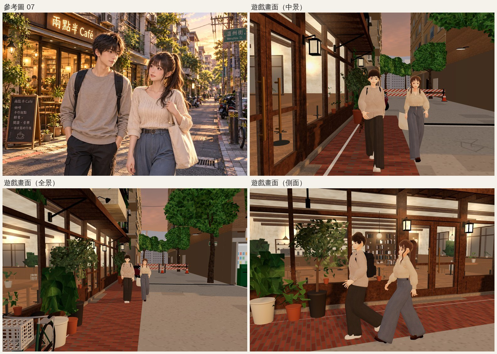
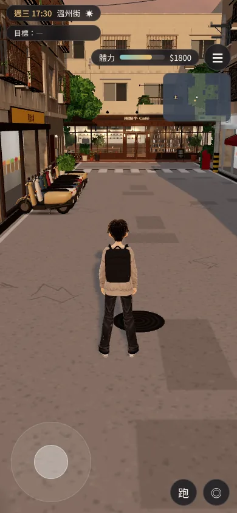
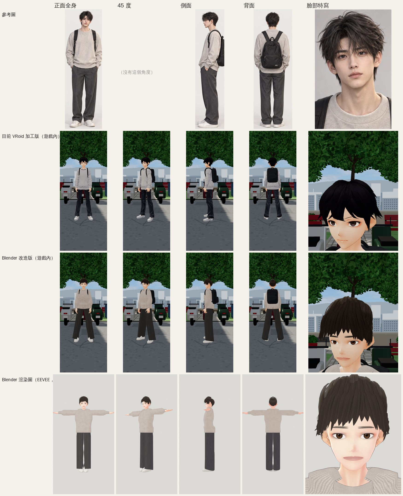
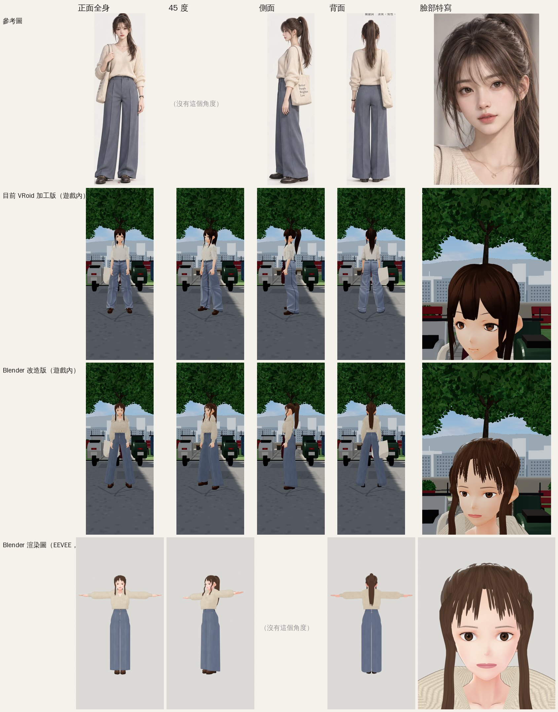
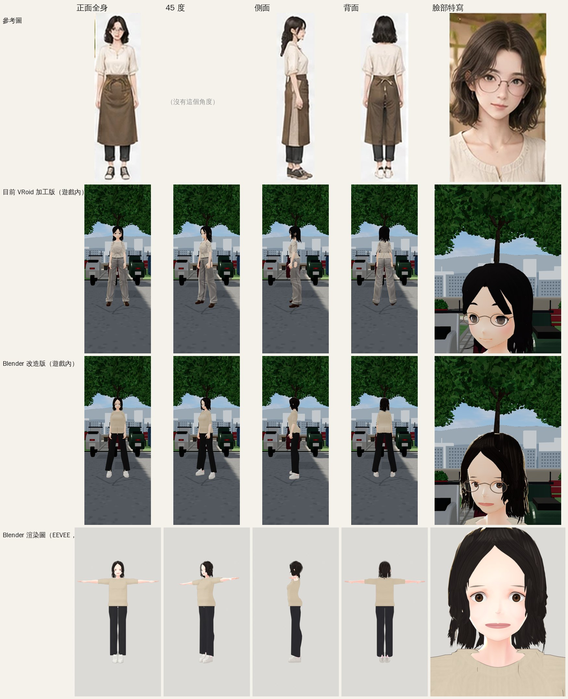
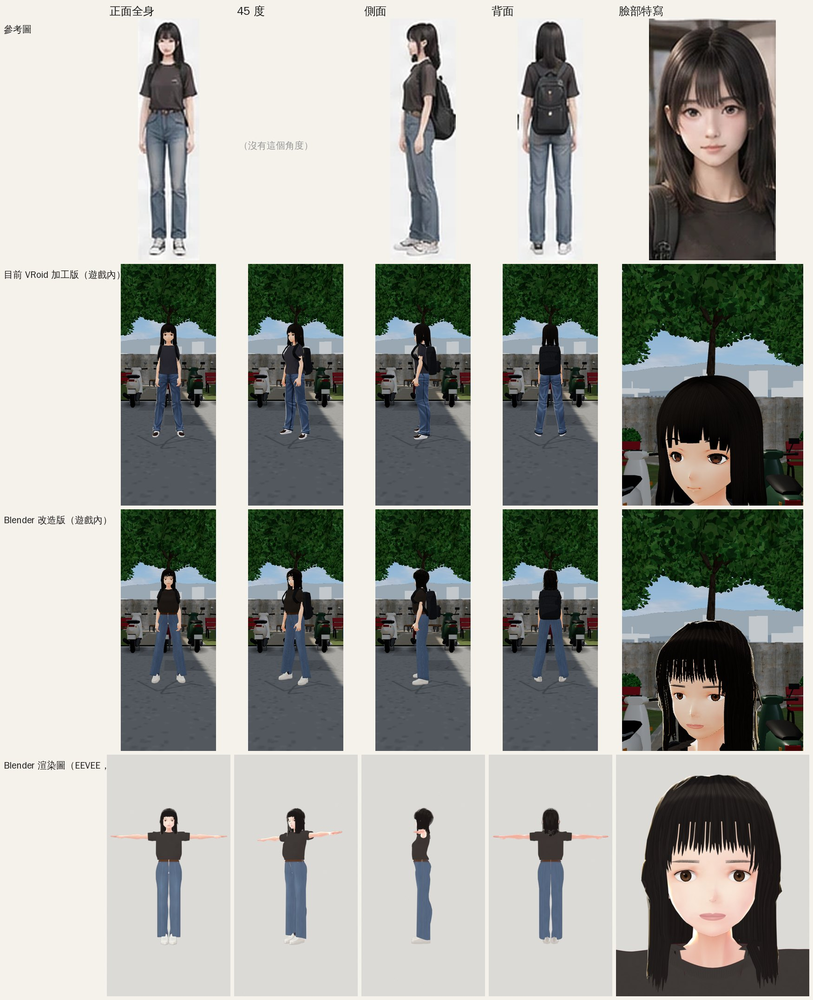
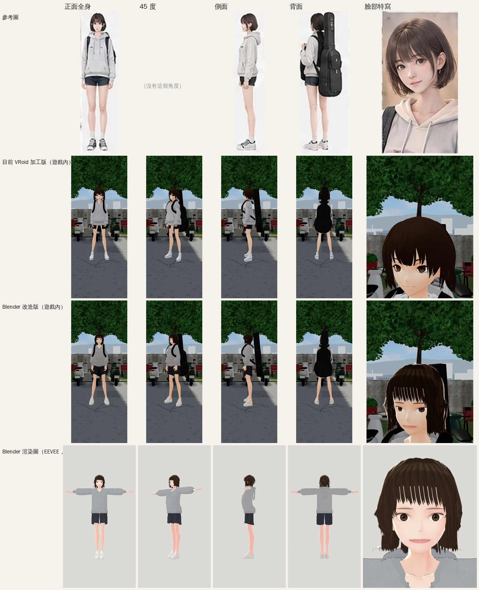
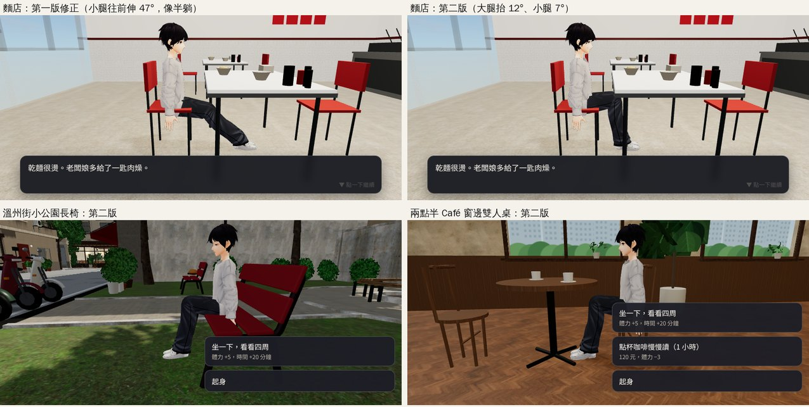
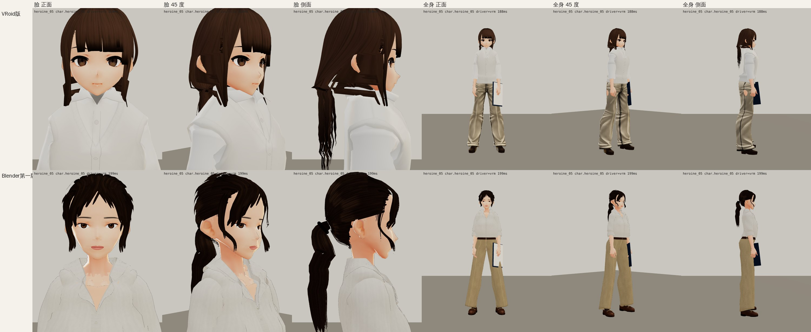

# 起床報告：九小時雙 AI 自主開發（2026-10-10 12:05–21:05 UTC＝台灣 10/10 20:05 – 10/11 05:05）

> **【歷史（2026-10-18 AA-C 依使用者授權標記）】**2026-10-10 九小時自主開發的一次性報告，只作紀錄。

> 寫的人：LAWWW（第一個 AI，主開發與發布）。LAWWW2（第二個 AI）的成果也整理在這裡，原始紀錄在 `docs/DUAL_AI_BOARD.md`。
> 所有測試都是 **Playwright 手機模擬（SwiftShader）**，**不是 iPhone 實機**。沒有任何美術標成 `ART_APPROVED`，要你看過才算。

## 一、一句話

這段時間發布了兩版。v9.4：霖澤館可以走進去。v9.4.1：兩點半 Café 換成 Blender 正式模型。五位主要人物（祐廷、沈以安、林芷若、陳語彤、高子晴）都做好了 Blender 第一版，但只有網址加 `?blchar` 才會載入，預設畫面沒有換。第六位溫書瑀在授權期結束時做到一半，之後補完了（見最後的補記）。LAWWW2 做好了溫州街近景和四間室內（便利商店、麵店、書店、宿舍），已經整合進開發分支，回歸測試全部通過，還沒有發布。**下一版 v9.4.2 的發布候選正在準備，你說可以才會發布**（最早 21:59 UTC）。

## 二、線上版本（https://pyhuanglaw.github.io/Lawstudent/）

| 版本 | 部署成功（UTC） | commit | 玩家會看到 |
|---|---|---|---|
| v9.4 | 14:47:16 | `6b9c0dc` | 霖澤館可以走進去：穿堂、一樓大廳、雙跑樓梯、玻璃電梯、二樓迴廊、201 階梯教室，48 個座位都能坐。走樓梯時腳會踩在階梯上。網路慢、人物還沒載好時，不會再一直顯示程序化的醜人物。長椅不再坐在空中。進門時，深色的門板不再擋住人物。（霖澤館主體在你睡前就做好了；這段時間做的是發布前測試、修兩個測試本身的錯，以及修鏡頭被門板擋住的問題。） |
| v9.4.1 | 18:59:10 | `e4ded6a` | 兩點半 Café 換成 LAWWW2 的 Blender 正式模型（外觀＋店內），導航、座位、互動都和原本一樣。網址加 `?blchar` 可以看祐廷、沈以安（第二版）、林芷若的 Blender 版。 |

- 兩次發布都遵守三小時規則。發布前會在乾淨的 worktree 跑完整套 `tests/release_suite.sh`。v9.4 和 v9.4.1 各有一、兩項第一次沒過，查清楚後都是**測試本身**的問題，例如人物還在走路，測試就去檢查按鈕。改好測試、重跑後全部通過。改了什麼、為什麼這樣改，都記在 `docs/RELEASES.md`。
- 緊急回復的指令在 `docs/RELEASES.md` 最上面，不需要 force push。

## 三、LAWWW（第一個 AI）完成的事

**1. 人物的 Blender 版**（都是 `READY_FOR_ART_REVIEW`，只在 `?blchar` 載入）

| 人物 | commit | 做了什麼 | 驗收資料 |
|---|---|---|---|
| 沈以安（第二版） | `c54bbce` → `e051461` | 臉（下半臉側面、嘴）、灰棕高馬尾（有彈簧骨，走路會擺動）＋空氣瀏海＋臉旁碎髮、V 領針織衫（肩膀不再翹得像帽沿）、高腰寬褲 | CHARACTER_REVIEW 第 9 節 |
| 祐廷 | `3e55a8f` | 層次短髮、淺灰圓領毛衣、深灰直筒褲、白球鞋 | 第 10 節 |
| 林芷若 | `af6a7a4` | 中分八字瀏海、及肩微捲；臉頰的灰藍色塊和臉旁往外飄的細線都修掉了 | 第 11 節 |
| 陳語彤 | `675a471` | 及肩直髮＋空氣瀏海、深色棉 T 紮進高腰牛仔褲＋皮帶、白球鞋 | 第 12 節 |
| 高子晴 | `3466902` | 清掉樣本皮膚上的科幻花紋、深棕鮑伯、淺麻灰連帽上衣＋放下來的帽子＋帽繩、深色牛仔短褲 | 第 13 節 |
| 溫書瑀（**起床後補完**，21:55 UTC） | 見下方補記 | 低馬尾（有彈簧骨）＋中分往兩旁撥的長瀏海、白襯衫（自己做的領子、門襟、捲起的袖口）、卡其直筒褲、深棕樂福鞋 | 第 14 節 |

前五位都附了三方比較（參考圖／VRoid 版／Blender 版）、遊戲裡六個角度的截圖、坐下、走上霖澤館樓梯，以及表情。圖都在 `docs/art-rebuild/CHARACTER_REVIEW.md`（第 11–13 節的圖原本放錯資料夾、文件裡看不到，已經修好）。

**2. 預設遊戲也會用到的修正**
- **坐下時腳沉到地面下**（`fa8a484`→第二版 `538796c`）：所有人物坐長椅、Café 或麵店的椅子時，腳底都在地面下 12～14 cm。高子晴穿短褲時，小腿看起來像斷在地面上。線上版也有這個問題。第一版修正讓小腿往前伸，腳是踩到地了，但我在麵店實際坐下時，看到小腿斜了 47°，像半躺著。第二版改成先把大腿抬高一點（膝蓋比臀部高一點，像坐在比較矮的椅子上），小腿幾乎垂直（6～8°），腳底只比地面低 0.4～0.6 cm。階梯教室的座位不套用，因為腳往前伸會從桌子下面穿出來。新增的 `tests/sit_feet_unit.js` 會檢查腳底高度、小腿和大腿角度，已經放進發布前測試。
- 霖澤館與 201 的鏡頭被門板擋住（`6d4fa85`）。
- VRoid 人物模型的格式警告（`fa8a484`，只改檔頭資料）。

**3. 雙 AI 分工與整合**：寫好交接文件和工作看板，訂了訊息規則（D39、D40）。LAWWW2 交來的五批成果都是我 merge 進開發分支，再跑回歸測試。做了 17:30 祐廷＋沈以安走過 Café 的示範畫面（`615edd0`，VISUAL_REVIEW 第 18 節）。檢查 LAWWW2 的截圖時，發現宿舍牆上的掛勾和毛巾在牆淡出時會浮在空中，請它修好了。

## 四、LAWWW2（第二個 AI）完成的事

| 項目 | LAWWW2 commit | 整合（開發分支） | 狀態 |
|---|---|---|---|
| 兩點半 Café 外觀＋店內 | `2ffd7d5` | `384c612` | **已在 v9.4.1 上線** |
| 溫州街近景：14 棟公寓、日式宿舍＋院牆、電線桿／反光鏡／路名牌、Café 門前紅磚道、小公園、兩款機車 | `e2ae4d6` → 減量版 `a58b517` | `f14b533` → `c9dbdf3` | 第一版同一個鏡頭的 draw call 比舊版多 47～52%。第二輪減量（純色零件合併成頂點色材質、窗戶共用同一個模型）後是 277／239／283 次，比舊版多 26～27%，達到目標（≤ 310）；三角形 33～36 萬 |
| 便利商店室內 | `e2ae4d6` | `f14b533` | 開發分支 |
| 麵店、書店、宿舍室內 | `046b84a` | `3455876` | 開發分支 |
| 修好「玻璃變成灰板」（便利商店也有這個問題） | `4391e1f` | `3455876` | 開發分支 |
| 宿舍牆上的掛勾、毛巾、冷氣、窗簾、月曆、傳單會跟著牆淡出 | `6374654` | `1f95ca9` | 開發分支；新測試在修改前會失敗、修改後通過 |
| 腳踏車、路燈、長椅的 Blender 模型 | — | 還沒接進遊戲 | 我已經同意它改共用檔，條件是要附測試 |
| Café 往南／往北和巷底的遠景公寓 | 製作中 | — | 要排到下一版之後 |

每一項都附三個時段（11:00／17:30／20:30）的前後對照截圖和 Blender 渲染圖：`docs/art-rebuild/second_ai/VISUAL_REVIEW.md` 第 1–4 節。

## 五、看圖

17:30 雙人示範（實際遊戲畫面，左上是參考圖 07）：

溫州街近景（LAWWW2，17:30，手機直向）：

五位人物的 Blender 版（每張左邊是參考圖、中間 VRoid 版、右邊 Blender 版）：

坐姿第二版（麵店的第一版／第二版、溫州街小公園長椅、Café 窗邊）：

溫書瑀製作中（上面是 VRoid 版，下面是 Blender 第一版；還沒修完，不是驗收用）：

## 六、等你看的美術（都是 `READY_FOR_ART_REVIEW`，沒有一項標 `ART_APPROVED`）

| 項目 | 在哪裡看 | 文件 |
|---|---|---|
| 祐廷、沈以安、林芷若（Blender） | 線上網址加 `?blchar` | `docs/art-rebuild/CHARACTER_REVIEW.md` 第 9–11 節 |
| 陳語彤、高子晴（Blender） | 截圖；下一版發布後，線上加 `?blchar` 也看得到 | 同上第 12–13 節 |
| 兩點半 Café | 線上（預設） | `docs/art-rebuild/second_ai/VISUAL_REVIEW.md` 第 1 節 |
| 溫州街近景、便利商店 | 截圖；下一版發布後線上可看 | 同上第 2–3 節 |
| 麵店、書店、宿舍 | 截圖；下一版發布後線上可看 | 同上第 4 節 |
| 17:30 雙人示範 | 截圖 | `docs/art-rebuild/VISUAL_REVIEW.md` 第 18 節 |
| 霖澤館（v9.4） | 線上 | 同上第 17 節 |
| 黃昏調色提案（之前就在等你決定） | 網址加 `?grade=golden` | 同上第 10 節 |

## 七、還沒完成／已知問題

- **溫書瑀**的 Blender 版還在做（見第三節）。
- 人物的共同問題：
  - 五官還是 VRoid 的畫法，沒有重新畫。
  - 祐廷、林芷若、陳語彤、高子晴的 Blender 版頭髮沒有彈簧骨，走路時不會擺動（沈以安的馬尾和臉旁碎髮有）。〔補記：林芷若、陳語彤、高子晴已經加上，見最後的補記〕
  - 高子晴沒有白襪；陳語彤的背包提把比肩膀高一點。
  - Blender 版頭髮用的材質有一張「斜著看會發亮」的貼圖。溫書瑀在 Blender 預覽裡頭頂出現一圈白光，所以先關掉了。其他四位在遊戲裡要再確認有沒有一樣的問題。
- 霖澤館剩下的美術（夜間玻璃、反射、201 窗外景），以及萬才館第二階段（可以走的弧形大樓梯）：還在排隊。
- 溫州街在手機上跑起來的效能還沒量過（只有模擬器的 draw call、三角形數字）。
- **iPhone 實機：什麼都沒有測過。**
- 舊問題：`mixamo_clips.glb` 的動畫有授權疑慮（repo 是公開的）。

## 八、需要你決定的事

1. **v9.4.2 要不要發布**（最早 21:59 UTC）。內容：
   - 溫州街近景，加上便利商店、麵店、書店、宿舍四間室內的正式模型（`?nobldg` 可以切回舊版）。
   - 玻璃修正。
   - 坐姿第二版。
   - `?blchar` 多了陳語彤、高子晴。

   人物的預設畫面不會換。發布前測試要等你醒來的時候才會跑完，結果會寫在 `docs/RELEASES.md`。
2. **五位 Blender 人物**：方向對不對？先改哪一位？什麼時候換成預設畫面？
3. 黃昏調色提案（之前就在等你決定）。

## 九、接下來（不用等你就可以做的）

1. 跑完 v9.4.2 的發布前測試，寫好發布紀錄，等你說可以。
2. 溫書瑀：修脖子和胸口的接縫、頭頂與瀏海、領子、馬尾的形狀，然後在遊戲裡驗收（六個角度、坐下、樓梯、表情），做三方比較。
3. LAWWW2：遠景公寓 → 街道道具 → 公館近景。

## 十、分支與 commit

- 開發分支：`claude/confident-ritchie-8rwh7t`（寫報告時最新是 `dfd2618`＝v9.4.2 發布候選；宿舍修正整合後的回歸全部通過）。
- LAWWW2：`claude/second-ai-env-art`（最新 `6374654`，已經全部整合）。
- main（線上）：`e4ded6a`（v9.4.1）。

## 補記（21:05 UTC 之後）

- **v9.4.2 發布前測試**：候選 `dfd2618`，25 項第一次全部通過（20:57–21:41 UTC）。**還沒發布，等你說可以。**
- **溫書瑀 Blender 第一版完成**（`READY_FOR_ART_REVIEW`，只在 `?blchar`；`CHARACTER_REVIEW.md` 第 14 節）。V 領裡的洞原因是樣本身體貼圖在原本衣服蓋住的地方是透明的，補上皮膚色後接縫看不到了。走樓梯、坐下、彈簧骨、15 個表情都檢查過。六位主要人物的 Blender 第一版都做完了。
- LAWWW2：溫州街遠景公寓已 merge 進開發分支（下一版之後），正在做街道道具，之後做公館近景（已同意它認領）。
- **頭髮彈簧骨**：林芷若、陳語彤、高子晴的 Blender 版頭髮現在走路、轉身時會擺動（`CHARACTER_REVIEW.md` 第 15 節），只在 `?blchar`。現在六位的 Blender 版頭髮都有彈簧骨，只剩祐廷（短髮）沒有。
