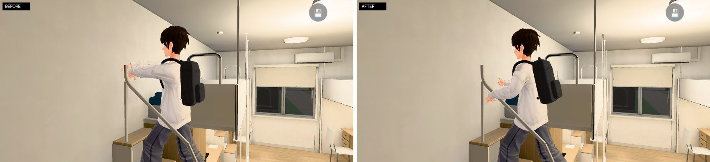
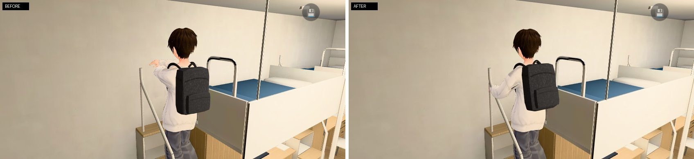
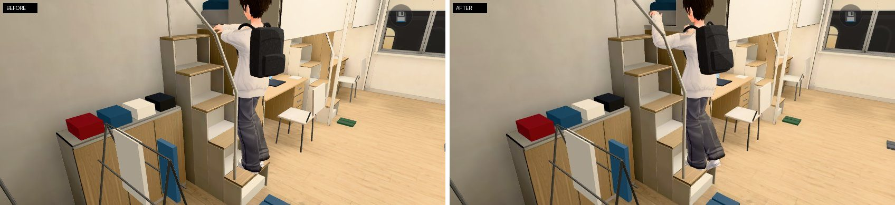

# 爬宿舍上舖梯子的手勢（CLIMB-POSE-1102）

LAWWW 子代理（帳號 A）2026-11-02。狀態：`INTEGRATED`（climbfix 分支，基底 int/m591 `776314ce0`，已經是新的窄宿舍 DORM-LOFT-SCALE）；角色動作由 LAWWW 驗收。commit 只是保存，不是驗收，也不是發布。

## 起因

使用者 11-02 看測試畫面：「走上床手為什麼要往上抬高阿 好像殭屍」。

原因：`src/character3d.js` 的 `CLIMB_VRM`（DORM-SLEEP-1030）在 `pose==='climb'` 時把兩隻上臂、前臂設成同一個固定角度（上臂繞 y 轉 ±1.4、前臂 ±0.5），蓋掉走路片段的手。
量起來（`tests/climb_pose_unit.js` 跑舊版）：兩手在胸前中線碰在一起（離中線 −16～12 cm，左右手交叉）、高度一直在肩膀高（126～139 cm，只差 6 cm）、手肘 147° 幾乎打直、整段不換手；而且從站姿換成爬梯子那一格，手一下子跳 61 cm。

## 改了什麼

只改手、上身（移動、碰撞、鏡頭、梯子的步數與時間都沒動）：

- 拿掉 `CLIMB_VRM`。新增 `climbIK(h,u,dt)`（`src/character3d.js`，在彈簧骨之前、腳步貼合之後跑，和騎腳踏車的 `rideIK` 同一套兩段式 IK `ik2`，在真實骨架上算，不分 VRM 0.x／1.0）：
  1. **上身往前靠**：脊椎 `lean` 0.14 rad、胸口 `chest` 0.06 rad（繞人物左右軸往前），脖子 `neck` −0.16 rad（頭抬回來看上面）。頭比站著往前約 5 cm。
  2. **兩手抓梯子兩側**：離身體中線 `side` 20 cm（梯子寬 0.52 m），高度在肩膀下 12 cm（`lo`，胸口）到肩膀上 27 cm（`hi`，額頭）之間，在肩膀前面 24～30 cm；手肘往下、往外彎（pole＝肩膀往外 0.5、往下 0.6、往後 0.1）。手肘 64°～126°。
  3. **兩手交替換手、跟腳一致**：爬梯子時下半身照舊是走路片段。每一格量左右膝蓋（相對大腿根）的前後差，`sin` 換算成 0～1：左腳在前（往上踩）→ 右手在上，反過來也一樣；兩端飽和一點（手在最上面、最下面停一下＝抓住），中間平滑變化。換手的節奏就是腳的節奏（走路片段 0.97 秒×timeScale 0.6＝約 1.6 秒一個循環）。
  4. **漸入**：從站姿換成爬梯子，0.7 秒內（緩進緩出）從片段的手漸漸抓上去，每格最多移動 5.9 cm（30 fps），不跳格。
  5. **握住**：食指到小指往掌心彎（指根 0.75、中節 0.9、末節 0.6 rad，繞食指根→小指根那條線），大拇指不動。
  6. **最高抓到床欄頂**：`src/story3d.js` 上床時多一行 `P.obj.userData.climbTop＝床墊頂＋0.26 m`（≈床欄頂 2.12 m）。爬到上面幾階，手不會伸到床欄上面的空中；高的那隻手比低的高 8 cm、照樣換手。
- 數值在 `CHAR.CLIMB`；`CHAR.climbIK=false` 可以關掉比較。`u.climbHi`＝[左手, 右手] 的高度（0＝胸口、1＝最上面）。
- 爬下來（`climbdown`）原本就是走路片段、手自然擺（不是殭屍），這次**沒改**：下來是面向房間走下來，兩手往後抓扶手要另外做（見下面「還不夠好」）。
- 備用 GLB 人物、程序化人物：`climb` 本來就是走路片段（手照走路擺），沒有殭屍問題，沒改。

## 截圖（雲端 SwiftShader、橫向 844×390；不是手機實機）

腳本：`tools/dev_scratch/climb_pose_shot.py`（[前置] 讀檔到 203、大一上第 2 週週一 22:30；[捷徑] 床的選單直接選第一項，爬到第 1、3、5 階時包住 `GAME.sleep` 把劇情停住、人物動畫照跑；側面、斜後方鏡頭是截圖工具用 `GAME.cine` 放的，遊戲裡沒有）。沒有用 `?turbo`。
改前＝同一個流程，只把 `src/character3d.js` 用 Playwright 換成 `776314ce0` 的版本（`--old`）。每一張的人物座標、手／手肘／肩膀位置在 `before.json`、`after.json`。腳本存 PNG，放進這裡時轉成 JPG（品質 85）、並排圖另外拼。

| | 改前 | 改後 |
|---|---|---|
| 第 1 階，遊戲的爬梯子鏡頭 | `before_step1_game.jpg`：兩手平舉在胸前 | `after_step1_game.jpg`：右手往上抓扶手頂、左手在胸口 |
| 第 1 階，側面 | `before_step1_side.jpg` | `after_step1_side.jpg` |
| 第 3 階，遊戲鏡頭 | `before_step3_game.jpg` | `after_step3_game.jpg` |
| 第 3 階，側面 | `before_step3_side.jpg`：兩手直直往前伸（殭屍） | `after_step3_side.jpg`：手肘彎、兩手一高一低 |
| 第 3 階，斜後方 | `before_step3_back.jpg`：手往前平舉、懸在空中 | `after_step3_back.jpg`：左手抓在扶手上 |
| 第 5 階（三個鏡頭） | `before_step5_*.jpg` | `after_step5_*.jpg`：兩手在床欄頂附近 |

並排比較（左改前、右改後）：`compare_step1_game.jpg`、`compare_step1_side.jpg`、`compare_step3_game.jpg`、`compare_step3_side.jpg`、`compare_step3_back.jpg`。

## 測試（雲端 Node，不是瀏覽器流程、不是實機）

- 新增 `tests/climb_pose_unit.js`（祐廷，梯子第一階的位置與朝向，每格 1/30 秒）：① 每隻手高度變化 ≥ 25 cm ② 左右手高度相關 ≤ −0.5、平均差 ≥ 12 cm ③ 左腳在前時右手在上（≥ 90%）④ 手肘 ≤ 135° ⑤ 離中線 12～30 cm、左手在左 ⑥ 胸口到頭頂、肩膀前面 15～50 cm ⑦ 每格 ≤ 6 cm（含換姿勢那一刻）⑧ 頭往前 ≥ 3 cm ⑨ 中指往掌心彎 ≥ 60° ⑩ 設了 climbTop 兩手不高過它、還是會換。
  - **改前（`776314ce0` 的 character3d.js）：FAIL 8 項**（①②③④⑤⑦⑧⑨；⑩ 改前沒有這個功能）。改後：ALL PASS。
- `tests/nav_buildings_unit.js`、`tests/stairs_feet_unit.js`，以及 `ls tests | grep -iE "dorm|bed|sleep|char|pose|vrm|anim"` 的 29 支 Node 測試（含 `dorm_sleep_scene_unit.js`、`ride_pose_unit.js`）：31 支全部 ALL PASS。
- 瀏覽器流程測試（`flow_dorm_hall` 等）沒有跑：這次沒動移動、導航、存檔。

## 還不夠好、需要配合的

1. **頭穿過天花板（改前就有，不是這次造成的）**：第 5 階踏點 1.60 m＋祐廷 1.75 m＞房間高 3.0 m，`before_step5_*`、`after_step5_*` 都看得到頭在天花板上面。要 LAWWW2 決定：房間挑高、或最上面一兩階改成彎腰／爬上床的動作（要 LAWWW 加姿勢）。
2. **只有一邊有扶手**：梯子（其實是階梯收納櫃，每階高 0.32、深 0.21）只在門那一側有一根扶手，另一側是床尾擋板（只在走道那一半）。程式是「兩手抓梯子兩側」的通用位置，所以靠床那一側的手在低幾階時是抓在空中。要真的抓到東西：請 LAWWW2 在靠床那一側加一根扶手或握把（建議高度和現在的扶手對稱），或給一份「每一階兩手可以抓的點」的資料（像 `sleep_scene.steps`），LAWWW 再把 IK 目標改成那些點。
3. **腳還是走路片段**：下半身照走路片段擺（一個循環約 1.6 秒、約 4 階），所以換手的節奏跟著腳、不是一階換一次手。要一階一換，要把爬梯子時的走路片段放快（約 1.27 倍）或做爬梯子專用的腿部動作——這次照指示沒動腿。
4. **爬下來沒抓扶手**：`climbdown` 是面向房間走下來，手照走路擺。要的話下一步做「一手扶著扶手往下」。
5. **手腕方向沒特別調**：手掌方向跟著前臂；斜後方看得到手指握起來，但近看手掌角度可能不完全對準扶手。
6. 只拍了祐廷；其他人物不會爬宿舍梯子。實機（iPhone）沒看過。
