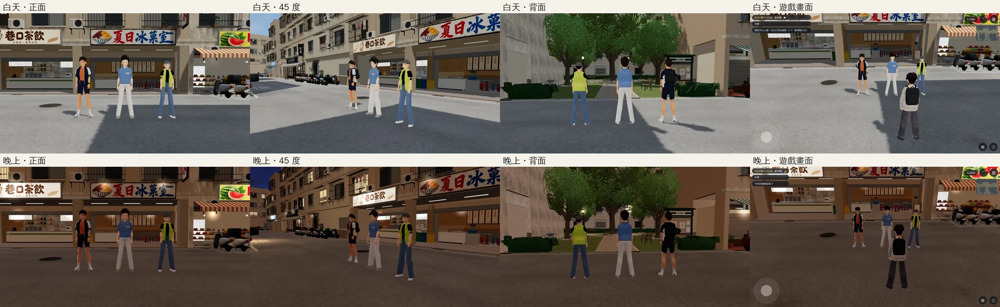
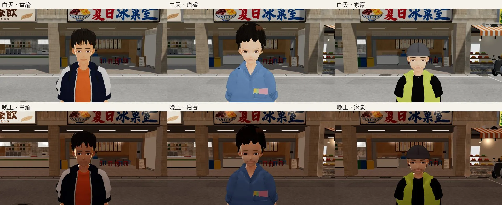
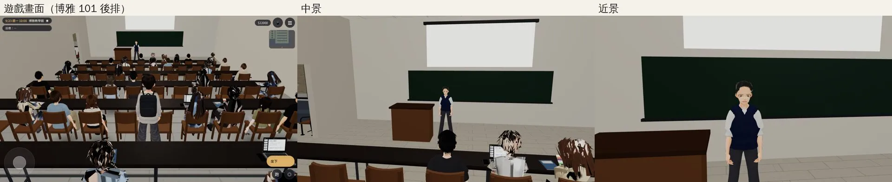
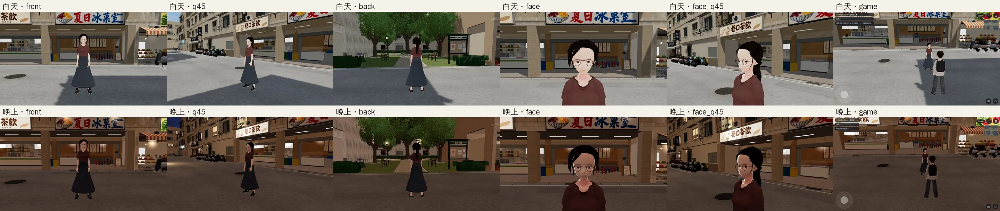
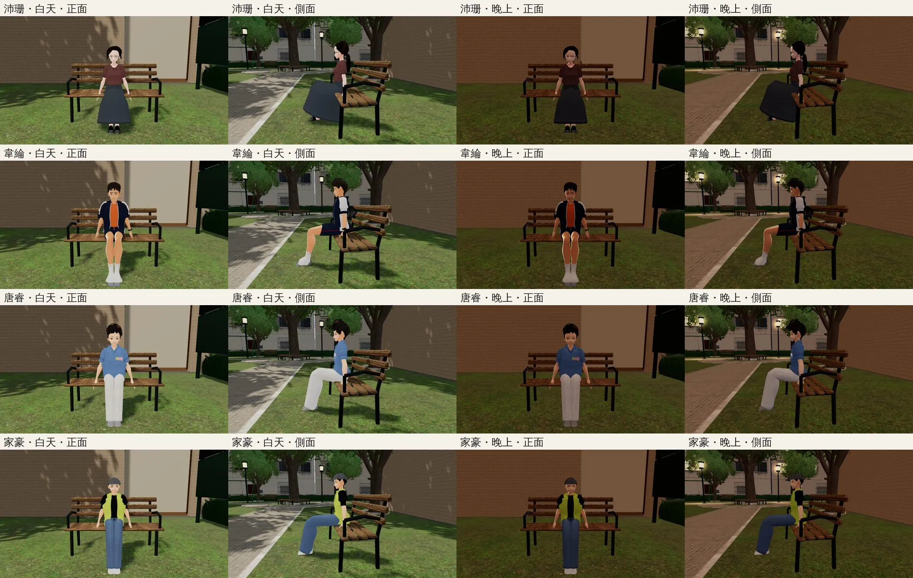
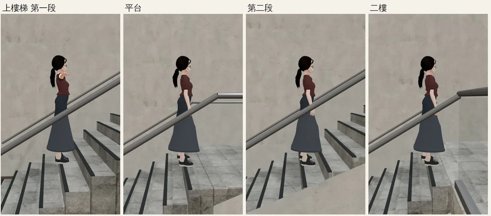
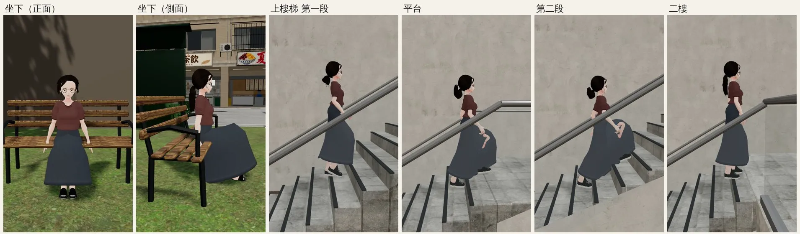

# 遊戲內截圖：經濟系四人＋魏教授、沛珊第二十六版（LAWWW-C 2026-10-17 15:5x UTC，給 BB-C 驗收）

- 版本：韋綸 v13、唐睿 v20（LAWWW2-C 60dc7908）、家豪 v10、魏教授 v6＋眼鏡（03179efb）、沛珊第二十六版（552185d9）；遊戲 commit 74a655e8 以後。
- 拍法：`tools/shots/econ_chars_ingame.py`（實際遊戲渲染器、SwiftShader，桌機模擬，不是手機實機）。人物用 `GAME.spawnCharacter` 放（[前置]），鏡頭是 `E.cinematic`；「遊戲畫面」是一般跟隨鏡頭＋介面。`drivers.json` 確認五個人都是正式 VRM（不是備用人物）；韋綸掛後背包＋安全帽、魏教授和沛珊戴自己的眼鏡。
- 魏教授：經濟系大一第 4 週週一 10:00 讀檔到博雅 101 後排，作息自己把他放到講台（講桌靠黑板中間那一側、面向座位），不是腳本擺的。
- 坐姿：溫州街小公園裡真的長椅座位（`坐在小公園的長椅`）。

| 檔案 | 內容 |
|---|---|
|  | 韋綸、唐睿、家豪（左到右）：白天／晚上的正面、45 度、背面、遊戲畫面 |
|  | 三人的臉（白天／晚上） |
|  | 魏教授：博雅 101 後排的遊戲畫面、中景、近景 |
|  | 沛珊第二十六版：白天／晚上的正面、45 度、背面、臉、臉 45 度、遊戲畫面 |
|  | 四人坐在長椅：白天／晚上、正面／側面 |
|  | 沛珊上霖澤館樓梯（`tools/shots/char_motion.py`） |

## LAWWW-C 看到、還沒處理的
- 沛珊上樓梯第一段：手臂往前平舉（其他段正常）。還沒查是動畫還是模型。
- 博雅 101 近處的幾位同學（路人底模）頭髮有黑白破碎的條紋（像透明貼圖的邊緣），見 `wei.webp` 第一張下面。已告訴 LAWWW2-C。
- 沛珊背面左邊一條細縫、肩膀一條淡折線：LAWWW2-C 的 README 寫還在。

## 修正後（LAWWW-C 16:1x，051e5c45：鏡頭外 16 m 內的人也更新骨架）

- 上樓梯第一段的手臂正常了（原因：人在鏡頭外不更新骨架，鏡頭一切過去的那一格露出模型原始的 T 字手臂）。
- 新看到的：平台、第二段走路時手擺到後面，手穿過長裙（裙子不跟手臂動）。是裙子和擺手的穿插，交 LAWWW2-C／BB-C 看。
- 坐姿現在坐在真的長椅上（截圖工具的長椅座標修正）。
