# 教學館室內：鏡頭穿牆的固定案例（修改前／修改後）

LAWWW2，2026-10-13。使用者第三點的分工：「LAWWW2：提供目前失敗的位置、角度與截圖。修好後在相同位置重新截圖。檢查門框、門片及正式模型是否還需要調整。」——這一份就是那個清單和重拍結果。
**Playwright＋SwiftShader 的手機模擬（844×390 橫向、有 HUD），不是 iPhone 實機。**

- 修改前：LAWWW `babb8c8`（還沒有鏡頭碰撞）。
- 修改後：LAWWW `dae1da3`（含 `8c2fa01` 跟隨鏡頭撞到隔間牆就拉近＋抬高、入口門框跟著南牆淡出；`5aaa306` 桌椅合併）。
- 案例檔：`camera_cases_1013.json`（一般位置 24 個）、`camera_cases_1013_doors.json`（教室門口 12 個）。重跑：`python3 tools/blender/env_second/shots/cam_cases_shots.py <URL> <輸出資料夾> --cases docs/art-rebuild/second_ai/camera_cases_1013.json`；鏡頭附近有什麼東西：`tools/blender/env_second/shots/cam_probe.py`。

## 0. 結論

| 項目 | 修改前 | 修改後 | 狀態 |
|---|---|---|---|
| 鏡頭跑到隔間牆後面（一般位置） | 19／24 個案例 | 0／24 | **FIXED**（這些案例） |
| 教室門口（走進去、走出來） | 2／12 | 0／12 | 見第 3 節 |
| 剛進門的黑色門框（三棟） | 擋在畫面前景 | 跟著南牆淡出，只剩很淡的輪廓 | **FIXED**（輪廓可以接受） |
| 牆邊、窄走廊轉向牆：鏡頭貼到頭頂上方 | —（原本是穿牆） | **10 個案例**水平只剩 0.40–0.92 m、比頭高 0.98–1.35 m：畫面只剩頭頂和地板，看不到前面 | **新問題**（第 1 節） |
| 高的家具、告示牌不在鏡頭碰撞裡 | — | 普通 1F 門廳：鏡頭停在公告欄正上方 0.22 m，近平面切進去，**畫面右半邊一大塊黑** | **新問題**（第 1 節） |

順便量到的效能（完全相同的鏡頭位置——剛進門的預設鏡頭）：draw call 博雅 817 → 154、普通 853 → 382、共同 496 → 152（`5aaa306` 桌椅合併）。

## 1. 修改後還要處理的兩件事（建議，LAWWW 決定做法）

**(1) 鏡頭貼到頭頂上方**（`boya_2F_1`、`boya_2F_2`、`boya_2F_4`、`gongtong_2F_2`、`gongtong_2F_3`、`gongtong_2F_4`、`putong_1F_1`、`putong_1F_2`、`putong_2F_1`、`putong_2F_4`）。現在的設計是「貼牆時鏡頭留在牆前、拉高從上面看」，牆不會擋住畫面了，但截圖看得出來：鏡頭在頭的正上方往下看，頭頂佔滿畫面中央，**看不到要走去的地方**。這些案例是「鏡頭轉向牆」的姿勢（`C.manualT=999`：手動轉過鏡頭、不會自動轉回來），實際玩的時候手動轉鏡頭、或停在牆邊轉身就會遇到。建議（可以合用）：
- **a. 自動轉開（建議先做）**：被隔間牆拉近到 1.5 m 以內、而且玩家沒有正在拖鏡頭時，往 ±30°、±60°、±90° 各打一條線，慢慢轉到最長的方向（每秒 60–90°）——在走廊裡鏡頭會轉成沿著走廊。
- **b. 拉近時看前面**：鏡頭距離小於 1.2 m 時，看的點往玩家面向的方向移 1–1.5 m（畫面看得到前面的地板，不是只有頭頂）。
- **c. 鏡頭離頭小於 0.8 m 時，玩家模型淡成半透明**（很多第三人稱遊戲的做法），頭不會佔滿畫面。
- **不建議**：把隔間牆完全透明（使用者：「不要把隔間牆完全透明化當成主要解法」）。

**(2) 家具、告示牌**：`zone.camCols` 只有隔間牆。普通 1F 門廳 `putong_1F_2`：鏡頭被牆拉近、抬高之後，停在公告欄（`bulletin_board_3`，深灰鐵框）上方 0.22 m，近平面（0.1 m）切進公告欄，畫面右半邊整片黑（第 2 節的截圖）。建議：高於 1.8 m 的家具（公告欄、書架、販賣機、隔板、講桌後的黑板架）也放進 `camCols`；或者鏡頭位置和任何看得見的表面保持 0.3 m 以上（從鏡頭往六個方向打 0.3 m 的短射線，碰到就往頭的方向再拉近）。

## 2. 一般位置（每棟每層 4 個，從 `cam_cases_pick.js` 的掃描挑「會穿牆」的位置與方向，在遊戲裡確認站得住）

每個案例：讀檔把玩家放到那個位置與樓層（[前置／捷徑]）→ 跟隨鏡頭轉到那個方向（`C.yaw`，`manualT=999` 不自動轉回）→ 等 2.5 秒＋8 格 → 截圖；用配置的牆（扣掉門洞）判斷鏡頭和頭之間有沒有隔間牆（2D）。最後一欄的「draw call」是那個畫面的數字。

| 案例 | 位置 | 鏡頭方向 yaw | 修改前（`babb8c8`）｜draw call | 修改後（`dae1da3`）｜draw call | 備註 |
|---|---|---|---|---|---|
| `boya_spawn` | 博雅 剛進門（出生點、預設鏡頭） | — | 牆前、水平 4.27 m、比頭高 1.91 m｜817 | 牆前、水平 4.27 m、比頭高 1.91 m｜154 | 對照組（兩版都在牆前） |
| `putong_spawn` | 普通 剛進門（出生點、預設鏡頭） | — | 牆前、水平 4.27 m、比頭高 1.91 m｜853 | 牆前、水平 4.27 m、比頭高 1.91 m｜382 | 對照組（兩版都在牆前） |
| `gongtong_spawn` | 共同 剛進門（出生點、預設鏡頭） | — | 牆前、水平 4.27 m、比頭高 1.91 m｜496 | 牆前、水平 4.27 m、比頭高 1.91 m｜152 | 對照組（兩版都在牆前） |
| `boya_1F_1` | 博雅 1F 大廳／走廊（-5.9, 6.1） | 3.93 | 牆前、水平 4.27 m、比頭高 1.91 m｜615 | 牆前、水平 4.27 m、比頭高 1.91 m｜155 | 對照組（兩版都在牆前） |
| `boya_1F_2` | 博雅 1F 102（10.1, 8.1） | 4.71 | **牆後**、水平 4.27 m、比頭高 1.91 m｜565 | 牆前、水平 3.66 m、比頭高 1.79 m｜122 |  |
| `boya_1F_3` | 博雅 1F 自習小桌（0.1, -3.4） | 0.79 | **牆後**、水平 4.27 m、比頭高 1.91 m｜684 | 牆前、水平 2.20 m、比頭高 1.55 m｜134 |  |
| `boya_1F_4` | 博雅 1F 討論桌（2.6, 4.6） | 1.57 | **牆後**、水平 4.27 m、比頭高 1.91 m｜772 | 牆前、水平 2.96 m、比頭高 1.68 m｜147 |  |
| `boya_2F_1` | 博雅 2F 二樓走廊（16.1, 1.6） | 0.79 | **牆後**、水平 4.27 m、比頭高 1.91 m｜1070 | 牆前、水平 0.64 m、比頭高 1.30 m｜132 | 鏡頭貼到頭頂上方（往下看） |
| `boya_2F_2` | 博雅 2F 大廳／走廊（-5.4, -1.4） | 3.93 | **牆後**、水平 4.27 m、比頭高 1.91 m｜818 | 牆前、水平 0.54 m、比頭高 1.29 m｜143 | 鏡頭貼到頭頂上方（往下看） |
| `boya_2F_3` | 博雅 2F 二樓走廊（5.6, 1.1） | 0.00 | 牆前、水平 4.27 m、比頭高 1.91 m｜758 | 牆前、水平 4.27 m、比頭高 1.91 m｜159 | 對照組（兩版都在牆前） |
| `boya_2F_4` | 博雅 2F 大廳／走廊（5.1, 8.1） | 0.79 | **牆後**、水平 4.27 m、比頭高 1.91 m｜926 | 牆前、水平 0.78 m、比頭高 1.33 m｜154 | 鏡頭貼到頭頂上方（往下看） |
| `putong_1F_1` | 普通 1F 走廊（16.1, 1.1） | 0.79 | **牆後**、水平 4.27 m、比頭高 1.91 m｜908 | 牆前、水平 0.40 m、比頭高 1.26 m｜98 | 鏡頭貼到頭頂上方（往下看） |
| `putong_1F_2` | 普通 1F 門廳（-3.4, 7.1） | 3.93 | **牆後**、水平 4.27 m、比頭高 1.91 m｜554 | 牆前、水平 0.92 m、比頭高 1.35 m｜101 | 鏡頭貼到頭頂上方（往下看）；鏡頭離「bulletin_board_3」只有 0.22 m（畫面一大塊黑） |
| `putong_1F_3` | 普通 1F 走廊（5.6, 1.6） | 2.36 | **牆後**、水平 4.27 m、比頭高 1.91 m｜623 | 牆前、水平 3.47 m、比頭高 1.76 m｜119 |  |
| `putong_1F_4` | 普通 1F 走廊（-7.4, -0.4） | 0.79 | **牆後**、水平 4.27 m、比頭高 1.91 m｜803 | 牆前、水平 2.34 m、比頭高 1.58 m｜378 |  |
| `putong_2F_1` | 普通 2F 二樓門廳（-3.4, 7.1） | 3.93 | **牆後**、水平 4.27 m、比頭高 1.91 m｜589 | 牆前、水平 0.92 m、比頭高 1.35 m｜114 | 鏡頭貼到頭頂上方（往下看） |
| `putong_2F_2` | 普通 2F 走廊（-7.4, -0.4） | 0.79 | **牆後**、水平 4.27 m、比頭高 1.91 m｜881 | 牆前、水平 2.34 m、比頭高 1.58 m｜389 |  |
| `putong_2F_3` | 普通 2F 走廊（-0.4, -0.4） | 2.36 | 牆前、水平 4.27 m、比頭高 1.91 m｜835 | 牆前、水平 4.27 m、比頭高 1.91 m｜361 | 對照組（兩版都在牆前） |
| `putong_2F_4` | 普通 2F 二樓門廳（3.1, 7.1） | 1.57 | **牆後**、水平 4.27 m、比頭高 1.91 m｜967 | 牆前、水平 0.86 m、比頭高 1.34 m｜116 | 鏡頭貼到頭頂上方（往下看） |
| `gongtong_1F_1` | 共同 1F 走廊（-11.4, 0.6） | 2.36 | 牆前、水平 4.27 m、比頭高 1.91 m｜360 | 牆前、水平 4.27 m、比頭高 1.91 m｜129 | 對照組（兩版都在牆前） |
| `gongtong_1F_2` | 共同 1F 大廳／走廊（1.6, 6.1） | 1.57 | **牆後**、水平 4.27 m、比頭高 1.91 m｜424 | 牆前、水平 1.56 m、比頭高 1.45 m｜124 |  |
| `gongtong_1F_3` | 共同 1F 走廊（-4.4, 2.1） | 3.93 | **牆後**、水平 4.27 m、比頭高 1.91 m｜426 | 牆前、水平 3.05 m、比頭高 1.69 m｜151 |  |
| `gongtong_1F_4` | 共同 1F 休息區（-8.4, 3.6） | 3.14 | **牆後**、水平 4.27 m、比頭高 1.91 m｜367 | 牆前、水平 3.56 m、比頭高 1.77 m｜128 |  |
| `gongtong_2F_1` | 共同 2F 走廊（-11.4, 0.6） | 2.36 | 牆前、水平 4.27 m、比頭高 1.91 m｜377 | 牆前、水平 4.27 m、比頭高 1.91 m｜127 | 對照組（兩版都在牆前） |
| `gongtong_2F_2` | 共同 2F 走廊（11.1, 1.6） | 0.00 | **牆後**、水平 4.27 m、比頭高 1.91 m｜486 | 牆前、水平 0.54 m、比頭高 1.29 m｜121 | 鏡頭貼到頭頂上方（往下看） |
| `gongtong_2F_3` | 共同 2F 走廊（4.1, 0.1） | 3.93 | **牆後**、水平 4.27 m、比頭高 1.91 m｜463 | 牆前、水平 0.40 m、比頭高 1.26 m｜131 | 鏡頭貼到頭頂上方（往下看） |
| `gongtong_2F_4` | 共同 2F 走廊（-4.4, 0.1） | 3.93 | **牆後**、水平 4.27 m、比頭高 1.91 m｜518 | 牆前、水平 0.47 m、比頭高 0.98 m｜140 | 鏡頭貼到頭頂上方（往下看） |

| 案例 | 修改前（`babb8c8`） | 修改後（`dae1da3`） |
|---|---|---|
| `boya_spawn` | 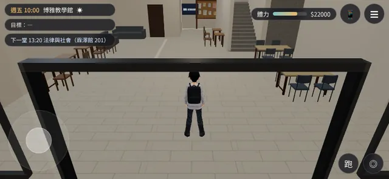 | 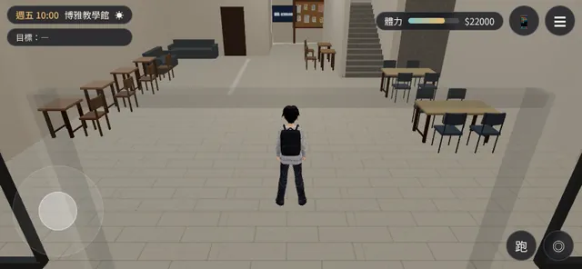 |
| `putong_spawn` | 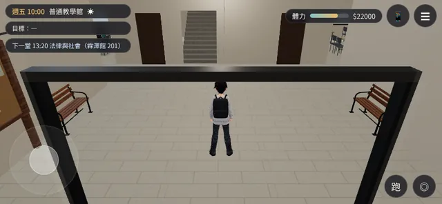 | 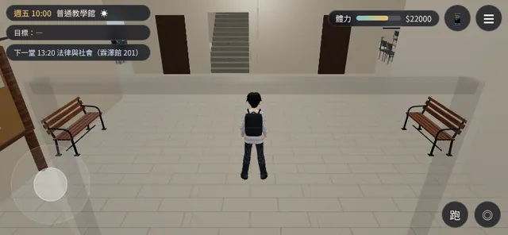 |
| `gongtong_spawn` | 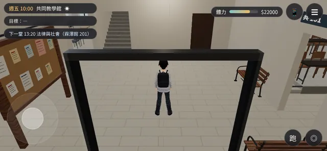 | 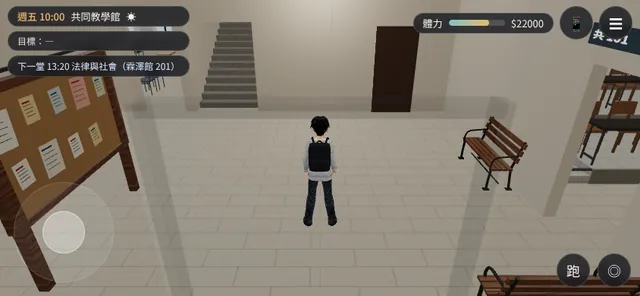 |
| `boya_1F_1` |  | 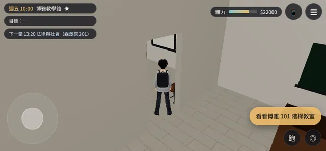 |
| `boya_1F_2` | 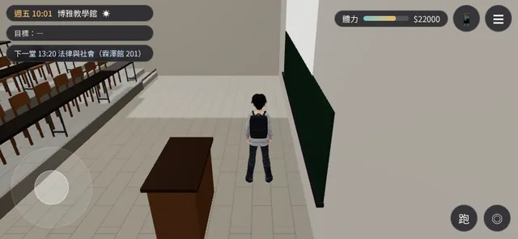 | 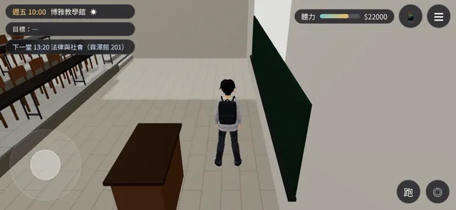 |
| `boya_1F_3` | 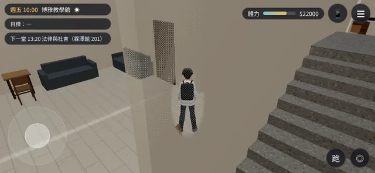 | 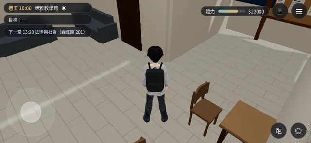 |
| `boya_1F_4` | 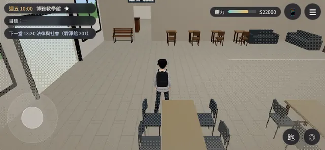 | 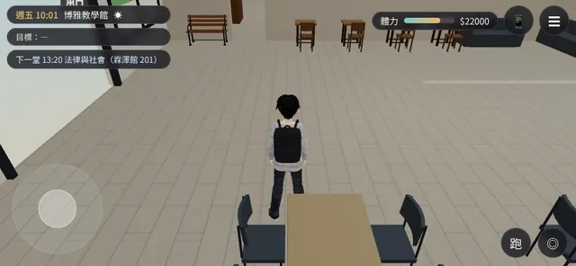 |
| `boya_2F_1` | 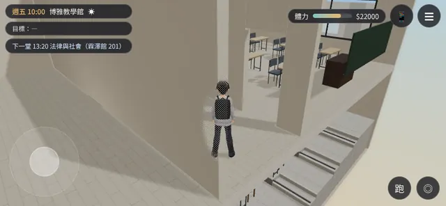 | 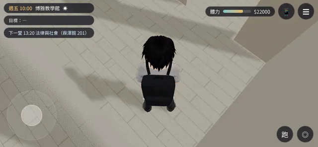 |
| `boya_2F_2` | 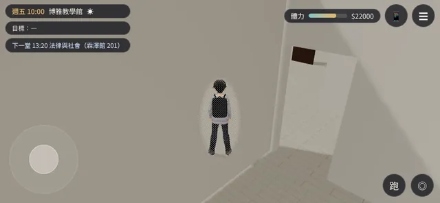 | 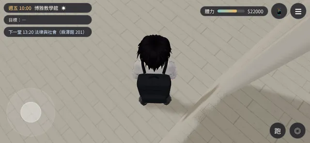 |
| `boya_2F_3` | 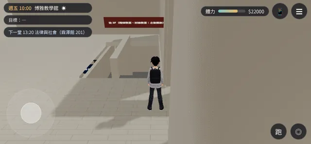 | 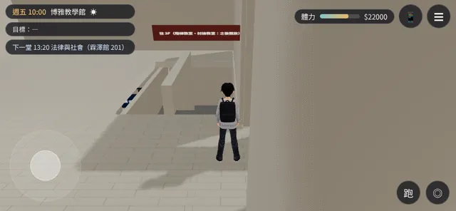 |
| `boya_2F_4` | 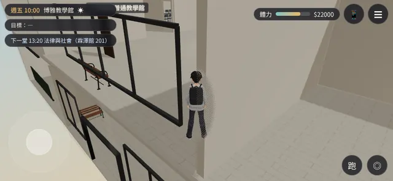 | 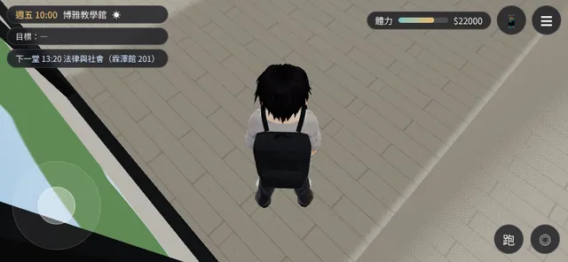 |
| `putong_1F_1` | 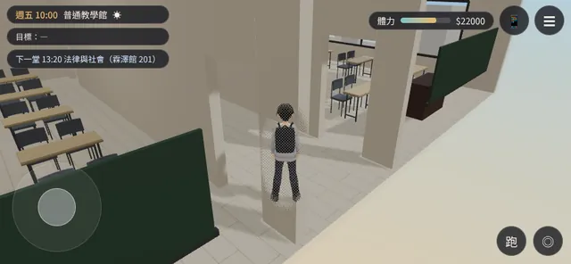 | 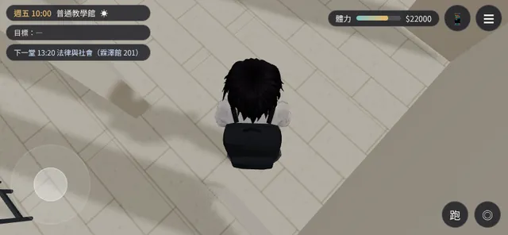 |
| `putong_1F_2` | 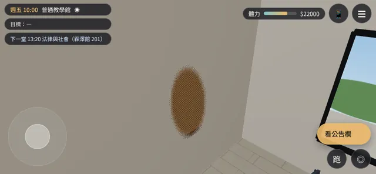 | 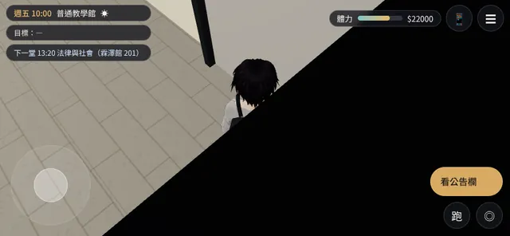 |
| `putong_1F_3` | 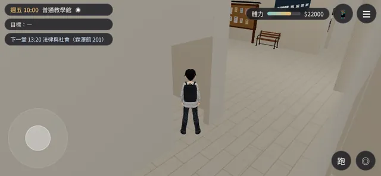 | 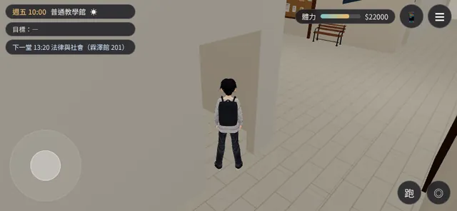 |
| `putong_1F_4` | 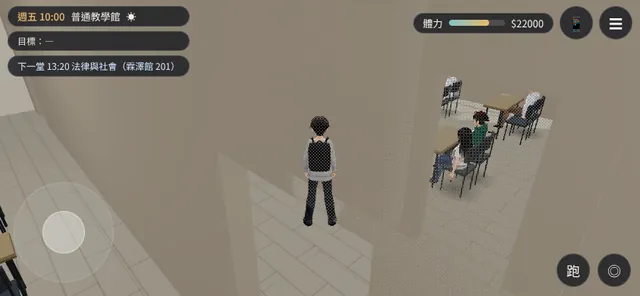 | 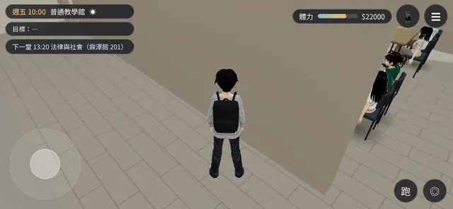 |
| `putong_2F_1` | 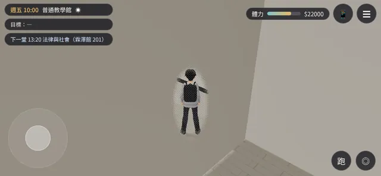 | 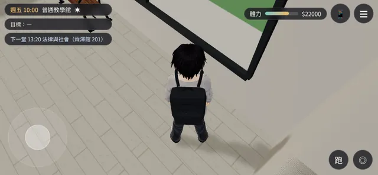 |
| `putong_2F_2` | 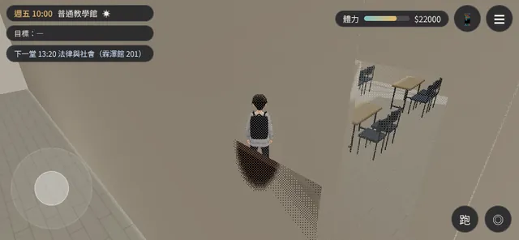 | 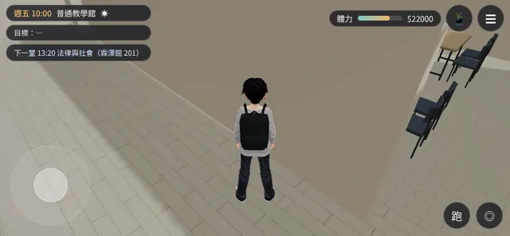 |
| `putong_2F_3` | 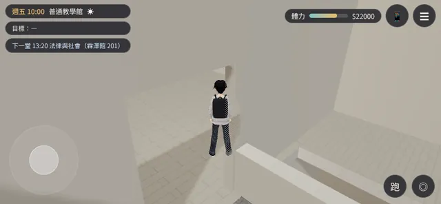 |  |
| `putong_2F_4` | 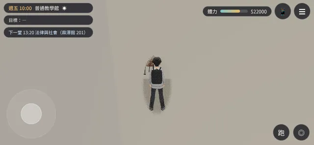 | 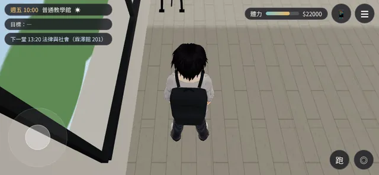 |
| `gongtong_1F_1` | 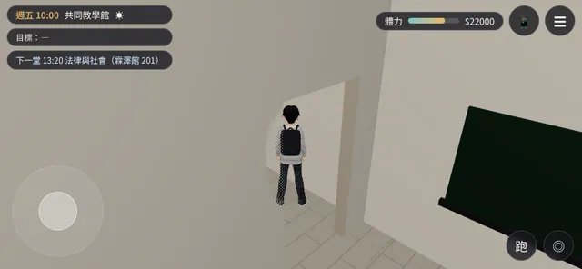 |  |
| `gongtong_1F_2` | 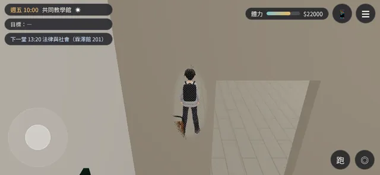 | 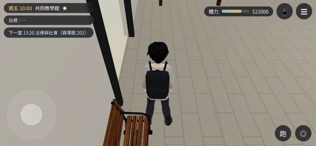 |
| `gongtong_1F_3` | 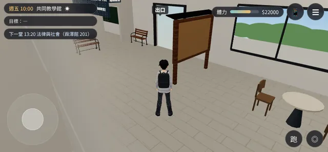 | 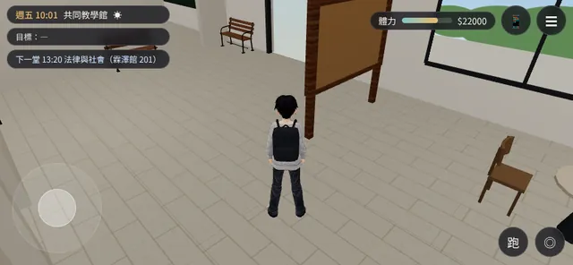 |
| `gongtong_1F_4` | 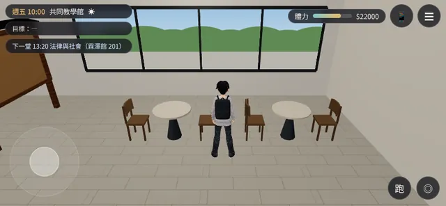 | 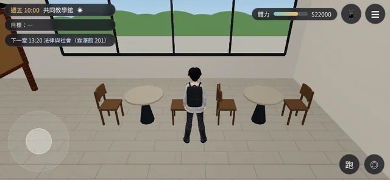 |
| `gongtong_2F_1` |  | 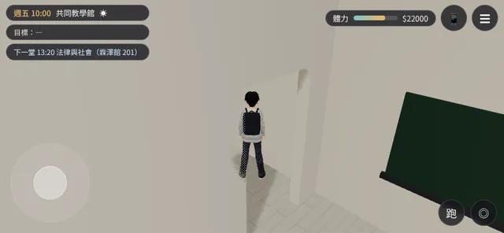 |
| `gongtong_2F_2` | 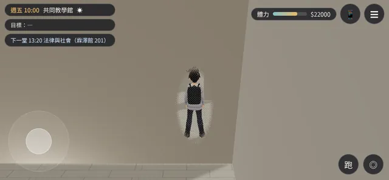 | 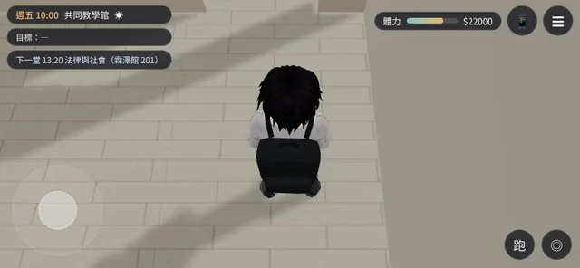 |
| `gongtong_2F_3` | 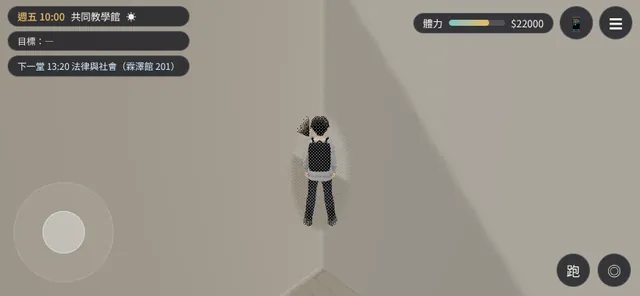 | 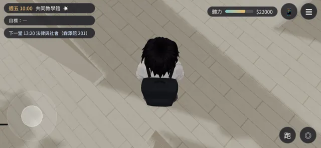 |
| `gongtong_2F_4` | 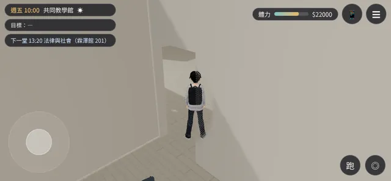 | 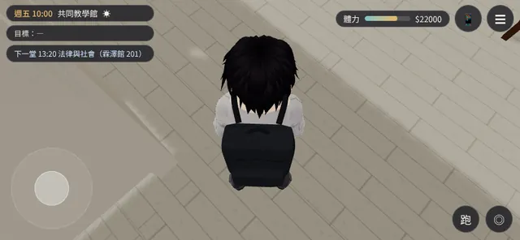 |

## 3. 教室門口（走進去、走出來；每棟每層一間）

「走進去」：玩家在門裡 0.6 m、鏡頭在走廊那一側（背後）；「走出來」：玩家在門外 0.6 m、鏡頭在教室那一側。

| 案例 | 位置 | 鏡頭方向 yaw | 修改前（`babb8c8`）｜draw call | 修改後（`dae1da3`）｜draw call | 備註 |
|---|---|---|---|---|---|
| `boya_1F_door101_in` | 博雅 1F 101 門口：走進去（鏡頭在走廊那一側）（-6.6, 6.0） | 1.57 | 牆前、水平 4.27 m、比頭高 1.91 m｜672 | 牆前、水平 4.27 m、比頭高 1.91 m｜134 | 對照組（兩版都在牆前） |
| `boya_1F_door101_out` | 博雅 1F 101 門口：走出來（鏡頭在教室那一側）（-5.4, 6.0） | 4.71 | 牆前、水平 4.27 m、比頭高 1.91 m｜786 | 牆前、水平 4.27 m、比頭高 1.91 m｜156 | 對照組（兩版都在牆前） |
| `boya_2F_door201_in` | 博雅 2F 201 門口：走進去（鏡頭在走廊那一側）（-15.6, -1.0） | 0.00 | **牆後**、水平 4.27 m、比頭高 1.91 m｜702 | 牆前、水平 2.96 m、比頭高 1.68 m｜126 |  |
| `boya_2F_door201_out` | 博雅 2F 201 門口：走出來（鏡頭在教室那一側）（-15.6, 0.2） | 3.14 | 牆前、水平 4.27 m、比頭高 1.91 m｜607 | 牆前、水平 4.27 m、比頭高 1.91 m｜142 | 對照組（兩版都在牆前） |
| `putong_1F_door101_in` | 普通 1F 101 門口：走進去（鏡頭在走廊那一側）（-15.6, -1.8） | 0.00 | 牆前、水平 4.27 m、比頭高 1.91 m｜713 | 牆前、水平 2.96 m、比頭高 1.68 m｜230 |  |
| `putong_1F_door101_out` | 普通 1F 101 門口：走出來（鏡頭在教室那一側）（-15.6, -0.6） | 3.14 | 牆前、水平 4.27 m、比頭高 1.91 m｜647 | 牆前、水平 4.27 m、比頭高 1.91 m｜167 | 對照組（兩版都在牆前） |
| `putong_2F_door201_in` | 普通 2F 201 門口：走進去（鏡頭在走廊那一側）（-15.6, -1.8） | 0.00 | **牆後**、水平 4.27 m、比頭高 1.91 m｜805 | 牆前、水平 2.96 m、比頭高 1.68 m｜338 |  |
| `putong_2F_door201_out` | 普通 2F 201 門口：走出來（鏡頭在教室那一側）（-15.6, -0.6） | 3.14 | 牆前、水平 4.27 m、比頭高 1.91 m｜592 | 牆前、水平 4.27 m、比頭高 1.91 m｜116 | 對照組（兩版都在牆前） |
| `gongtong_1F_door102_in` | 共同 1F 102 門口：走進去（鏡頭在走廊那一側）（-10.8, -1.0） | 0.00 | 牆前、水平 4.27 m、比頭高 1.91 m｜396 | 牆前、水平 4.27 m、比頭高 1.91 m｜125 | 對照組（兩版都在牆前） |
| `gongtong_1F_door102_out` | 共同 1F 102 門口：走出來（鏡頭在教室那一側）（-10.8, 0.2） | 3.14 | 牆前、水平 4.27 m、比頭高 1.91 m｜380 | 牆前、水平 4.27 m、比頭高 1.91 m｜137 | 對照組（兩版都在牆前） |
| `gongtong_2F_door201_in` | 共同 2F 201 門口：走進去（鏡頭在走廊那一側）（-10.8, -1.0） | 0.00 | 牆前、水平 4.27 m、比頭高 1.91 m｜436 | 牆前、水平 4.27 m、比頭高 1.91 m｜131 | 對照組（兩版都在牆前） |
| `gongtong_2F_door201_out` | 共同 2F 201 門口：走出來（鏡頭在教室那一側）（-10.8, 0.2） | 3.14 | 牆前、水平 4.27 m、比頭高 1.91 m｜415 | 牆前、水平 4.27 m、比頭高 1.91 m｜140 | 對照組（兩版都在牆前） |

| 案例 | 修改前（`babb8c8`） | 修改後（`dae1da3`） |
|---|---|---|
| `boya_1F_door101_in` |  |  |
| `boya_1F_door101_out` |  |  |
| `boya_2F_door201_in` |  |  |
| `boya_2F_door201_out` |  |  |
| `putong_1F_door101_in` |  |  |
| `putong_1F_door101_out` |  |  |
| `putong_2F_door201_in` |  |  |
| `putong_2F_door201_out` |  |  |
| `gongtong_1F_door102_in` |  |  |
| `gongtong_1F_door102_out` |  |  |
| `gongtong_2F_door201_in` |  |  |
| `gongtong_2F_door201_out` |  |  |

## 4. 門框、門片、正式模型還要不要調整

- **入口門框**：修改後淡出，三棟剛進門都只剩很淡的輪廓（第 2 節前三列）。可以接受；如果要完全看不到，淡出時把門框的不透明度降到 0（牆可以留一點）。
- **教室門口**：修改前 2 個「走進去」的案例鏡頭在牆後（博雅 2F 201、普通 2F 201），修改後都拉到牆前（水平 2.96 m），看得到教室裡面；「走出來」的案例兩版都正常。普通 1F 101「走出來」：鏡頭在教室裡、靠近黑板，黑板的一角擋在畫面右下（輕微）。
- **門片**：**教室的門口沒有門片**，只是牆上的一個洞（關著的房間才有門板）；門口也沒有門框（之前的檢查報告第 4 節）。建議做一組門的模組（Blender，我做）：門框（木或鋁）、門片（上課時打開、靠牆 90°，不擋路也不擋鏡頭；有一個小窗）、門牌（教室號碼）、門檔；遊戲端用 instancing，鏡頭碰撞照牆（門片靠牆，不用另外加）。要不要做由 LAWWW 排。
- **正式模型**：三棟的室內現在都是 LAWWW 的教學館模板（程序化，D38 分類 ③）；我的正式模型還沒有進到教學館室內（家具模組 `furniture_study.glb` 是 `MODEL_READY`，還沒接）。外觀（共同、大一女舍：`f3a18d6`）的入口這一輪沒有測（戶外鏡頭是建築碰撞盒，不是這次的修改）。

## 5. 這一輪沒做到的

- 只判斷「玩家那一層」的隔間牆；樓梯間、天花板、樓板邊緣沒有判斷（看截圖）。
- 「牆後」是 2D 判斷（鏡頭和頭的連線穿過配置的牆）；畫面好不好要看截圖。
- 沒有測：坐下時的鏡頭、演講的運鏡、走樓梯時的鏡頭。

## 6. 第二輪：LAWWW 第一階段修正之後（`9884d29`；同一份案例重拍）

LAWWW `068f671`：被隔間牆拉近到 1.5 m 以內、沒有在拖鏡頭時，鏡頭**自動轉開**（試 ±30／60／90°，每秒約 75°）、拉近時看的點往前移、貼牆抬高最多 0.9 m；公告欄加進鏡頭碰撞。`8234015`：座位上的人先套好坐姿再畫。
重拍方法（LAWWW 建議）：每個案例兩張——**剛拖過鏡頭**（`manualT=999`，不會自動轉，看抬高變少、往前看的效果）、**放開 3 秒**（`manualT=0`，等遊戲時間 3 秒）。工具：`cam_cases_shots.py --swing`。Playwright＋SwiftShader，**不是 iPhone**。

### 6.1 結果

| 項目 | 修改前（`babb8c8`） | 第一輪（`dae1da3`） | 第二輪：剛拖過鏡頭 | 第二輪：放開 3 秒 |
|---|---|---|---|---|
| 鏡頭在牆後（36 個案例：一般 24＋門口 12） | 21 | 0 | 0 | 0 |
| 鏡頭水平離頭不到 1 m（貼到頭頂上方） | — | 10 | 10 | 0 |

（「牆後」＝鏡頭和頭的連線穿過那一層的隔間牆；格式「牆前、水平距離／比頭高」，單位公尺。）

| 案例 | 組 | 修改前 | 第一輪 | 第二輪：剛拖過 | 第二輪：放開 3 秒 | 備註 |
|---|---|---|---|---|---|---|
| `boya_spawn` | 一般 | 牆前、4.27／+1.91 | 牆前、4.27／+1.91 | 牆前、4.27／+1.91 | — |  |
| `putong_spawn` | 一般 | 牆前、4.27／+1.91 | 牆前、4.27／+1.91 | 牆前、4.27／+1.91 | — |  |
| `gongtong_spawn` | 一般 | 牆前、4.27／+1.91 | 牆前、4.27／+1.91 | 牆前、4.27／+1.91 | — |  |
| `boya_1F_1` | 一般 | 牆前、4.27／+1.91 | 牆前、4.27／+1.91 | 牆前、4.27／+1.91 | 牆前、4.27／+1.91 |  |
| `boya_1F_2` | 一般 | **牆後**、4.27／+1.91 | 牆前、3.66／+1.79 | 牆前、3.66／+1.76 | 牆前、3.66／+1.76 |  |
| `boya_1F_3` | 一般 | **牆後**、4.27／+1.91 | 牆前、2.20／+1.55 | 牆前、2.20／+1.46 | 牆前、2.20／+1.46 |  |
| `boya_1F_4` | 一般 | **牆後**、4.27／+1.91 | 牆前、2.96／+1.68 | 牆前、2.96／+1.62 | 牆前、2.96／+1.62 |  |
| `boya_2F_1` | 一般 | **牆後**、4.27／+1.91 | 牆前、0.64／+1.30 | 牆前、0.64／+1.13 | 牆前、4.27／+1.91 | 第一輪貼到頭頂上方 → 放開後轉開 |
| `boya_2F_2` | 一般 | **牆後**、4.27／+1.91 | 牆前、0.54／+1.29 | 牆前、0.54／+1.11 | 牆前、4.27／+1.91 | 第一輪貼到頭頂上方 → 放開後轉開 |
| `boya_2F_3` | 一般 | 牆前、4.27／+1.91 | 牆前、4.27／+1.91 | 牆前、4.27／+1.91 | 牆前、4.27／+1.91 |  |
| `boya_2F_4` | 一般 | **牆後**、4.27／+1.91 | 牆前、0.78／+1.33 | 牆前、0.78／+1.16 | 牆前、4.27／+1.91 | 第一輪貼到頭頂上方 → 放開後轉開 |
| `putong_1F_1` | 一般 | **牆後**、4.27／+1.91 | 牆前、0.40／+1.26 | 牆前、0.40／+1.08 | 牆前、4.27／+1.91 | 第一輪貼到頭頂上方 → 放開後轉開 |
| `putong_1F_2` | 一般 | **牆後**、4.27／+1.91 | 牆前、0.92／+1.35 | 牆前、0.57／+1.12 | 牆前、4.27／+1.91 | 第一輪貼到頭頂上方 → 放開後轉開 |
| `putong_1F_3` | 一般 | **牆後**、4.27／+1.91 | 牆前、3.47／+1.76 | 牆前、3.47／+1.72 | 牆前、3.47／+1.72 |  |
| `putong_1F_4` | 一般 | **牆後**、4.27／+1.91 | 牆前、2.34／+1.58 | 牆前、2.34／+1.49 | 牆前、2.34／+1.49 |  |
| `putong_2F_1` | 一般 | **牆後**、4.27／+1.91 | 牆前、0.92／+1.35 | 牆前、0.92／+1.19 | 牆前、3.04／+1.63 | 第一輪貼到頭頂上方 → 放開後轉開 |
| `putong_2F_2` | 一般 | **牆後**、4.27／+1.91 | 牆前、2.34／+1.58 | 牆前、2.34／+1.49 | 牆前、2.34／+1.49 |  |
| `putong_2F_3` | 一般 | 牆前、4.27／+1.91 | 牆前、4.27／+1.91 | 牆前、4.27／+1.91 | 牆前、4.27／+1.91 |  |
| `putong_2F_4` | 一般 | **牆後**、4.27／+1.91 | 牆前、0.86／+1.34 | 牆前、0.86／+1.18 | 牆前、4.27／+1.91 | 第一輪貼到頭頂上方 → 放開後轉開 |
| `gongtong_1F_1` | 一般 | 牆前、4.27／+1.91 | 牆前、4.27／+1.91 | 牆前、4.27／+1.91 | 牆前、4.27／+1.91 |  |
| `gongtong_1F_2` | 一般 | **牆後**、4.27／+1.91 | 牆前、1.56／+1.45 | 牆前、1.56／+1.32 | 牆前、1.56／+1.32 |  |
| `gongtong_1F_3` | 一般 | **牆後**、4.27／+1.91 | 牆前、3.05／+1.69 | 牆前、3.05／+1.63 | 牆前、3.05／+1.63 |  |
| `gongtong_1F_4` | 一般 | **牆後**、4.27／+1.91 | 牆前、3.56／+1.77 | 牆前、3.56／+1.74 | 牆前、3.56／+1.74 |  |
| `gongtong_2F_1` | 一般 | 牆前、4.27／+1.91 | 牆前、4.27／+1.91 | 牆前、4.27／+1.91 | 牆前、4.27／+1.91 |  |
| `gongtong_2F_2` | 一般 | **牆後**、4.27／+1.91 | 牆前、0.54／+1.29 | 牆前、0.54／+1.11 | 牆前、4.27／+1.91 | 第一輪貼到頭頂上方 → 放開後轉開 |
| `gongtong_2F_3` | 一般 | **牆後**、4.27／+1.91 | 牆前、0.40／+1.26 | 牆前、0.40／+1.08 | 牆前、2.49／+1.52 | 第一輪貼到頭頂上方 → 放開後轉開 |
| `gongtong_2F_4` | 一般 | **牆後**、4.27／+1.91 | 牆前、0.47／+0.98 | 牆前、0.46／+0.84 | 牆前、4.27／+1.91 | 第一輪貼到頭頂上方 → 放開後轉開 |
| `boya_1F_door101_in` | 門口 | 牆前、4.27／+1.91 | 牆前、4.27／+1.91 | 牆前、4.27／+1.91 | 牆前、4.27／+1.91 |  |
| `boya_1F_door101_out` | 門口 | 牆前、4.27／+1.91 | 牆前、4.27／+1.91 | 牆前、4.27／+1.91 | 牆前、4.27／+1.91 |  |
| `boya_2F_door201_in` | 門口 | **牆後**、4.27／+1.91 | 牆前、2.96／+1.68 | 牆前、2.96／+1.62 | 牆前、2.96／+1.62 |  |
| `boya_2F_door201_out` | 門口 | 牆前、4.27／+1.91 | 牆前、4.27／+1.91 | 牆前、4.27／+1.91 | 牆前、4.27／+1.91 |  |
| `putong_1F_door101_in` | 門口 | 牆前、4.27／+1.91 | 牆前、2.96／+1.68 | 牆前、2.96／+1.62 | 牆前、2.96／+1.62 |  |
| `putong_1F_door101_out` | 門口 | 牆前、4.27／+1.91 | 牆前、4.27／+1.91 | 牆前、4.27／+1.91 | 牆前、4.27／+1.91 |  |
| `putong_2F_door201_in` | 門口 | **牆後**、4.27／+1.91 | 牆前、2.96／+1.68 | 牆前、2.96／+1.62 | 牆前、2.96／+1.62 |  |
| `putong_2F_door201_out` | 門口 | 牆前、4.27／+1.91 | 牆前、4.27／+1.91 | 牆前、4.27／+1.91 | 牆前、4.27／+1.91 |  |
| `gongtong_1F_door102_in` | 門口 | 牆前、4.27／+1.91 | 牆前、4.27／+1.91 | 牆前、4.27／+1.91 | 牆前、4.27／+1.91 |  |
| `gongtong_1F_door102_out` | 門口 | 牆前、4.27／+1.91 | 牆前、4.27／+1.91 | 牆前、4.27／+1.91 | 牆前、4.27／+1.91 |  |
| `gongtong_2F_door201_in` | 門口 | 牆前、4.27／+1.91 | 牆前、4.27／+1.91 | 牆前、4.27／+1.91 | 牆前、4.27／+1.91 |  |
| `gongtong_2F_door201_out` | 門口 | 牆前、4.27／+1.91 | 牆前、4.27／+1.91 | 牆前、4.27／+1.91 | 牆前、4.27／+1.91 |  |

### 6.2 截圖（第一輪貼到頭頂上方的 10 個案例、公告欄案例、剛進門）

| 案例 | 修改前 | 第一輪 | 第二輪：剛拖過 | 第二輪：放開 3 秒 |
|---|---|---|---|---|
| `boya_spawn` |  |  |  | — |
| `putong_spawn` |  |  |  | — |
| `gongtong_spawn` |  |  |  | — |
| `boya_2F_1` |  |  |  |  |
| `boya_2F_2` |  |  |  |  |
| `boya_2F_4` |  |  |  |  |
| `putong_1F_1` |  |  |  |  |
| `putong_1F_2` |  |  |  |  |
| `putong_2F_1` |  |  |  |  |
| `putong_2F_4` |  |  |  |  |
| `gongtong_2F_2` |  |  |  |  |
| `gongtong_2F_3` |  |  |  |  |
| `gongtong_2F_4` |  |  |  |  |

### 6.3 聽眾剛出現時是不是坐好了（`8234015`；`boya_seat_probe2.py`）

[前置／捷徑] 讀檔進博雅大廳、鏡頭看著 101 的座位，加一場測試演講（16 人）；在 `E.render` 的開頭呼叫 `CLS.syncRooms`（＝遊戲的課堂、人流加人物的時間點：E.update 之後、畫面之前），然後每一個畫面都數畫出來的聽眾裡有幾個是站著的（臀部離座位地面 0.75 m 以上；模型還在載入的不算）。

| 版本 | 前 60 個畫面裡，畫出站著的聽眾的畫面數 | 第一個畫面 | 1 秒後 | 5 秒後 |
|---|---|---|---|---|
| 修改前（`dae1da3`） | **1／60**（最多 16 人） | 16 人站著、0 人坐著 | 0／16 站著 | 0／16 站著 |
| 修改後（`9884d29`） | **0／60**（最多 0 人） | 0 人站著、16 人坐著 | 0／16 站著 | 0／16 站著 |

**結論**：修改前，聽眾在「E.update 之後、畫面之前」加進來的那一個畫面，16 個人**全部是站姿**（下一個畫面才坐下：手機 60 fps 是閃一下，低幀率的手機看得到）；修改後第一個畫面就坐好了。這個測試在修改前失敗、修改後通過。
（第一版的檢查報告寫「前十幾秒有一半是站姿」：那是讀了畫面外的人的骨架——畫面外不跑動畫——LAWWW 指出後改成只數畫面上畫出來的人。）

| 版本 | 出現後第一個畫面 | 5 秒 |
|---|---|---|
| 修改前 |  |  |
| 修改後 |  |  |

### 6.4 第二輪結論

- **穿牆**：36 個案例兩種狀態都是 0（第一輪也是 0）。**FIXED**（這些案例）。
- **貼到頭頂上方**：**放開鏡頭 3 秒後 10 → 0**（自動轉開到 3.0–4.27 m，截圖是正常的第三人稱畫面）。**剛拖過鏡頭**的那一刻還是很近（10 個案例水平 0.40–0.92 m）——這是玩家自己把鏡頭轉向牆的狀態，鏡頭比第一輪低（抬高最多 0.9 m）、往前看，畫面看得到頭和前面一點點的地板；放開 1.5 秒後才開始轉。可以接受；要更好的話是 LAWWW 還沒做的 (c)：鏡頭離頭很近時人物變半透明。
- **公告欄黑一塊**（`putong_1F_2`）：沒有了（公告欄進了鏡頭碰撞，剛拖過鏡頭的畫面是頭和牆，沒有黑塊）。**FIXED**。
- **聽眾剛出現時站著**：修改前第一個畫面 16 人站著、修改後 0。**FIXED**（這個情境：E.update 之後、畫面之前加人）。進教室、讀檔、跳時間這三個情境是 LAWWW 的 `tests/flow_seated_spawn.py`，我這邊沒有另外跑。
- 全部是 Playwright＋SwiftShader 的手機模擬，**iPhone 實機沒有測**。
