# 普通、共同、博雅、大一女舍：遊戲內檢查與改法提案（2026-10-13，LAWWW2）

回應使用者 2026-10-13 轉來的審查（重點：真實辨識度、室內比例、實際遊玩）。**這份是檢查與提案，不是驗收**：美術正式驗收由使用者決定；配置、導航、互動、鏡頭、人群的程式是 LAWWW 的，下面的改法都是 `PROPOSAL`，要 LAWWW 決定、實作。

- 檢查的版本：LAWWW 開發分支 `claude/confident-ritchie-8rwh7t` 的 `93b93b5`（乾淨 checkout，本機 http 伺服器）。
- 截圖：Playwright＋SwiftShader（雲端沙盒的軟體繪圖），**不是 iPhone**；手機畫面是「手機模擬」（844×390 橫向、390×844 直向、觸控、iPhone UA）。
- 進博雅、普通、共同室內用讀檔（`[前置／捷徑]`：校園上普通、博雅的門在方案 A 的 WIP 裡，還沒跑瀏覽器測試）；演講的聽眾用一場測試活動（`[前置／捷徑]`：遊戲的活動清單是空的）。
- 工具（我的資料夾，不改遊戲檔案）：`tools/blender/env_second/shots/boya_audit.py`（博雅截圖＋效能）、`cam_wall_scan.js`（鏡頭穿牆比例）、`boya_plan_diagram.py`（平面比較圖）、`fast_shots.py`（校園、普通、共同截圖）。

## ★ 2026-10-13 晚上更新：使用者決定之後（照片與官方資料、R2 修正版、鏡頭、整合狀態、分工）

使用者 2026-10-13 晚上的決定（摘要）：博雅**先做 R2**（外觀不放大），條件是 ① 101 一看就是大型階梯講堂 ② 一樓自習區有足夠空間（面對面小桌、中央圓桌區）③ **102、103 不能永久刪除或封死**；和 LAWWW 一起看官方平面圖，提出「縮尺但保留核心空間功能」的 R2 修正版，真的做不到才比 R1，**不要直接擴大地圖**。鏡頭穿牆最優先（不要把隔間牆完全透明當主要解法）。101 不先做 400 個完整人物。**在報告更新、和 LAWWW 確認分工之前，不開新的建築外觀工作**。整合順序：①鏡頭／入口遮擋／NPC 坐姿 → ②共同、大一女舍與重要資產整合＋回歸 → ③博雅 101 與自習區 R2 修正版＋效能 → ④其他教學館與室內。

### U1. 照片與官方資料（取代第 1 節「沒有照片」的結論）

使用者找到了七個來源（博雅照片、博雅一樓官方平面圖、容量表、普通外觀與正門、大一女舍官方照片、共同 2024 照片）；清單、用途、授權限制寫在 `research/四棟教學館與宿舍_參考資料.md` 最上面的「★ 2026-10-13 晚上更新」。容量（使用者轉述容量表）：**博雅 101＝400、102＝279、103＝278；共同 101＝240；普通 101＝298**。

**照片比對還沒做**：這個沙盒對 `*.ntu.edu.tw` 和 `commons.wikimedia.org`、`upload.wikimedia.org` 都查不到網域名稱（18:5xZ 再試：curl 失敗、網頁讀取工具 `ENOTFOUND`）。要使用者在環境設定把這幾個網域加進允許清單，或直接貼照片／PDF 最後一頁的截圖。拿到之前，第 1 節的外觀判斷維持「依文字」；**照片只用來核對、不放進遊戲；不確定是哪一間教室的照片，不標成 101**。

### U2. 博雅 R2 修正版（PROPOSAL；還沒有用官方平面圖核對）

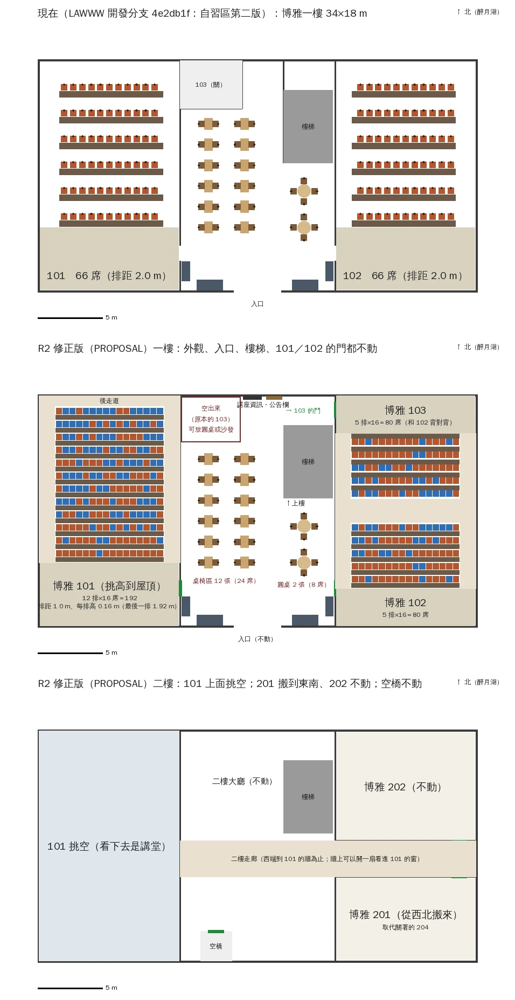

**不動的**：外觀 34×18、南面正中間的入口、校園上的門、大廳樓梯、101 與 102 的門（大廳東西兩面牆、z≈6）、二樓空橋。

**改的**：

| 空間 | 現在 | R2 修正版 |
|---|---|---|
| 101 | 10.9×17.8 m、6 排×11＝66 席、排距 2.0 m、每排高 0.30、天花板 4.2 m | **同一塊地、挑高到屋頂（8.6 m）**：12 排×16＝**192 席**、排距 1.0 m、每排高 0.16 m（最後一排 1.92 m）、兩側台階走道 1.2 m、後走道 0.9 m；固定講堂椅（`furniture_study.glb`，instancing）；講台、門的位置不變 |
| 102 | 10.9×17.8 m、66 席 | 東南半邊（z 0～8.9）：5 排×16＝**80 席**；門不動 |
| 103 | 大廳西北角 4.8×3.7 m 的「關著的門」 | **東北半邊（z −8.9～0），和 102 一樣大、背對背**（容量表 279／278＝雙胞胎）：5 排×16＝**80 席**；講台在北端，門在大廳東牆北端（樓梯北邊 2.3 m 寬的通道進去）。第一階段可以開放，或先「借用中」之後開放（不是封死） |
| 自習區 | LAWWW 第二版（`4e2db1f`）：**12 張雙人小桌（面對面、24 席）**兩列×6、**2 張圓桌（8 席）**、南面窗下沙發 | **沿用 LAWWW 第二版、不動**（203/203 個位子走得到、坐得下，`tests/nav_teach_unit.js`）；103 搬走後西北角（4.8×3.7 m）空出來，可以再放 1 張圓桌（中央圓桌區變 3 張）或沙發；講座資訊螢幕、公告欄不動 |
| 二樓 | 201、203（101 上面）、202、204 | 101 上面挑空（二樓走廊西端到 101 的牆為止，可以開一扇看進 101 的窗）；**201 搬到東南、取代關著的 204**；202 不動；203 拿掉 |

**三個條件逐一核對**：

| 條件 | R2 修正版 | 判斷 |
|---|---|---|
| ① 101 一看就是大型階梯講堂 | 192 席（現在 66）、12 排一排比一排高、挑高 8.6 m、固定講堂椅、兩條台階走道；坐下時前面是一排排的頭（坐姿替身） | 成立（座位是真實 400 席的一半：「縮尺」） |
| ② 一樓自習區夠大 | LAWWW 第二版：12 張面對面小桌（24 席）＋2 張圓桌（8 席）＋窗邊沙發＋長椅；中間留 2.2 m 以上的走道（大門到講座資訊角、樓梯口）；R2 修正版再多出西北角 | 成立 |
| ③ 102、103 不刪、不封死 | 兩間都是真的階梯教室（80 席），103 的門在大廳 | 成立 |
| 必要通行空間 | 入口→101 門、102 門：z≈6 的通道 2 m 以上；入口→樓梯（x 2～3.75 的上樓口前面留 1 m）；→103 門：樓梯北邊通道 2.3 m | 成立（要 LAWWW 用導航格驗證） |

**代價（LAWWW 的工作）**：教學館模板要支援①挑高的講堂（101 上面不放二樓）②背對背的兩間講堂③真實排距的排不能走、從走道側身入座（之前提案第 2.2 節）；二樓 201 搬家（我查了 `dae1da3`：課表 `courses.js` 只用到博雅 101，其他程式也沒有指名博雅 201–204，搬家不影響課表）；103 的門移位。

**和 R1 比**：R2 修正版三個條件都成立、地圖不動，所以**不建議 R1**。只有兩種情況要重新比：(a) 官方平面圖顯示的空間關係和這裡差很多——例如 101 在中間、「西側大廳」在 101 的西邊（官方名稱「101 階梯教室旁西側大廳桌椅區」也可以這樣讀），那 R2 修正版要左右重排，我拿到平面圖後重畫；(b) 使用者看過覺得 192 席還不夠「400 人」。

### U3. 鏡頭穿牆（第一階段）：修改前／修改後

完整的固定案例、截圖、建議在 **`CAMERA_WALLS.md`**。結果：LAWWW `8c2fa01` 之後，一般位置 **19／24 → 0／24**、教室門口 **2／12 → 0／12** 不再跑到牆後面；三棟剛進門的黑色門框淡出了。**修改後新發現兩件**：①牆邊、窄走廊轉向牆時鏡頭貼到頭頂上方（10 個案例，畫面只剩頭頂和地板）②公告欄這類高的家具不在鏡頭碰撞裡（普通門廳：畫面一大塊黑）。教室門口沒有門片、門框（建議做門的模組）。

### U4. 101 講堂椅、自習桌椅（`MODEL_READY`）

`furniture_study.glb`：自習雙人桌（0.9×0.6）、自習椅（彎管椅架＋有弧度的夾板）、圓桌、講堂椅（圓邊布面軟墊、胡桃木椅背殼、側板＋扶手；**座面放下／收起兩種**）、講堂椅簡化版、排尾側板、連續桌板（一段接一段看不到縫）。一個材質、一張貼圖集（顏色＋法線＋粗糙度）；每件 36–1,020 個三角形。Blender 渲染與尺寸表在 VISUAL_REVIEW 第 23 節。**還沒接進遊戲**（座位配置、入座、LOD 是 LAWWW 的）。

### U5. 整合狀態（使用者要的五個狀態；2026-10-13 19:1xZ）

| 成果 | 模型完成 | 已接進開發分支 | 遊戲內功能測試通過 | 視覺驗收通過 | 已發布 |
|---|---|---|---|---|---|
| 共同教學館外觀（`55fbedb`） | ✅ | ✅ `f3a18d6` | ⏳ LAWWW 瀏覽器批次（結果還沒出來） | ❌（等使用者；照片比對也還沒做） | ❌ |
| 大一女舍外觀（`55fbedb`） | ✅ | ✅ `f3a18d6` | ⏳ 同上 | ❌ 同上 | ❌ |
| 社科院圖書館室內（⑬） | ✅ | ✅（`soclib` 區域） | ⏳ flow_soclib：上一個失敗已修（`77deeab`），等重跑 | ❌ | ❌ |
| 新社科院外觀（`2a316b7`） | ✅ | ❌（導航、鏡頭碰撞、門要換新形狀） | ❌ | ❌ | ❌ |
| 家具模組（`furniture_study.glb`） | ✅（這一輪） | ❌ | ❌ | ❌ | ❌ |
| 聽眾坐姿替身 | ❌（下一項） | ❌ | ❌ | ❌ | ❌ |
| 鏡頭穿牆修正（LAWWW 的程式） | — | ✅ `8c2fa01` | ✅ 我的 36 個固定案例不再穿牆；⚠️ 修改後兩個新問題（U3） | — | ❌ |
| 普通外觀（磚紅 5 層） | ❌（暫停：等照片、等這份報告與分工確認） | ❌ | ❌ | ❌ | ❌ |
| 博雅外觀 | ❌（R2：外觀 34×18 不變；照片比對之後才決定要不要改） | ❌ | ❌ | ❌ | ❌ |

（已發布的：v9.5（`main` `a4f2760`）有總圖、傅鐘、行政大樓的外觀；這四棟教學館與宿舍的成果都還沒發布。）

### U6. 分工（使用者訂的；已傳給 LAWWW，等 ACK）

| 項目 | LAWWW | LAWWW2（我） |
|---|---|---|
| 鏡頭穿牆、門框 | 牆碰撞、出生點門框、教學館入口與室內的回歸測試 | 失敗位置／角度／截圖、修好後同位置重拍（`CAMERA_WALLS.md`）、門框門片正式模型 |
| 101 | 座位配置、入座、坐下的鏡頭、LOD、效能；坐姿 bug（進場、開始上課、讀檔、跳時間） | 講堂椅模組（`MODEL_READY`）、低成本坐姿人物（下一項） |
| 自習區 | 配置、坐下、朋友坐對面、NPC 讀書、發呆 | 桌椅模組（`MODEL_READY`）、桌上小物 |
| 外觀 | 整合、回歸 | 普通（磚紅 5 層）、大一女舍、共同照照片修正——**照片比對之後、分工確認之後才開工** |
| 效能 | 修改前後的 draw call、三角形、FPS、卡頓、手機大小與操作 | 模組的三角形、材質數 |

## 0. 結論（先講）

| # | 審查要求 | 結果 |
|---|---|---|
| 1 | 四棟的位置、外觀查證 | 位置：四棟都和官方／維基資料的相對位置一致（大一女舍是住宿組的「大一女舍」，在公館捷運站一側，不是女一舍、不是水源 BOT）。**外觀**：四棟都**沒有照片**，只有文字；普通的套件是米色 4 層，資料寫「磚紅色、5 層」，**不一致**（第 1 節）。 |
| 2 | 博雅 101 比例 | **像中型教室，不像 400 人的大講堂**：10.9×17.8 m、6 排×11＝66 席、排距 2.0 m（真實講堂約 1.0 m）、活動椅、最後一排離天花板只剩 2.4 m；演講最多坐 16 個人物。改法：真實排距＋固定講堂椅（instancing）＋從走道側身入座＋「坐著的聽眾替身」（第 2 節）。 |
| 3 | 博雅自習區 | **太空**：6 張單人小桌（面向牆）＋2 張討論桌＋2 張沙發，看起來像走廊放了幾張桌子。官方資料：一樓有「101 旁西側大廳桌椅區」「中央大廳圓桌區」，平日 8–18 點給學生自習。改法：16 張雙人小桌（面對面、都能坐、桌間 1 m 以上走道）＋圓桌＋沙發（第 3 節）。 |
| 4 | 入口、樓梯、門牌、樓層、窗景、NPC 空間 | **最大的問題是鏡頭穿牆**：教學館室內（`teach3d.js` 模板）的隔間牆不擋鏡頭，鏡頭跑到牆後面時整個畫面是一面牆。用版面資料算：博雅一樓 18%、普通 33–36%、共同 24–32% 的「位置×方向」會這樣；剛進博雅，前景有一大條黑色門框。另外：101 最後一排頭頂太低；演講的聽眾剛出現的前十幾秒有一半以上是站在桌椅中間（穿模）；門是黑色的洞、沒有門框（第 4 節）。 |
| 5 | 還沒整合的成果 | 我交的 8 個 commit 只有 1 個進了開發分支；我的分支整個合進去**沒有衝突**；已請 LAWWW 排整合順序（第 5 節）。 |
| 6 | 每棟的截圖、狀態、效能、缺點 | 第 6 節。**效能最大的問題**：博雅室內空著時每個畫面要畫 570–810 次（街景的上限是 310），坐 16 個聽眾時約 1,060 次、68 萬個三角形。 |

## 1. 官方資料查證（位置與外觀）

查證方式和上一輪一樣（`research/四棟教學館與宿舍_參考資料.md`）：沙盒連不到 `ntu.edu.tw` 和維基百科，只能用**搜尋摘要**；**沒有任何照片**（**晚上更正：照片是有的，見最上面 U1；沙盒還打不開**）。這一輪新查到的（確認程度：A＝兩個以上來源一致、B＝一個來源、C＝推測）：

| 建築 | 新查到的 | 程度 | 來源 |
|---|---|---|---|
| 博雅 | **博雅 101＝400 席**（官方教室容量表 115.08.21 版）；上一輪維基寫的「440」是舊數字或別的來源，以容量表為準 | B（官方） | [教務處：校屬 5 棟教學館教室容量表](https://www.aca.ntu.edu.tw/WebUPD/aca/CDForms/校屬5棟教學館教室容量表.pdf) |
| 博雅 | 一樓的藝文空間：**中央大廳展覽牆柱區、西側大廳圖書攤位區、101 階梯教室旁西側大廳桌椅區、中央大廳圓桌區**；桌椅區、圓桌區**平日 8:00–18:00 只給本校學生自主學習**，夜間、假日、寒暑假可以借用 | B（官方規定，113-10-01 版） | [教務處：博雅教學館藝文空間借用管理使用規定](https://www.aca.ntu.edu.tw/WebUPD/aca/CDRules/國立臺灣大學博雅教學館藝文空間借用管理使用規定暨收費標準.pdf) |
| 博雅 | 地上 5 層、地下 1 層；1–4 樓 7 間階梯教室＋21 間研討教室；地下一層是機房、防空避難、500 輛腳踏車停車場；原地理系舊址、緊鄰醉月湖與舊體育館；基地 42 棵樹、1 棵市府保護樹木原地保留；100 年 1 月完工、2 月啟用 | A（和上一輪一致） | [教務處 99_4](https://www.aca.ntu.edu.tw/WebUPD/aca/SecretariatService/99_4.pdf) |
| 普通 | 建築總面積 **8,791 m²**、2,630 席 | B | [臺大公共教學館資料](https://ntuinfo.ntu.edu.tw/pdf/1.3.6-1.pdf)（搜尋摘要） |
| 大一女舍 | A、B 兩棟、二樓天橋連通；A 地上 5 層、B 地上 5 層＋地下 1 層、**沒有電梯**、約 728 床；1991 落成、2008 翻修；**24 小時傳達室在 A 棟一樓、A、B 共用**；四人房、公共衛浴；鄰近捷運站與公館商圈 | A（住宿組官方頁） | [住宿組：大一女舍](https://osa_dorm.ntu.edu.tw/Freshman_House) |

**和遊戲現在的配置比**（遊戲的校園是縮小的：校門到霖澤館 160 m，真實約 1 km；建築也縮小，所以只比「相對位置」和「看起來像不像」）：

| 建築 | 相對位置 | 外觀 |
|---|---|---|
| 普通 | ✅ 文學院正後方、博雅南邊、二樓空橋連博雅（方案 A） | ❌ 套件是**米色**、4 層；資料寫**磚紅色**、5 層（B，維基）。總面積 8,791 m² ÷ 5 層 ≈ 每層 1,760 m²，遊戲 34×16＝544 m²（約 1/3） |
| 博雅 | ✅ 普通北邊、北望醉月湖、空橋（方案 A） | ⚠️ 套件是白色帶狀窗的現代系館；**真實外觀沒查到**（材料、顏色都沒有資料）。入口：資料寫主要入口在**西南（綠園）和東側（朴樹）**，遊戲在南面正中間 |
| 共同 | ✅ 行政大樓東邊、南臨舟山路、正面朝北 | 遊戲裡是套件；我的 Blender 外觀（土黃十三溝面磚、樓板豎貼帶、洗石子拱窗、山牆、西側木造走廊、北側蒲葵）**做好了、還沒接**（第 5 節） |
| 大一女舍 | ✅ 舟山路／公館捷運站一側、A 西 B 東、二樓天橋；不是女一舍、不是水源 BOT | 遊戲裡是套件；我的 Blender 外觀**做好了、還沒接**；**外觀沒有任何資料**，是「1990 年代台灣大學宿舍」的通用樣子（C） |

~~**需要使用者協助**：四棟的實際照片……~~（**晚上更新**：使用者已經找到照片與官方平面圖，見最上面 U1。）

## 2. 博雅 101：比例檢查與「大講堂感」的做法

### 2.1 現在的樣子（同一個房間，空的／坐 16 個聽眾）

| 鏡頭 | 空的 | 演講（16 個聽眾，測試活動） |
|---|---|---|
| 最後一排後面往講台看 | 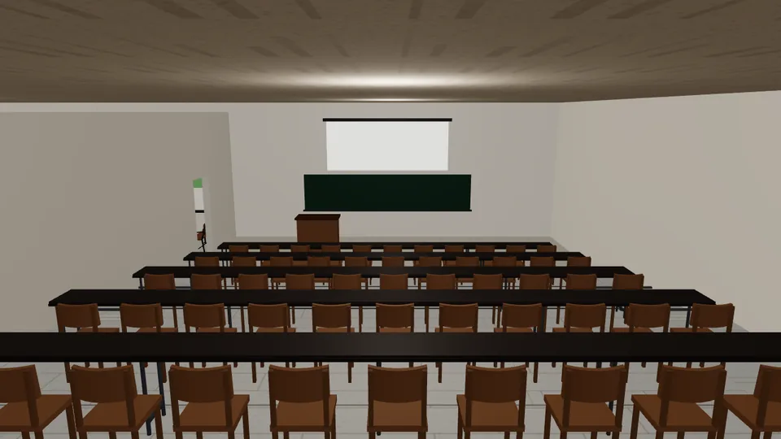 | 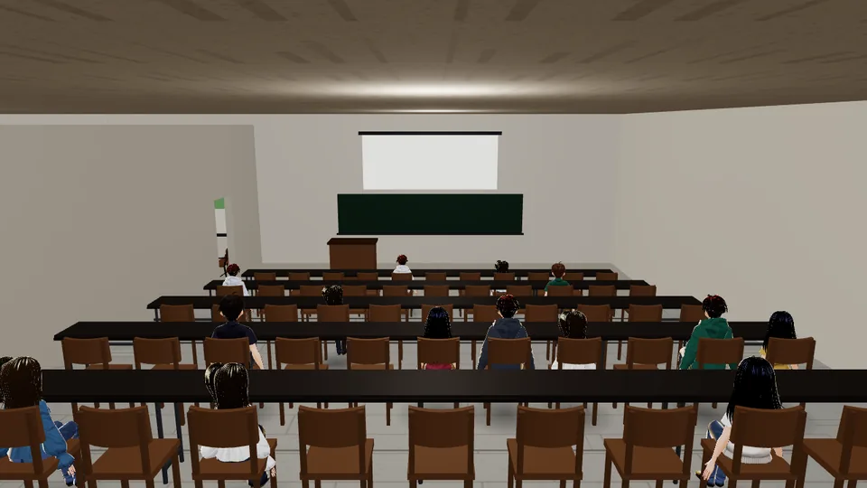 |
| 從講台往座位看 | 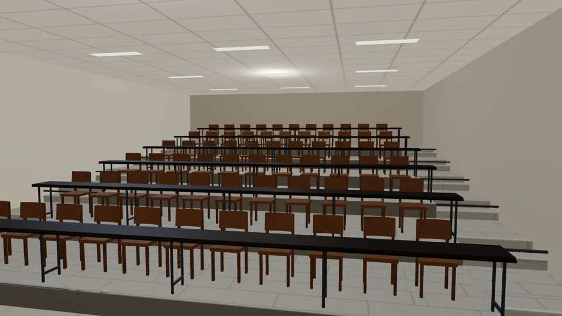 | 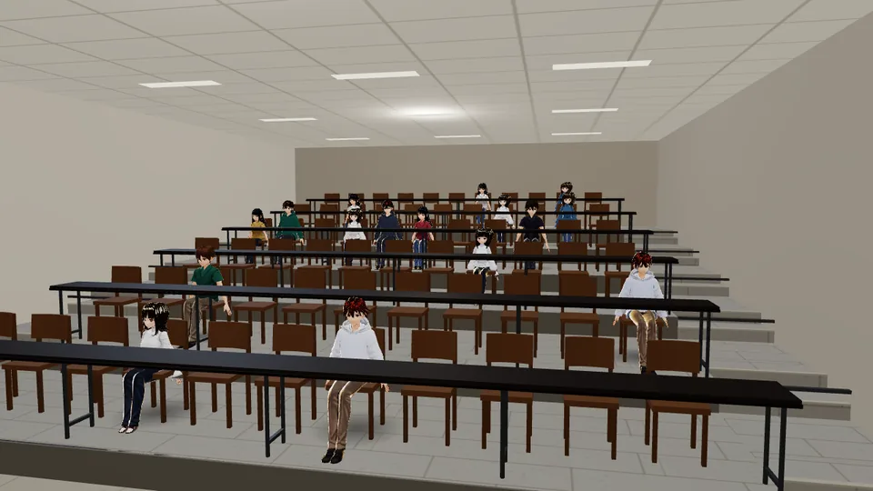 |
| 坐在第 3 排中間的視線 | 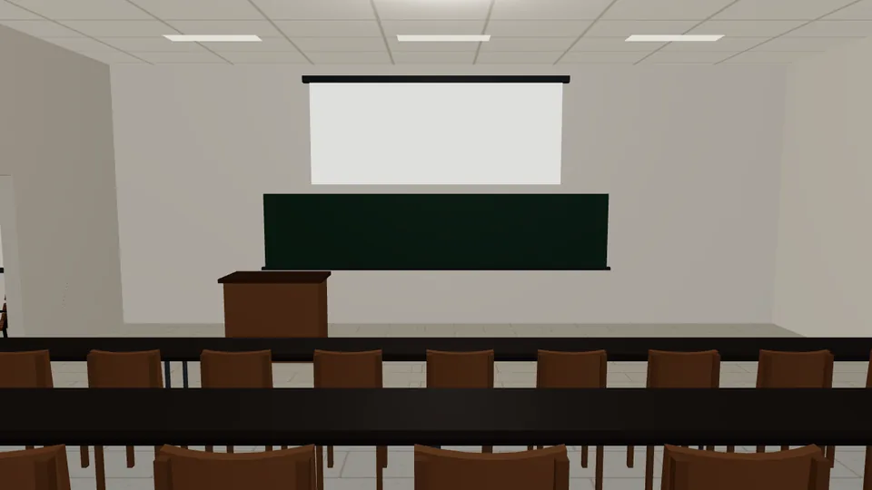 | — |

量到的（`src/data/boya_layout.js`，模板）：

| 項目 | 遊戲現在 | 400 席講堂常見的數值（一般講堂設計，**不是博雅 101 的實測**） |
|---|---|---|
| 房間 | 10.9 × 17.8 m（含講台）＝194 m² | 約 20 × 23 m（約 460 m²） |
| 座位 | 6 排 × 11 席＝**66 席** | 16 排 × 24–25 席 |
| 排距 | **2.0 m**（引擎要讓人走進每一排、站在椅子後面坐下） | 0.95–1.05 m |
| 每排升高 | 0.30 m（最後一排 1.8 m） | 0.12–0.18 m |
| 天花板 | 4.2 m（**最後一排頭頂只剩 2.4 m**） | 前低後高或整間挑高，最後一排頭頂 3 m 以上 |
| 椅子 | 活動木椅＋細長桌板 | 固定式講堂椅（可掀座墊）＋連續桌板或寫字板、排號 |
| 聽眾 | 最多 16 個人物（`classes3d.js` 上限） | 通識大課、演講常常坐到一半以上 |

**我的判斷**：看起來是中型教室。造成這個感覺的不是座位數，是**排距太寬（座位稀疏）、活動椅、房間窄、頭頂低、人太少**。

### 2.2 不必做 400 個可坐座位、也像大講堂的做法（PROPOSAL）

1. **比例照真的**：排距 1.0 m、每排升高 0.16 m、每排 24 席（三區 6｜12｜6、中間兩條走道＋兩側走道各 1.2–1.3 m）、整間挑高（101 上面不放二樓房間）。看得到 360–384 個座位。
2. **座位不用一個一個導航**：每一排本身**不能走**（真實的講堂也是側身擠進去）；**走道是台階，走得上去**。在每一排的走道端有「坐下（第 n 排）」：玩家從走道**側身移進**最近的空位（短短一段腳本移動，不需要導航格），起身時退回走道。這樣**每個座位都坐得到**，但導航只需要走道。朋友坐旁邊用同一套。
3. **座位用 instancing**：一種講堂椅模型（Blender 做：座墊、椅背、扶手、桌板、排號牌）→ `InstancedMesh`，384 個座位約 3–4 次 draw call。**現在 66 席就要畫好幾百次**（第 6 節的效能表）。
4. **人群用「坐著的聽眾替身」**：玩家附近（同一排、前後兩排）保留 4–6 個真的人物（會動、有臉）；其他位子放 instancing 的坐姿人物（6–8 種外型 × 2–3 種姿勢：聽講、抄筆記、滑手機；近的約 1,500 個三角形、遠的約 300 個），每個位子換衣服、頭髮顏色；頂點著色器做一點點點頭、寫字的動作。分布照真實的坐法（前排空、中後排滿、朋友坐一起）。
   - 估算（還沒量）：300 個替身約 12 萬個三角形、10–16 次 draw call；**現在 16 個真人物就是 62 萬個三角形、約 340 次 draw call**。
5. **鏡頭**：坐下時鏡頭在玩家斜後上方、往講台俯看，畫面裡要有「前面一排排的頭」——這是大講堂感最強的一個畫面；第一次走進 101 可以有 1.5 秒的全景（從後面高處）。
6. **細節**（Blender，我做）：兩面投影幕、四片上下推拉黑板、講桌＋麥克風、牆上吸音木條、階梯走道的踏步燈、後牆的控制室小窗、出口指示燈、時鐘、喇叭、冷氣出風口、門牌「博雅 101　400 席」。材質 Poly Haven（CC0）。

### 2.3 配置：同一個比例尺的平面（PROPOSAL）

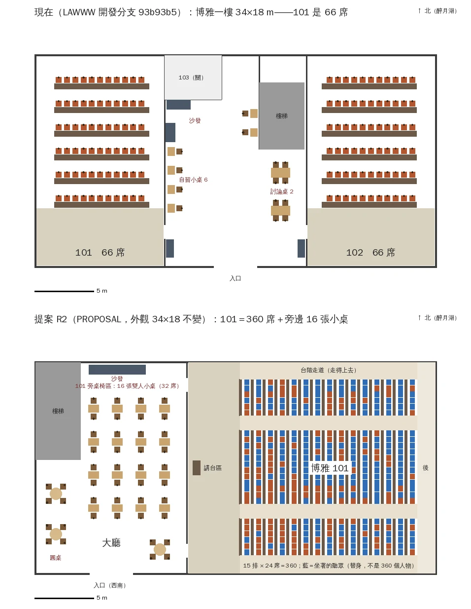

- **R2（推薦先做，外觀 34×18 不變）**：101 放在東半邊（21 × 17.8 m、15 排 × 24＝360 席、講台在西端靠大廳、門在講台那一端——和現在的模板一樣），大廳在西半邊（**西南入口**＝資料寫的主要入口方向；**101 旁的桌椅區**＝官方名稱）。代價：入口從南面中間移到西段（校園的門 x 從 -38 移到約 -48.5）；二樓只剩大廳上方（201、202 改小）；空橋門往西移約 2.6 m；102 變成關著的門。
- **R1（之後，要動地圖）**：照真實把博雅外觀放大到約 46 × 28（真實的一層大概兩千平方公尺，這是估算），一樓同時放 101、桌椅區、中央大廳圓桌區。方案 A 的位置北邊到湖岸步道只剩約 5 m，要 LAWWW 量東西兩側有沒有空間。
- 兩個都要的：第 2.2 節的座位、入座、人群、鏡頭做法。

## 3. 博雅自習區（使用者記得的「很多小桌子」）

### 3.1 現在的樣子

| 大廳入口往西北看 | 大廳高處（三處公共空間） |
|---|---|
| 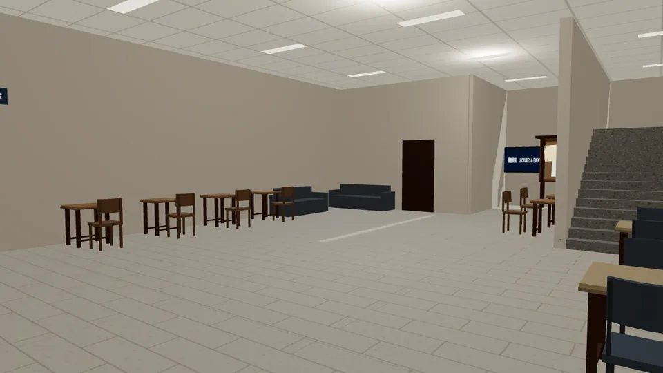 | 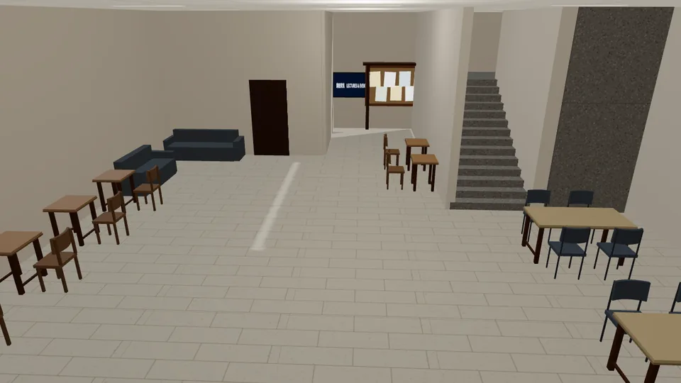 |

- 自習小桌 **6 張**（一人一張、面向牆）、討論桌 2 張（8 席）、沙發 2 張（4 席）、長椅 2 張——一樓公共空間一共 18 個位子。
- 功能上是好的（`tests/flow_boya_interior.py`：走到小桌旁坐下、讀書 1 小時、起身站得住；沙發、討論桌也坐得到）。
- **看起來**：牆邊零零落落幾張桌子，像走廊，不像「很多小桌子、常常回來讀書遇到朋友」的地方；單人桌面向牆，兩個人沒辦法面對面坐。

### 3.2 改法（PROPOSAL，R2 的大廳；平面圖在 2.3 節）

- **101 旁桌椅區**：16 張雙人小桌（0.9 × 0.6 m，兩張椅子面對面）排成 4 × 4，桌距 2.0 m（左右）× 2.8 m（前後）——**椅背和椅背之間 1.04 m**（人物要 0.66 m），每張椅子都能從後面走過去坐（照現在的 `GAME.seatApproach`，不用新程式）；32 個位子。
- **圓桌**：3 張（直徑 1 m、四張椅子）——三四個人一起討論。
- **沙發**：靠北牆（醉月湖那一面的窗）。
- **能交談**：同一張小桌面對面、圓桌圍坐——朋友坐在一起時可以觸發對話（LAWWW 的系統）。
- **有人在讀書**：平日 8–18 點坐四到六成（官方：這段時間只給學生自習），晚上少；背景的人用第 2.2 節的坐姿替身（讀書、打電腦的姿勢），桌上放書、筆電、水壺（instancing）。
- **桌椅一律 instancing**：16 張桌子、40 張椅子 2–4 次 draw call。

## 4. 入口、樓梯、門牌、樓層、窗景、NPC 空間

### 4.1 鏡頭穿牆（P1，三棟室內都有）

教學館室內（`src/teach3d.js`）的隔間牆不擋鏡頭（只有「玩家附近網點透空」，給樹幹用的那一種），鏡頭會停在牆後面。我用版面資料算（鏡頭距離 4.6 m、俯角 0.38——在博雅實際量到的值；每 0.5 m 一個位置 × 8 個方向；`cam_wall_scan.js`）：

| 建築 | 1F：有問題的位置／方向 | 2F：有問題的位置／方向 |
|---|---|---|
| 博雅 | 52%／**18%** | 70%／**25%** |
| 普通 | 85%／**33%** | 87%／**36%** |
| 共同 | 67%／**24%** | 80%／**32%** |

（「位置」＝站在那裡、8 個方向裡至少一個會穿牆；「方向」＝所有位置×方向裡穿牆的比例。）

| 站在自習小桌旁、面向東：鏡頭在 101 裡面（整個畫面是 101 的牆背面） | 剛進博雅（出生點）：鏡頭在門外，前景一大條黑色門框 |
|---|---|
| 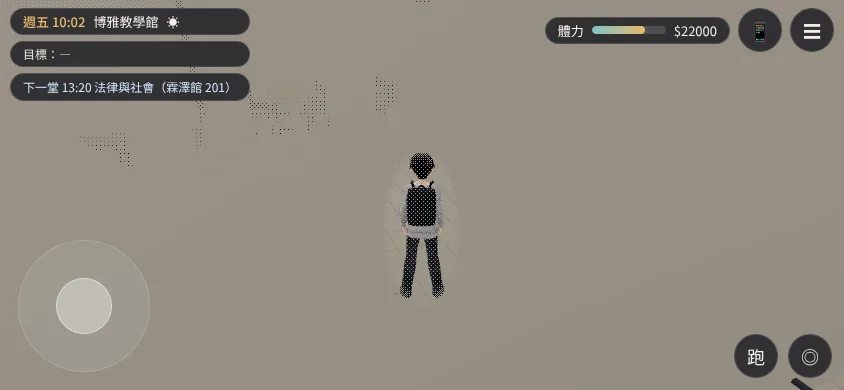 | 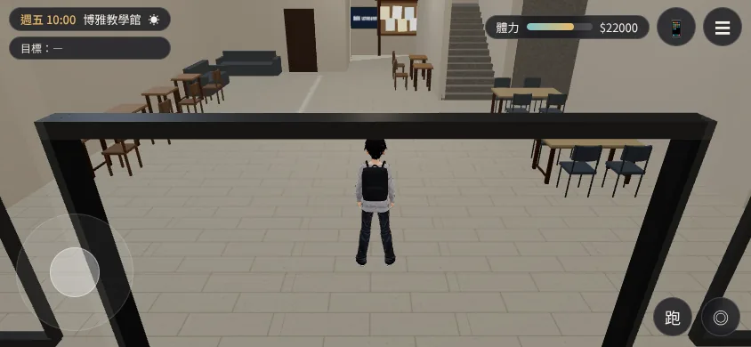 |

- 實測（引擎裡讀出來的）：玩家 (-3.6, 0, 1.6)、鏡頭 (-7.58, 3.36, 0.05)——101 的東牆在 x=-6.0，鏡頭在牆後 1.6 m，等了 20 秒也沒有回來。
- 出生點的黑色門框：**普通、共同、博雅三棟剛進門都一樣**（4.3 節的兩張手機截圖）——鏡頭在南牆外面，南牆淡出了，但入口的門框不在淡出的群組裡。
- 建議（LAWWW）：跟隨鏡頭對室內隔間牆做碰撞（鏡頭拉近到牆前、必要時俯角加大），網點透空留給小東西；加一個在瀏覽器裡用引擎真的鏡頭跑的測試（現在的版本要失敗、修好要通過）。

### 4.2 其他

| 項目 | 看到的 | 嚴重度 | 誰 |
|---|---|---|---|
| 101 最後一排頭頂 | 天花板 4.2 m、最後一排平台 1.8 m → 2.4 m；後排的跟隨鏡頭會被樓板夾住 | P2 | 配置（LAWWW）；R2 改挑高 |
| 坐著的聽眾 | **聽眾剛出現的前十幾秒，有一半以上是站著的**：站在椅子和桌板中間（穿模），之後才變成坐姿。量法（`tools/blender/env_second/shots/boya_seat_probe.py`，讀骨架）：出現後 5 秒，16 人裡 9 人的臀部離座位平台 0.89–1.03 m（站姿）、其他 0.47–0.59 m（坐姿）；30 秒後 16 人都是 0.47–0.59 m。臀部和座位中心的水平距離都 ≤ 1.2 cm（位置是對的）。玩家在演講中走進 101、或演講剛開始時會看到。下面左圖是出現後約 9 秒（左邊還有人站著） | P2 | LAWWW（人物出現時先套好坐姿再顯示，或先藏起來） |
| 門 | 門洞是深色長方形，沒有門框、門牌只在牆上高處（博雅 101 的牌子在門旁牆上 2.75 m） | P2 | 正式模型（我）＋配置（LAWWW） |
| 窗景 | 博雅一樓只有南牆兩扇窗、沒有窗外照片（`photo: null`）；北面醉月湖那一側沒有窗 | P2 | 我（窗景照片）＋配置 |
| 樓梯 | 功能測試通過（LAWWW 的 flow 測試）；外觀是灰色方塊台階、沒有扶手細節 | P3 | 正式模型（我） |
| NPC 活動空間 | 大廳 12 m 寬、桌椅貼牆，NPC 只能站在中間走道；沒有「下課的人潮」可以停留的地方 | P2 | 配置（R2 的大廳） |

| 出現後約 9 秒（側面；左邊還有人站在桌椅中間） | 30 秒後（後面往前看：都坐好了） |
|---|---|
| 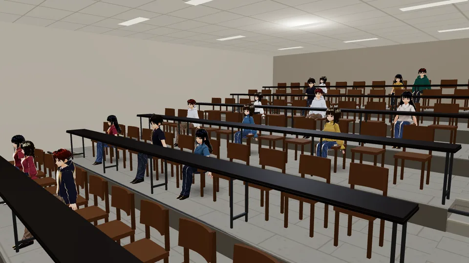 | 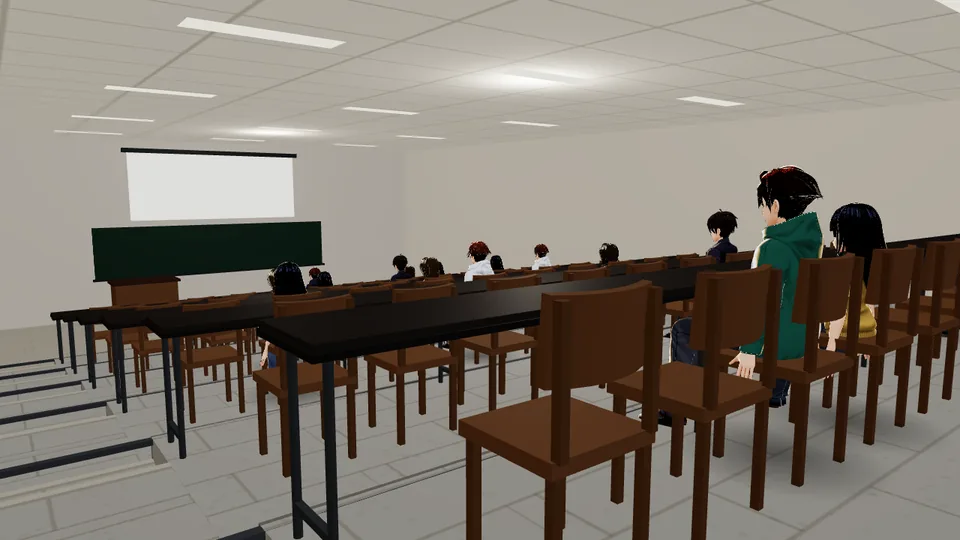 |

| 第一次截圖時的放大（左：站在椅子位置的聽眾和椅背重疊；右：前排腳斜伸到地上——都是「還沒坐下」的狀態） | |
|---|---|
| 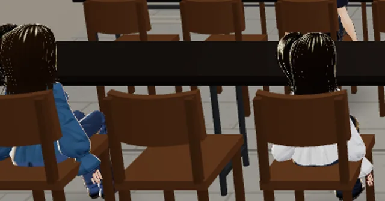 | 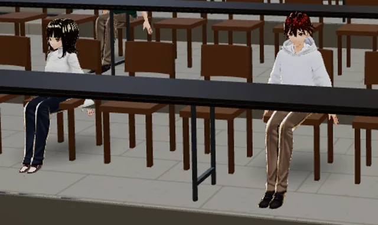 |

### 4.3 普通、共同室內（同一個模板）

| 普通：門廳（公告欄、長椅；右邊是教室門） | 普通：101 教室 | 共同：101 階梯教室（40 席，真實 240 席） | 共同：大廳 |
|---|---|---|---|
| 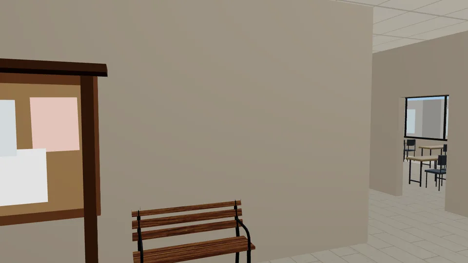 | 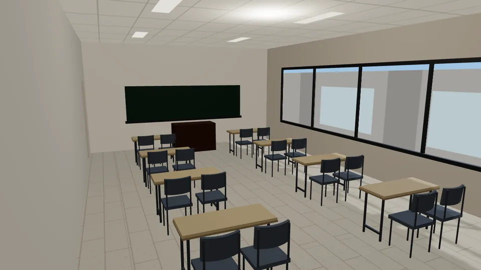 | 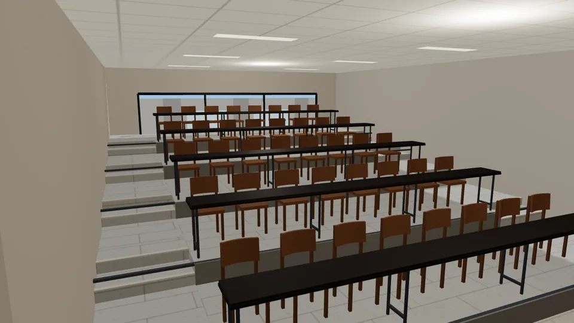 | 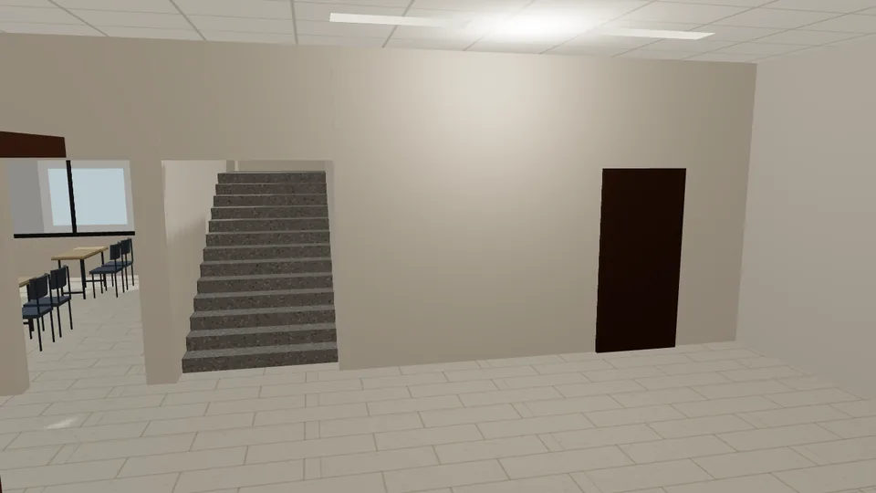 |

| 普通：剛進門（手機橫向、跟隨鏡頭） | 共同：剛進門（手機橫向、跟隨鏡頭） |
|---|---|
| 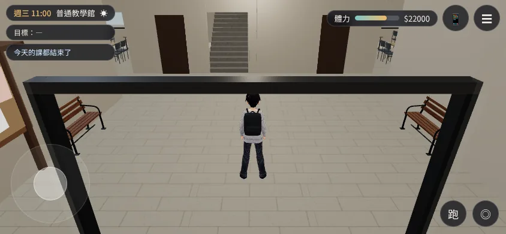 | 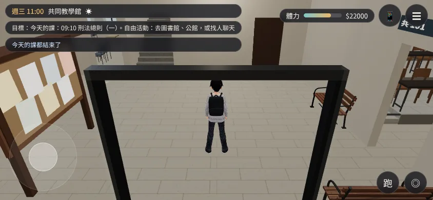 |

- 共同 101 是同一個問題（5 排 × 8＝40 席、活動椅；真實 240 席）。做法同第 2.2 節。
- 牆、地板、天花板都是單色材質，門沒有門框——這是 `BLOCKOUT`（模板），還沒有正式模型。

### 4.4 校園外觀（方案 A 的位置；普通、博雅是套件方盒）

| 空拍：文學院（左下）→ 普通 → 博雅 → 醉月湖 | 普通、博雅中間：空橋、博雅的門 |
|---|---|
| 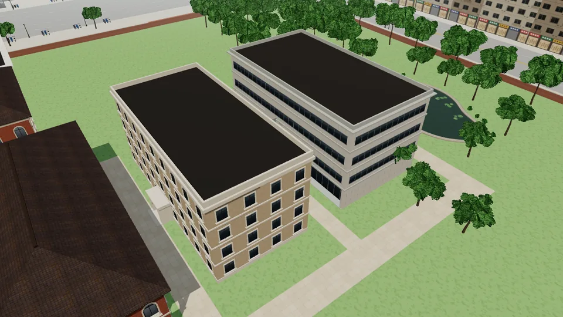 | 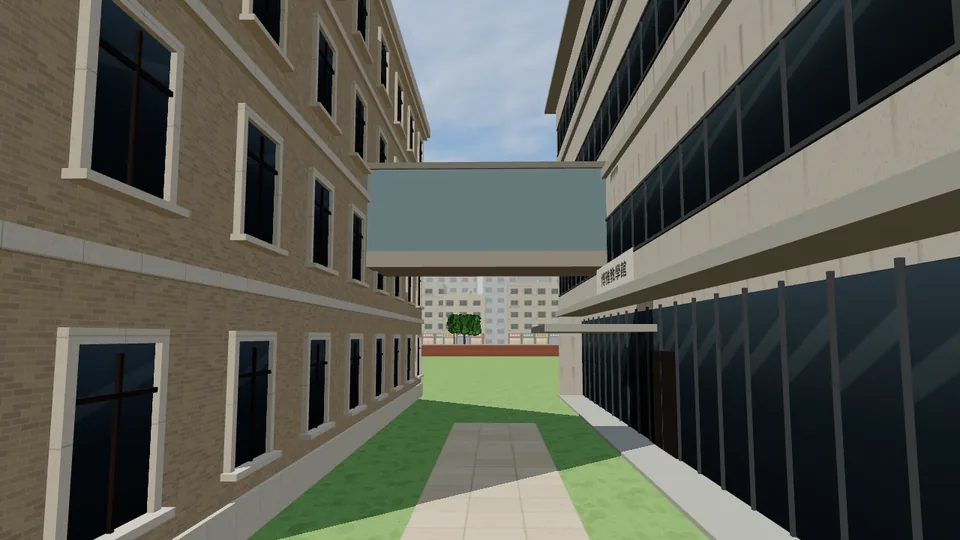 |

| 普通南面（文學院後面往西看） | 博雅北面（醉月湖岸往東南看） | 博雅西南角（資料寫的主要入口方向） |
|---|---|---|
| 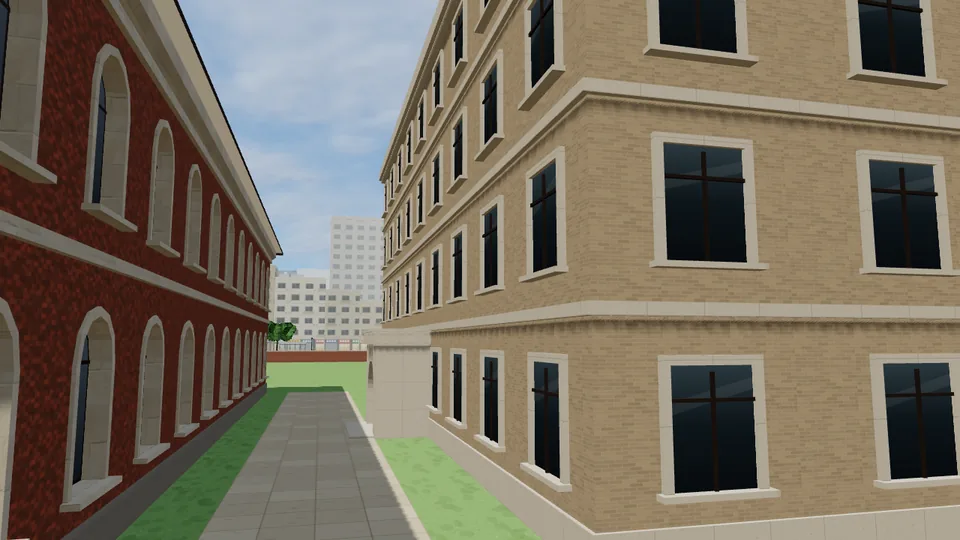 | 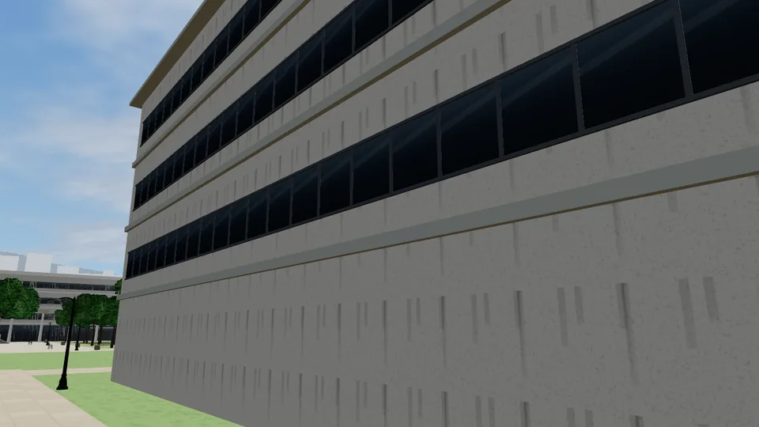 | 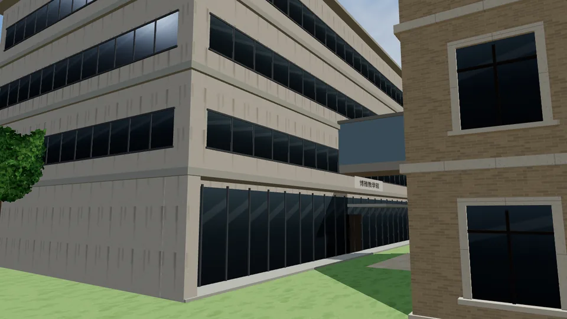 |

| 手機直向：站在普通門口 | 手機直向：站在博雅門口 |
|---|---|
| 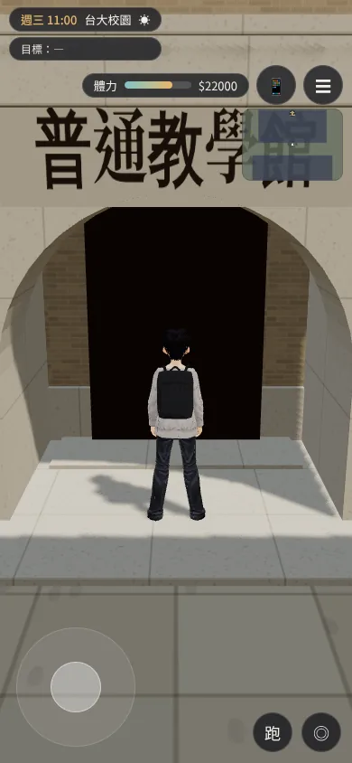 | 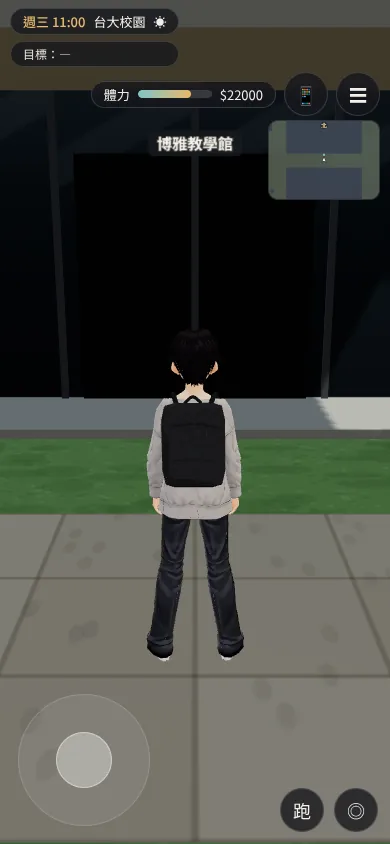 |

- 相對位置對；空橋是一個灰色方盒；博雅的門在兩棟中間 7.5 m 寬的窄巷裡（資料寫主要入口在西南綠園、東側朴樹）。
- 兩個門口都是**黑色的洞**（沒有門扇、玻璃、門框、室內的光）；普通門口的「普通教學館」字很大、和小地圖重疊。這些是套件方盒（`BLOCKOUT`），正式外觀要重做門。

## 5. 整合狀態（對 `93b93b5`）

| 我交的 | commit | 驗收狀態 | 進了開發分支？ |
|---|---|---|---|
| 店家窗景重拍 | `f0bab8c` | READY_FOR_ART_REVIEW | ✅ |
| ⑤ 洞洞館、社科院（原型造型）＋⑥ 法學院廣場花台、公告欄、販賣機 | `451d032` | FUNCTIONAL_VERIFIED／READY_FOR_ART_REVIEW | ❌（LAWWW：v9.5 之後和洞洞館一起接） |
| ⑬ 社科院圖書館一樓（配置＋GLB） | `f3212c0` | MODEL_READY | ❌ |
| 法律學院圖書館（室內＋萬才館西牆門＋窗景） | `a9a227a` | MODEL_READY | ❌ |
| ⑭ 118 巷街景 | `f570fff`＋`6ac6624` | MODEL_READY | ❌ |
| ⑫ 騎車用的腳踏車 | `af561ce`＋`fd970c4` | MODEL_READY | ❌ |
| 共同教學館外觀＋大一女舍外觀 | `55fbedb` | MODEL_READY | ❌ |

- 試合併：`claude/second-ai-env-art`（`55fbedb`）整個合進 `93b93b5` **沒有衝突**（`git merge-tree`）。
- **接線 patch**：`patches/gongtong_freshman_wiring_93b93b5.patch`（`src/zones3d.js` 9 行：兩棟加 ckTag、載入正式模型；大樹牆的缺口改成有 GLB 才開、北側 6 棵蒲葵 `blockCircle` 0.35）＋`src/assets3d.js` 兩行（我的分支已有）。在 `93b93b5`＋patch＋兩個 GLB 上實際載入校園：**兩個正式模型都接上、套件的外觀藏起來、沒有 JavaScript 錯誤**（下面兩張）。**沒跑** `campus_layout_nav`、`reachability_all`、`see_through`（導航只多了 6 個蒲葵的阻擋）。

| 共同教學館（`93b93b5`＋patch） | 大一女舍（`93b93b5`＋patch） |
|---|---|
| 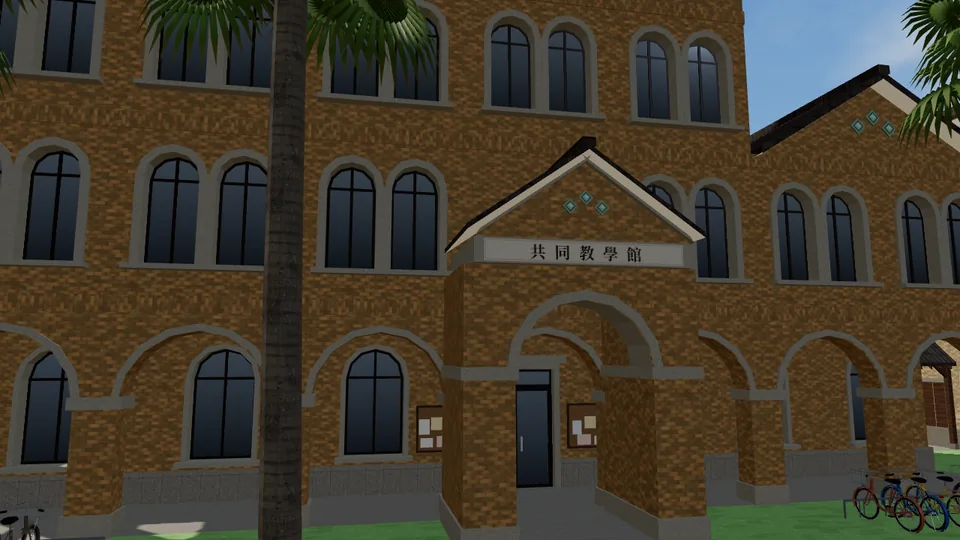 | 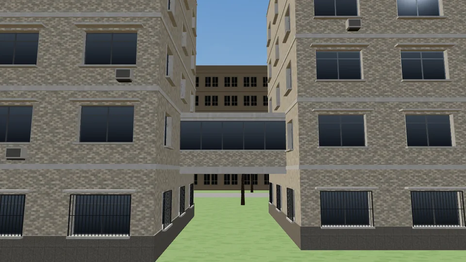 |

- 已請 LAWWW 排順序（P1，DELIVERED，等回覆）。我的建議：先接共同、大一女舍外觀（兩棟已經在可玩地圖上、只換外觀）和法律學院圖書館（使用者指定）。

## 6. 每棟總表

| 建築 | 外觀模型 | 室內 | 整合 | 效能（這次量的，Playwright＋SwiftShader） | 我認為還不夠自然的地方 |
|---|---|---|---|---|---|
| 普通 | 套件方盒（`BLOCKOUT`）；我還沒做 | LAWWW 模板（`BLOCKOUT`）：101–104、201、202、空橋 | 開發分支（方案 A 的 WIP） | 校園：131–152 次／約 70 萬三角形（整個校園）；室內：見下表 | 顏色和資料不合（米色 vs 磚紅）、4 層 vs 5 層；室內單色、沒有門框；鏡頭穿牆 33–36% |
| 共同 | **我的 Blender 外觀 `MODEL_READY`**（還沒接）；遊戲裡是套件 | LAWWW 模板：共 101（40 席）、102、201、202、自習區 | 外觀：❌；室內：開發分支 | 外觀換上後同鏡頭 draw call ×1.02–1.10、三角形 ×1.01–1.03（VISUAL_REVIEW 20.6）；室內 347–455 次／2.8–3.6 萬 | 沒有照片（面磚顏色、窗型、退縮方向都是推測）；共同三松沒放、西側戶外樓梯沒做；101 只有 40 席 |
| 博雅 | 套件方盒（`BLOCKOUT`）；我還沒做 | LAWWW 模板：101、102（各 66 席）、自習區、2F 討論教室 | 開發分支（方案 A 的 WIP） | **室內空著 572–811 次／4.7–6.1 萬；演講 16 人 1,043–1,090 次／68 萬**；手機橫向剛進門 781–822 次／13.5–13.8 萬 | 第 2–4 節：像小教室、自習區太空、鏡頭穿牆、頭頂低、效能 |
| 大一女舍 | **我的 Blender 外觀 `MODEL_READY`**（還沒接）；遊戲裡是套件 | 沒有室內（男賓止步；門口長椅、傳達室互動點） | 外觀：❌ | 換上後同鏡頭 draw call ×0.93–0.98、三角形 ×0.92–0.98（VISUAL_REVIEW 21.6） | 外觀沒有任何資料（通用宿舍樣子）；兩棟同一套設計；門口沒有盆栽、腳踏車（要阻擋才放） |

室內效能（每個鏡頭的 draw call／三角形；同一台機器、同一種設定比較用，不代表手機實機幀率）：

| 建築 | 鏡頭 | 畫面 | draw call | 三角形 |
|---|---|---|---|---|
| 博雅 | 101 最後一排往講台（空） | 1280×720 | 721 | 56,432 |
| 博雅 | 101 從講台往座位（空） | 1280×720 | 748 | 58,364 |
| 博雅 | 101 第 3 排的視線（空） | 1280×720 | 572 | 46,516 |
| 博雅 | 101 最後一排往講台（16 個聽眾） | 1280×720 | 1,061 | 679,668 |
| 博雅 | 101 從講台往座位（16 個聽眾） | 1280×720 | 1,090 | 681,604 |
| 博雅 | 101 第 3 排的視線（16 個聽眾） | 1280×720 | 654 | 194,276 |
| 博雅 | 大廳入口往西北 | 1280×720 | 811 | 61,416 |
| 博雅 | 大廳高處 | 1280×720 | 682 | 53,208 |
| 博雅 | 剛進門（跟隨鏡頭、有 HUD；含玩家人物） | 手機橫向 844×390 | 822 | 138,222 |
| 博雅 | 自習小桌旁（鏡頭在 101 裡） | 手機橫向 844×390 | 773 | 134,882 |
| 普通 | 門廳 | 1280×720 | 680 | 57,154 |
| 普通 | 101 教室 | 1280×720 | 540 | 46,772 |
| 普通 | 入口往北 | 1280×720 | 613 | 52,416 |
| 普通 | 剛進門（跟隨鏡頭、有 HUD；含玩家人物） | 手機橫向 844×390 | 661 | 129,832 |
| 共同 | 大廳 | 1280×720 | 451 | 35,050 |
| 共同 | 共 101 階梯教室 | 1280×720 | 455 | 36,284 |
| 共同 | 102 教室 | 1280×720 | 347 | 27,876 |
| 共同 | 剛進門（跟隨鏡頭、有 HUD；含玩家人物） | 手機橫向 844×390 | 501 | 112,412 |

對照：溫州街、公館街景的效能目標是同一個鏡頭 draw call ≤ 約 310、三角形 ≤ 42 萬（含陰影）。校園鏡頭（整個校園一起畫）：普通、博雅附近 131–230 次／70–80 萬三角形。

**我對自己成果的批評**：
- 共同、大一女舍外觀：Blender 渲染好看，但**都沒有照片**，是「看起來像台灣的大學建築」，不是「看起來就是共同／大一女舍」。辨識度要等照片。
- 我到現在還沒做普通、博雅的外觀，也還沒做任何教學館室內的正式模型——使用者會一再回來的地方（101、自習區）現在都是單色方塊。下一步應該先做室內（講堂椅、桌椅、聽眾替身），而不是再多一棟外觀。
- 我交了 8 個成果，只有 1 個進了可玩的遊戲；之後每交一項要追到整合，不再一直往下做新的。

## 7. 下一步（等 LAWWW 回覆後確定）

1. LAWWW 決定：整合順序；R2／R1；鏡頭碰撞；人群替身誰做。
2. 我（不等配置也能做的）：講堂椅（instancing 模組）、自習區雙人小桌＋椅子＋圓桌＋沙發（instancing 模組）、桌上小物；這些普通、共同、博雅、新社科院都用得到。
3. 照片：請使用者提供（第 1 節）。
