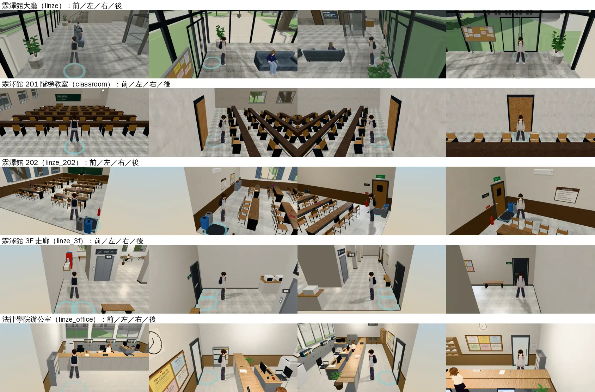
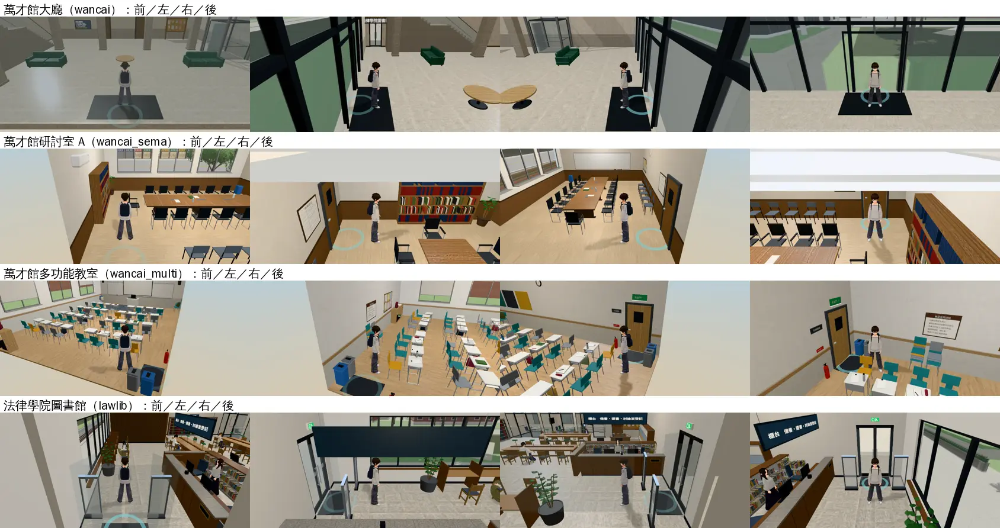
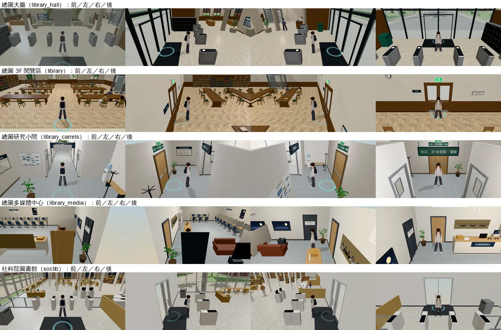
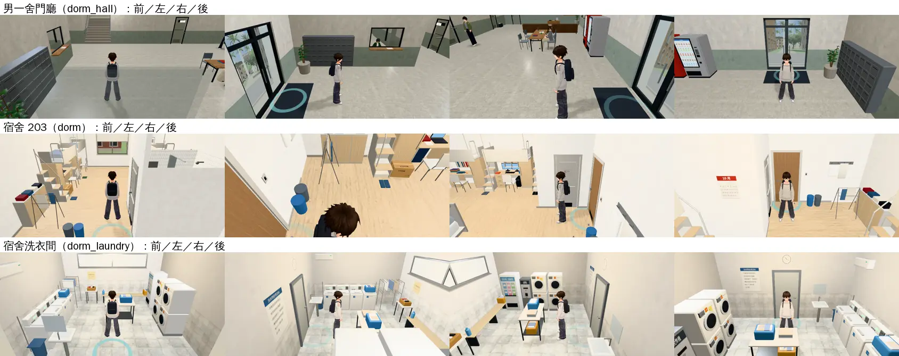
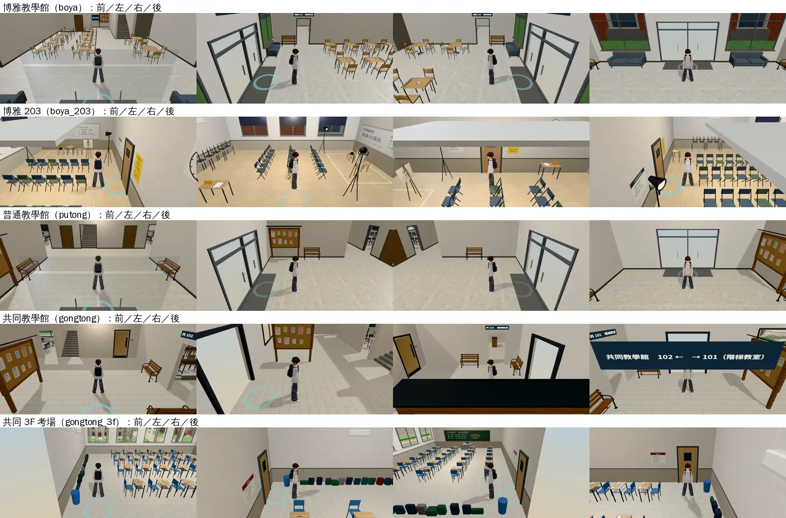
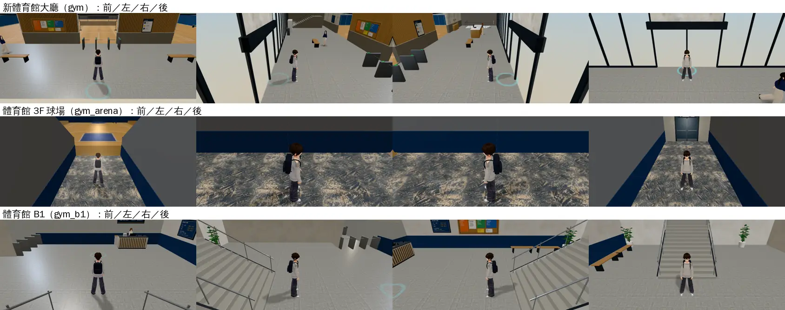
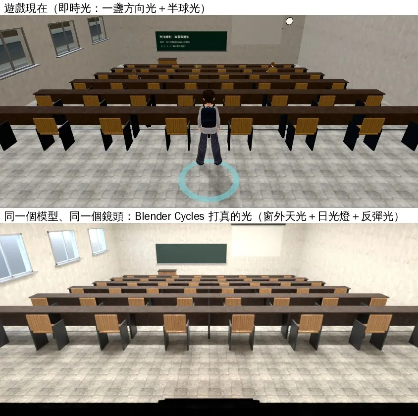

# 校內建築室內美術檢討：為什麼像廉價手遊、3A 作品怎麼做、我們要改什麼

- **任務**：INTERIOR-AAA-REVIEW-1028（UA-LAWWW2-1028-01）
- **作者**：LAWWW2-C（3D 美術），2026-10-28
- **使用者原話**（10-28 01:5x UTC）：「我仍然覺得 校內建築 空間內配置 有很大的美術提升空間 現在是一個廉價手遊感 請你去參閱3A大作好好檢討」
- **範圍**：校內建築的室內，共 25 個區域。
  - 霖澤館、萬才館、總圖、社科院圖書館、法學院圖書館、男一舍。
  - 博雅、普通、共同教學館、新體育館。
- **人物美術不在範圍**（D99 凍結）。

---

## 0. 結論

1. **光是最大的原因，但只改光不夠。**
   - 遊戲裡的室內只有一盞方向光加一個半球光（`engine3d.js`），沒有反彈光、沒有接觸陰影（AO）、沒有反射。整間平均地亮，東西看起來像貼在地上的方塊，看不出空間的深淺。
   - 實驗：同一個 201 教室模型、同一個鏡頭，在 Blender 用真的光（窗外天光、日光燈、反彈光）算一張。畫面明顯乾淨、有層次，**但房間還是單調**：空、同一款桌椅一排排複製、牆面空白。光照和內容兩邊都要改。
2. **鏡頭會看到牆外的天空。**
   - 小房間裡鏡頭在牆外，擋住視線的牆淡出以後，後面直接是天空的漸層，房間像一個飄在天空裡的模型屋。
   - 202、3F 走廊、研討室、多功能教室、多媒體中心、共同 3F、體育館都有。
   - 也有整片天花板、牆板從畫面中間切過去的情形（博雅 203、研究小間）。
3. **地板占畫面一半，但地板最像佔位素材。**
   - 玩家鏡頭往下俯看（俯角約 0.38）。
   - 教室、大廳、走廊用的是同幾種灰色石磚貼圖，尺度大、看得出重複、沒有磨損和反射。
   - 體育館 3F 走道是很吵的雜訊貼圖。
4. **擺設照網格、一樣的東西一直複製、沒有人用過的痕跡。**
   - 桌椅完全對齊。
   - 大廳大片空地上只放兩張沙發或兩張長椅（萬才館、普通教學館、總圖、男一舍門廳）。
   - 台灣校園常見的東西很多沒有：飲水機、層層疊疊的公告、雨傘架、回收桶分類、吊扇、日光燈具、喇叭、課表、學生的包包水壺外套。
5. **空間沒有焦點、建築細部不夠。**
   - 牆是平的一片顏色。
   - 很少看到樑、柱、踢腳板、門框、窗台、天花板燈具。
   - 進門第一眼沒有一個讓眼睛停下來的東西（講台、窗、書牆、樓梯）。

> 一句話：我們一直在「把單件道具做精緻」，3A 作品是在「把玩家鏡頭裡的整個畫面做好」：光、空間、密度、故事一起設計。

---

## 1. 現況（遊戲內截圖，玩家鏡頭）

- 開發分支 `aa3be50ec`。手機橫向模擬（SwiftShader），不是 iPhone。
- 每區 4 張：玩家在進門的位置，鏡頭在玩家後面往前看，再轉左、右、後。
- [捷徑] 讀檔直接進區域、條件事件關閉。
- 工具：`tools/shots/interior_review/survey.py`。

| 法學院（霖澤館） | 萬才館、法圖 |
|---|---|
|  |  |

| 總圖、社科圖 | 宿舍 |
|---|---|
|  |  |

| 教學館 | 體育館 |
|---|---|
|  |  |

**實驗：同一個模型，光照換掉會怎樣**（201 教室，上：遊戲現在；下：Blender Cycles 打真的光，同一個鏡頭）

- 下圖的差別：
  - 窗戶透進來的光、桌子底下和牆角的暗、整體的明暗層次、顏色比較乾淨。
- 下圖還是不好的地方：
  - 空間單調、一樣的桌椅複製。
  - 牆面空白，沒有人用過的痕跡。
  - 天花板、燈具、窗簾、講台區都很簡單。
- 工具：`tools/blender/env_second/lightbake/lit_preview.py`（這是 Blender 渲染，不是遊戲截圖）。

---

## 2. 3A 作品怎麼做（參考）

> 我玩不到這些遊戲。以下是從公開的技術演講、開發者說法、評論、業界討論整理的，出處在第 8 節。沒有可靠出處的地方我會寫「業界常見做法」。

### 2-1 光：先烘焙間接光，即時光只照會動的東西
- **Naughty Dog《最後生還者 2》**：SIGGRAPH 2020 的光照技術演講，重點是「烘焙的環境光（間接光）」。在記憶體限制下維持 30 fps；大部分場景是陰天，環境光是渲染系統最關鍵的部分。
- **《秘境探險》《最後生還者》**：把全域光照（GI）和部分燈光烘焙成光照貼圖，太陽和會動的東西用即時陰影（Polycount 業界討論，非官方）。
- **手機**：Android 官方的 Unity 手機遊戲指南說「**烘焙光照應該是手機遊戲的第一選擇**」。
- **網頁（three.js）**：常見流程是 Blender Cycles 烘焙到第二套 UV，遊戲裡接 `lightMap`（glTF 本身不帶光照貼圖，要自己接，`flipY=false`）。
- **用光引導**：The Level Design Book 的 D6 打光：一盞獨立的燈標出焦點；兩盞對稱的燈框住門口和路線。

### 2-2 擺設：照「怎麼被使用」擺，痕跡是事件的結果
- 東西照空間怎麼被使用擺，不是照網格。拉開的椅子＝剛有人坐過；地上的磨痕沿著常走的路。
- 「髒、鏽、破損不是貼圖，是事件的結果」。
- 要避免「博物館感」：每樣東西都像在展示。
- 便宜又有效的生活感：用膠帶貼的告示、臨時湊合的修理、一個顯眼的地標。
- 先想「誰在這裡、剛發生什麼」，再決定擺什麼（一位 3D 美術拆解浴室場景的做法）。

### 2-3 材質：可重複貼圖＋飾條貼圖＋貼花，打破重複
- 業界常見做法：
  - 大面用可重複貼圖。
  - 邊、框、踢腳板用飾條貼圖（trim sheet）。
  - 污漬、磨損、標示用貼花（decal）。
- 重複感用大尺度的變化遮罩、頂點色手繪打掉；灰塵污垢用遮罩疊在材質上。

### 2-4 真實的參考
- 《奇異人生》的美術總監去研究真實的、那個年代的學校來設計校園。
- 《審判之逝》的誠稜高中參考真實的高中，整間學校可以探索。
- 赤燭《還願》被評論特別提到「1980 年代台灣公寓」的真實感：映像管電視、桌上的家常菜。這是台灣場景最好的對照，細節來自真實生活。

### 2-5 人物和空間的比例
- 《女神異聞錄 3 Reload》重做時，把人物和道具做得和環境的比例更一致，光照也跟著重做。

---

## 3. 差距對照表

| 項目 | 3A 的做法 | 我們現在 | 玩家看到的 | 改法 | 效能 |
|---|---|---|---|---|---|
| **間接光、接觸陰影** | 烘焙 GI＋AO 到光照貼圖 | 只有方向光＋半球光；SOP 2-5 寫著「烘焙 AO 工具：目前沒有」 | 整間平均亮、東西浮在地上、看不出深度 | Blender Cycles 烘焙光照貼圖（白天、晚上各一張），遊戲接 `lightMap` | 每間多 1～2 張貼圖，執行時幾乎不花 GPU |
| **反射** | 反射探針 | 沒有環境貼圖；金屬度上限 0.45（沒有反射，金屬會變黑） | 磨石子、拋光磚、玻璃、金屬都是死的 | 每區一張小的環境貼圖（從同一間的 Cycles 算出來） | 一張 256×128 的貼圖 |
| **牆外** | 鏡頭碰撞留在房間內；剖面視角時外面是暗的或真的環境 | 牆淡出以後看到天空漸層、被大片天花板／牆板切畫面 | 模型屋飄在天上 | 室內背景改暗色；牆淡出時留牆的斷面（厚度）；房間外加一圈走廊殼；鏡頭碰撞 | 幾乎不花 |
| **地板** | 照真實材質、尺度對、宏觀變化、沿動線磨損、牆角積灰 | 同幾種灰石磚、尺度大、重複明顯；體育館雜訊貼圖 | 地板占畫面一半，最像佔位素材 | 照台灣校園的真實材質（磨石子＋銅條、塑膠地磚、拋光石英磚、PU 地板）、變化遮罩、磨損 | 不變 |
| **牆、天花板、細部** | 踢腳板、腰牆、樑柱、門框、窗台、燈具、管線、標示 | 大多是平的一片色；細部少 | 牆像紙板 | 飾條貼圖＋模型細部；台灣校園的牆（油漆、腰牆磁磚、洗石子） | 小 |
| **擺設** | 照使用邏輯、故事；打破網格 | 對齊、複製、空 | 樣品屋、空殼 | 每間寫「誰在用、剛發生什麼」再擺；台灣校園清單（第 5 節） | 合併成少數材質 |
| **空間焦點** | 每個空間有焦點、用光引導 | 大廳大而空、沒有焦點 | 不知道該看哪裡 | 每間定焦點（講台、窗、書牆、樓梯、公告欄），燈光、擺設往焦點集中 | — |
| **窗** | 窗外有真的景深、光從窗戶照進來 | 窗景是平面貼圖、窗光不落在地上 | 窗像海報 | 烘焙窗光落在桌面和地上；窗景加深度（視差） | 小 |
| **晚上** | 室內燈真的照亮周圍 | 天花板自發光、沒有光池 | 晚上一樣平 | 晚上那張光照貼圖只有室內燈 | 一張貼圖 |

---

## 4. 自我檢討：為什麼照 10-16 的 ART_SOP 做了還是廉價

使用者 10-16 就說過「得遊戲大獎、不要像廉價拼接、不要有方塊感」，我們也寫了 SOP。這次使用者說「仍然」，原因在我們自己：

1. **SOP 管的是「單件道具」，沒有管「整個畫面」。**
   - 倒角、PBR、磨損都是一件一件的。
   - 光、空間的焦點、鏡頭看出去是什麼、整間的密度，SOP 沒有規定。
2. **驗收圖用 Blender Cycles，遊戲裡沒有 Cycles 的光。**
   - Cycles 有反彈光、看起來還可以，遊戲是平的。這個落差從來沒有量過。
   - SOP 2-5 自己寫了「烘焙 AO 工具：目前沒有」：知道缺，但沒有去做。
3. **先做能走、能坐、能互動，美術最後補。**
   - 房間大小、家具位置是導航格決定的（0.4 m 一格），空間比例和密度是被功能牽著走。
4. **使用者點名哪一件就修哪一件。**
   - 窗景、裙子、某一張桌子……局部修補，沒有回頭看整間、整棟。
5. **驗收的鏡頭不是玩家的鏡頭。**
   - 很多截圖是特寫或固定機位，看不到玩家走進門那一刻的畫面，也看不到牆外的天空。

---

## 5. 改善計畫（照影響排序）

| 順序 | 做什麼 | 內容 | 先做在哪 |
|---|---|---|---|
| **P1** | **光照管線** | Blender Cycles 烘焙室內光照貼圖（白天：天光＋日光燈；晚上：只有室內燈），遊戲接 `lightMap`、降低室內的半球光；每區一張環境貼圖；人物照同一間的光 | 201 教室示範 → 全部室內 |
| **P2** | **牆外不露天空** | 室內背景改暗色；牆淡出時留牆的斷面；房間外一圈走廊殼；必要時鏡頭碰撞 | 全部室內（引擎一處） |
| **P3** | **地板、牆的真實材質** | 照台灣校園：磨石子、塑膠地磚、拋光石英磚、PU 球場地板、腰牆磁磚、油漆牆；變化遮罩；動線磨損、牆角積灰 | 201 → 其他 |
| **P4** | **生活感擺設** | 每間先寫一句「誰在用、剛發生什麼」；台灣校園清單（見下）；椅子拉開、角度不一；翻椅大多收起來 | 201 → 大廳 → 其他 |
| **P5** | **建築細部、燈具** | 踢腳板、樑、柱、輕鋼架天花板、日光燈具、吊扇、冷氣、喇叭、灑水頭、窗台、窗簾、門框 | 201 → 其他 |
| **P6** | **焦點與構圖** | 每間定焦點；大廳加分區（等候區、公告區、服務台）；用燈光引導動線 | 大廳、走廊 |

**台灣校園室內的清單**（照真實，不放真實品牌、校徽）：
- 公共設施：
  - 飲水機（附紙杯架）。
  - 消防栓箱、滅火器、逃生指示燈、疏散圖。
  - 回收桶（一般／資源回收／紙類）。
  - 雨傘架、雨傘套機。
- 標示與公告：
  - 公告欄（講座海報、社團招生、遺失物，一層貼一層）。
  - 樓層指示、教室門牌與課表。
- 教室設備：
  - 輕鋼架天花板、T5 日光燈、吊扇、分離式冷氣、喇叭、投影機與布幕。
  - 黑板（板擦、粉筆槽）、講桌（麥克風、延長線）、時鐘。
  - 階梯教室的翻椅、台階的止滑條。
- 學生的東西：後背包、水壺、手搖杯、外套、講義、筆電充電線、雨傘、安全帽。

**效能原則**：
- 光照貼圖、環境貼圖都是貼圖，執行時幾乎不增加計算。
- 擺設照舊合併材質；新道具照 SOP 的三角形預算。
- 每做完一間量 draw call、三角形、手機模擬 fps，寫在 README。手機實機沒量的照實寫。

---

## 6. 示範：201 階梯教室（10-28 完成第一版，`READY_FOR_ART_REVIEW`）

- 為什麼選 201：上課是遊戲的核心循環，這是玩家最常進的教室。模型照使用者給的教室照片做的（`classroom_layout.js` 開頭）。
- 做了什麼：
  1. 光照管線：Cycles 烘焙（`tools/blender/env_second/lightbake/bake_room.py`）＋遊戲接 `lightMap`，日夜兩張。
  2. 牆外背景：房間外一圈暗色的殼，鏡頭在牆外看不到天空。
  3. 重做內容（`tools/blender/classroom_201.py` v2）：
     - 翻椅（空位掀起來）、分段長桌。
     - 木腰牆、柱子、鋁窗框、捲簾、雙開門。
     - 輕鋼架燈具、冷氣、投影機。
     - 公告欄、講桌上的東西、窗台上的手搖杯。
- 同角度前後截圖、測試、效能、還沒做到的：`docs/art-rebuild/second_ai/test_shots/interior_201_v2_1028/README.md`。
- 配置、座位、導航、存檔都沒有動。
- 下一步：等使用者看過再推到其他室內，順序照第 5 節。
- **10-28 03:4x 自己查到的問題（LIGHTBAKE-UV-FIX-1028）**：做 202 v2 時看到窗簾有一條一條的暗紋，追下去發現烘焙工具有兩個錯，201 v2 交出去的那一版也有：
  1. 光照貼圖排得很鬆：整張 1024 的貼圖，201 只用了 8.5%、202 9.3%。牆、地板每公尺只分到 2～14 個像素，光的細節（桌下的暗、燈下的亮）被糊掉。
     原因：排版的間隔照 UV 的大小放大（Blender 預設）；而且幾千個小零件（鐵腳、書包、收邊條）每個都要自己的一小塊和間隔。
  2. 沒有貼圖座標的零件（頂點色的鐵腳、收邊、格柵）光照座標放錯欄位：遊戲裡根本沒吃到光照貼圖，還佔了位置。
  - 改法：間隔固定 4 個像素；細小零件不烘（照舊即時光）；看不到的面不參加排版。202 每公尺 34 個像素、多功能教室 46 個、201 12～17 個。
  - 以後每間烘完都用 `tools/blender/env_second/lightbake/uv_fill.py` 量填滿率和每公尺像素（驗收項目，第 7 節）。
- **10-28 05:3x 第三包**（202 v2＋三間重烘＋講台淺色地板）：`test_shots/interior_202_v2_1028/README.md`。我做 201 v2 時用了深色木地板（違反使用者 10-23 的永久規則 UA-LAWWW2-1023-03），這包改淺色；以後每間交件前跑 `scan_floors.py`（第 7 節）。
- **10-28 09:xx 第四包：霖澤館一樓大廳第二版**（LINZE-LOBBY-V2-1028）：`test_shots/linze_lobby_v2_1028/README.md`。
  - 照第 5 節 P4～P6 加擺設，分成入口、等候、公共設施、展示櫃四區。
  - 光照烘焙（P1）：第一次用在兩層樓的中庭。亮度調了五輪：玻璃中庭的天光比教室多很多，第一輪整片發白。
  - 程式：`src/building3d.js` 的 `attachFormal` 也會接光照貼圖。萬才館室內也走這一段，它的 GLB 烘好就會接上。
  - 填滿率 44.7%，沒有到第 7 節的 50%（小東西多）；主要的面每公尺 17～27 個像素有達到。
- **10-28 10:3x 第五包：萬才館室內（一樓大廳＋二樓）**（WANCAI-LM-1028）：`test_shots/wancai_lm_1028/README.md`。
  - 擺設和霖澤館大廳第二版同一套：北牆兩扇門中間的展示櫃、東牆飲水機＋回收桶、消防栓箱、出口燈、南面玻璃前長椅、傘架、沙發旁小圓桌、盆栽、中庭吊燈。離劇情、社團站位 1.2 m 以上。
  - 光照烘焙照大廳校正好的參數，一次就用（沒有再調五輪）。白天地上有窗框的影子；晚上原本地板上的大片反光不見了。
  - 西南角、樓梯那一側在樓板下面，比改前暗。BB 覺得太暗的話，在二樓門廳樓板下加崁燈重烘。
  - 填滿率 42.1%；draw call 多 7～10%。
  - 同一天的 LOBBY-CEIL-1028：大廳吊燈的發光條頂面朝上，`room_ceiling_unit` 不過（擋 v9.10.13）。改成只拿掉頂面，兩棟一起改。

## 7. 驗收方式改成什麼

1. **以遊戲內、玩家鏡頭的截圖為準**：每區固定 4 個鏡頭（`survey.py`），改前改後同角度、同時段。Blender 渲染只當參考。
2. **每區要過的問題**：
   - 牆外有沒有天空？
   - 東西底下、牆角有沒有暗？
   - 地板看得出材質嗎？
   - 第一眼看哪裡（焦點）？
   - 有沒有「人用過」的痕跡？
   - 一樣的東西有沒有一直複製？
3. **和參考照片並排**（真實的台大教室、走廊；使用者給過的照片優先）。
4. **光照貼圖要量**：`uv_fill.py` 的填滿率 50% 以上、主要的面每公尺 12 個像素以上；沒有 uv1 的網格要是故意的（發光面、細小零件）。
5. **沒有深色木地板**：`tools/blender/env_second/floors/scan_floors.py` 不能有 DARK 的地板（桌面、家具不算）。

## 8. 出處

- [Lighting Technology of The Last of Us Part II（SIGGRAPH 2020，Naughty Dog）](https://history.siggraph.org/?p=76961)、[Naughty Dog at SIGGRAPH 2020](https://www.naughtydog.com/blog/naughty_dog_at_siggraph_2020)
- [In-Game and Cinematic Lighting of The Last of Us（GDC 2014）](https://gdcvault.com/play/1020475/In-Game-and-Cinematic-Lighting)
- [Polycount：The Last of Us 2 environments（業界討論，非官方）](https://polycount.com/discussion/220739/the-last-of-us-2-environments)
- [Android Developers：Lighting for mobile games with Unity](https://developer.android.com/games/optimize/lighting-for-mobile-games-with-unity)
- [three.js 論壇：Blender 烘焙光照貼圖接到 three.js](https://discourse.threejs.org/t/apply-uv-coordinates-and-lightmaps-baked-from-blender-to-mesh/63910)、[How to setup lightmap bake from Blender to glTF](https://discourse.threejs.org/t/how-to-setup-lightmap-bake-from-blender-to-gltf/34924)
- [The Level Design Book：構圖](https://book.leveldesignbook.com/process/blockout/massing/composition)、[D6 打光](https://book.leveldesignbook.com/process/lighting/d6-lighting)（10-28 查資料時是從鏡像站讀的，這裡改回原站的網址）
- [What Makes an Environment Believable: Non-Obvious Principles](https://ar.linkedin.com/in/francogamarra)
- [80 Level：John Doe's Bathroom Breakdown](https://80.lv/articles/john-doe-s-bathroom-breakdown)
- [Roblox Creator Docs：Develop polished assets（可重複貼圖、飾條貼圖）](https://create.roblox.com/docs/tutorials/curriculums/environmental-art/develop-polished-assets)、[Polycount：打破重複、污垢遮罩](https://polycount.com/discussion/comment/2620875)
- [Life is Strange（Blackwell Academy 的設計研究）](https://life-is-strange.fandom.com/wiki/File:Chloescar_interieur4.jpg)、[Feral Interactive：Life is Strange 概念圖](https://feralinteractive.com/en/games/lifeisstrange/extras)
- [Lost Judgment（Wikipedia）](https://en.wikipedia.org/wiki/Lost_Judgment)、[GameSpot 評論](https://www.gamespot.com/reviews/lost-judgment-review-back-to-school/1900-6417741/)
- [Devotion 評論（TechRaptor）](https://techraptor.net/content/devotion-review)、[赤燭 Devotion press kit](https://redcandlegames.com/presskit/sheet.php?p=devotion)
- [Persona 3 Reload（Wikipedia）](https://en.wikipedia.org/wiki/Persona_3_Reload)
