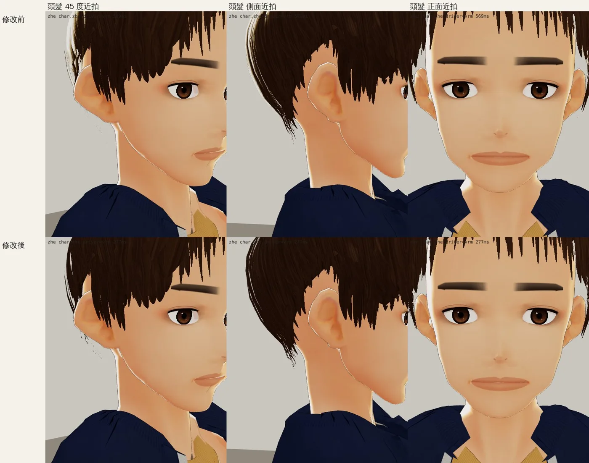
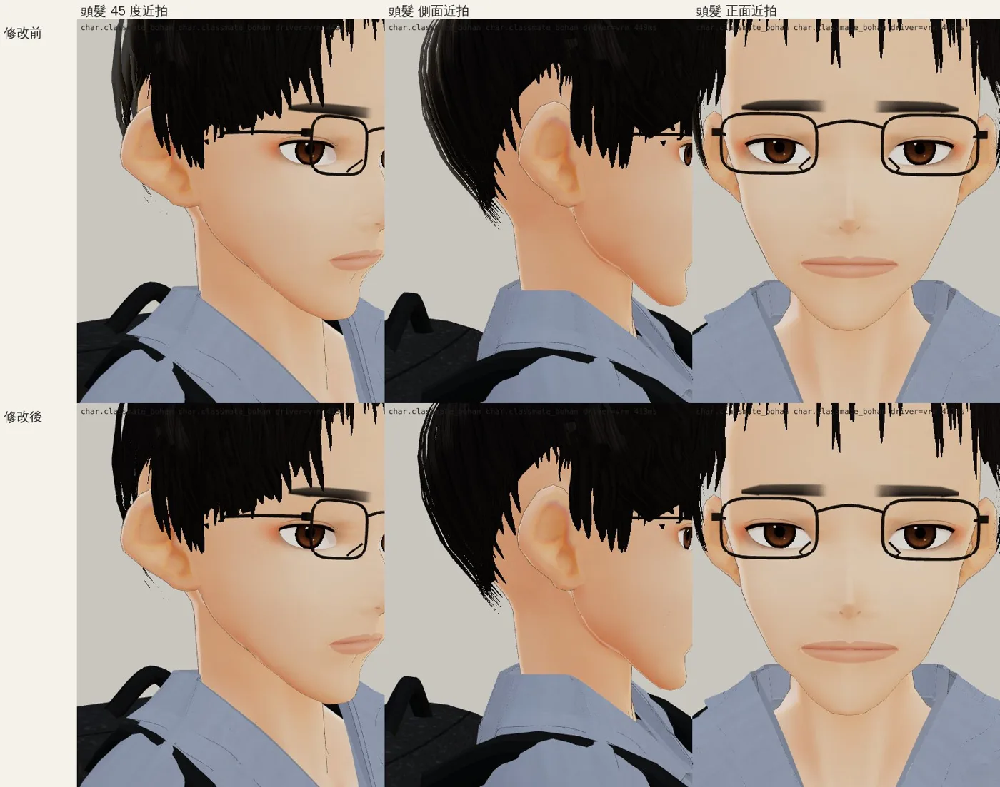
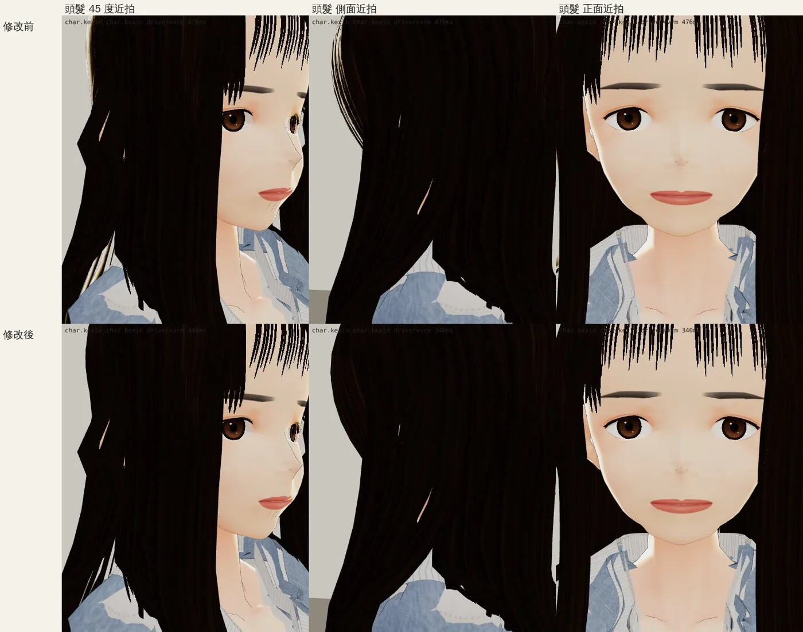
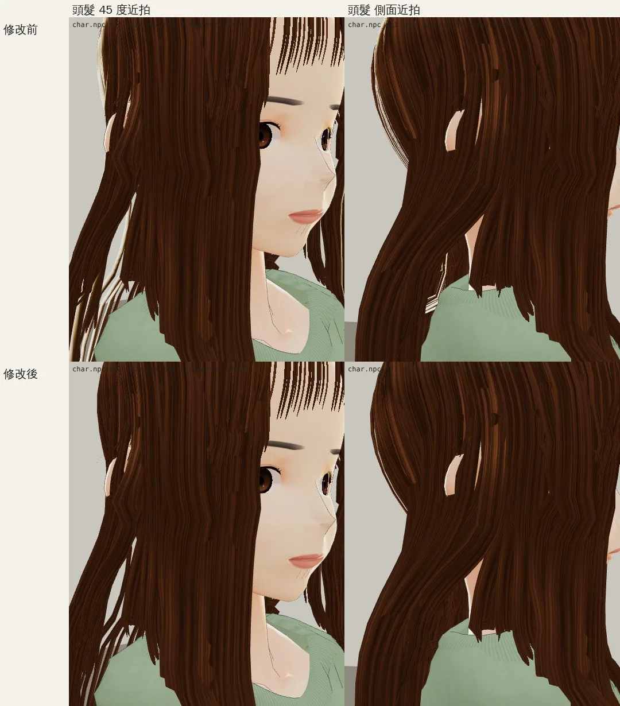
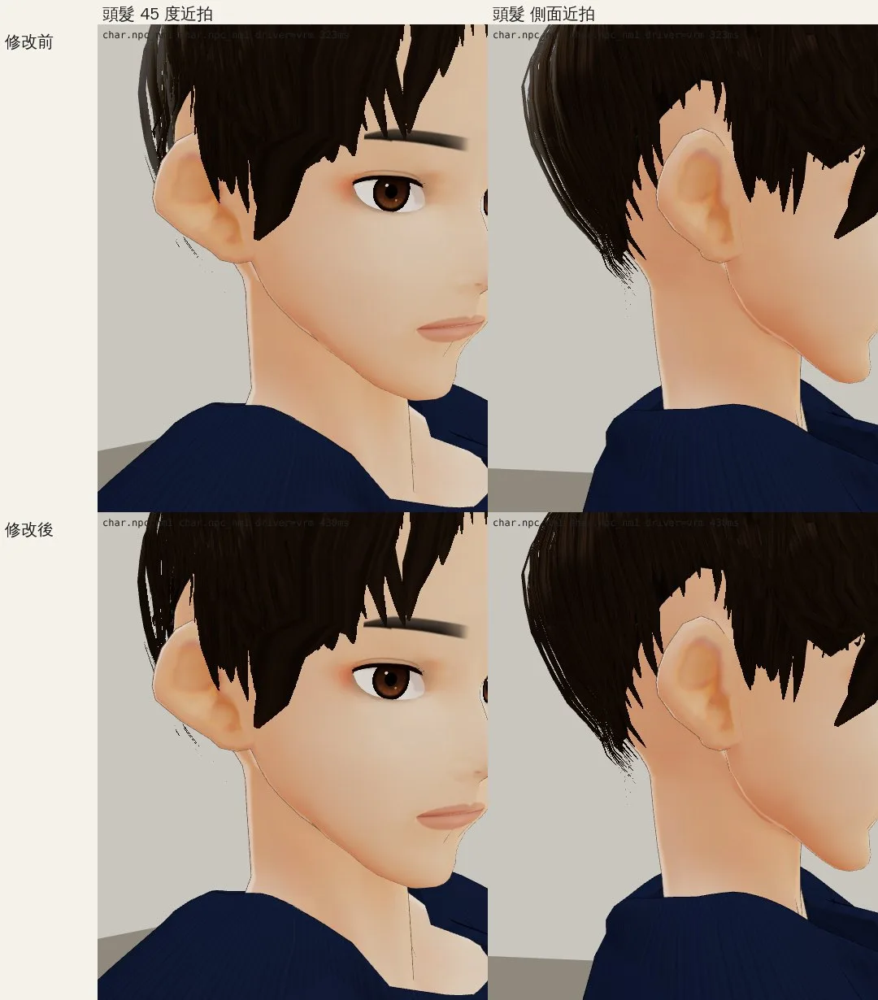

# 頭髮的 MatCap 白邊（LAWWW2-C，2026-10-17；LAWWW-C 排的工作）

## 問題
- VRoid 樣本的頭髮材質帶一張 MatCap（VRM 0.x MToon 的 `_SphereAdd`，樣本名「Matcap_RimHair」：黑底、邊緣一圈亮）。
- 在遊戲的燈光下，髮梢邊緣會出現一條一條白色的髮絲；長髮的外側最明顯。

## 改法
- 工具：`tools/char_strip_hair_matcap.py`。
  - 只刪頭髮材質（名字結尾 `_HAIR`）的 `_SphereAdd`。
  - 只改 glTF 的 JSON 區塊；網格、骨架、貼圖、臉、衣服一個位元組都沒動。
- 改了 11 個檔（`assets/models/char/second_ai/`），每個檔改一個材質：

| 檔案 | 材質 |
|---|---|
| `bl_zhe.vrm`（阿哲） | Z01_HairCard_HAIR |
| `bl_classmate_bohan.vrm`（柏翰） | B01_HairCard_HAIR |
| `bl_kexin.vrm`（可昕） | K01_HairCard_HAIR |
| `bl_npc_nf1`～`nf4.vrm`、`bl_npc_nm1`～`nm4.vrm`（路人） | NF1～NF4、NM1～NM4_HairCard_HAIR |

- 沈沛珊、吳芯慈、品妤、阿勳的頭髮材質本來就沒有 MatCap，沒有改。
- 韋綸：開發分支上那一版有 MatCap；新的第七版在 Blender 端已經關掉，跟著第七版一起交。

## 前後近拍（遊戲的渲染器 `test_charlook.html`，同一個燈光；上排修改前、下排修改後）
- 要看的是髮梢邊緣：修改前有一圈白色亮邊，修改後沒有。
- 不是真機。

### 阿哲

### 柏翰

### 可昕

### 路人（女，nf1；nf2～nf4 同一個材質設定）

### 路人（男，nm1；nm2～nm4 同一個材質設定）

