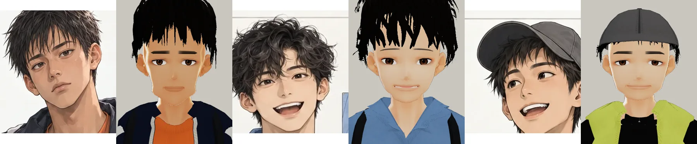
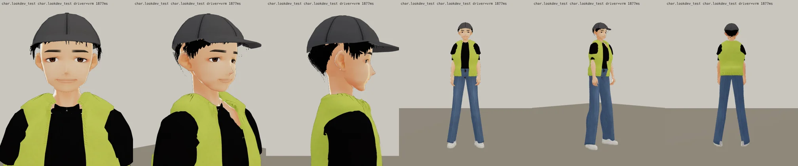
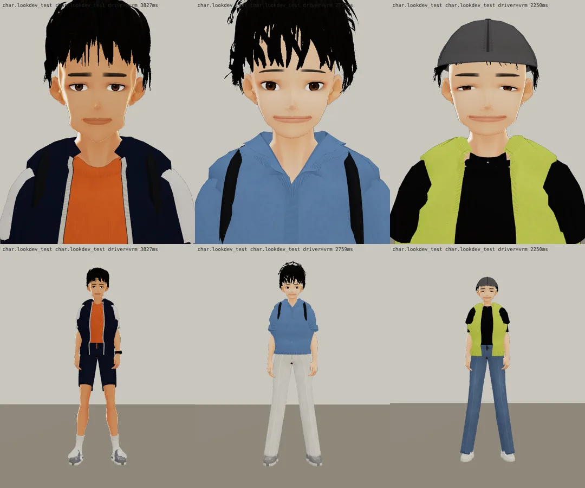

# v8：表情一輪（BB_201 第 6 節；LAWWW2-C 2026-10-17 13:5x UTC；等 BB-C 驗收）
- 嘴窄、唇色淡；上眼皮不壓（Fcl_EYE_Joy 0.42 → 0.18）、Fcl_MTH_Fun 0.55；眉毛粗、尾巴往下。
- 三人臉部近照和立繪頭部並排（左立繪、右 3D；韋綸、唐睿、家豪）：
  
- 遊戲渲染器：
- 還沒改：衣服（下一步，照 BB_201 第 2～4 項）、身材（做衣服時一起加）。

---

# 家豪學長（econ_jiahao） 3D v7：臉分開＋待機臉帶笑（BB_201 第 0 節第 1、2 項；LAWWW2-C 2026-10-17 13:5x UTC；等 BB-C 驗收，D59）

- 這一版只改臉（BB_201 優先順序第 1 項）：臉最寬最圓、下巴最短；眼睛小一點、眼尾往下；粗眉；待機臉烘 Fcl_MTH_Fun 0.75＋Fcl_EYE_Joy 0.50（笑眼）。
- 做法：
  - 臉型參數 `tools/blender/char_second/jiahao_face.py`；
  - 待機臉用 `vrm_finish2.py` 的 `VRM_REST`，把表情的一部分烘進基本形。
- 三個人並排（上：臉正面，下：全身；左到右韋綸、唐睿、家豪）：
  
- 遊戲渲染器：
  
- 上一版：
  
- 還沒改（BB_201 第 2～6 項，下一步）：
  - 韋綸：短袖連帽風衣、安全帽；
  - 唐睿：polo 領、便利貼；
  - 家豪：薄背心；
  - 上衣像連帽衫（照沛珊第十版的領口做法）；
  - 頭髮、身材、鞋。

---

# 家豪學長（econ_jiahao） 3D v5（LAWWW2-C，2026-10-17；等 BB-C 驗收，D59）
- VRM：`assets/models/char/second_ai/bl_econ_jiahao.vrm`；頭髮沒有 MatCap。
- 穿搭：螢光綠背心外套＋黑 T、牛仔褲、白球鞋、帽子（帽簷、按扣、六片帽身）。
- 截圖：
  - `look_*.webp`：遊戲渲染器 test_charlook，待機、走路、坐下；
  - `blender_*.webp`：Blender 預覽。
- 已知問題：帽子下的髮片做得簡單。
- 新遊戲從經濟系那一年開場（LIFE-LINE 第 7 組），經濟系人物提前交件。
