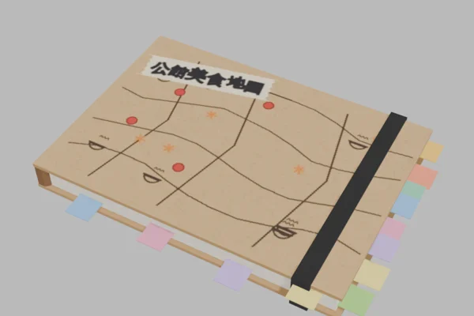
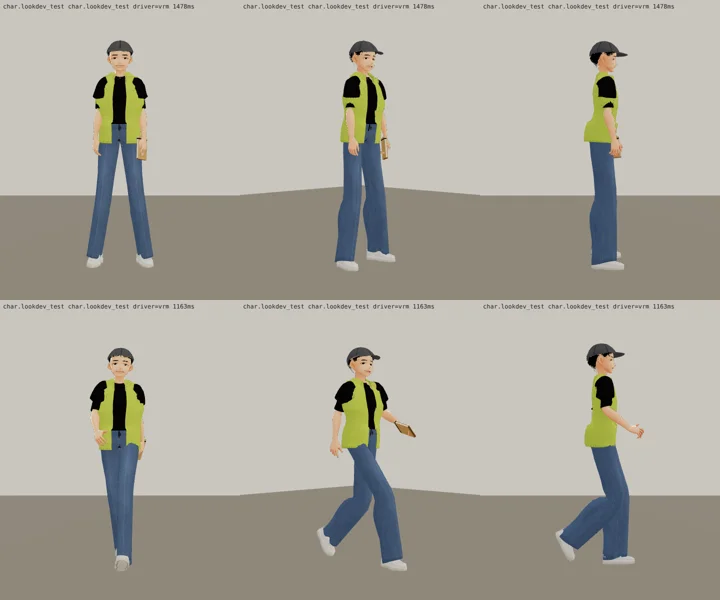
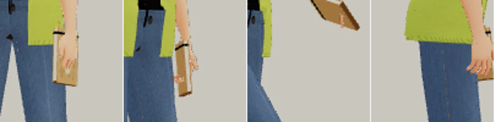
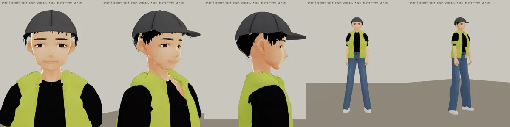

# 「公館美食地圖」筆記本（BB_109 識別物；BB_201「有的話拿在手上」；LAWWW2-C 2026-10-17 19:4x UTC；等 BB-C 驗收，D59）
- 模型：`assets/models/char/second_ai/notebook_foodmap.glb`（`tools/blender/char_second/prop_foodmap_notebook.py`，274 個三角形、42 KB）。
  - A6 左右的硬殼筆記本（18.5×13×1.8 cm）、牛皮紙封面；
  - 封面上手畫的地圖：彎彎的路、紅色圓點（去過的店）、冒熱氣的小碗；
  - 一條紙膠帶標籤「公館美食地圖」（他自己取的外號，不是店名）；
  - 書口和上緣冒出一排彩色索引貼（寫滿了的樣子）、一條黑色鬆緊帶；
  - 圖是本作用 PIL 畫的，沒有真實店名、商標（D77）。
- 拿法：照遊戲現有的資料夾配件（`folder`）——左手、平拿；站著時直拿在身側，走路時跟著手擺。
- 接進遊戲（LAWWW-C）：`docs/art-rebuild/second_ai/patches/props_foodmap_jiahao.js`（`PROPS.DEF.foodmap`＋manifest），`CHARACTERS.econ_jiahao.char3d.props` 加 `'foodmap'`。
- Blender 預覽：
- 遊戲渲染器（test_charlook，v10 的 VRM＋上面的 patch；上排待機、下排走路）：
- 手的特寫（待機正面、待機 45°、走路 45°、側面）：
- 還沒做：拿起來翻開的動作（只有拿著）；遊戲內截圖要等 LAWWW-C 接進去。

---

# v10：衣服＋表情（BB_201 第 3、7 節；LAWWW2-C 2026-10-17 14:2x UTC；等 BB-C 驗收）
- 背心（第 3 節「薄的、像隊輔或工作人員的背心」）：
  - 布薄、下襬平（羅紋 4.5 cm → 1.6 cm）、前面敞開、比身體寬鬆（寬鬆量 0.95 → 0.55，下擺不收）；
  - 領口改成薄的滾邊（第九版羅紋 2.2 cm、比身片厚 3 mm，看起來像一圈立起來的針織領）；
  - 肩膀往下沉 2 cm、袖子往內 3.5 cm。
- 表情（第 7 節建議）：待機臉加 `Fcl_MTH_Joy` 0.35（嘴角往上、露一點牙）。
- 頭髮：帽子下面露出來的頭髮和韋綸一樣加密、耳朵上面貼頭。
- 遊戲渲染器：
- 上一版（表情一輪 v8）：
- 四個人並排（同一個鏡頭，看身高；左到右韋綸 176、唐睿 177、家豪 170、魏教授 172）：
  
- 臉正面（同上順序）：
  
- 還沒做：「公館美食地圖」筆記本（第 3 節：沒時間可以之後再加）。

---

# v8：表情一輪（BB_201 第 6 節；LAWWW2-C 2026-10-17 13:5x UTC；等 BB-C 驗收）
- 嘴窄、唇色淡；上眼皮不壓（Fcl_EYE_Joy 0.42 → 0.18）、Fcl_MTH_Fun 0.55；眉毛粗、尾巴往下。
- 三人臉部近照和立繪頭部並排（左立繪、右 3D；韋綸、唐睿、家豪）：
  
- 遊戲渲染器：
- 還沒改：衣服（下一步，照 BB_201 第 2～4 項）、身材（做衣服時一起加）。

---

# 家豪學長（econ_jiahao） 3D v7：臉分開＋待機臉帶笑（BB_201 第 0 節第 1、2 項；LAWWW2-C 2026-10-17 13:5x UTC；等 BB-C 驗收，D59）

- 這一版只改臉（BB_201 優先順序第 1 項）：臉最寬最圓、下巴最短；眼睛小一點、眼尾往下；粗眉；待機臉烘 Fcl_MTH_Fun 0.75＋Fcl_EYE_Joy 0.50（笑眼）。
- 做法：
  - 臉型參數 `tools/blender/char_second/jiahao_face.py`；
  - 待機臉用 `vrm_finish2.py` 的 `VRM_REST`，把表情的一部分烘進基本形。
- 三個人並排（上：臉正面，下：全身；左到右韋綸、唐睿、家豪）：
  
- 遊戲渲染器：
  
- 上一版：
  
- 還沒改（BB_201 第 2～6 項，下一步）：
  - 韋綸：短袖連帽風衣、安全帽；
  - 唐睿：polo 領、便利貼；
  - 家豪：薄背心；
  - 上衣像連帽衫（照沛珊第十版的領口做法）；
  - 頭髮、身材、鞋。

---

# 家豪學長（econ_jiahao） 3D v5（LAWWW2-C，2026-10-17；等 BB-C 驗收，D59）
- VRM：`assets/models/char/second_ai/bl_econ_jiahao.vrm`；頭髮沒有 MatCap。
- 穿搭：螢光綠背心外套＋黑 T、牛仔褲、白球鞋、帽子（帽簷、按扣、六片帽身）。
- 截圖：
  - `look_*.webp`：遊戲渲染器 test_charlook，待機、走路、坐下；
  - `blender_*.webp`：Blender 預覽。
- 已知問題：帽子下的髮片做得簡單。
- 新遊戲從經濟系那一年開場（LIFE-LINE 第 7 組），經濟系人物提前交件。
