# 路人：去掉紅色上衣、男女各 20 種、日劇穿搭（LAWWW2-C，2026-10-17）

## 使用者的指示（2026-10-17，P0；下一版發布一定要有）
1. 「臺大不要再有這麼鮮艷紅色的衣服上衣的女生，而且還有很多顆超醜的」
2. 「長得很像的路人真的太多了，很誇張，你不能只有這幾種」
3. 「路人數量要再加倍喔，而且請參考日劇穿搭」
4. 「男生女生各 20 種」
5. 「這個路人的修改是最優先工作，然後下一版發布就要有」

## 原因
- 預設（沒有 `?npcnew`）時，無名路人只用兩個 VRoid 樣本臉（`char.npc_f1／f2`，男 `m1／m2`），換 5 種衣服顏色。
- `src/story3d.js` 的 `extraSpec` 女生第 5 套 `['tee','#8c3b47']` 換色後是鮮紅色，每 5 個女路人就有 1 個。

修改前（舊的兩個樣本臉；左三、右三是紅色上衣）：
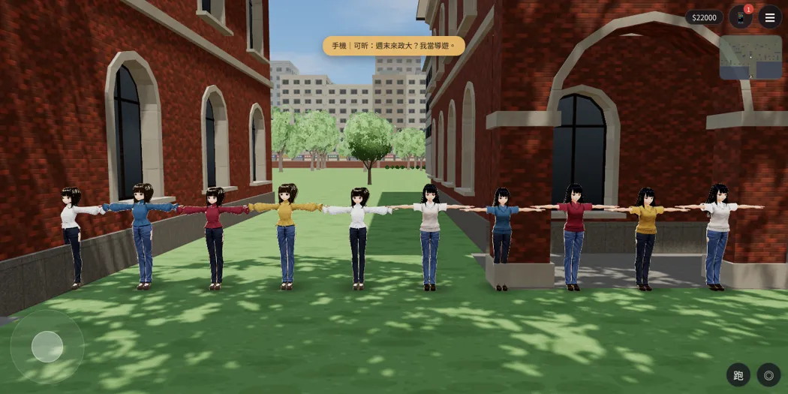
只換顏色（`#9aa392` 灰綠）的樣子：
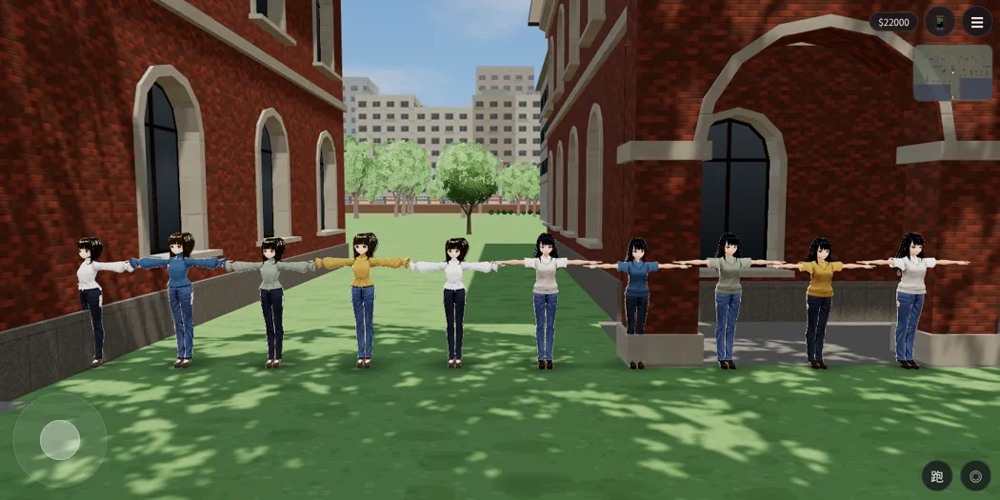

## 新路人底模（`assets/models/char/second_ai/bl_npc_nf*.vrm`、`bl_npc_nm*.vrm`）
- 工具：`tools/blender/char_second/npc.py`。
- 每個人的組合都不同：VRoid CC0 樣本、臉型參數、髮長、髮色、分線、身高、穿搭。
- 頭髮沒有 MatCap 白邊，頭頂的洞已補（`npc_hair_f／m`）。

| 批次 | 狀態 | 說明 |
|---|---|---|
| 第一批 nf1–4、nm1–4 | 已整合 | 2026-10-14 整合，`?npcnew` 才載入。nf4 珊瑚色 → 炭灰、nm3 磚紅 → 駝色（偏紅，重建） |
| 第二批 nf5–8、nm5–8 | **這次交** | 基本款：V 領針織衫＋寬褲、襯衫布＋牛仔褲、黑 T＋橄欖褲、平頭曬黑的運動型…… |
| 第三～五批 nf9–20、nm9–20 | 建模中 | 日劇穿搭：敞開的開襟衫／襯衫＋T 恤、長裙／中長裙／及膝裙、寬褲、樂福鞋；低彩度，不用紅色 |

第一、二批在遊戲裡（開發分支 `adoring-meitner-mqzst8` 工作樹，套了下面的 patch）：
- 上排女生 nf1–8，下排男生 nm1–8。
- 動畫還沒載入，所以是 T 字姿勢。
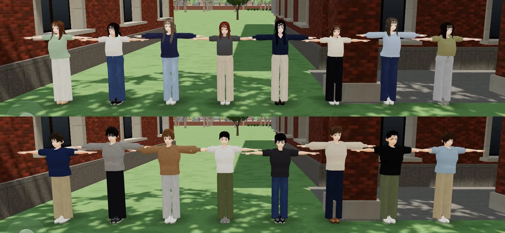

日劇穿搭的第一個（nf9，Blender 預覽）：米色開襟針織衫、白 T、深藍長裙、棕樂福鞋。
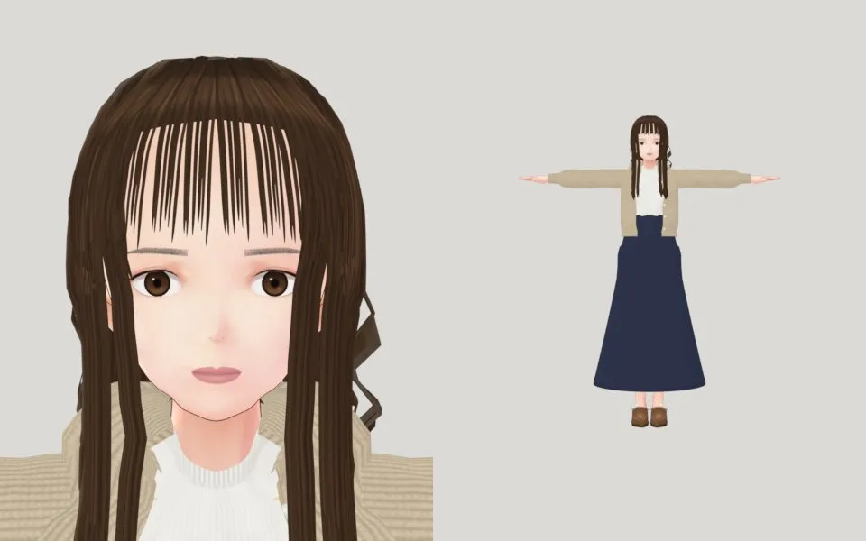

## 給 LAWWW 的整合（你的檔案）：`docs/art-rebuild/second_ai/patches/npc_crowd_batch2.patch`
1. `src/story3d.js`：`extraSpec` 的 `['tee','#8c3b47']` → `['tee','#9aa392']`。
2. `src/assets3d.js`：
   - 新路人底模**預設載入**（`?npcold` 才回到舊的）；
   - 加 `char.npc_nf5–8`、`npc_nm5–8`。
3. `src/character3d.js`：`AMB_ANON` 只用新的底模，舊的四個樣本不再給無名路人用（有名字、要換色的人物照舊用 `AMB`）。

遊戲裡檢查（同一個工作樹，預設網址，校園 12:00）：
- 19 個路人分到 16 種模型，最多重複 2 次；沒有舊樣本臉。
- 畫面上看得到的數量是引擎的距離剔除決定的。

**載入**：每個約 2.5 MB。到 40 個（約 100 MB）時，不能開場全部預載，要分批輪替（LAWWW 決定做法）。

## 第三批：日劇穿搭（nf9–20、nm9–20；2026-10-17 10:3x）
- manifest 條目：`docs/art-rebuild/second_ai/patches/npc_manifest_batch3.js`（LAWWW-C 的格式）。
- 做法：`tools/blender/char_second/npc_layered.py`。
  - 敞開的開襟衫或襯衫＋T 恤（芯慈的開襟做法）。
  - A 字長裙、中長裙、及膝裙（芯慈的裙子，只綁腰臀與大腿，坐下時不炸開）。
  - 顏色低彩度，不用紅色。

女生 20 種（遊戲裡；上排 nf1–10、下排 nf11–20；T 字姿勢是因為動畫還沒載入）：
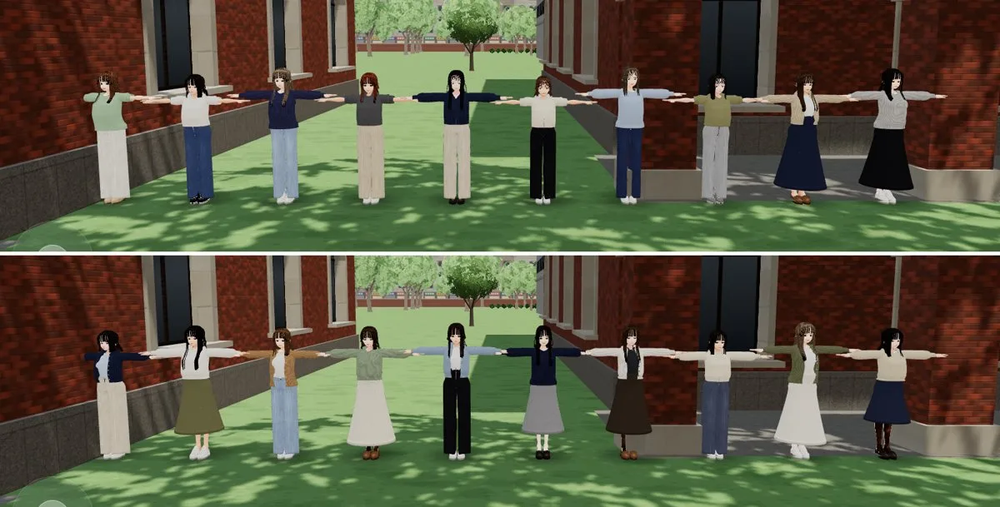

男生 20 種，第一版：
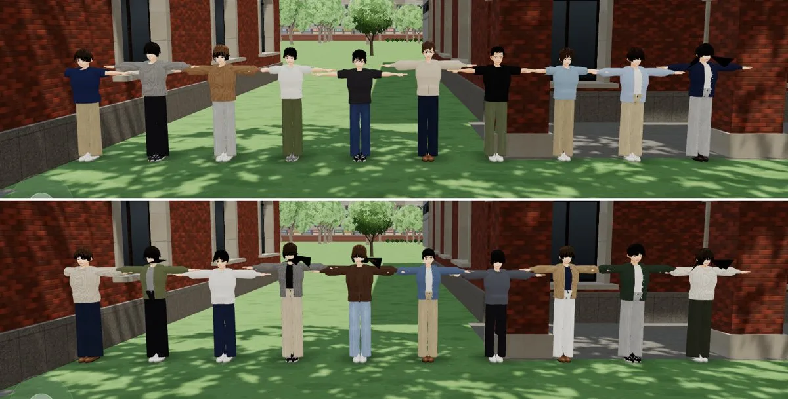
- **問題**：nm10、nm12、nm14、nm15、nm20 的耳後、後腦岔出一撮長髮，遊戲裡變成黑色翅膀。
- **處理**：髮尾長度限制在第一批沒出問題的範圍（≥ −0.026）、換隨機種子，重建中。這 5 個之後另交。
- nm16：前兩版臉部擬合失敗（`h01_face.slit_fit` 嘴縫分類），第三版臉的參數和 nm20 相同；髮型、穿搭、身高不同。

## 第四批：男生 5 個的頭髮翅膀修好（nm10、nm12、nm14、nm15、nm20；2026-10-17 11:1x）
- manifest 條目：`docs/art-rebuild/second_ai/patches/npc_manifest_batch4.js`（和第三批同一段）。加完男女各 20 種到齊。
- **真正的原因**（`tools/blender/char_second/npc_hair_m.py` 的 `card()`）：髮片的寬度＝旁邊 6.4° 那一條的距離。耳朵後面那一條往下找髮尾高度時量到耳朵外緣，距離跳到 10 cm 以上，整片髮片變成往外的翅膀。
  - 前三次只限制髮片的中線（髮尾長度、離頭中心、離頭皮），中線拉回來了，寬度沒有，所以 nm15、nm20 還在。
  - 第四次：寬度最多 2.4 cm（正常的地方 1.1～1.5 cm）。
- 修之前（Blender 預覽，左到右 nm15、nm12、nm20；nm12 在第三次已經好了）：
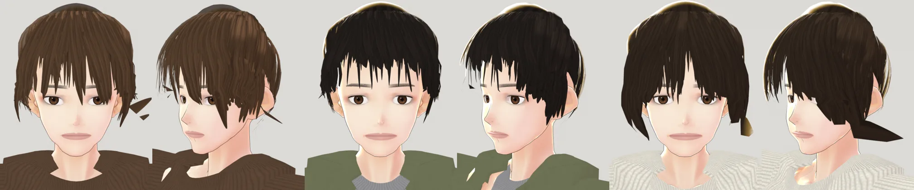
- 修之後，遊戲渲染器（`test_charlook.html`，上排 nm15、下排 nm20；側面、背面都沒有翅膀）：
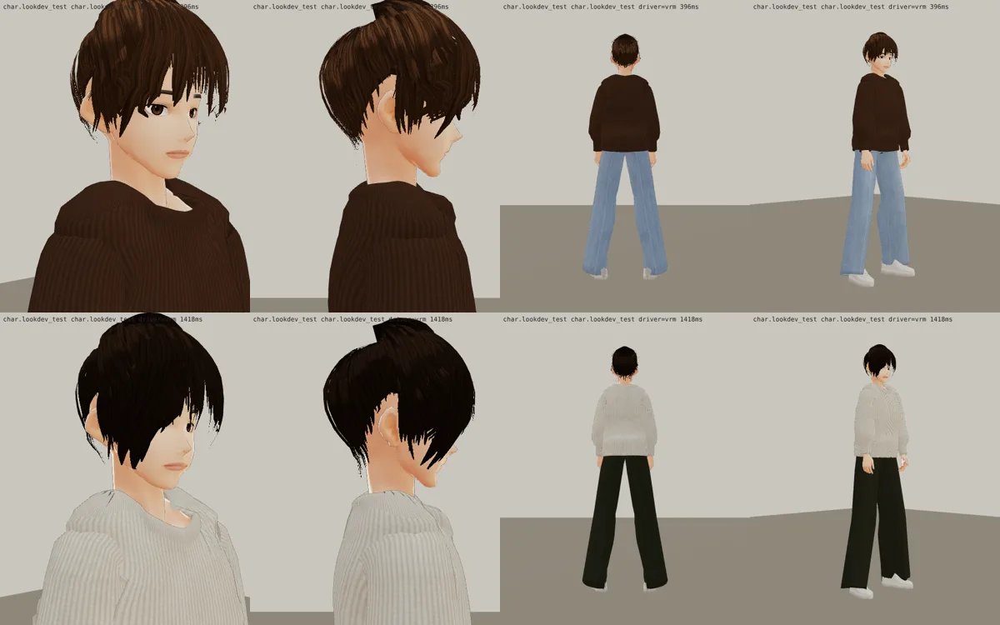
- nm10、nm14 在第二次（離頭中心的限制）就好了；nm12 在第三次。這 5 個的 VRM 都已經放進 `assets/models/char/second_ai/`。
- 沒做：遊戲內 20 人排排站重拍（LAWWW-C 整合時拍）。

## 第五批：日劇髮型（33 人；2026-10-17 11:3x～12:4x UTC）
- 使用者 2026-10-17：「你可以參考日劇的男女主角的髮型嗎」。
- 理解：參考日劇裡大學生、年輕上班族常見的髮型**種類**，不照任何真實演員的臉或造型。
  - 穿搭、髮色、長度照原本；主要角色照 2D 立繪，不改。
- 樣式表：`tools/blender/char_second/npc.py` 的 `JP_STYLE`。產生器的參數在 `npc_hair_f.py`、`npc_hair_m.py` 開頭。

| 樣式 | 誰 |
|---|---|
| 女：空氣瀏海（シースルーバング） | nf2、nf3、nf6、nf12、nf13、nf16、nf20 |
| 女：斜瀏海（分線那邊露出額角，另一邊撥到眼尾） | nf1、nf4、nf7、nf11、nf17、nf18 |
| 女：中分沒有瀏海（センターパート，臉旁髮先撥到眼睛外面才往下） | nf5、nf9、nf10、nf15、nf19 |
| 女：厚瀏海 | nf8、nf14 |
| 女：外ハネ（髮尾外翻） | nf2、nf4、nf6、nf7、nf13、nf18、nf20 |
| 女：ゆる巻き（大波浪） | nf1、nf3、nf9、nf15、nf17、nf19 |
| 男：中分（センターパート，前面的髮尾停在髮際線） | nm8、nm9、nm10、nm14、nm18 |
| 男：蘑菇頭（マッシュ） | nm2、nm5、nm12、nm17 |
| 男：微捲燙（ゆるパーマ） | nm8、nm11、nm14、nm15、nm18、nm20（nm3 原本也是；10-22 改耳上短髮，見 `test_shots/npc_nm3_hair_1022/`） |
| 男：不變（清爽短髮、側分、平頭） | nm1、nm4、nm6、nm7、nm13、nm16、nm19 |

女生 20 人（Blender 預覽：臉正面＋45°；標籤是樣式參數）：
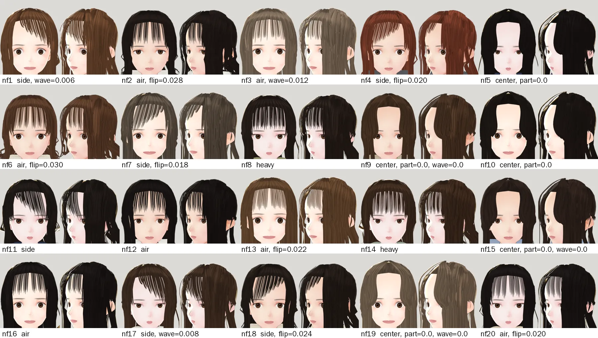

男生（灰格＝不變的 4 個，這次沒重建、沒有預覽）：
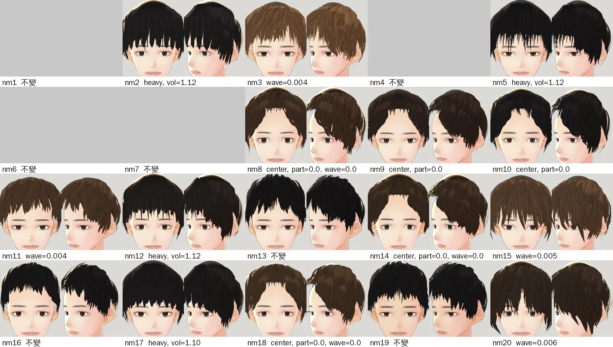

遊戲渲染器抽查（`test_charlook.html`；上到下 nf9 中分大波浪、nf6 外翻鮑伯、nm14 中分微捲、nm2 蘑菇頭；正面、側面、背面、45°）：
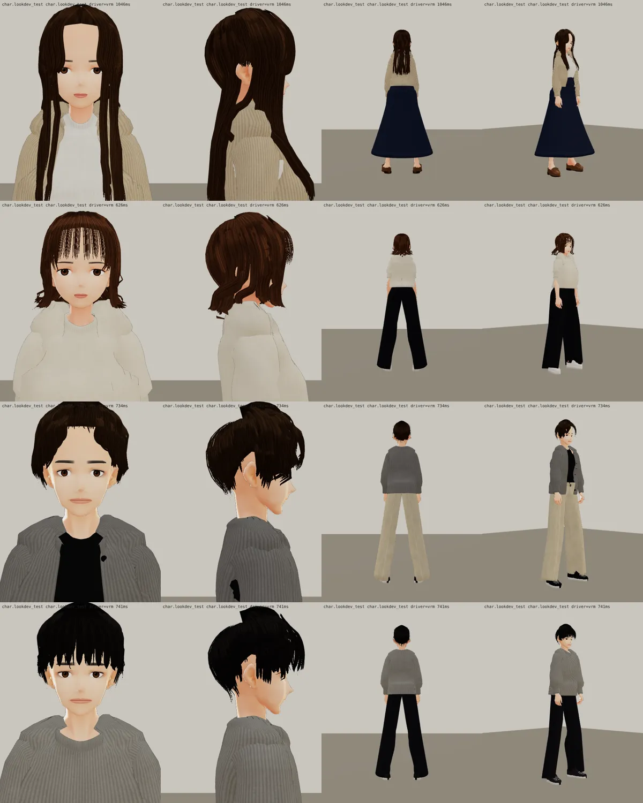

### 順便修好的舊問題
- 長髮兩側肩膀上一條條發亮的細線（之前 nf9、nf12、nf16、nf19 都有）：
  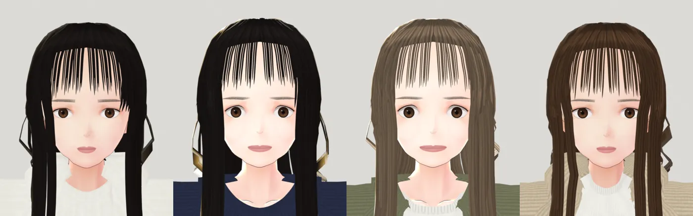
- 原因有三個，都在 `npc_hair_f.py`：
  - 背後的頭髮往兩邊散開 3 cm，散開的髮片在正面看是側著的，跑到臉旁頭髮的外面 → 改成 1 cm；
  - 前側的長髮推出衣服時，被 T 字姿勢的肩膀、手臂往外推到 15 cm，遊戲裡手放下來以後浮在肩膀兩邊 → 推完再收左右（探針：最外面 0.149 m → 0.111 m）；
  - 長髮的正側面（80–102°）掛在肩膀上折出去 → 只到耳下。

### 自己退件的版本
| 版本 | 問題 | 改法 |
|---|---|---|
| 外ハネ v1 | 每片在不同高度翻出去，像亂翹的細髮 | 外層的長短差、扭轉變小 |
| 斜瀏海＋外ハネ v1 | 正側面的髮片翻出去又被收回來，扭成一條發亮的 S | 正側面不翻 |
| 女中分 v1 | 臉旁髮平貼在額頭上，用空氣瀏海的貼圖：額頭上一排黑色梳齒 | 從分線一開始就往兩側撥、改用 lock 貼圖 |
| 女中分 v3 | 想蓋住額頭兩角，臉旁髮在眼睛的方位就往下：蓋住眼睛 | 回到 v2 的路徑 |
| nf9、nf15 | 分線偏一邊（−14°、10°）：中分的一邊從偏的分線出發，蓋到眼睛 | 中分的人分線歸零 |
| 男中分 v1、v2 | 簾狀髮片從額頭中間往下才往外撥，額頭只有 4 cm 高，還是一排刺；髮根擠在分線上，頭頂堆成尖角 | 前面的髮尾停在髮際線、髮片一開始就往兩側撥、髮根往前移 |

v1 的外翻和中分（上排鮑伯：前→後；下排男中分）：
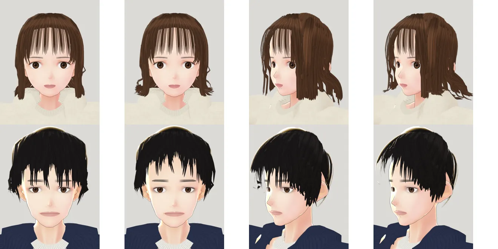

女中分 v1（梳齒）：
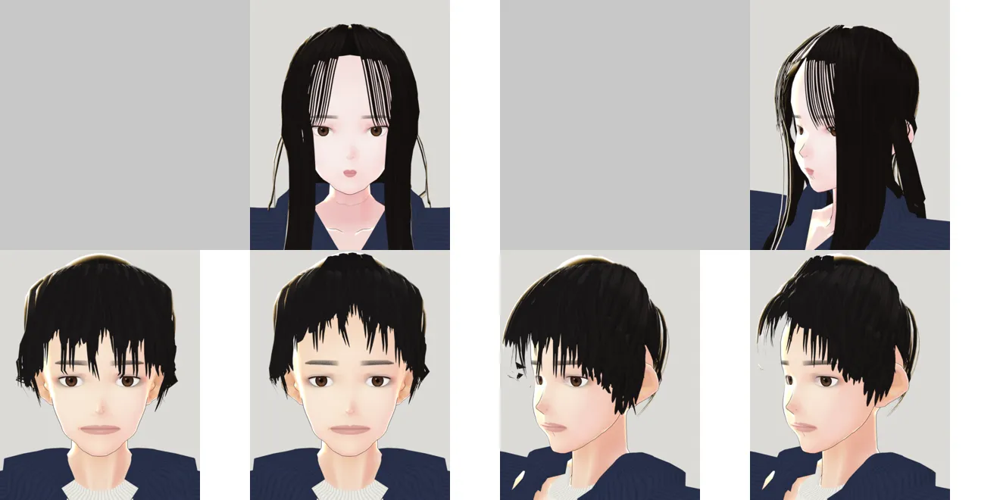

女中分 v3（蓋住眼睛，退件）：
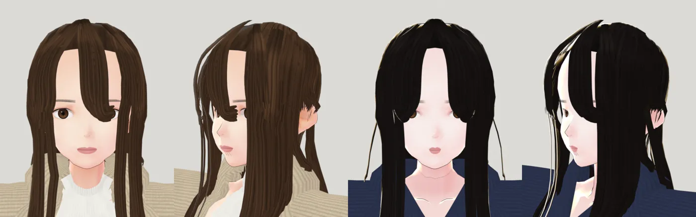

### 已知小問題（沒修）
- 男生太陽穴旁偶爾有一兩小塊髮尾的碎片：貼圖的髮尖斜著看，之前的版本就有。
- 部分女生耳朵旁邊偶爾一小段發亮的捲：外翻、波浪的髮片側著看。
- 中分的女生額頭看起來大一點：中分本來就露出額頭，這張臉的髮際線高。
