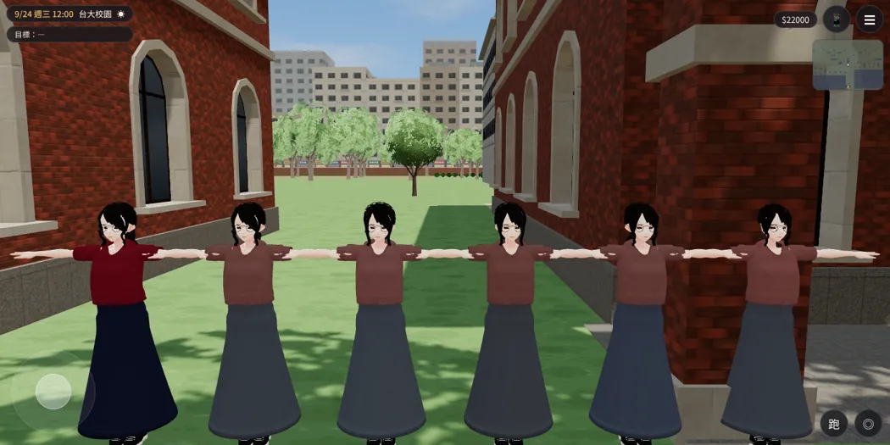
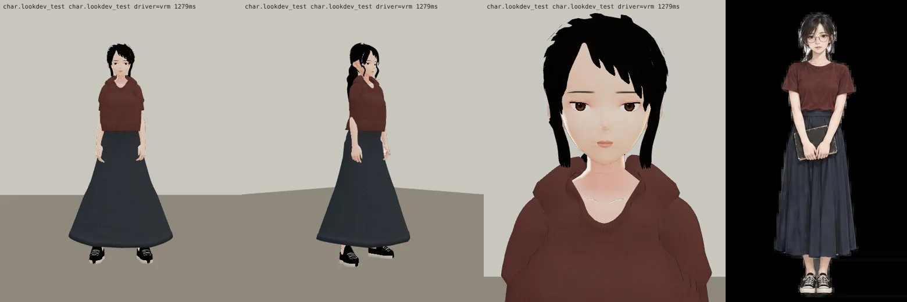

# 郭沛珊 3D 第五版：顏色、髮型、上衣照 2D 立繪（LAWWW2-C，2026-10-17；等 BB-C 驗收，D59）

## 使用者 2026-10-17 的指示（依序）
1. 「沛珊一定要換，她走日系風」→ 第二版（灰藍 T＋米白長裙），**作廢**。
2. 「我後悔了，她的 2D 圖不改的情況下，你給她在校園裡的人物就好。但重點是，你原本的人物的紅色也不是她 2D 圖的紅啊，她這個是酒紅耶，而且她還比較有品味」。
3. 「還是要日系風！！！！不要恢復」「原本的人物不對」「要照 2D 圖畫」。
4. 「量到差不多就用了，直接下一步」。

**定案**：日系風＝她現在的 2D 立繪那一套；2D 不改，3D 照 2D。

## 問題
- 遊戲裡的沛珊用的是這個 Blender 版（LAWWW 分支 `char.classmate_peishan`），不是換色模型。
- 第一版的顏色（T 恤 (118,38,44)、裙子 (36,42,64)）在遊戲裡畫出來：
  - T 恤是鮮紅 `#540510`；
  - 裙子幾乎是黑 `#0a0e1f`。
- 立繪（`assets/portraits/classmate_peishan/campus/neutral.webp` 取樣）：T 恤偏咖啡的暗酒紅 `#603835`，裙子深藍灰 `#343740`。

## 校正
- 在遊戲裡（校園 12:00）直接乘材質顏色，量畫面上的顏色，找到最接近立繪的係數，換算回貼圖顏色：
  - T 恤 (121,86,83) → 畫面 `#643b37`（立繪 `#603835`）；
  - 裙子 (80,86,94) → 畫面 `#343841`（立繪 `#343740`）。
- 校正截圖：最左是第一版，其他是不同係數。
  
- 第三版和立繪並排（遊戲渲染器 test_charlook；渲染器沒有掛眼鏡，遊戲裡會掛）：
  

## 第五版（照 BB-C bd659a4d 的驗收清單）
| # | 項目 | 改了什麼 | 結果 |
|---|---|---|---|
| 5 | 髮型（最優先） | 拿掉一排瀏海、額頭露出來、往後梳；分線改中間偏一邊（−10°）；臉旁碎髮從太陽穴出發、細、比較透；拿掉臉頰旁彎的短碎髮；臉旁長髮拉直 | 改了；臉旁兩條長碎髮可能還太黑、太明顯 |
| 6 | 髮色 | 純黑 → 深黑褐、亮面多一點 | 改了 |
| 2 | 上衣 | 合身、下擺紮進裙頭、領口收小、後領放低 | 紮進去了；**肩膀、領口周圍還是鼓一圈，像連帽衫**（手放下來時肩膀的布往脖子擠；下一版修權重） |
| 3 | 長裙 | 小腿中間、下擺收窄 | 站著時是 A 字；Blender 預覽看起來太窄，下一版放寬一點 |
| 4 | 坐下 | 沒改 | **還是一塊**（下一版） |
| 7 | 眼鏡 | 渲染器沒掛 | 等遊戲內截圖 |
| 8 | 鞋 | 沒改 | 下一版 |

## 還沒照立繪的地方（下一步）
| 項目 | 狀態 |
|---|---|
| 領口 | 立繪是細的圓領、合身 T 恤；3D 領口太厚，像連帽衫（BB_197 第 1 項） |
| 坐姿 | 坐下時長裙成一大塊（BB_197 第 3 項） |
| 頭髮 | 立繪是中分、低髮髻，臉旁垂幾綹；3D 是黑色短瀏海＋低馬尾 |
