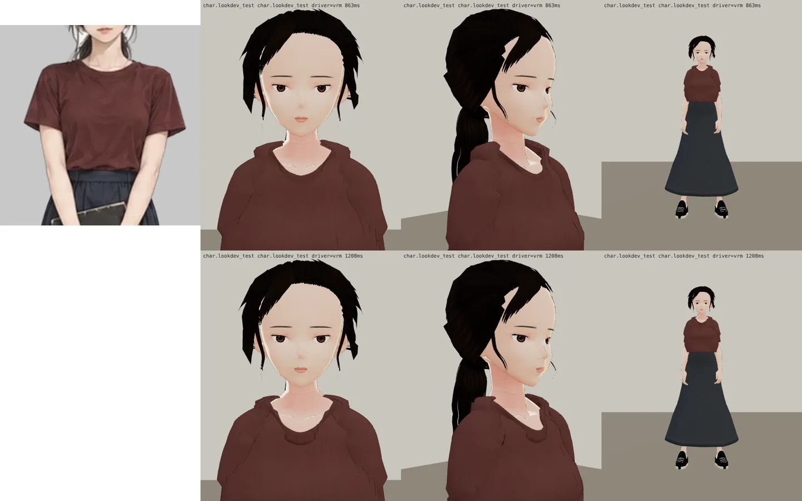
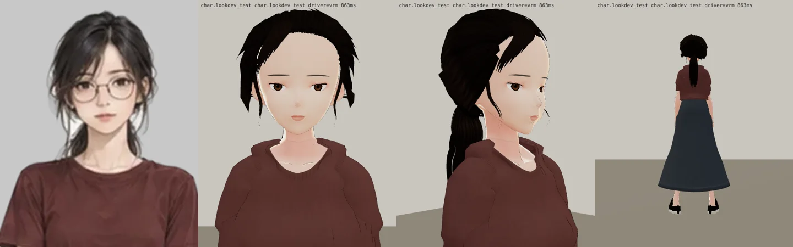
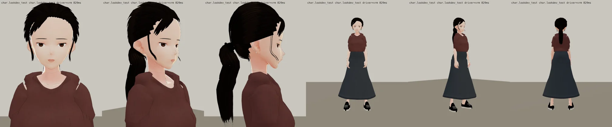
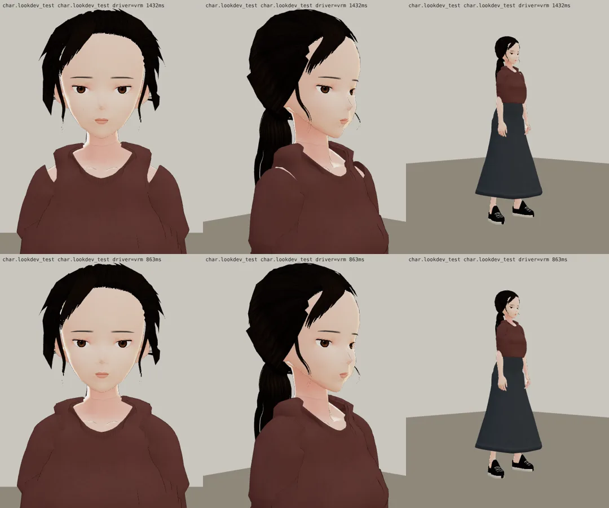
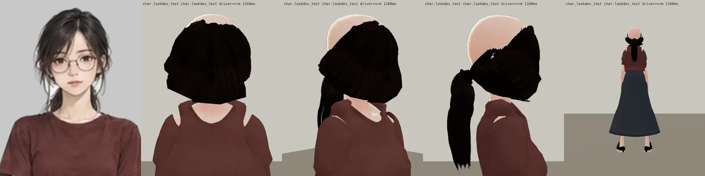
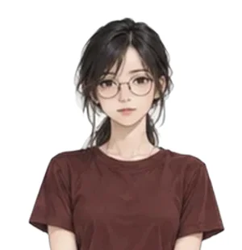
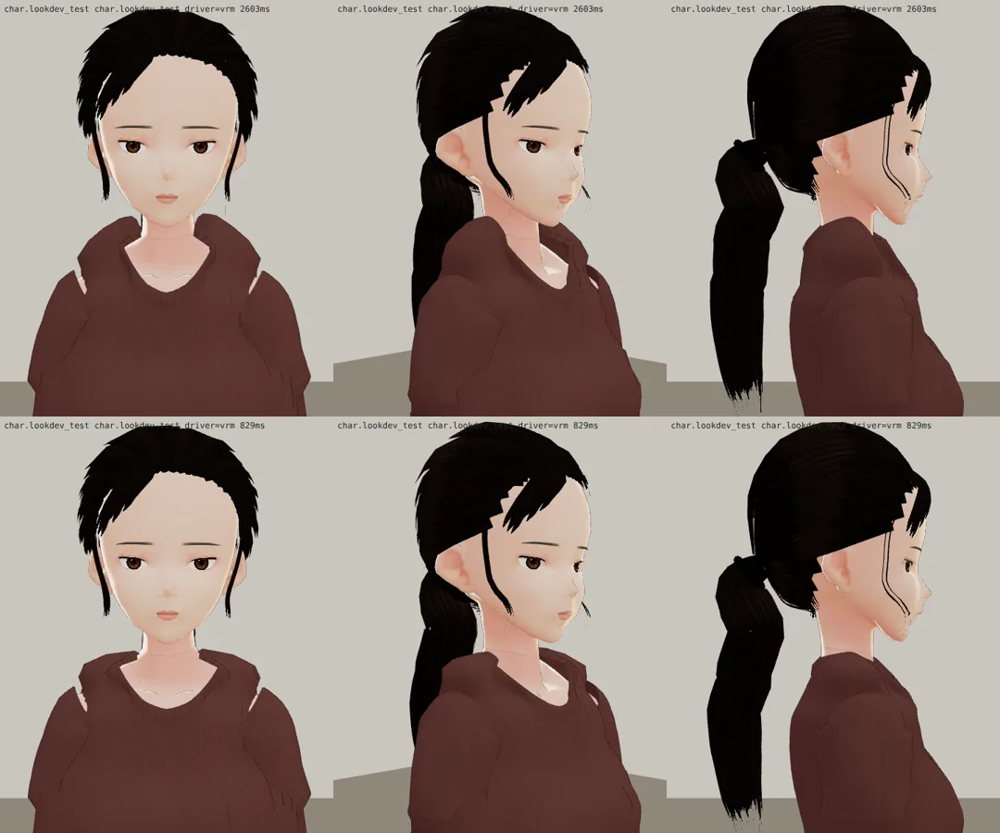
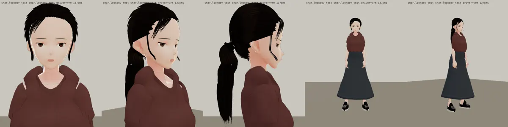

# 郭沛珊 3D 第十六版：只改上衣（BB-C 第十四版：頭髮通過；LAWWW2-C 2026-10-17 14:3x UTC；等 BB-C 驗收）

| BB-C 第十四版意見 | 第十六版 |
|---|---|
| 1. 領口立起來圍著脖子、肩膀到領口的布堆成一團 | 原因有兩個：①第九版改的「肩膀貼斜方肌」在靠脖子那頭變陡，羅紋立起來 → 改回原本的弧線；②上衣照 T 字姿勢做，肩膀比手放下來高 2～3 cm，布堆在肩膀上 → 肩膀上面低 2 cm（`SHOULDER_SAG`）。領口再開大、放低 1 cm（側頸點往外 8 mm） |
| 2. 胸口以下圓桶 | 貼身（合身 0.85 → 1.0、寬鬆量 0.42 → 0.30）＋胸口以下 7 道垂墜皺褶（`DRAPE`） |

左：立繪；上排第十四版、下排第十六版（臉正面、45°、全身）：

頭髮和第十四版相同（通過）。上衣通過後請 LAWWW-C 拍遊戲內截圖（眼鏡、白天、晚上）。

---

# 郭沛珊 3D 第十四版：BB-C 第八版、第十版意見（LAWWW2-C，2026-10-17 14:1x UTC；等 BB-C 驗收，D59）

立繪＋第十四版（遊戲渲染器 test_charlook：臉正面、45°、背面看馬尾高度）：

遊戲渲染器全部角度：

| BB-C 意見（第八版頭髮、第十版領口） | 第十四版 | 狀態 |
|---|---|---|
| 1. 鋸齒（瀏海下緣、髮際線前緣） | 瀏海每片 15 → 32 點；髮殼 64 → 128 欄、髮際線的髮尖 4 → 14 束細的；往後梳的髮片從髮際線後面 2% 開始（髮際線交給髮殼） | 改了 |
| 2. 馬尾太高 | 綁點 −24° → −44°（後頸、耳垂高度）；前面的髮片改走「經過後腦上方」的二次曲線 | 改了（第十一版直接壓低，頭髮從臉前面繞過去，退件） |
| 3. 蓬度：蓋住耳朵上緣、太陽穴每邊寬 1.5～2 cm、分線旁拱起 | 兩側蓬 0.55 → 0.9 cm；綁點低了以後兩側的頭髮從耳朵上面繞過去，蓋住耳朵上緣 | PARTIAL：比第八版寬，還不到 1.5～2 cm（第十二版壓低耳朵上方的髮際線＋1.2 cm，兩側翹成刺，退件） |
| 4. 臉旁碎髮像黑鐵絲 | 根部 1 cm、往下變細、末端分束；顏色亮一點（深黑褐）；中段微彎 | 改了 |
| 5. 斜瀏海像一整塊 | 分五綹（1.1～1.3 cm）、長短不一 | 改了 |
| 6a. 肩膀往外翹、接縫亮縫 | 原因：手放下來時袖子往下轉，肩膀上面和身片裂開（底下皮膚剪掉，看得到後面）→ 袖子從肩關節往內 3.5 cm 開始；落肩 0.098 → 0.088 | 改了（對照：shoulder_v13_vs_v14） |
| 6b. 羅紋領太厚太高 | 羅紋 2.2 → 1.6 cm、厚度減半 | 改了 |
| 6c. 胸口以下像厚帽 T | 寬鬆量 0.56 → 0.42、合身 0.62 → 0.85 | PARTIAL：貼了一點，還是比立繪的棉 T 鼓 |

第十三／十四版的肩膀（上：十三，洞；下：十四）：

第十一版（退件：馬尾綁點壓低後頭髮從臉前面繞過去）：

還沒做：眼鏡近照（lookdev 沒掛眼鏡）、晚上的照片、坐姿長裙。

---

# 郭沛珊 3D 第十版：頭髮照 BB-C 第五版意見＋領口（LAWWW2-C，2026-10-17 13:1x UTC；等 BB-C 驗收，D59）

立繪（參考）：

遊戲渲染器（`test_charlook.html`，LAWWW-C 分支；這不是遊戲內截圖）：

| BB-C 第五版意見 | 第八版 | 狀態 |
|---|---|---|
| 鬆一點，不要往後貼 | 頭頂、前額、兩側的髮殼再蓬 2～3 mm；第二層髮片多拱一點 | PARTIAL：比第六版鬆，但和立繪比還是貼（立繪耳朵旁邊蓬出來） |
| 分線那邊一片斜瀏海蓋住額角，另一邊塞到耳後；額頭露約七成 | 分線那邊三片疊在一起的斜瀏海（lock 貼圖、寬 1.8～2 cm），從分線旁往外撥到眉尾～眼尾外側；另一邊沒有瀏海 | 改了（第七版用空氣瀏海的貼圖，遊戲裡幾乎看不到，退件） |
| 拿掉太陽穴的白線 | 拿掉太陽穴往後梳的細碎髮；髮際線那端不用貼圖最尖的 3.5%（第七版髮際線一排白點） | 改了 |
| 臉旁 3～4 綹細的直碎髮到下巴，不要像鐵絲彎的鉤子 | 分線那邊兩綹、另一邊一綹，到下巴就停；少扭（原本下端轉過來往內勾）；拿掉耳前的短鉤 | 改了；側面看還是兩條細線 |

領口（BB_197 第 1 項「像連帽衫」）：第十版
- 第九版：只把領口離脖子的距離從 1.3 cm 改 0.8 cm、肩膀上面改貼斜方肌——沒有差別。
- 第十版：真正的原因是側頸點太高。領口兩側爬到脖子中段，比肩線高 3 cm，手放下來以後像帽沿。
  - 改法：側頸點低 2.2 cm、往外 6 mm；後領低 1.2 cm。
  - 結果：脖子露出來，比較像圓領 T 恤。
- 還有：肩膀和袖子接的地方有一條亮縫。

上排第八版、下排第十版（正面、45°、側面）：

還沒做（下一步）：肩膀的亮縫、坐下時長裙成一大塊、白色鞋頭、眼鏡近照（lookdev 沒掛眼鏡）、晚上的照片。

第八版（頭髮和第十版相同，領口高）：

第七版（退件：斜瀏海看不到、臉旁碎髮像黑色棒子、髮際線白點）：

---

# 郭沛珊 3D 第五版：顏色、髮型、上衣照 2D 立繪（LAWWW2-C，2026-10-17；等 BB-C 驗收，D59）

## 使用者 2026-10-17 的指示（依序）
1. 「沛珊一定要換，她走日系風」→ 第二版（灰藍 T＋米白長裙），**作廢**。
2. 「我後悔了，她的 2D 圖不改的情況下，你給她在校園裡的人物就好。但重點是，你原本的人物的紅色也不是她 2D 圖的紅啊，她這個是酒紅耶，而且她還比較有品味」。
3. 「還是要日系風！！！！不要恢復」「原本的人物不對」「要照 2D 圖畫」。
4. 「量到差不多就用了，直接下一步」。

**定案**：日系風＝她現在的 2D 立繪那一套；2D 不改，3D 照 2D。

## 問題
- 遊戲裡的沛珊用的是這個 Blender 版（LAWWW 分支 `char.classmate_peishan`），不是換色模型。
- 第一版的顏色（T 恤 (118,38,44)、裙子 (36,42,64)）在遊戲裡畫出來：
  - T 恤是鮮紅 `#540510`；
  - 裙子幾乎是黑 `#0a0e1f`。
- 立繪（`assets/portraits/classmate_peishan/campus/neutral.webp` 取樣）：T 恤偏咖啡的暗酒紅 `#603835`，裙子深藍灰 `#343740`。

## 校正
- 在遊戲裡（校園 12:00）直接乘材質顏色，量畫面上的顏色，找到最接近立繪的係數，換算回貼圖顏色：
  - T 恤 (121,86,83) → 畫面 `#643b37`（立繪 `#603835`）；
  - 裙子 (80,86,94) → 畫面 `#343841`（立繪 `#343740`）。
- 校正截圖：最左是第一版，其他是不同係數。
  
- 第三版和立繪並排（遊戲渲染器 test_charlook；渲染器沒有掛眼鏡，遊戲裡會掛）：
  

## 第五版（照 BB-C bd659a4d 的驗收清單）
| # | 項目 | 改了什麼 | 結果 |
|---|---|---|---|
| 5 | 髮型（最優先） | 拿掉一排瀏海、額頭露出來、往後梳；分線改中間偏一邊（−10°）；臉旁碎髮從太陽穴出發、細、比較透；拿掉臉頰旁彎的短碎髮；臉旁長髮拉直 | 改了；臉旁兩條長碎髮可能還太黑、太明顯 |
| 6 | 髮色 | 純黑 → 深黑褐、亮面多一點 | 改了 |
| 2 | 上衣 | 合身、下擺紮進裙頭、領口收小、後領放低 | 紮進去了；**肩膀、領口周圍還是鼓一圈，像連帽衫**（手放下來時肩膀的布往脖子擠；下一版修權重） |
| 3 | 長裙 | 小腿中間、下擺收窄 | 站著時是 A 字；Blender 預覽看起來太窄，下一版放寬一點 |
| 4 | 坐下 | 沒改 | **還是一塊**（下一版） |
| 7 | 眼鏡 | 渲染器沒掛 | 等遊戲內截圖 |
| 8 | 鞋 | 沒改 | 下一版 |

## 還沒照立繪的地方（下一步）
| 項目 | 狀態 |
|---|---|
| 領口 | 立繪是細的圓領、合身 T 恤；3D 領口太厚，像連帽衫（BB_197 第 1 項） |
| 坐姿 | 坐下時長裙成一大塊（BB_197 第 3 項） |
| 頭髮 | 立繪是中分、低髮髻，臉旁垂幾綹；3D 是黑色短瀏海＋低馬尾 |
