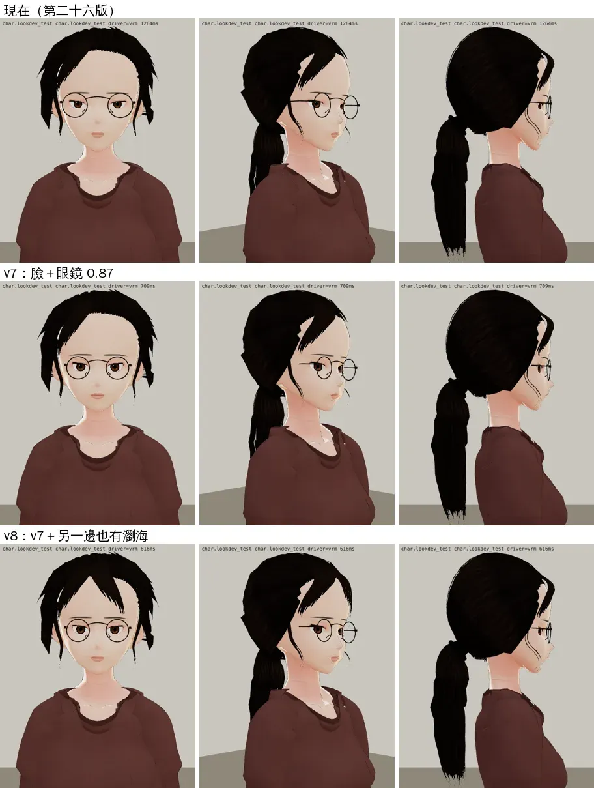
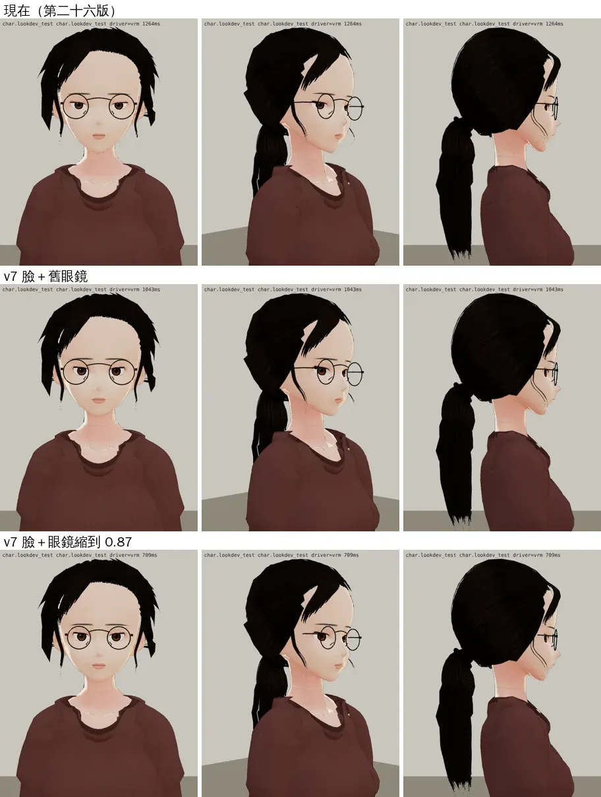
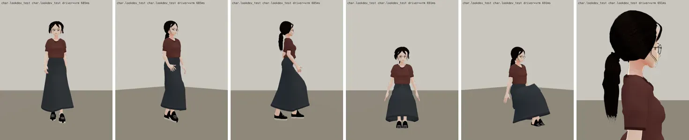
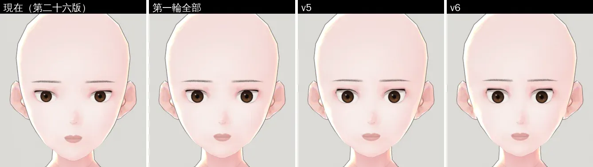

# 郭沛珊 3D 第二十七版：使用者「沛珊也是（好憨）」

帳號 A 的 LAWWW2，2026-10-22 04:0x～04:4x UTC。

- **狀態**：LAWWW 驗收通過（10-22 04:4x，D100 第 6 點），已接進開發分支 `7e00ad05`，v9.10.5 發布。
- **起因**：使用者 10-22 04:0x 直接說「林芷若3d好憨 沛珊也是」（UA-LAWWW2-1022-01）。
  - 使用者 10-17 暫停了人物修改；這件是使用者自己提的，所以這兩位解除暫停。
  - 名字、身高、低馬尾、酒紅 T 恤、深藍長裙、細圓框眼鏡都照通過的參考圖，不動。

## 為什麼看起來憨（第二十六版，遊戲渲染器）

在臉部模組 `h01_face` 的座標裡量：

| | 第二十六版 | 一般成人／參考圖 | 第二十七版 |
|---|---|---|---|
| 內眼角距離 ÷ 眼寬 | **1.45** | 約 1.0 | 1.10 |
| 眼高 ÷ 眼寬 | 0.40 | 0.45～0.5 | 0.46 |
| 額頭（髮際到眉）÷ 眉到下巴 | **0.76** | 參考圖 0.51 | 中間露出一個倒 V（兩側被瀏海蓋住） |

1. **眼睛小、分得很開**：再套一副 84 mm 的大圓框，鏡片裡像兩個小點。
2. **眉毛離眼睛遠、下半臉長**：人中長、下巴長，看起來像在發呆。
3. **額頭一整片**：頭髮全往後梳，只有分線那一邊有一片瀏海。參考圖是中分、兩邊都往外撥。

## 改了什麼

### 臉（`tools/blender/char_second/peishan_face.py` 的 `PEISHAN`）

| 參數 | 第二十六版 | 第二十七版 |
|---|---|---|
| `EYE_IN` | 0.0026 | 0.0095 |
| `EYE_SX`／`EYE_SZ` | 1.00／0.70 | 1.10／0.80 |
| `IRIS_FRAC` | 0.52 | 0.55 |
| `EYE_TILT` | 0.025 | 0.05 |
| `BROW_DROP` | 0.0042 | 0.0068 |
| `D_CHIN` | 0.008 | 0.003 |
| `MOUTH_DOWN` | 0.0020（預設） | 0.0005 |
| `FACE_NARROW` | 0.96 | 0.92 |
| `MOUTH_K` | 1.50 | 1.60 |
| `EYELINE_K` | 0.9 | 1.1 |

### 頭髮（`peishan_hair.py`）

- 分線另一邊也加四綹往外撥的瀏海，比分線那邊短一點。
- `HAIR_BANGS2=0` 可以回到第二十六版的單邊。

### 眼鏡（`glasses_peishan.py`）

- 鏡片中心距 84 → **72.7 mm**、鏡框半徑 23 → **21 mm**。
- 原因：眼鏡掛在兩顆眼球骨頭的中點，鏡片間距是固定的。眼睛往中間靠以後，舊眼鏡太寬，眼睛會偏到鏡片內側（見 `glasses_fit.webp` 第二排）。

### 試參數的方式

- `FACE_OVERRIDE` 環境變數，一次只改一樣、同鏡頭比。
- 第一輪 4 個版本、第二輪 2 個版本（`blender_face_rounds.webp`；光頭算圖，只看臉）。
- 變形檢查：最小 det J，眉毛那一段 0.14～0.2，沒有摺疊。

## 前後（遊戲渲染器 `test_charlook.html`；Playwright＋SwiftShader，不是 iPhone）

上：第二十六版（現在）；中：新的臉＋眼鏡縮小；下：再加兩邊的瀏海＝**第二十七版**。



眼鏡要跟著縮。上：第二十六版；中：新的臉＋舊眼鏡（眼睛偏到鏡片內側）；下：眼鏡縮到 0.87 倍：



走路、坐下（身體、衣服和第二十六版相同）：



Blender 光頭算圖（左到右）：第二十六版、第一輪全部、第二輪 v5、v6（v6 太過頭，沒用）：



## 重建、驗證

- 用寫回預設值的腳本、不帶任何環境變數重建，VRM、眼鏡 GLB 都和試出來的那一版**逐位元組相同**。
- 建置：

```bash
/opt/blenv/bin/python tools/blender/char_second/peishan.py -- - --stages stage0,face --blend <工作>/face.blend
/opt/blenv/bin/python tools/blender/char_second/peishan.py -- <工作>/v.vrm --from-blend <工作>/face.blend --stages clothes,hair
VRM_BASE=Darkness_Shibu python3 tools/blender/char_second/vrm_finish2.py <工作>/v.vrm assets/models/char/second_ai/bl_classmate_peishan.vrm 郭沛珊 '#3a2a22'
/opt/blenv/bin/python tools/blender/char_second/glasses_peishan.py
```

- VRM 3.09 MB（第二十六版 3.06 MB）。

## 接法（LAWWW）

- 換兩個檔，同檔名，manifest、程式都不用改：
  - `assets/models/char/second_ai/bl_classmate_peishan.vrm`
  - `assets/models/char/second_ai/glasses_peishan.glb`（＋`.json`）
- **兩個要一起換**：只換其中一個，眼鏡會對不準眼睛。
- 驗收：角色美術由 LAWWW 驗收（D100 第 6 點；D59 已作廢，交件時誤寫成 BB）。

## 還不到的地方（誠實寫）

- 眼睛往中間移了 5 mm，但眼球骨頭沒跟著移。眼睛轉動時虹膜繞著舊的中心轉，估計 ±10° 時偏不到 1 mm，還沒在遊戲裡量。
- 新加那一邊的瀏海，改了 BB-C 10-17 第七版「另一邊塞到耳後」的決定；LAWWW 驗收時照立繪改用新的。
- 臉的明暗還是很平：人物材質 `C.LOOK` 是 LAWWW 的檔，這次沒動。
- 真機沒看過；遊戲內（區域裡、劇情鏡頭）的截圖等 LAWWW 換檔以後拍。
