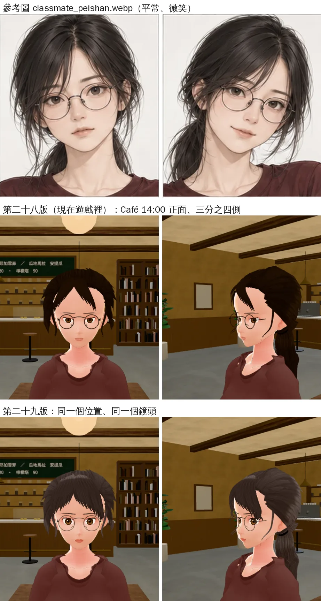
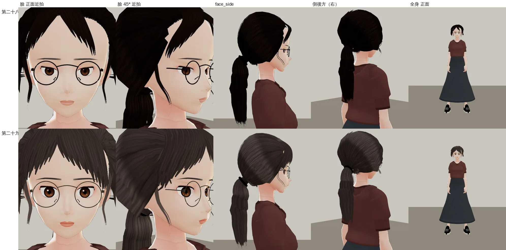
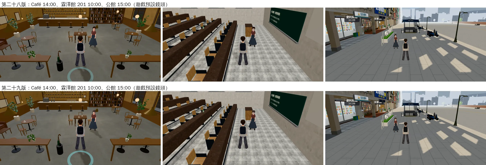

# 郭沛珊 3D 第二十九版：臉、頭髮重做

帳號 A 的 LAWWW2，2026-10-22 11:5x～12:5x UTC。

- **狀態**：交件；角色美術由 LAWWW 驗收（D100 第 6 點）。
  - 換三個檔（同檔名），程式、manifest 都不用改：
    - `assets/models/char/second_ai/bl_classmate_peishan.vrm`
    - `assets/models/char/second_ai/glasses_peishan.glb`（＋`.json`）
  - **VRM 和眼鏡要一起換**：鏡框變大、變細，舊眼鏡配新臉也看得過去，但新眼鏡才對得上參考圖。
- **起因**：使用者 11:5x 直接說「你花這麼多時間改沛珊長裙結果她人還是很醜 臉啊頭髮啊 醜死了」（UA-LAWWW2-1022-02）。
  - 04:4x 第二十七版（「好憨」那一次）只改了眼距和一邊的瀏海，LAWWW 那時驗收通過；LAWWW 11:59 已經把那次驗收作廢。
  - 這次照 LAWWW 11:59 的驗收格式交：遊戲內臉部近景和參考圖並排、逐項標對不對、Café 和教室一般距離各一張。

## 為什麼醜（第二十八版和參考圖並排看）

| 部位 | 參考圖 `classmate_peishan.webp` | 第二十八版 | 原因 |
|---|---|---|---|
| 髮色 | 深灰棕，看得出一束一束（中位數 sRGB 0.21, 0.18, 0.17） | 純黑一塊（遊戲渲染器量到 0.047, 0.024, 0.016） | 頭髮貼圖本身就近黑 |
| 瀏海 | 中分、往兩邊垂的八字瀏海，蓋住額頭兩側，中間露出到眉頭的窄倒 V | 額頭整片露出，幾根黑色尖刺 | 一根根 1.1～1.3 cm 的窄髮片，髮尾分成細尖 |
| 眼睛 | 大、上眼線清楚、有亮點 | 小、沒有神，像快睡著 | 基本形烘了 `Fcl_EYE_Close` 0.2（上眼瞼蓋住虹膜三分之一）；遊戲把眼睛的高光網格藏起來（`character3d.js` 的 `C.LOOK.hideEye`），虹膜貼圖裡的亮點只有 0.10×0.085 個虹膜半徑 |
| 眉毛 | 細、深、微彎，貼近鏡框 | 一條平的灰色帶子 | 眉峰 0.30、顏色偏灰 |
| 臉 | 鼻樑兩側有淡淡的影子、看得出唇色 | 整張臉一片白，鼻子只剩兩個鼻孔點，唇色很淡 | 臉是平塗，鼻樑沒有明暗 |
| 眼鏡 | 細的深灰金屬框，鏡片比眼睛大一圈 | 兩個粗黑圈蓋在臉上 | 框線 1.7 mm、近黑 |

## 改了什麼

### 頭髮（`tools/blender/char_second/peishan_hair.py`）

- **前面改成中分八字瀏海**：
  - 每邊 8 片 1.6～2.6 cm 寬、彼此重疊的髮片；貼圖整片不透明，只有髮尾分 4 束（新的貼圖格 `bangA`）。
  - 從分線旁邊的頭頂出發，越過髮際線時離額頭 1.5 cm（有蓬度）。
  - 裡面幾片停在眉頭上方、往外撥；越往外越長，最外面到顴骨、包住臉的兩側。
  - 舊的窄瀏海拿掉。
- **髮色**：
  - 整組往參考圖的深灰棕調亮、偏冷一點。
  - 頭髮的陰影色不要太紅（0.80, 0.70, 0.70 → 0.78, 0.74, 0.74）。
  - 髮絲紋路的對比降低：在遊戲的鏡頭距離不會變成雜訊。
  - 遊戲渲染器量到的中位數：0.204, 0.165, 0.149（參考圖 0.21, 0.18, 0.17）。
- 後腦、馬尾、臉旁碎髮的形狀不動，只跟著換顏色。

### 臉（`tools/blender/char_second/peishan_face.py`；`tools/blender/char/h01_face.py` 沒有改）

- **眼型**：基本形 `Fcl_EYE_Close` 0.2 → 0.06（`vrm_finish2.py` 要帶 `VRM_REST='{"Fcl_EYE_Close": 0.06}'`，量測和烘焙用同一個眼型）。
- **眼睛大一點**：`EYE_SX` 1.10 → 1.18、`EYE_SZ` 0.80 → 0.92；虹膜 0.55 → 0.58。
- **亮點**：
  - 虹膜貼圖的亮點放大到 0.19×0.16 個虹膜半徑，虹膜下半部亮一點。
  - 只在做沛珊時換掉 `h01_face` 畫虹膜的那一段（`paint_iris_v29`）。
- **上眼線、睫毛**：`EYELINE_K` 1.1 → 1.4、`LASH_L` 0.8 → 1.0。
- **眉毛**：細、深棕、微彎（`BROW_K` 0.82 → 0.78、`BROW_ARCH` 0.30 → 0.65、`BROW_A` 0.88 → 1.0）。
- **唇色**：珊瑚粉（`LIP_A` 0.75 → 0.90）；腮紅留多一點（`CHEEK_TINT_K` 0.6 → 0.3，參考圖有淡淡的紅）。
- **鼻子**（`paint_nose_v29`）：
  - 鼻樑兩側畫很淡的陰影，鼻頭下面的影子加深一點。
  - 左右對稱，遊戲裡光從哪邊來都不會怪。

### 眼鏡（`tools/blender/char_second/glasses_peishan.py`）

- 框線半徑 0.85 → 0.58 mm；鏡框半徑 21 → 23 mm。
- 顏色改成深的槍灰金屬（#2e2826 → #4f4a47、金屬度 0.30 → 0.45；遊戲沒有環境貼圖，上限 0.45）。
- 鏡片中心距 72.7 mm、節點名稱照舊。

## 逐項對照（LAWWW 11:59 的格式；這是我的判斷，LAWWW 驗收）



- 上：參考圖；中：第二十八版；下：第二十九版。
- 遊戲內 Café 14:00，同一個位置、同一個鏡頭（正面、三分之四側）。

| 項目 | 對／不對 | 說明 |
|---|---|---|
| 瀏海 | **形狀對，質感還不到** | 中分、往兩邊垂、中間露出到眉頭的窄倒 V 都有了；參考圖的髮尾很細很鬆、有幾根散在鏡框上，3D 的髮尾比較厚、比較齊 |
| 髮色 | **對** | 深灰棕、看得出一束一束；Café 的暖光下偏棕一點 |
| 眼睛 | **接近** | 張開了、有亮點、上眼線清楚；參考圖是比較成熟的杏眼、雙眼皮明顯，3D 還是比較圓的動畫眼 |
| 眉毛 | **對** | 細、深、微彎 |
| 唇色 | **對** | 看得出唇色；參考圖再淡一點、偏米粉色 |

## 遊戲渲染器（`test_charlook` 的燈，不是遊戲畫面）



- 上：第二十八版；下：第二十九版。臉正面近拍、45° 近拍、側面、側後方、全身。

## 遊戲內一般距離（遊戲的預設鏡頭）



- Café 14:00、霖澤館 201 教室 10:00、公館 15:00。
- 測試環境：Playwright＋SwiftShader，844×390（手機橫向）、像素比 2，**不是 iPhone**。
- 開發分支 `1ad1a710`：修改前＝原本的檔；修改後＝只換 VRM＋眼鏡（同檔名）。
- 【捷徑】沛珊是截圖腳本放的（`CHAR.build`＋`E.addNPC`，遊戲生成人物也是這兩個），不是照作息走過來的；路人藏起來。

## 沒有變的（LAWWW 說不能動的）

- 身體、衣服、骨架：和第二十八版逐項相同。
  - 只有頭髮側鏈 6 根骨頭的位置差 ≤ 0.12 mm（頭髮重做）。
  - 裙子輔助骨頭（第二十八版）照舊：最後一步一樣跑 `peishan_skirt_bones.py`。
- 表情：15 組、名字、preset 都一樣。
  - 只有 `Blink`、`Blink_L`、`Blink_R` 的幅度 80 → 94：眼型張開了，眨眼要多閉一點才閉滿（`vrm_finish2.py` 原本的公式）。
  - 遊戲渲染器拍過眨眼：閉滿。
- 身高 1.63、`glasses` 節點名、manifest 的 `armOut`／`armBack`／`armFwd`：不用改。
- VRM 3.09 → 3.38 MB（瀏海的髮片多了、頭髮貼圖重畫）。

## 重建、驗證

```bash
/opt/blenv/bin/python tools/blender/char_second/peishan.py -- - --stages stage0,face --blend <工作>/face.blend
/opt/blenv/bin/python tools/blender/char_second/peishan.py -- <工作>/v.vrm --from-blend <工作>/face.blend --stages clothes,hair
VRM_REST='{"Fcl_EYE_Close": 0.06}' VRM_BASE=Darkness_Shibu python3 tools/blender/char_second/vrm_finish2.py <工作>/v.vrm <工作>/g29.vrm 郭沛珊 '#3a2a22'
python3 tools/blender/char_second/peishan_skirt_bones.py <工作>/g29.vrm assets/models/char/second_ai/bl_classmate_peishan.vrm --back3 --kbumax 0.8 --kblmax 1.0
/opt/blenv/bin/python tools/blender/char_second/glasses_peishan.py
```

- 用這幾行從頭重做，和試出來的那一版位元組相同。
- 舊版開關：`PS_FACE_V=28`、`PS_HAIR_V=28`（`VRM_REST` 不帶）、`PS_GLASSES_V=28`。
  - 用舊版開關做出來，和 repo 裡原本的第二十八版 VRM、眼鏡 GLB 位元組相同（動手前先驗證）。

## 接法（LAWWW）

1. 換 `bl_classmate_peishan.vrm`、`glasses_peishan.glb`、`glasses_peishan.json`（同檔名）。
2. 腳本：`peishan_face.py`、`peishan_hair.py`、`glasses_peishan.py`（`h01_face.py`、`vrm_finish2.py` 沒改）。
3. 角色美術由你驗收（D100 第 6 點）；身體、衣服、骨架沒變，走路、坐下、上下樓梯和裙子輔助骨頭照舊。

## 還不到的地方（誠實寫）

- 瀏海的髮尾比參考圖厚、齊；參考圖那種散在鏡框上的細碎髮沒有做（3D 裡細髮在遊戲的距離會變成鋸齒點）。
- 後腦、馬尾還是一條一條的髮片，沒有參考圖鬆。
- 這次只改臉和頭髮：
  - T 恤的圓領還是像厚帽 T；
  - 臉的皮膚偏白、脖子偏紅（Café 暖光下更明顯），原本就這樣，沒動。
- 真機沒看過。
