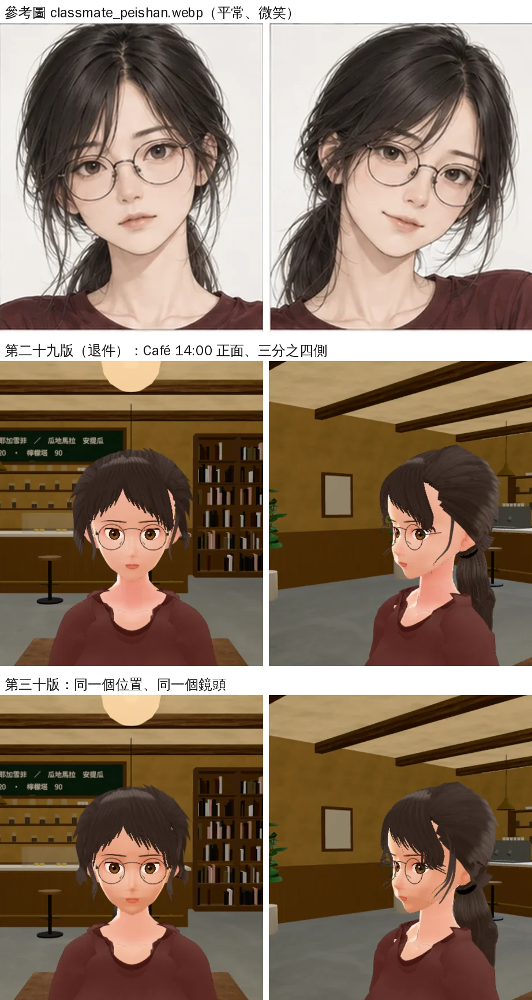
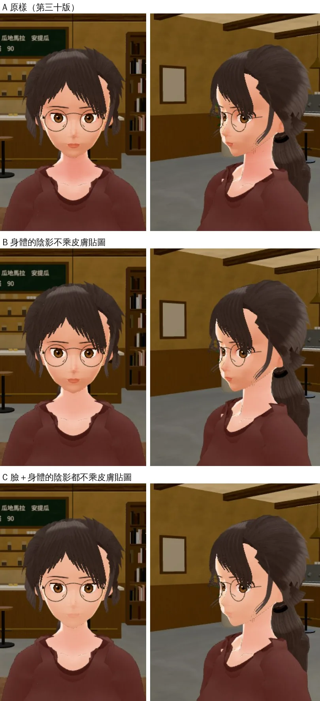
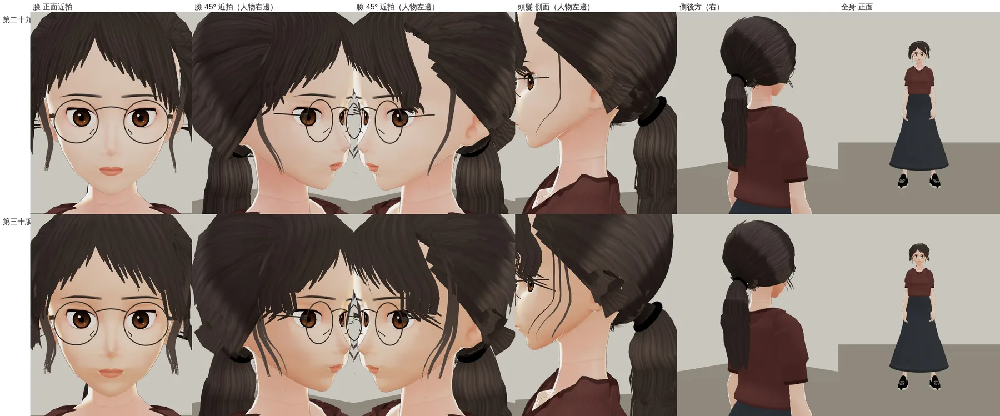
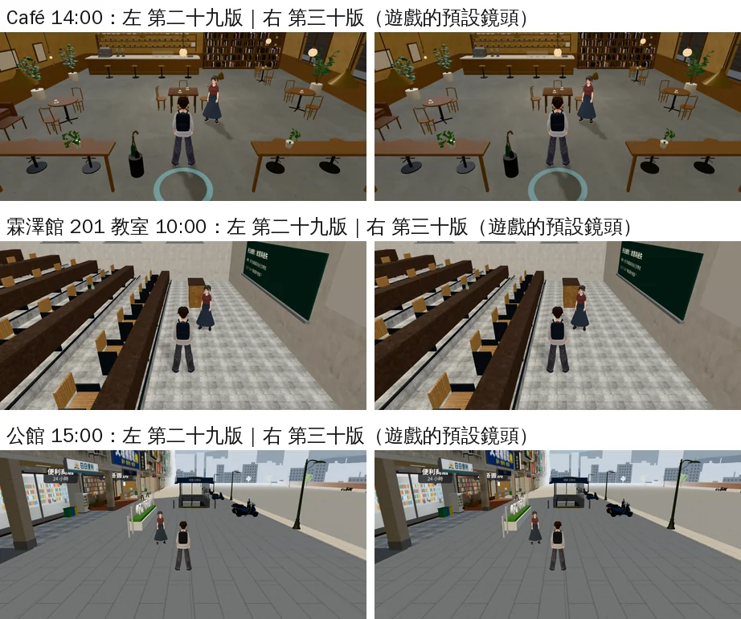

# 郭沛珊 3D 第三十版：瀏海、臉旁碎髮、膚色、馬尾

帳號 A 的 LAWWW2，2026-10-22 13:0x～14:0x UTC。

- **狀態**：交件；角色美術由 LAWWW 驗收（D100 第 6 點）。
  - 換三個檔（同檔名），程式、manifest 都不用改：
    - `assets/models/char/second_ai/bl_classmate_peishan.vrm`（第三十版）
    - `assets/models/char/second_ai/glasses_peishan.glb`（＋`.json`）
  - 眼鏡和第二十九版同一個檔（`f510b1b7` 起沒有改）。第二十九版沒有接進遊戲，開發分支上還是舊的粗框，所以要一起換。
- **起因**：
  - LAWWW 13:0x 退回第二十九版（開發分支 `620821e1`、USER_WANTS C27）。
  - 對的：髮色、眉毛、唇色；眼睛接近。
  - 不對的：
    - 瀏海兩側太短，像一頂安全帽；
    - 沒有臉旁垂到下巴的長碎髮；
    - 臉白、脖子紅，像戴面具；
    - 三分之四側梳痕太硬；
    - 馬尾太高、太規整。
  - 使用者 11:5x 的原話：「你花這麼多時間改沛珊長裙結果她人還是很醜 臉啊頭髮啊 醜死了」（UA-LAWWW2-1022-02）。

## 逐項對照（照 LAWWW 13:0x 的單子；這是我的判斷，LAWWW 驗收）



- 上：參考圖；中：第二十九版；下：第三十版。
- 遊戲內 Café 14:00，同一個位置、同一個鏡頭（正面、三分之四側）。

| 項目 | 對／不對 | 說明 |
|---|---|---|
| 瀏海兩側長度 | **對** | 中分、往兩邊斜垂；兩側蓋住眉尾和鏡框外側上角，最外面到顴骨下面 |
| 髮尾 | **接近** | 有長短、會削細；比參考圖粗一點（最細的針尖沒做，遊戲的距離會變成一排點） |
| 越過鏡框的碎髮 | **對** | 每邊一綹，從分線旁邊斜斜越過鏡框外側上角 |
| 臉旁長碎髮 | **對** | 兩邊各 3 綹垂到下巴，下段散開 |
| 頭頂 | **對** | 貼頭皮，不蓬 |
| 膚色 | **對** | 臉和脖子、胸口同一個色調（數字在下面「膚色」一節）；臉有一點顴骨、鼻側、下巴下面的陰影 |
| 三分之四側梳痕 | **對** | 一片一條的明暗淡很多 |
| 馬尾 | **接近** | 低一點（約 0.6 cm）、鬆一點、後頸散出幾綹；再低會出問題（見下面「馬尾」） |
| 髮色、眉毛、眼睛、唇色 | **不動** | 量到的數字在下面「沒有變的」 |

## 改了什麼

### 瀏海（`tools/blender/char_second/peishan_hair.py`）

- **兩側加長**：每邊 8 片簾子。
  - 靠分線的兩片停在眉頭上面（髮尾離分線 11°、17°）。
  - 往外越來越長，蓋住眉尾、鏡框外側上角。
  - 最外面到顴骨下面：髮尾比眉毛低 5.8 cm（第二十九版 4.3 cm）。
- **左右對稱**：
  - 分線偏人物的右邊 10°，左邊那一片簾子原本比較窄。
  - 遊戲內斜前方看，左邊太陽穴露出一條皮膚、髮際線一階一階的硬邊（試做 g7 在遊戲裡拍到的）。
  - 左邊外面幾片的髮尾往外移，和右邊對臉的中線對稱。
- **額頭露出的倒 V 收窄**：靠分線幾片的髮尾往分線收 3～5°（試做 g2 比參考圖寬）。
- **髮尾**：
  - 試做 g2 從一半就分成 5 束：一排細刺像梳子，瀏海看起來只到額頭中間。
  - 改成 4 束、從 62～80% 才分開，長短不一、慢慢削細（第二十九版 68～84%、比較齊）。
- **越過鏡框的細碎髮**：每邊一綹，用細碎髮的貼圖，從分線旁邊斜斜越過鏡框外側上角，停在顴骨。
- **頭頂貼頭皮**：
  - 髮殼的蓬度：頭頂 1.1＋0.85 cm → 0.8＋0.4 cm。
  - 瀏海越過髮際線時離額頭 1.5 → 1.1 cm。

### 臉旁長碎髮（同一支腳本）

- 兩邊都 3 綹（第二十九版：分線那邊 2 綹、另一邊 1 綹），垂到下巴。
- 下段往前後散開 0.4～1.4 cm。試做 g7 側面看是三條平行的線，像爪痕。

### 三分之四側、馬尾（同一支腳本）

- **梳痕**：
  - 往後梳的髮片，橫向的法線偏角 0.25 → 0.08。原本一片一條明暗，就是 LAWWW 說的梳痕。
  - 髮絲紋路的對比降低。
- **馬尾低一點**：
  - 綁點 −44° → −48°，約低 0.6 cm。
  - 試做 −52°：耳朵後上方往後梳的髮片尾端交叉，翹出一根黑色的棍子（遊戲內三分之四側看得到），所以停在 −48°。
- **鬆一點**：馬尾中段粗 16%；後頸 3 撮碎髮長一點，散出來。

### 膚色（`tools/blender/char_second/peishan_face.py`）

- **脖子紅的原因**：
  - 遊戲內 Café 14:00 量第二十九版：臉頰色相 18°、脖子和胸口 12°。
  - 下巴下面、胸口在 MToon 的陰影那一邊。陰影色＝`C.LOOK` 的 0xcf967f × 陰影貼圖，陰影貼圖就是身體的皮膚貼圖（粉紅），所以變成飽和的紅。
  - 臉大多在受光那一邊，所以看起來白。
- **改法**：
  - 身體的陰影不乘皮膚貼圖，陰影色就是 `C.LOOK` 的皮膚陰影色。
  - 身體的皮膚貼圖乘和臉一樣的暖色：受光的時候，臉和手臂、胸口同一個色調。
  - 臉的貼圖照臉的形狀，畫淡淡的暖色陰影（顴骨外側、鼻側、下顎、下巴下面），整張臉往參考圖的暖米色靠一點。
- 遊戲內同一個鏡頭量（Café 14:00，正面）：

| | 臉頰 | 脖子 | 胸口 |
|---|---|---|---|
| 第二十九版 | 色相 18°、亮度 0.74～0.76 | 12°、0.69 | 12°、0.75 |
| 第三十版 | 19～20°、0.71～0.74 | 17°、0.73 | 17°、0.76 |

- 試過在遊戲裡直接改材質比較：A 原樣、B 身體不乘、C 臉＋身體都不乘。
  - C 的陰影那一邊嘴唇不見了，所以臉照舊。



## 遊戲渲染器（`test_charlook` 的燈，不是遊戲畫面）



- 上：第二十九版；下：第三十版。
- 六張：臉正面、45°（人物右邊）、45°（人物左邊）、側面（人物左邊）、側後方、全身。
- 眨眼拍過：閉滿（表情和第二十九版一樣）。

## 遊戲內一般距離（遊戲的預設鏡頭）



- 三張：Café 14:00、霖澤館 201 教室 10:00、公館 15:00。
- 測試環境：Playwright＋SwiftShader，844×390（手機橫向）、像素比 2，**不是 iPhone**。
- 開發分支 `11707a19`：左＝第二十九版、右＝第三十版（都配第二十九版的眼鏡）。
- 【捷徑】沛珊是截圖腳本放的（`CHAR.build`＋`E.addNPC`，遊戲生成人物也是這兩個），不是照作息走過來的；路人藏起來。

## 沒有變的

- **髮色**：同一組顏色，只降低紋路對比。遊戲內正面頭頂的中位數：
  - 第二十九版 0.200, 0.141, 0.118；
  - 第三十版 0.208, 0.149, 0.122。
- **眉毛、眼睛**：貼圖和網格位元組相同。
- **唇色**：跟著整張臉暖一點（藍 −4.5%）。遊戲內量到：
  - 第二十九版 (211, 110, 85)；
  - 第三十版 (209, 110, 79)。
- **身體、衣服、臉的網格**：和第二十九版相同。
- **骨架**：只有馬尾 6 根骨頭往下移 ≤ 6.4 mm（綁點低了）。
- **表情**：15 組、名字、preset、幅度都和第二十九版一樣。
  - `Blink`／`Blink_L`／`Blink_R` 是第二十九版起的 94（第二十八版 80）。
- **其他**：身高 1.63、`glasses` 節點名、manifest 的 `armOut`／`armBack`／`armFwd` 都不用改。
- VRM 3.38 → 3.36 MB。

## 重建、驗證

```bash
/opt/blenv/bin/python tools/blender/char_second/peishan.py -- - --stages stage0,face --blend <工作>/face.blend
/opt/blenv/bin/python tools/blender/char_second/peishan.py -- <工作>/v.vrm --from-blend <工作>/face.blend --stages clothes,hair
VRM_REST='{"Fcl_EYE_Close": 0.06}' VRM_BASE=Darkness_Shibu python3 tools/blender/char_second/vrm_finish2.py <工作>/v.vrm <工作>/g30.vrm 郭沛珊 '#3a2a22'
python3 tools/blender/char_second/peishan_skirt_bones.py <工作>/g30.vrm assets/models/char/second_ai/bl_classmate_peishan.vrm --back3 --kbumax 0.8 --kblmax 1.0
```

- 用這幾行從頭重做，和交件的檔位元組相同。
- 舊版開關：
  - `PS_HAIR_V=29 PS_FACE_V=29`（`VRM_REST` 照帶）做出來，和第二十九版的 VRM 位元組相同。
  - `=28`（`VRM_REST` 不帶）做出來，和第二十八版的 VRM 位元組相同。
  - 這兩項是用這一版的腳本重做驗證的。

## 接法（LAWWW）

1. 換 `bl_classmate_peishan.vrm`、`glasses_peishan.glb`、`glasses_peishan.json`（同檔名）。
2. 腳本：`peishan_face.py`、`peishan_hair.py`、`glasses_peishan.py`（第二十九版那次改的，這次沒動）。
   - `h01_face.py`、`vrm_finish2.py`、`character3d.js` 都沒改。
3. 身體的陰影不乘貼圖，是 VRM 的材質設定（沒有 `_ShadeTexture`）：`C.LOOK` 照舊會設定陰影色，程式不用改。
4. 角色美術由你驗收（D100 第 6 點）；身體、衣服、骨架沒變，走路、坐下、上下樓梯和裙子輔助骨頭照舊。

## 還不到的地方（誠實寫）

- 髮尾還是比參考圖粗。參考圖那種一根一根的細髮，在遊戲的距離會變成鋸齒點，沒有做。
- 耳朵後上方往後梳的髮片，尾端還是一階一階的（第二十九版以前就有）；只有近拍側面看得到。
- 臉的五官還是 VRoid 的動畫臉（眼睛比參考圖圓、大）。這次照 LAWWW 的單子，眼睛、眉毛、唇色不動。
- 馬尾只低了 0.6 cm；再低要重做往後梳髮片的收尾，這一版沒做。
- 只在 Café 量了膚色；晚上、戶外正午沒有量。
- 真機沒看過。
