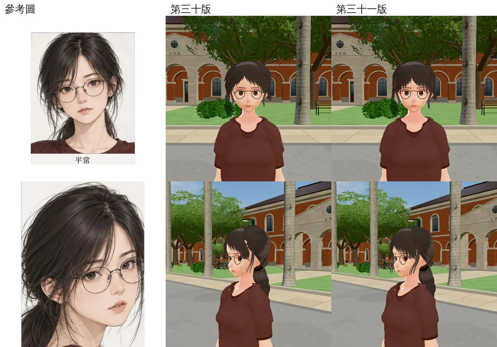
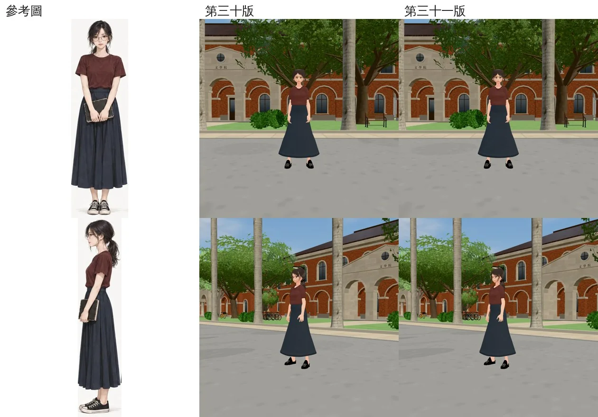
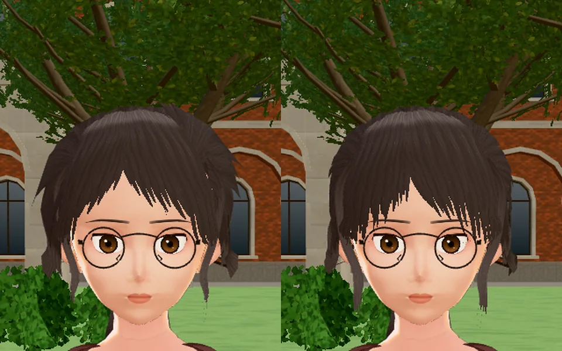
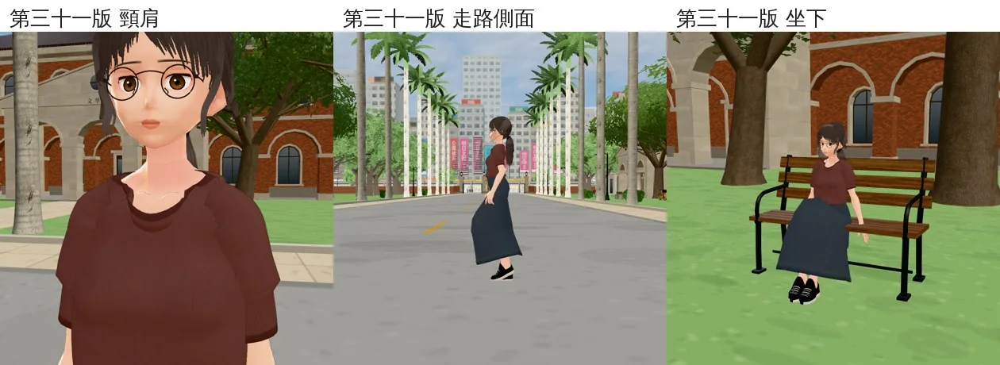
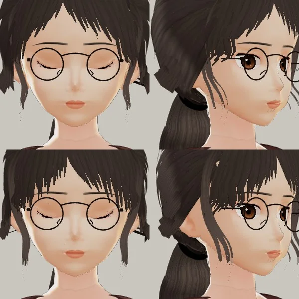

# 郭沛珊 3D 第三十一版：交件（正面的瀏海、臉旁長碎髮）

- **交件**：LAWWW2-B，2026-10-23。
- **起頭**：帳號 A 的 LAWWW2 10-22 14:0x～15:0x 做的。
- **給誰驗收**：LAWWW（D100：角色美術由 LAWWW 驗收）。
- **狀態**：`READY_FOR_ART_REVIEW`。
- **VRM**：`assets/models/char/second_ai/bl_classmate_peishan.vrm`，md5 `105e8353817b7212c4f62ac9a79bef5f`，3,638,244 bytes（commit `9c425e65`）。
  - 用 `tools/blender/char_second/peishan_hair.py` 的預設從頭重做，結果是同一個檔。
  - 開發分支現在還是第二十八版（`9a9e312e`）。第三十版（`80a39166`）驗收沒過、沒有合併。
- **起因**：LAWWW 10-22 13:5x 驗收第三十版，正面兩項沒過：
  1. 瀏海像一頂短帽子：頭頂兩側往上翹的尖刺、額頭中間一個大的倒 V、髮尾停在眉毛上面。
  2. 臉旁的長碎髮從正面看不到。
- **不動的**：髮色、眉毛、嘴唇、眼睛（LAWWW 說不要再動）、膚色、臉的陰影、馬尾。和第三十版位元組相同，只換了頭髮。

## 遊戲內並排（參考圖｜第三十版｜第三十一版）

- 開發 `6326916cc`，Playwright＋SwiftShader，**不是 iPhone**。
- 椰林大道 10:30。同一支截圖腳本、同一個鏡頭，只換 VRM。
- 【捷徑】沛珊是截圖腳本放的（`GAME.spawnCharacter`），讀檔後收起手機。
- 腳本：`tools/shots/char_review.py`，這次加了 `faceq`（頭肩特寫、斜前 45°）。

臉（上：正面頭肩；下：三分之四側頭肩）：

全身（上：正面；下：斜前 45°）：

正面放大（左第三十版、右第三十一版）：

第三十一版的頸肩、走路側面、坐下：

眨眼（遊戲渲染器，上第三十版、下第三十一版）：

- 正面閉眼閉滿，瀏海沒有穿過眼皮。

## 第三十一版最後一步（試做 s，10-23）

- 分線另一邊（人物左邊）越過髮際線的位置，再往外移一倍：`HAIR_CUR_AHS` 預設 1.0 → 2.0。
- 遊戲渲染器四個角度和 r 比：
  - 分線那一側的太陽穴、額角蓋住了；
  - 頭頂兩側沒有多翹出髮片的邊。
- 所以預設改成 2.0，用預設重做就是 s（`105e8353`）。
- 下面 `accept_ref_game_face.webp`、`game_normal_distance.webp`、`lookdev_v30_v31*.webp` 是 10-22 的試做 r（舊），留著對照。

## 改了什麼（都在 `peishan_hair.py`，`V31` 開頭的地方）

1. **頭頂兩側的尖刺**
   - **原因**：往後梳的髮片在分線兩側 33～57° 那一段，路徑從「越過頭頂」換成「繞過側面」。
     - 中段和隔壁那片的路徑離 3～8 cm，髮片照這個距離寬到 6～13.6 cm。
     - 結果是一整片平板翹出圓的頭形，正面看就是尖刺。
   - **改法**：這幾片限寬 2.2 cm（`SW_WMAX`）。
     - 中間補 66 片窄的，照各自方位角的路徑貼著頭形。
     - 補的那幾片從寬度超過上限的地方前面一點開始，那一端是細的髮尾。
   - 那幾片超寬的髮片原本也蓋住後腦髮殼的一個洞（試做 m 只限寬：後腦一條條深色的縫）。
     - 所以後腦另外補一片照頭形的髮殼：方位角 95～265°，從後頸髮際線到頭頂。
2. **倒 V、髮尾**
   - 髮尾的方位角從臉的中線量，兩邊對稱；分線照舊偏右 10°。
   - 裡面兩片停在眉頭，額頭露出窄長的倒 V。
   - 往外一路垂過眉尾、眼睛外側，最外面到顴骨（髮尾比眉毛低 6 cm）。
   - 越過髮際線時離額頭 7.5 mm（第三十版 11 mm）：貼著額頭往下、往外垂。
   - 分線另一邊（人物左邊）越過髮際線的位置照第三十版往外移：試做 q 沒移，左邊額角露出一條皮膚。
3. **臉旁長碎髮**
   - 路徑改成從太陽穴往外、經過鏡框腳外面，垂到下巴下面 2.8 cm。
     - 試做 a 從鏡框腳前面過，和鏡框腳纏成一圈。
   - 寬一點、下段不收那麼細，正面看得到。

## 逐項自評（照 LAWWW 13:5x 沒過的兩項）

| 項目 | 對／不對 | 說明 |
|---|---|---|
| 頭頂兩側往上翹的尖刺 | **大致對** | 正面頭頂的輪廓圓了；左上還有一點不平 |
| 額頭中間的倒 V | **接近** | 比第三十版窄、短。參考圖本身是中分，額頭也露出一個窄的 V |
| 瀏海髮尾停在眉毛上面 | **對** | 髮尾到眉毛，兩側蓋住眉尾、垂到眼睛外側 |
| 臉旁長碎髮正面看不到 | **對** | 正面兩邊都看得到，垂到下巴 |
| 三分之四側 | **接近** | 太陽穴蓋住；臉旁碎髮、馬尾看得到 |
| 眨眼 | **對** | 閉滿，瀏海沒穿過眼皮 |
| 不動的項目 | **不動** | 位元組相同 |

## 和參考圖還差的（老實說）

1. **正面看整體還是偏短、偏小的一頂**：參考圖兩側的頭髮多、蓬，垂過下巴到脖子；第三十一版兩側的量少，頭頂偏扁、偏密。
2. **髮片邊緣一階一階**：遊戲距離看得出鋸齒（髮片卡的邊）。
3. 後腦：耳朵後上方往後梳的髮片尾端一階一階（第三十版就有）。
4. iPhone 實機沒看過。

如果第 1 項要再改，方向是兩側加髮量、往下垂到脖子（加臉旁的層次），不是再改瀏海。

