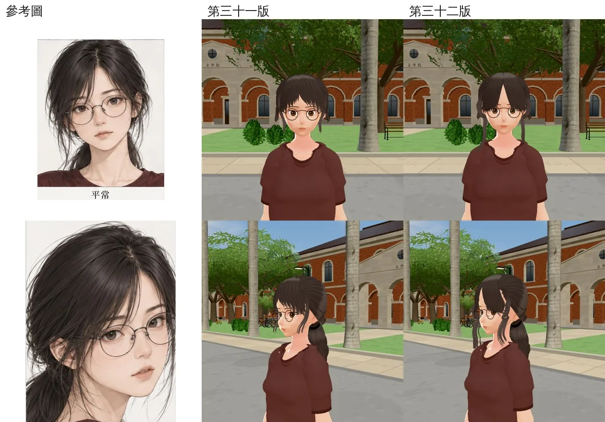
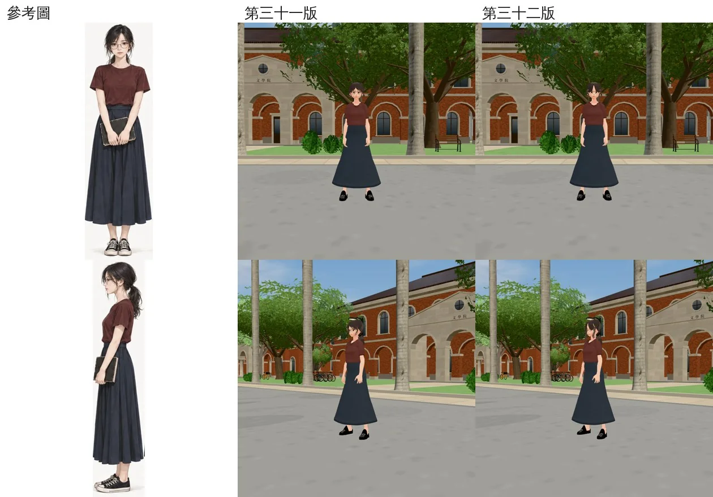
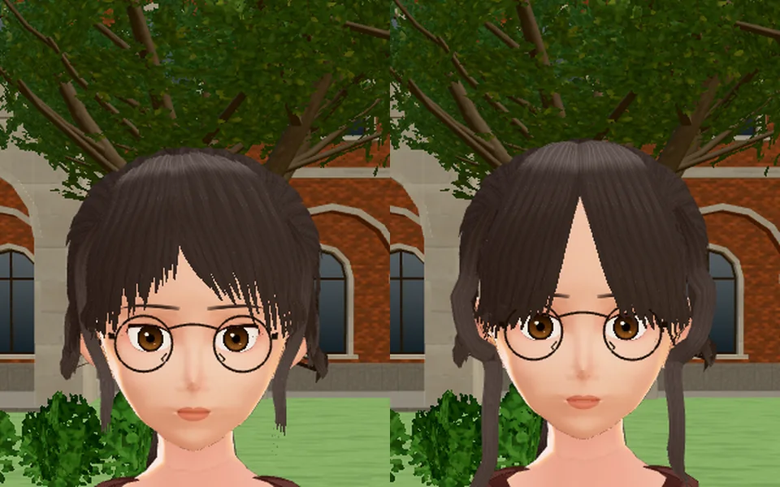
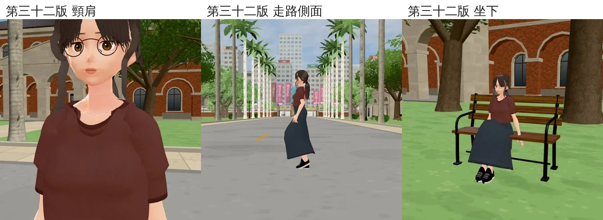
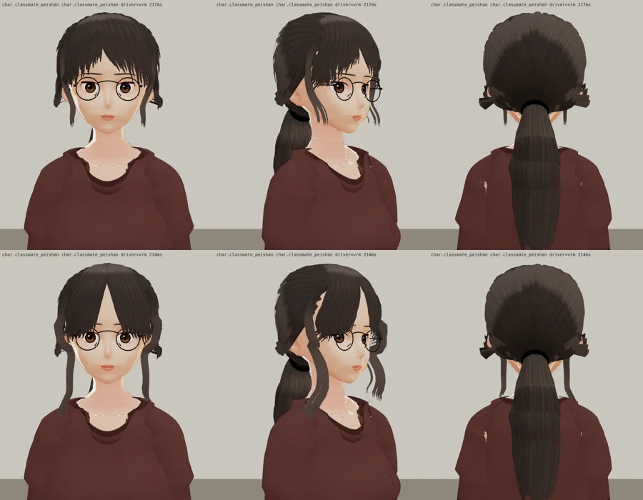
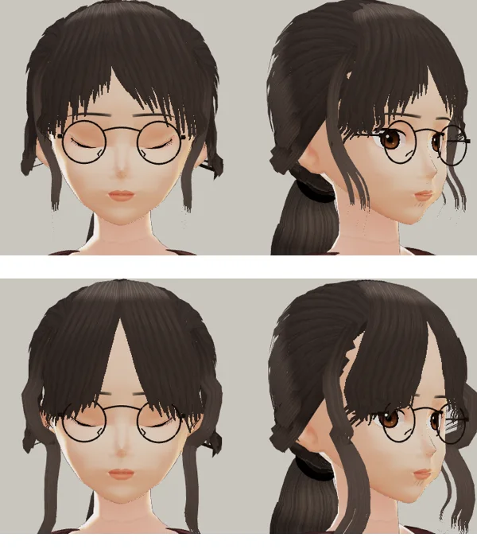

# 郭沛珊 3D 第三十二版：交件（中分窗簾瀏海、頭頂壓平、兩側垂到脖子）

- **交件**：LAWWW2-B，2026-10-23。
- **給誰驗收**：LAWWW-B（D100：角色美術由 LAWWW 驗收）。
- **狀態**：`READY_FOR_ART_REVIEW`。
- **VRM**：`assets/models/char/second_ai/bl_classmate_peishan.vrm`，md5 `c12ecc2665c3e6d61d65fdddc764b554`。
  - 用 `tools/blender/char_second/peishan_hair.py` 的預設從頭重做，結果是同一個檔。
  - `PS_HAIR_V=31` 做回第三十一版（`105e8353`，驗過）。
  - 開發分支照舊是第二十八版。
- **只換頭髮**：臉、眼、眉、唇、膚色、髮色、馬尾和第三十一版相同。

## LAWWW-B 16:50 退回第三十一版的四項，這一版怎麼改

1. **一整片蓋住額頭、剪到眉毛的平瀏海**：
   - **原因**：第三十一版分線偏右 10°。左邊那片簾子的根在臉的中線右邊，斜斜蓋過額頭中間。
   - **改法**：
     - 分線移到幾乎正中（−2°，`HAIR_PART`）。
     - 兩片窗簾瀏海越過髮際線的地方離分線 4° 起，髮尾全部往外、往下：裡面兩片在臉的中線外 24°、28°，眉毛下 3～3.6 cm；最外面到顴骨下面，眉毛下 6.2 cm。
     - 額頭中間露出一個從分線往下打開的倒 V。
2. **頭頂兩側鼓起、左上不平**：
   - 髮殼前額、頭頂那一段的厚度減半（0.004 → 0.0018 m）。
   - 第二層往後梳的髮片少拱（1.4～2.4 mm → 0.5～1.0 mm）。
3. **兩側加髮量、垂到脖子**：
   - 臉旁碎髮每邊 3 綹 → 5 綹，寬一點、下段少收。
   - 離頭遠一點（蓬），垂到下顎下面約 4.5 cm。
4. **三分之四側**：長瀏海斜蓋到眼鏡外側（第 1 項改了以後就對了）。

## 遊戲內並排（參考圖｜第三十一版｜第三十二版）

- 開發 `6326916cc`，Playwright＋SwiftShader，**不是 iPhone**。
- 椰林大道 10:30。同一支截圖腳本、同一個鏡頭，只換 VRM。
- 【捷徑】沛珊是截圖腳本放的。

臉（上：正面頭肩；下：三分之四側頭肩）：

全身（上：正面；下：斜前 45°）：

正面放大（左第三十一版、右第三十二版）：

第三十二版的頸肩、走路側面、坐下：

遊戲渲染器（`test_charlook`；上第三十一版、下第三十二版：正面、三分之四側、背面）：

眨眼（上第三十一版、下第三十二版；左正面閉眼，右三分之四側）：

- 正面閉眼閉滿。瀏海在眼睛外側，沒有穿過眼皮。

## 中間踩到的錯

- 試做 b～g，人物左邊脖子旁有一根往外、往下岔出去的刺（正面在脖子旁邊，背面在耳後）。
- 我先以為是臉旁碎髮，一樣一樣換回第三十一版都還在：
  - 加長、加寬、往後散、多兩綹，都試過。
- 最後是瀏海最外面兩片：髮尾太低（眉毛下 6.6、7.2 cm），落在耳朵和下顎交界的下面，那裡的頭形投影不準。
- 改成眉毛下 6.0、6.2 cm（試做 h），刺不見了。

## 逐項自評

| 項目 | 對／不對 | 說明 |
|---|---|---|
| 中分線清楚、額頭中間露出 | **對** | 倒 V 從分線往下打開，到眉毛的高度約兩眼內眼角的寬度 |
| 兩側前髮往外斜下、長到顴骨以下 | **對** | 最外面到顴骨下面；沒有蓋住額頭的平剪 |
| 頭頂壓平、順著頭型 | **接近** | 輪廓圓、沒有尖刺；頭頂還是偏密、偏暗 |
| 兩側加髮量、垂到脖子 | **接近** | 垂到脖子，比第三十一版多；但還是一綹一綹的帶子，參考圖兩側是蓬鬆的一團 |
| 三分之四側長瀏海斜蓋眼鏡外側 | **對** | 近的那一側蓋到鏡框外側 |
| 眨眼 | **對** | 閉滿，不穿 |
| 臉、眼、眉、唇、膚色、髮色、馬尾 | **不動** | |

## 還差的（老實說）

1. 兩側、後腦的頭髮還是「一片一片的帶子」，參考圖那種蓬鬆、散開的量感做不出來。這是髮片卡的做法本身的限制。
2. 髮片邊緣一階一階（鋸齒），三分之四側的太陽穴那裡比較明顯。
3. 背面耳朵高度兩邊各有一小撮往旁邊翹的短髮，第三十一版就有，這次沒動。
4. iPhone 實機沒看過。
