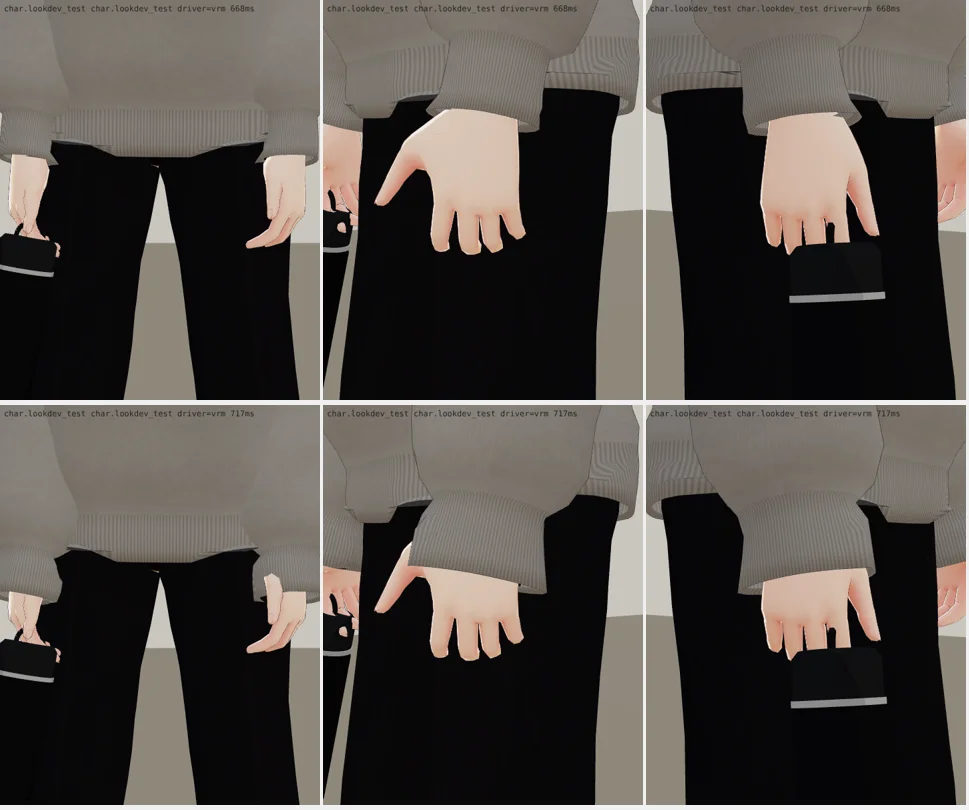
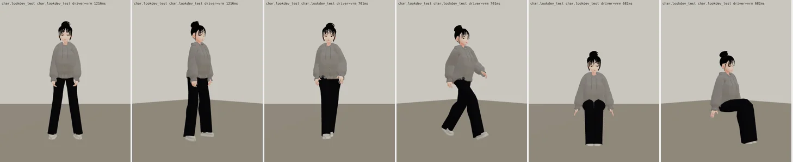
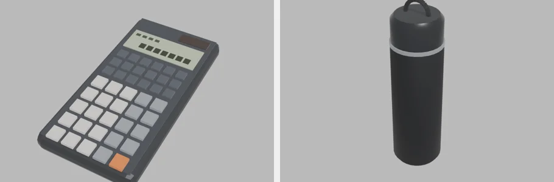
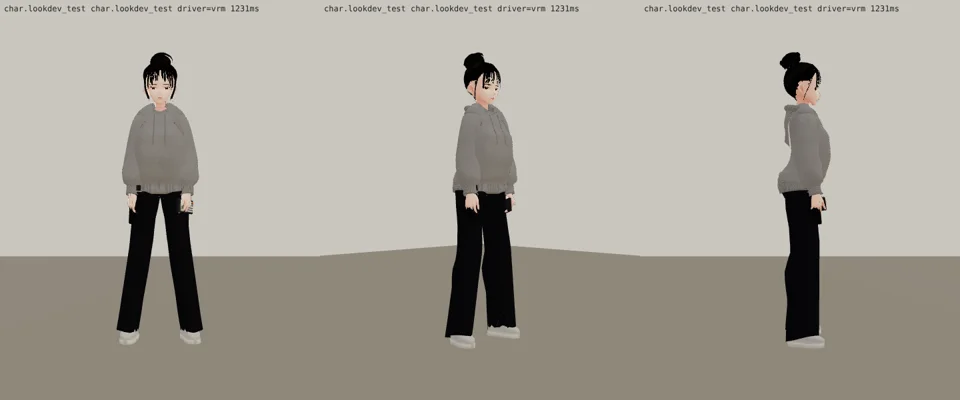
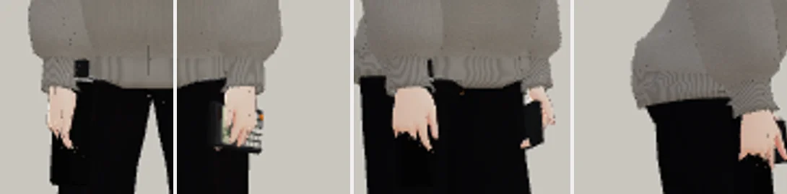
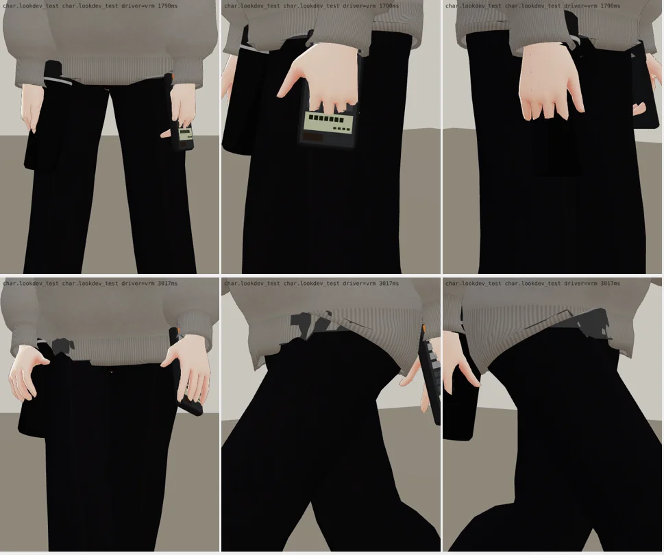
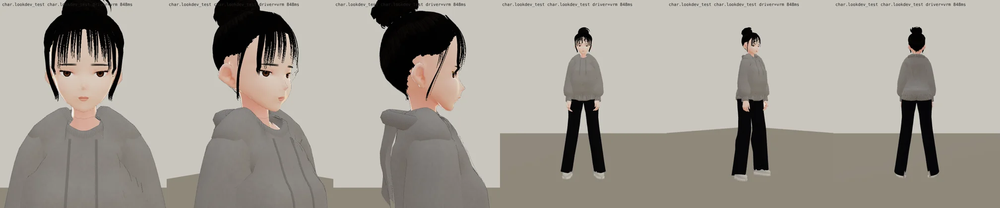

# 第六版：袖子蓋到手背（BB-C ed0d36bc 第 3 點；LAWWW2-C 2026-10-17 20:3x UTC；等 BB-C 驗收，D59）
- 標準圖「袖子蓋到手背」，第五版袖口停在手腕 → `pinyu_clothes.py`：`SLEEVE_LEN` 1.03 → 1.12（過手腕約 5–6 cm、蓋住手背一半），袖口鬆一點（`CUFF_EASE` 0.014 → 0.018）。臉、頭髮、褲子沒動。
- `assets/models/char/second_ai/bl_econ_pinyu.vrm` 換成第六版（3.1 MB）。
- 手腕特寫（遊戲渲染器、待機、拿保溫瓶；上排第五版、下排第六版；正面、左手外側、右手外側）：
- 待機、走路、坐下（正面、45°）：
- 要 LAWWW-C 接進遊戲、拍白天站著和走路的遊戲內截圖，BB-C 才標 ART_APPROVED。

---

# 隨身物：工程計算機、黑色保溫瓶（BB_131「手上常拿」；LAWWW2-C 2026-10-17；第二版 20:2x UTC；等 BB-C 驗收，D59）
- 模型（`tools/blender/char_second/prop_pinyu.py`）：
  - `assets/models/char/second_ai/calc_engineering.glb`：工程計算機 16×8×1.6 cm、660 個三角形；深灰機身、液晶（兩行數字的小塊）、太陽能板；上三排小的功能鍵、下五排數字鍵，一顆橘色運算鍵；**沒有牌子、型號**。
  - `assets/models/char/second_ai/thermos_black.glb`：黑色保溫瓶 直徑 7 cm、高 22 cm、810 個三角形；霧黑瓶身、銀色細環、亮一點的瓶蓋＋提環；沒有牌子。
- 接進遊戲（LAWWW-C）：`docs/art-rebuild/second_ai/patches/props_pinyu.js`（`PROPS.DEF.calc`、`PROPS.DEF.thermos`＋manifest）。

## 第二版：照 BB-C 驗收（BB_201 §14，ed0d36bc）改的
| BB-C 的意見 | 改法 |
|---|---|
| ① 平常只拿保溫瓶（兩手都拿像要去考試）；計算機給上課、讀書、考試的事件 | patch 的說明改成平常 `props` 只放 `'thermos'`；計算機的配件照留，事件裡再加 |
| ② 保溫瓶貼著黑褲子看不到：(a) 握上半段往前斜，或 (b) 手指勾提環垂在手下 | **選 (b)**：提環勾在手指上、瓶子垂在手下面，銀環和瓶蓋露出來。(a) 試過：寬袖口蓋住手腕，銀環和瓶蓋還是被蓋住；遊戲的手是放鬆張開的，勾提環比握瓶身自然 |
| ③ 袖子應該蓋到手背（這版停在手腕） | 人物模型的事，下次送驗收時一起改（還沒改） |

- 兩件都**掛在前臂**（不是手）：掛在手上時走路動畫手腕一轉，東西就轉成水平（家豪筆記本退件的原因）。位置在載入時照前臂到手的距離算。
- Blender 預覽：
- 遊戲渲染器（只拿保溫瓶；上排待機、下排走路；正面、45°、側面）：
- 右手特寫（上排待機、下排走路；正前、斜前外側、側面）：
- 第一版（兩件都拿、保溫瓶握在手裡貼著褲子）：
- 還沒做到的：袖子蓋到手背（人物模型）；計算機在事件裡的位置（桌上或手上）要等事件。

---

# ART-CH-PINYU 曾品妤（econ_pinyu）3D 人物（LAWWW2-C 2026-10-17；第五版；狀態 READY_FOR_ART_REVIEW → 等 BB 驗收，D59）

- **參考**：BB_131 通過的標準圖 `docs/story_planning/art_reference/pinyu.webp`（企劃線）：經濟系一年級、19 歲、158 cm；面無表情、偶爾翻白眼、難得大笑；黑色高丸子頭（有點亂）＋透得到額頭的空氣瀏海＋臉旁兩撮碎髮；灰色 oversize 連帽上衣（袖子蓋到手背）＋黑色寬直筒長褲＋灰白老爹鞋；手上常拿工程計算機、黑色保溫瓶（配件之後另外做）。
- **檔案**：`assets/models/char/second_ai/bl_econ_pinyu.vrm`（3.11 MB，VRM 0.x，`vrm_finish2.py` 處理過：縮貼圖、女生眼睛）。
- **腳本**：`tools/blender/char_second/pinyu.py`＋`pinyu_face.py`、`pinyu_clothes.py`、`pinyu_hair.py`；一次建好：
  `SP=<工作資料夾> LOOK_ROOT=<伺服器> VRM_MALE=0 EXTRA=--blchar bash tools/blender/char_second/char_build.sh pinyu v5 Darkness_Shibu 曾品妤 '#2a1e1a' char.classmate_xinci 1.58 '' face`
- **生產線**：VRoid CC0 樣本 Darkness Shibu（和芯慈、沛珊同一個樣本，臉的參數、髮型、衣服都不同）；頭髮從芯慈的低髮髻改成高丸子頭。

## 遊戲渲染器（LAWWW 的 test_charlook.html；不是遊戲內截圖，Playwright＋SwiftShader，不是真機）

全部：`look_face_front／q45／side`、`look_body_front／q45／back`、走路、坐下各角度；Blender 預覽 `blender_*`。

## 版本（自己退件的，都在遊戲渲染器看過）
- 第一版（`v1_look_sheet.webp`）：瀏海是一整片齊的鋸齒（像公主切）、丸子頭像一圈一圈疊起來的頭巾、帽 T 太短、褲腳張開像喇叭褲。
- 第二、三版（`v3_look_sheet.webp`）：瀏海加長、變細、透得到額頭；丸子頭反方向繞＋鬆開的幾圈；帽 T 加長到胯下；褲管跟著腿走（直筒）。臉旁碎髮在下巴旁邊折成鉤子、Z 字。
- 第四版：領口拉高時脖子的皮膚穿出領口——改回原來的高度。
- 第五版：臉旁碎髮從太陽穴經過耳朵前面直直垂到下巴。

## 八項（ART_SOP 3-2）
| 項目 | 結果 |
|---|---|
| 輪廓 | 高丸子頭（髮殼＋15 條纏繞的髮片，三條裡一條反方向、幾圈鬆開）、空氣瀏海（12＋2 撮）、臉旁碎髮（彈簧骨 3 節）；oversize 帽 T（落肩、羅紋下擺與袖口、放下來的帽子、兩條帽繩）、寬直筒長褲 |
| 材質 | MToon；衣服貼圖程式產生（棉 T 的平針、斜紋） |
| 比例 | 158 cm |
| 動作 | 待機、走路、坐下沒有看到穿模；**還沒測**：上下樓梯、跑步、轉身 |
| 效能 | VRM 3.11 MB |
| 還沒做／已知 | 計算機、保溫瓶（配件）；帽子側面看比參考圖厚一點；正面領口上方看得到一點點樣本脖子的接縫線；表情（翻白眼、大笑）靠遊戲的表情 |
