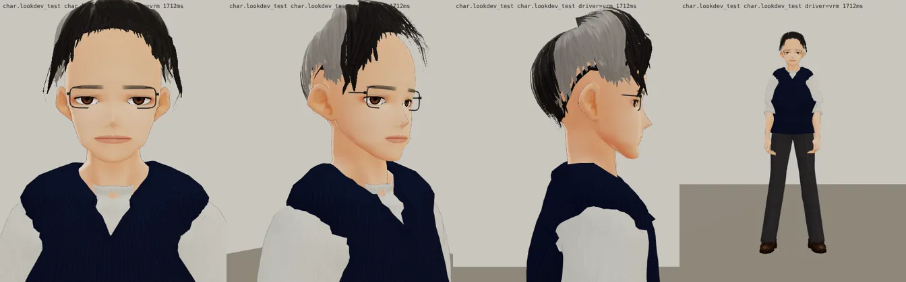
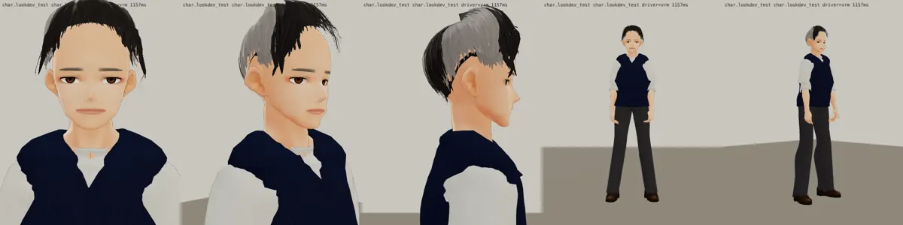
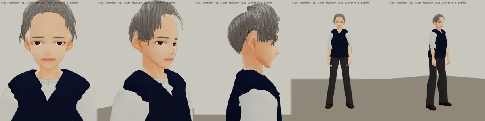

# 魏教授第六版（BB_201 第 8 節；LAWWW2-C 2026-10-17 14:2x UTC；等 BB-C 驗收）
- 髮型：男性短髮——兩側、後腦剪短貼頭（`npc_hair_m.py` 加 `side_taper`：耳朵上面越靠髮尾越貼頭）、耳朵和後頸露出來，頭頂短、往旁邊梳的側分。
- 髮色：灰黑夾雜——頭頂深灰黑；兩鬢、耳上、後腦下緣的髮片髮根深、往髮尾漸漸變灰白，一束一束深淺交錯（第五版整片灰，側面看像染了半邊）。
- 身材：肩膀寬、脖子粗（1.10 倍）、腰有一點肚子（1.6 cm）。
- 眼鏡：`assets/models/char/second_ai/glasses_wei.glb`——深槍灰細金屬、圓角方框 5.0 × 3.3 cm（`glasses_zhiruo.py --style wei`）。遊戲端是配件：`{name:'glasses', glb:'prop.glasses_wei'}`＋manifest 一筆，請 LAWWW-C 掛上。
  
- 遊戲渲染器（沒戴眼鏡）：
- 第五版（自己退件：側面一整片灰）：
- 第四版：
- 四個人並排（同一個鏡頭，看身高；左到右韋綸 176、唐睿 177、家豪 170、魏教授 172）：
  
- 臉正面（同上順序）：
  
- 驗收照 BB_201 第 8 節：等 LAWWW-C 接進遊戲、拍經原教室講台的遠景。

---

# 魏教授 3D 第四版：年紀（BB_201 第 4 節「看起來像國中生」；LAWWW2-C 2026-10-17 13:5x UTC；等 BB-C 驗收）

- 遠景看得出年紀的地方（`tools/blender/char_second/npc.py` 的 `pwei`）：
  - 頭髮灰白（0.33 → 0.50）；
  - 前額髮際線往後 9°、額角多 40%（`npc_hair_m.py` 的 `recede`）；
  - 前面的頭髮往旁邊梳、露出額頭（第三版瀏海垂在額頭上，看起來年輕）。
- 身體：
  - 頭小一點（0.95 → 0.91）；
  - 上身寬厚 1.08 倍（胸口到肩膀）；
  - 胸口以上往前 1.8 cm（稍微駝；身體和臉一起動）。
- 臉：眉毛灰、臉寬一點、嘴角低一點；臉不精修（遠景）。
- 眼鏡：BB-C 建議細框眼鏡（遠景最容易看出「老師」）。眼鏡是遊戲端的配件（props3d），請 LAWWW-C 決定要不要掛。
- 遊戲渲染器：
  
- 第二版 → 第三版（上：二，下：三；第四版再把瀏海梳開）：
  

---

# 魏教授（prof_wei） 3D v2（LAWWW2-C，2026-10-17；等 BB-C 驗收，D59）
- VRM：`assets/models/char/second_ai/bl_prof_wei.vrm`；頭髮沒有 MatCap。
- 穿搭：深藍 V 領毛衣背心＋白襯衫、深色長褲、樂福鞋；灰黑短髮側分。
- 截圖：
  - `look_*.webp`：遊戲渲染器 test_charlook，待機、走路、坐下；
  - `blender_*.webp`：Blender 預覽。
- 已知問題：只在講台上遠景，臉沒有精修。
- 新遊戲從經濟系那一年開場（LIFE-LINE 第 7 組），經濟系人物提前交件。
