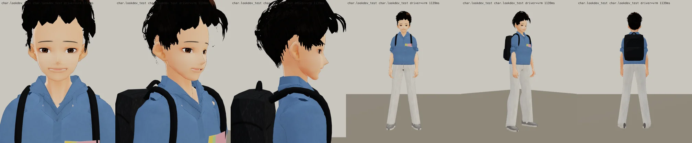
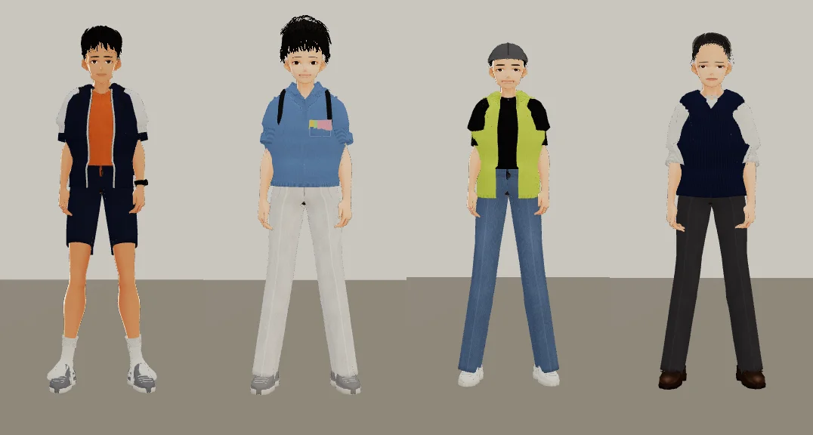
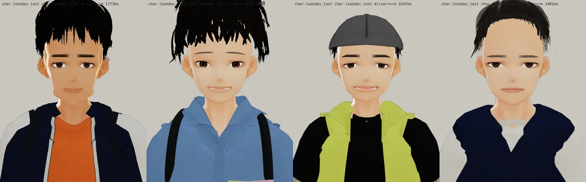
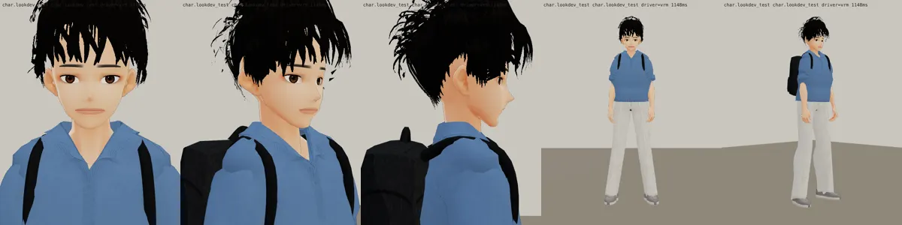

# v11：衣服＋頭髮（BB_201 第 2、7 節；LAWWW2-C 2026-10-17 14:2x UTC；等 BB-C 驗收）
- 衣服（第 2 節）：
  - polo 衫：翻領的領座高一點、三顆扣子的前襟；比身體貼（寬鬆量 0.45）；
  - 胸前左邊一個貼袋，口袋裡露出三張便利貼（黃、粉紅、淺綠；`tangrui_clothes.py` 的 `pocket_notes`）；
  - 肩膀往下沉 2 cm、袖子往內 3.5 cm（同韋綸）。
- 頭髮（第 2 節「圓、蓬、往上」、第 7 節「一塊一塊的黑色尖角」）：
  - 外形交給髮殼：髮殼離頭皮 +6 mm（原本 −2 mm），剪影是圓的；波浪髮束貼在髮殼上；
  - 後面的髮尾不往外翹、勾小一點（第十版正面看頭頂兩邊有一根根飛出去的黑線＝往外翹的髮尾側面朝鏡頭）；
  - 瀏海 2 × 20 片、寬一點、短 2 cm、髮尾往上勾；
  - 黑色亮一點點（看得出一團一團）。
  - 瀏海下緣還是一撮一撮的尖端，沒有完全變成「捲」——這一版先送，請 BB 看方向。
- 遊戲渲染器：
- 上一版（表情一輪 v9）：
- 四個人並排（同一個鏡頭，看身高；左到右韋綸 176、唐睿 177、家豪 170、魏教授 172）：
  
- 臉正面（同上順序）：
  

---

# v9：表情一輪（BB_201 第 6 節；LAWWW2-C 2026-10-17 13:5x UTC；等 BB-C 驗收）
- 嘴窄、唇色淡；嘴角上揚＋微張（Fcl_MTH_Fun 0.6＋Fcl_MTH_Joy 0.22＋Fcl_EYE_Joy 0.3）；眉毛細、有弧度、淡。
- 三人臉部近照和立繪頭部並排（左立繪、右 3D；韋綸、唐睿、家豪）：
  
- 遊戲渲染器：
- 還沒改：衣服（下一步，照 BB_201 第 2～4 項）、身材（做衣服時一起加）。

---

# 唐睿（econ_tangrui） 3D v8：臉分開＋待機臉帶笑（BB_201 第 0 節第 1、2 項；LAWWW2-C 2026-10-17 13:5x UTC；等 BB-C 驗收，D59）

- 這一版只改臉（BB_201 優先順序第 1 項）：三個人裡眼睛最大最圓、短臉、下巴短、細弧眉、嘴寬；待機臉烘 Fcl_MTH_Fun 0.75＋Fcl_EYE_Joy 0.22＋Fcl_BRW_Fun 0.4（帶笑）。
- 做法：
  - 臉型參數 `tools/blender/char_second/tangrui_face.py`；
  - 待機臉用 `vrm_finish2.py` 的 `VRM_REST`，把表情的一部分烘進基本形。
- 三個人並排（上：臉正面，下：全身；左到右韋綸、唐睿、家豪）：
  
- 遊戲渲染器：
  
- 上一版：
  
- 還沒改（BB_201 第 2～6 項，下一步）：
  - 韋綸：短袖連帽風衣、安全帽；
  - 唐睿：polo 領、便利貼；
  - 家豪：薄背心；
  - 上衣像連帽衫（照沛珊第十版的領口做法）；
  - 頭髮、身材、鞋。

---

# 唐睿（econ_tangrui） 3D v6（LAWWW2-C，2026-10-17；等 BB-C 驗收，D59）
- VRM：`assets/models/char/second_ai/bl_econ_tangrui.vrm`；頭髮沒有 MatCap。
- 穿搭：藍色上衣、淺色長褲、後背包；波浪捲髮第六版。
- 截圖：
  - `look_*.webp`：遊戲渲染器 test_charlook，待機、走路、坐下；
  - `blender_*.webp`：Blender 預覽。
- 已知問題：捲髮沒有做出來（使用者 10-17：不要花時間處理捲髮）；眼角那一小片是睫毛的幾何。
- 新遊戲從經濟系那一年開場（LIFE-LINE 第 7 組），經濟系人物提前交件。
