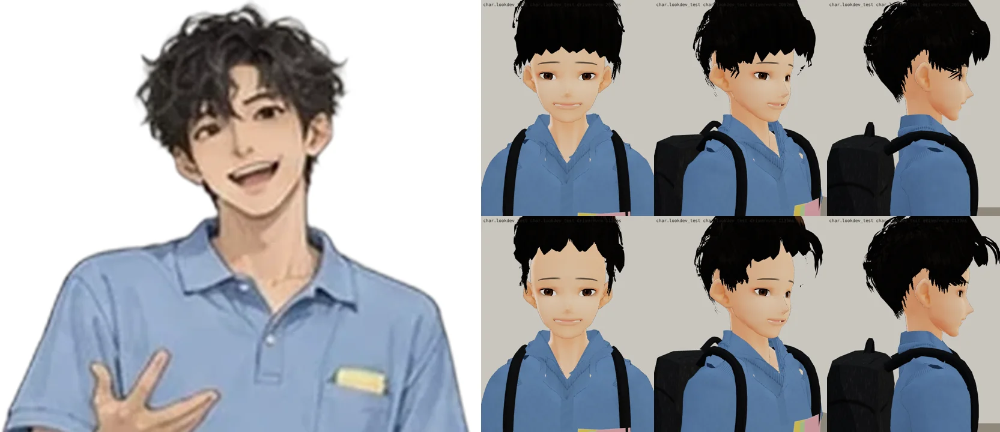
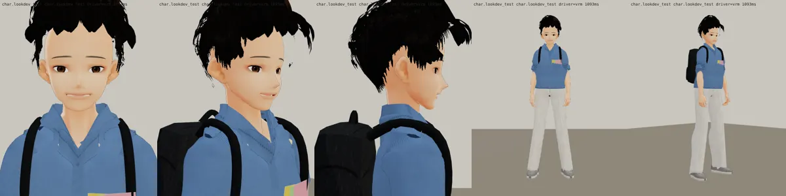
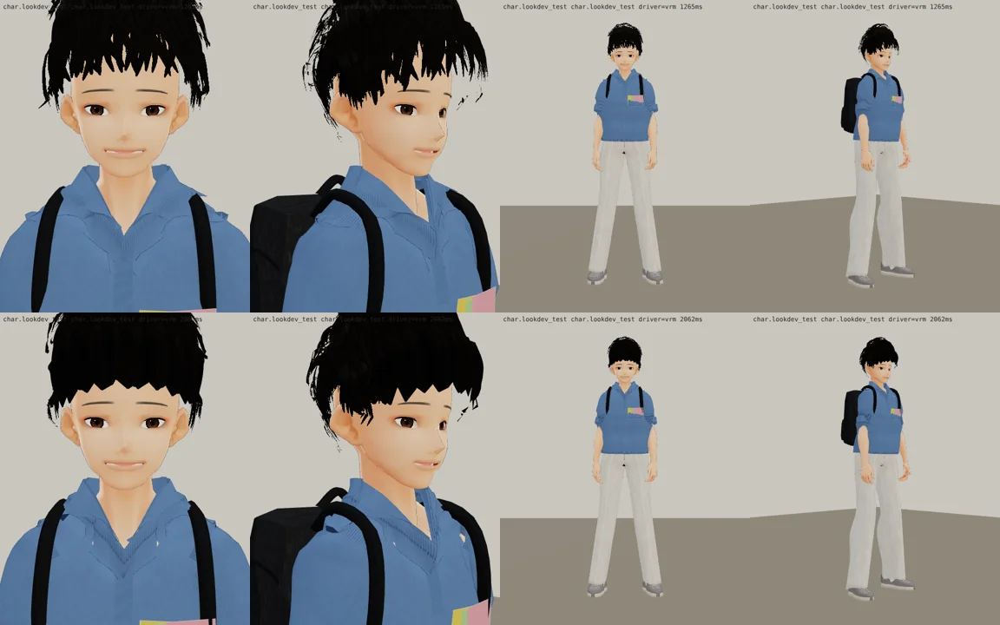
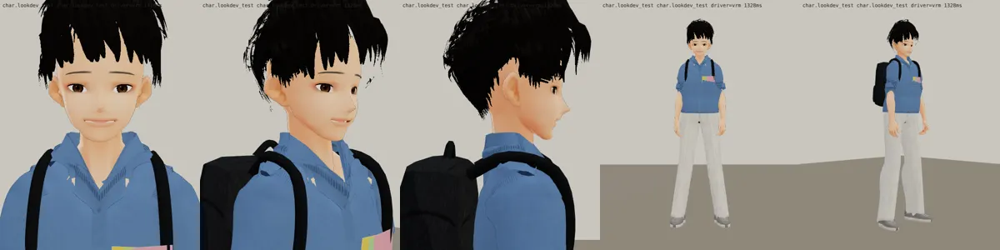

# v19：只改頭髮（BB_201 第 10 節；LAWWW2-C 2026-10-17 15:1x UTC；等 BB-C 驗收；polo v15 已通過、沒動）

左：立繪；右上 v15、右下 v19（臉正面、45°、側面）：

| BB-C 第 10 節 | v19 |
|---|---|
| 1. 瀏海短 2 cm、往上翻，露出眉毛和一半額頭 | 前面四個髮尾高度 +2 cm（太陽穴 +1.4～1.8 cm）；中間（±28° 以內）的瀏海髮尾往外、往上翻（`flip`）；兩側的不翻（v16 兩側也翻，太陽穴旁邊像翅膀） |
| 2. 外圈的半圓大小不一，片和片之間留縫 | 瀏海 9＋8 片 → 7＋6 片，寬 4.2～7.5 cm、長短 ±1.5 cm、方位錯開 ±3°；最外層 44 → 36 片、寬 2.8～6 cm |
| 3. 深咖啡的亮面，頭頂和右前方各一塊 | 原本沒用到的直瀏海貼圖，改成「髮片 18～45% 那一段混進深咖啡 #664733」；頭頂（從髮旋附近出發的最外層）和右前方（方位 12～52°）的整片用這一格 |
| 太陽穴、V 領兩側的淡色點 | 太陽穴：洋紅背景放大後發現是「臉的側邊和垂在外面的頭髮之間 1 cm 的縫」→ 耳朵上面的頭髮貼頭（0.75）、額角的髮際線往下 3～8°、太陽穴的髮殼往下延伸；V 領：兩側的皮膚收深一點 |

- 自己退件：
  - v16：兩側翻起來像翅膀；亮面看不出來；
  - v17：亮面 #4a3226 → #664733，太陽穴沒修好；
  - v18：額角髮際線往下，太陽穴還有縫。
  - v16 的樣子：
- 遊戲渲染器：
- 還沒達到的：
  - 太陽穴還有一條很細的縫；
  - 側面看後腦上方有幾撮往後翹的髮尾；
  - 亮面在遊戲的卡通明暗下很淡（Blender 預覽看得比較清楚）；
  - 立繪的頭髮是偏灰的深色、捲；3D 還是比較黑、比較平（使用者說過「不要花時間處理捲髮」）。

---

# v15：polo 貼身＋頭髮圓弧（BB_201 第 9 節；LAWWW2-C 2026-10-17 14:5x UTC；等 BB-C 驗收）

| BB-C 第 9 節（v11 不通過） | v15 |
|---|---|
| 1. polo 太鼓（肩膀、袖子、胸口）；貼身針織、袖口一圈羅紋 | 照沛珊的做法：寬鬆量 0.45 → 0.16、合身 1.0、袖子細、袖口貼手臂；袖口那一圈畫粗一點、深一點的羅紋（`cuff_rib`）；貼身以後從布裡穿出的皮膚收進去（胸口、肩膀、領子底下） |
| 2. 瀏海一撮一撮的黑尖角、頭頂很多飛出去的細線；要幾大片圓弧、末端往內收 | 瀏海 2×20 片窄的 → 9＋8 片寬的；不透明的整片，尾端的半圓用網格做（`solid`：貼圖透明邊緣做的圓頭被 alpha 門檻切成尖角）；髮尾往內收（`tuck`）；底下的直髮片在前面只到髮際線（它們的尖端從瀏海下面露出來，是 v12～v13 還是一排尖角的真正原因）；頭頂最外層也是整片、貼近髮殼 |
| 3. 便利貼、三顆扣、翻領 | 不變 |

上：v11（不通過），下：v15（臉正面、45°、全身）：

- 自己退件的版本：
  - v12：polo 收窄以後 V 字兩側露出兩塊皮膚（洋紅背景確認是皮膚，不是破洞）；瀏海還是尖的；
  - v13：瀏海改成整片，但看起來還是尖：其實是底下直髮片的尖端；
  - v14：直髮片縮短以後，兩片瀏海中間露出一條額頭。
  - v12 的樣子：
- 遊戲渲染器：
- 還沒達到的：
  - 側面看頭頂後面還有幾根細線；
  - 太陽穴兩邊有一點淡色（韋綸用 `side_taper` 修過同樣的問題；唐睿兩側要蓬，先沒有收）；
  - 正面 V 字兩側還有很小的淡色點。

---

# v11：衣服＋頭髮（BB_201 第 2、7 節；LAWWW2-C 2026-10-17 14:2x UTC；等 BB-C 驗收）
- 衣服（第 2 節）：
  - polo 衫：翻領的領座高一點、三顆扣子的前襟；比身體貼（寬鬆量 0.45）；
  - 胸前左邊一個貼袋，口袋裡露出三張便利貼（黃、粉紅、淺綠；`tangrui_clothes.py` 的 `pocket_notes`）；
  - 肩膀往下沉 2 cm、袖子往內 3.5 cm（同韋綸）。
- 頭髮（第 2 節「圓、蓬、往上」、第 7 節「一塊一塊的黑色尖角」）：
  - 外形交給髮殼：髮殼離頭皮 +6 mm（原本 −2 mm），剪影是圓的；波浪髮束貼在髮殼上；
  - 後面的髮尾不往外翹、勾小一點（第十版正面看頭頂兩邊有一根根飛出去的黑線＝往外翹的髮尾側面朝鏡頭）；
  - 瀏海 2 × 20 片、寬一點、短 2 cm、髮尾往上勾；
  - 黑色亮一點點（看得出一團一團）。
  - 瀏海下緣還是一撮一撮的尖端，沒有完全變成「捲」——這一版先送，請 BB 看方向。
- 遊戲渲染器：
- 上一版（表情一輪 v9）：
- 四個人並排（同一個鏡頭，看身高；左到右韋綸 176、唐睿 177、家豪 170、魏教授 172）：
  
- 臉正面（同上順序）：
  

---

# v9：表情一輪（BB_201 第 6 節；LAWWW2-C 2026-10-17 13:5x UTC；等 BB-C 驗收）
- 嘴窄、唇色淡；嘴角上揚＋微張（Fcl_MTH_Fun 0.6＋Fcl_MTH_Joy 0.22＋Fcl_EYE_Joy 0.3）；眉毛細、有弧度、淡。
- 三人臉部近照和立繪頭部並排（左立繪、右 3D；韋綸、唐睿、家豪）：
  
- 遊戲渲染器：
- 還沒改：衣服（下一步，照 BB_201 第 2～4 項）、身材（做衣服時一起加）。

---

# 唐睿（econ_tangrui） 3D v8：臉分開＋待機臉帶笑（BB_201 第 0 節第 1、2 項；LAWWW2-C 2026-10-17 13:5x UTC；等 BB-C 驗收，D59）

- 這一版只改臉（BB_201 優先順序第 1 項）：三個人裡眼睛最大最圓、短臉、下巴短、細弧眉、嘴寬；待機臉烘 Fcl_MTH_Fun 0.75＋Fcl_EYE_Joy 0.22＋Fcl_BRW_Fun 0.4（帶笑）。
- 做法：
  - 臉型參數 `tools/blender/char_second/tangrui_face.py`；
  - 待機臉用 `vrm_finish2.py` 的 `VRM_REST`，把表情的一部分烘進基本形。
- 三個人並排（上：臉正面，下：全身；左到右韋綸、唐睿、家豪）：
  
- 遊戲渲染器：
  
- 上一版：
  
- 還沒改（BB_201 第 2～6 項，下一步）：
  - 韋綸：短袖連帽風衣、安全帽；
  - 唐睿：polo 領、便利貼；
  - 家豪：薄背心；
  - 上衣像連帽衫（照沛珊第十版的領口做法）；
  - 頭髮、身材、鞋。

---

# 唐睿（econ_tangrui） 3D v6（LAWWW2-C，2026-10-17；等 BB-C 驗收，D59）
- VRM：`assets/models/char/second_ai/bl_econ_tangrui.vrm`；頭髮沒有 MatCap。
- 穿搭：藍色上衣、淺色長褲、後背包；波浪捲髮第六版。
- 截圖：
  - `look_*.webp`：遊戲渲染器 test_charlook，待機、走路、坐下；
  - `blender_*.webp`：Blender 預覽。
- 已知問題：捲髮沒有做出來（使用者 10-17：不要花時間處理捲髮）；眼角那一小片是睫毛的幾何。
- 新遊戲從經濟系那一年開場（LIFE-LINE 第 7 組），經濟系人物提前交件。
