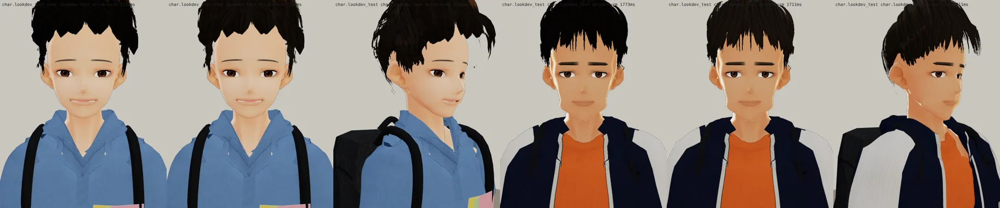
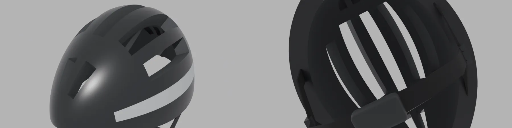
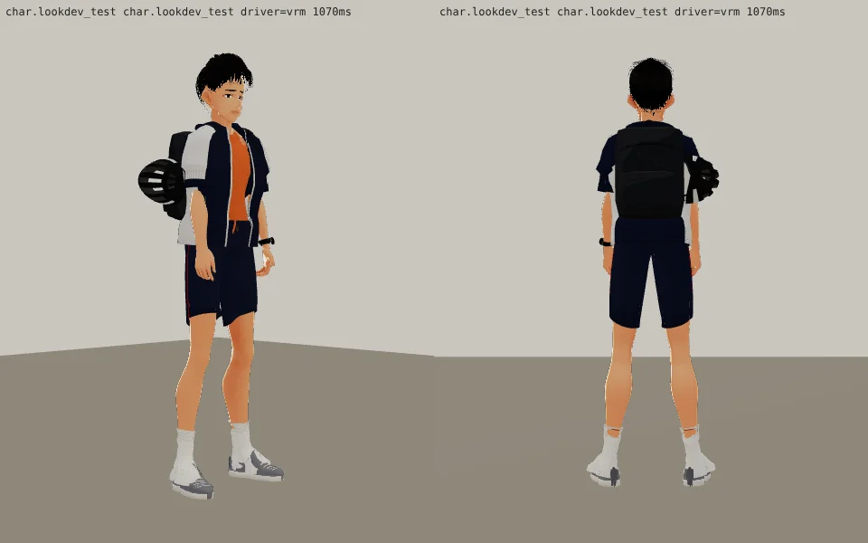
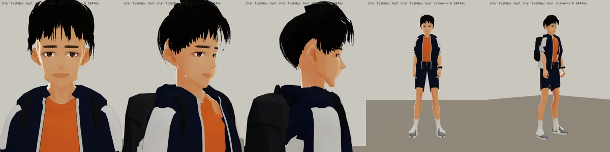

# v13：髮色（BB_201 第 11 節必修「韋綸一起改」；LAWWW2-C 2026-10-17 15:2x UTC；v12 模型通過）
- 頭髮底色從近黑改成很深的炭灰咖啡（和唐睿同一組顏色）；其他和 v12 相同。家豪的頭髮照舊是近黑（BB-C 通過的那一版，`jiahao_hair.py` 指定 `BLACK_V12`）。
- 對照：
- 遊戲渲染器：

---

# v12：衣服＋頭髮＋腿（BB_201 第 1、7 節；LAWWW2-C 2026-10-17 14:2x UTC；等 BB-C 驗收）
- 衣服（BB_201 第 1 節）：
  - 短袖連帽風衣、敞開不拉：袖子寬、到上臂一半，白色拼接只在袖子上半（第七版看起來像無袖，因為袖子很貼、大部分是白色拼接）；
  - 肩膀照沛珊的做法往下沉 2 cm、袖子從肩關節往內 3.5 cm（手放下來時肩膀上面不會裂開）。
- 頭髮（第 7 節）：
  - 剪短、耳朵露出來；髮殼 64 → 128 格、髮片 14 → 22 段（瀏海下緣的鋸齒）；
  - 耳朵上面的頭髮越靠髮尾越貼頭（`weilun_hair.py` 的 `side_taper`）：第十一版正面看太陽穴兩邊各一塊淡色，是髮尖的縫裡看到背景。
- 腿（第 1 節「運動型」）：小腿肚 +13 mm、大腿 +7 mm（`weilun_face.py` 的 `CALF_MM`、`THIGH_MM`）。
- 安全帽（第 1 節）：`assets/models/char/second_ai/helmet_bike.glb`（`tools/blender/char_second/helmet_bike.py`）：
  - 黑色外殼、銀色細側條、長條通風孔、深灰內襯、下巴帶和扣環；
  - 掛在後背包右側；遊戲端是配件（props3d），給 LAWWW-C 的片段：`docs/art-rebuild/second_ai/patches/props_helmet_weilun.js`。
  - Blender：
  - 遊戲渲染器（掛在背包右側，套 patch 預覽）：
- 遊戲渲染器：
- 上一版（表情一輪 v10）：
- 四個人並排（同一個鏡頭，看身高；左到右韋綸 176、唐睿 177、家豪 170、魏教授 172）：
  
- 臉正面（同上順序）：
  
- 還沒做：
  - 鞋子再深一點（BB 第 1 節「可以」）；
  - 遊戲裡的經原教室遠景（LAWWW-C 接進遊戲以後拍）。

---

# v10：表情一輪（BB_201 第 6 節；LAWWW2-C 2026-10-17 13:5x UTC；等 BB-C 驗收）
- 嘴窄到瞳孔內側、唇色淡；眉毛直、濃、短。
- 三人臉部近照和立繪頭部並排（左立繪、右 3D；韋綸、唐睿、家豪）：
  
- 遊戲渲染器：
- 還沒改：衣服（下一步，照 BB_201 第 2～4 項）、身材（做衣服時一起加）。

---

# 韋綸（邱韋綸 econ_weilun） 3D v9：臉分開＋待機臉帶笑（BB_201 第 0 節第 1、2 項；LAWWW2-C 2026-10-17 13:5x UTC；等 BB-C 驗收，D59）

- 這一版只改臉（BB_201 優先順序第 1 項）：長臉、窄、下巴長而有角；細長的眼睛、眼尾往上（眼神直）；曬黑；待機臉烘 Fcl_MTH_Fun 0.40＋Fcl_EYE_Surprised 0.12（嘴角平、眼睛張開）。
- 做法：
  - 臉型參數 `tools/blender/char_second/weilun_face.py`；
  - 待機臉用 `vrm_finish2.py` 的 `VRM_REST`，把表情的一部分烘進基本形。
- 三個人並排（上：臉正面，下：全身；左到右韋綸、唐睿、家豪）：
  
- 遊戲渲染器：
  
- 上一版：
  
- 還沒改（BB_201 第 2～6 項，下一步）：
  - 韋綸：短袖連帽風衣、安全帽；
  - 唐睿：polo 領、便利貼；
  - 家豪：薄背心；
  - 上衣像連帽衫（照沛珊第十版的領口做法）；
  - 頭髮、身材、鞋。

---

# 韋綸（邱韋綸 econ_weilun） 3D v7（LAWWW2-C，2026-10-17；等 BB-C 驗收，D59）
- VRM：`assets/models/char/second_ai/bl_econ_weilun.vrm`；頭髮沒有 MatCap。
- 穿搭：短袖 T＋連帽背心、運動短褲、白短襪、手錶；第七版改了腳跟（身體貼圖深色襪口的改色範圍）。
- 截圖：
  - `look_*.webp`：遊戲渲染器 test_charlook，待機、走路、坐下；
  - `blender_*.webp`：Blender 預覽。
- 已知問題：身體偏瘦；已知：沒有在遊戲裡看過坐下。
- 新遊戲從經濟系那一年開場（LIFE-LINE 第 7 組），經濟系人物提前交件。
