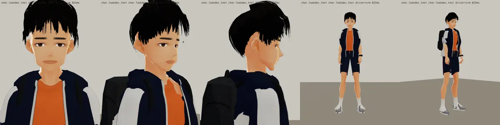

# 韋綸（邱韋綸 econ_weilun） 3D v9：臉分開＋待機臉帶笑（BB_201 第 0 節第 1、2 項；LAWWW2-C 2026-10-17 13:5x UTC；等 BB-C 驗收，D59）

- 這一版只改臉（BB_201 優先順序第 1 項）：長臉、窄、下巴長而有角；細長的眼睛、眼尾往上（眼神直）；曬黑；待機臉烘 Fcl_MTH_Fun 0.40＋Fcl_EYE_Surprised 0.12（嘴角平、眼睛張開）。
- 做法：
  - 臉型參數 `tools/blender/char_second/weilun_face.py`；
  - 待機臉用 `vrm_finish2.py` 的 `VRM_REST`，把表情的一部分烘進基本形。
- 三個人並排（上：臉正面，下：全身；左到右韋綸、唐睿、家豪）：
  
- 遊戲渲染器：
  
- 上一版：
  
- 還沒改（BB_201 第 2～6 項，下一步）：
  - 韋綸：短袖連帽風衣、安全帽；
  - 唐睿：polo 領、便利貼；
  - 家豪：薄背心；
  - 上衣像連帽衫（照沛珊第十版的領口做法）；
  - 頭髮、身材、鞋。

---

# 韋綸（邱韋綸 econ_weilun） 3D v7（LAWWW2-C，2026-10-17；等 BB-C 驗收，D59）
- VRM：`assets/models/char/second_ai/bl_econ_weilun.vrm`；頭髮沒有 MatCap。
- 穿搭：短袖 T＋連帽背心、運動短褲、白短襪、手錶；第七版改了腳跟（身體貼圖深色襪口的改色範圍）。
- 截圖：
  - `look_*.webp`：遊戲渲染器 test_charlook，待機、走路、坐下；
  - `blender_*.webp`：Blender 預覽。
- 已知問題：身體偏瘦；已知：沒有在遊戲裡看過坐下。
- 新遊戲從經濟系那一年開場（LIFE-LINE 第 7 組），經濟系人物提前交件。
