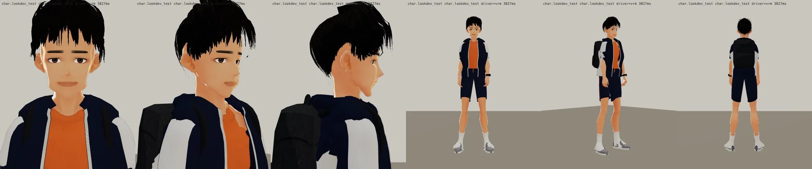

# ART-CH-WEILUN 邱韋綸（econ_weilun）3D 人物（LAWWW2-C 2026-10-17；第二版；狀態 READY_FOR_ART_REVIEW → 等 BB 驗收，D59）

- **參考**：BB_131 通過的標準圖 `docs/story_planning/art_reference/weilun.webp`（企劃線）：經濟系一年級、176 cm、小麥色、黑色短髮往上翹、深藍防風外套（肩膀白色拼接）、橘色 T、深藍短褲、白襪、灰色慢跑鞋、黑色後背包。
- **檔案**：`assets/models/char/second_ai/bl_econ_weilun.vrm`（2.74 MB，VRM 0.x，`vrm_finish2.py` 處理過：縮貼圖、男性眼睛）。
- **腳本**：`tools/blender/char_second/weilun.py`＋`weilun_face.py`、`weilun_clothes.py`、`weilun_hair.py`；指令：
  `/opt/blenv/bin/python tools/blender/char_second/weilun.py -- - --stages stage0,face --blend <工作檔>` →
  `... weilun.py -- <out.vrm> --from-blend <工作檔> --stages clothes,hair` →
  `VRM_BASE=Sakurada_Fumiriya VRM_MALE=1 python3 tools/blender/char_second/vrm_finish2.py <out.vrm> bl_econ_weilun.vrm 邱韋綸 "#3a2a22"`。
- **生產線**：和阿哲同一條（VRoid CC0 樣本 Sakurada Fumiriya 的身體、臉、表情、骨架；LAWWW 的 `tools/blender/char/`）。阿哲是法律系那一年、韋綸是經濟系那一年，不會同框。和阿哲不同的地方：臉的參數（眼睛平、細，直的近黑濃眉，下顎線硬）、頭髮（短、往上翹、黑）、外套（肩膀到上臂外側的白色拼接）、短褲＋白襪（新做的襪子網格，蓋掉樣本身體貼圖上畫的深色短襪）、身高 176。

## 遊戲渲染器（LAWWW 的 test_charlook.html：遊戲的 ASSETS＋CHAR.build、白天光線、待機／走路／坐下；背包是 props3d 的 backpack）
這**不是**遊戲內截圖（D59：LAWWW 接進遊戲後拍給 BB）。Playwright＋SwiftShader，不是真機。

全部：`look_face_front／q45／side`、`look_body_front／q45／back`、`look_body_front_walk／q45_walk`、`look_body_side_sit`。

## 版本
- 第一版（Blender 預覽 `v1_blender_sheet.webp`）自己退件：頭髮是蓋到眉毛的碗蓋頭、短褲像七分寬褲、鞋子上面露出樣本貼圖的深色短襪、臉太軟。
- 第二版：頭髮整圈改短（瀏海到眉毛上方 3.5 cm、耳朵露出來、頭頂往上翹）、短褲改短改窄、白色中筒襪、下顎線更硬。

## 八項（ART_SOP 3-2；人物照 D59 由 BB 驗收）
| 項目 | 結果 |
|---|---|
| 輪廓 | 外套敞開、羅紋袖口與下擺、短褲有寬鬆量；頭髮層次髮片＋瀏海撮 |
| 材質 | MToon（遊戲的人物材質）；衣服貼圖程式產生（平織、斜紋） |
| 比例 | 176 cm、約 7.7 頭身（樣本 8 頭身，頭縮 0.98） |
| 動作 | 待機、走路、坐下（遊戲渲染器）沒有看到穿模；**還沒測**：上下樓梯、跑步、轉身 |
| 效能 | 衣服 1.1 萬三角形、頭髮約 1.1 萬、VRM 2.74 MB |
| 還沒做 | 膝蓋擦傷（參考圖細節）、外套立領（現在是圓領敞開）、單車安全帽；短褲剛好到膝蓋（參考圖在膝蓋上面一點） |
