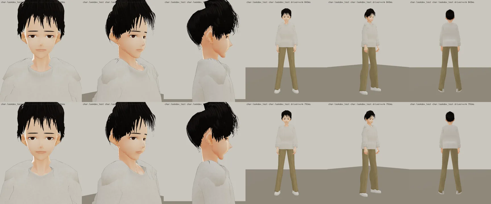
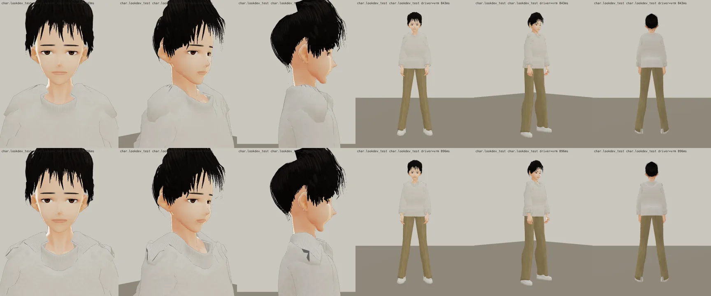
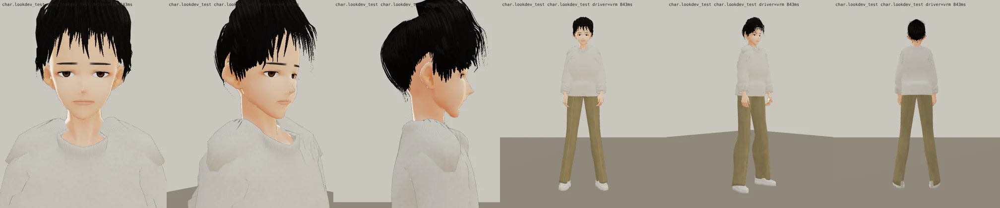

# ART-CH-XUN 盧正勳（阿勳，econ_zhengxun）3D 人物（LAWWW2-C；**第八版 2026-10-18**；狀態 READY_FOR_ART_REVIEW → **LAWWW-C 驗收**（使用者 23:5x，D100／bfacd97e）

## 第八版（2026-10-18，LAWWW-C 23:49 派工）
- 同一個檔名換新：`assets/models/char/second_ai/bl_econ_zhengxun.vrm`（2.75 MB）。下面的 `look_*.webp`、`look_sheet.webp`、`blender_*.webp` 都是第八版；第六版的移到 `v6/`。
- 對照：（上＝第六版、下＝第八版；遊戲渲染器 test_charlook.html，Playwright＋SwiftShader，不是真機、不是遊戲內截圖）
- 改了什麼（第六版自己再看一次不合格的兩點）：
  1. 正面像連帽衫／高領毛衣（領口一圈鼓起）→ 領口貼近脖子（NECK_GAP 0.8 cm）、羅紋改成家豪第十版的薄滾邊（不立起來）、圓領低一點（參考圖露出脖子根部）、棉 T 往下垂的皺褶（DRAPE）。
  2. 側面下巴、嘴往前突 → 往後收（LOWER_BACK、CHIN_FWD）。
- 第七版自己退件： 開了沛珊那一套肩膀選項（SHOULDER_SKIN、NECK_CALM、SLEEVE_IN、SHOULDER_SAG），這條簡單的生產線（p00_clothes，沒有把身體拉到布底下）側面肩膀的布分成兩片、中間破洞看到衣服裡面。
- **還沒達到參考圖的地方（老實說）**：肩膀上面還有一道布的折痕（和第六版差不多）；臉比參考圖年輕、柔（VRoid 樣本的臉型）；側面下巴還是比參考圖往前一點；上衣的寬鬆、垂墜不如參考圖。要再往下修，要換成沛珊／經濟系四人那條「把身體拉到布底下」的生產線（估半天以上）——要不要做由 LAWWW-C 決定。
- 走路、坐下（遊戲渲染器）沒有看到穿模；**還沒測**：上下樓梯、跑步、轉身。

## 第六版（2026-10-17）以下是舊紀錄（圖在 `v6/`）

- **參考**：BB_131 通過的標準圖 `docs/story_planning/art_reference/xun.webp`（企劃線）：經濟系一年級、19 歲、180 cm；冷淡、很淡的微笑；黑色凌亂短髮（瀏海一撮一撮到眉毛、兩側蓋到耳朵上緣）；白色寬版長袖 T（袖子略往上推、沒有紮）＋卡其色直筒長褲＋白球鞋。
- **檔案**：`assets/models/char/second_ai/bl_econ_zhengxun.vrm`（2.75 MB，VRM 0.x，`vrm_finish2.py` 處理過：縮貼圖、男性眼睛）。
- **腳本**：`tools/blender/char_second/xun.py`＋`xun_face.py`、`xun_clothes.py`、`xun_hair.py`；一次建好：
  `SP=<工作資料夾> LOOK_ROOT=<伺服器> bash tools/blender/char_second/char_build.sh xun v6 Sakurada_Fumiriya 盧正勳 '#2e221c' char.zhe 1.80 '' face`
- **生產線**：和阿哲、明軒同一條（VRoid CC0 樣本 Sakurada Fumiriya）。阿勳是經濟系那一年的室友，明軒、阿哲是法律系那一年，不同框。

## 遊戲渲染器（LAWWW 的 test_charlook.html：遊戲的 ASSETS＋CHAR.build、白天光線、待機／走路／坐下）
這**不是**遊戲內截圖（D59：LAWWW 接進遊戲後拍給 BB）。Playwright＋SwiftShader，不是真機。

全部（第六版，在 v6/）：`look_face_front／q45／side`、`look_body_front／q45／back`、`look_body_front_walk／q45_walk／side_walk`、`look_body_front_sit／q45_sit／side_sit`、`look_hips_side_sit`。Blender 預覽：`blender_face_front／face_q45／body_front`。

## 版本（自己退件的，都在遊戲渲染器看過）
- 第一版（`v1_look_sheet.webp`）：眼睛圓、有精神（不像參考圖的冷淡）；瀏海像窗簾垂到眼睛；褲子太寬。
- 第二、三版（`v3_look_sheet.webp`）：眼睛改細長；但褲腳往外張開像喇叭褲（樣本的腿往內斜、褲管是垂直的管子）；頭頂一圈白邊（頭髮材質從樣本帶來的 MatCap）；頭頂一個白點（髮殼在髮旋留了洞）；兩側的瀏海撥過去之後掉到眼睛、顴骨；上衣像泡泡袖毛衣。
- 第四、五版：褲管改成跟著腿骨走（生產線新選項 `PANTS_FOLLOW`）、關掉頭髮的 MatCap、髮殼補到髮旋、瀏海髮尾照撥過去的方位算、眼尾不下垂、下巴不往前突；袖口放寬。上衣還是像羅紋毛衣（jersey 貼圖 360 條直紋）。
- 第六版：上衣改平織棉貼圖（生產線新選項 `TOP_TEX='cotton'`）。

## 八項（ART_SOP 3-2；人物照 D59 由 BB 驗收）
| 項目 | 結果 |
|---|---|
| 輪廓 | 凌亂短髮（三層髮片＋瀏海兩層）、寬版長袖 T（落肩、直筒袖）、直筒長褲（褲腳略堆在鞋上） |
| 材質 | MToon（遊戲的人物材質）；衣服貼圖程式產生（平織棉、斜紋） |
| 比例 | 180 cm、約 7.8 頭身（樣本 8 頭身，頭縮 0.97） |
| 動作 | 待機、走路、坐下（遊戲渲染器）沒有看到穿模；**還沒測**：上下樓梯、跑步、轉身 |
| 效能 | VRM 2.75 MB |
| 還沒做／已知 | 自動鉛筆（配件，之後另外做）；表情是平常（冷淡），「很淡的微笑」「關心」靠遊戲的表情；側面看下巴還是比參考圖往前一點（樣本的臉型）；上衣的寬鬆量比參考圖少一點 |
