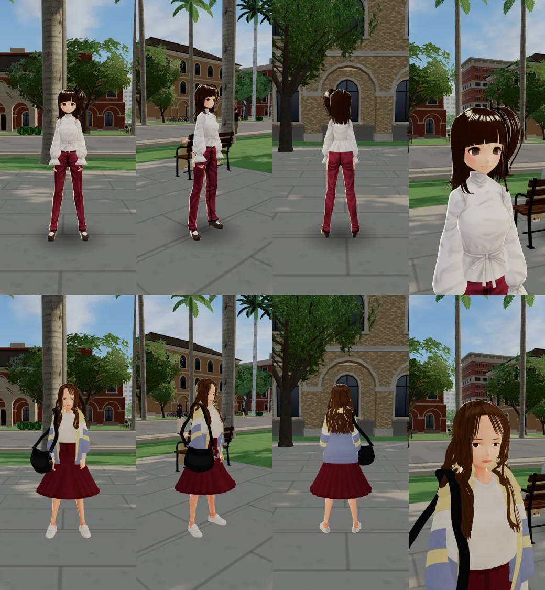
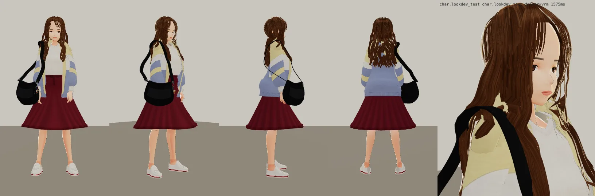
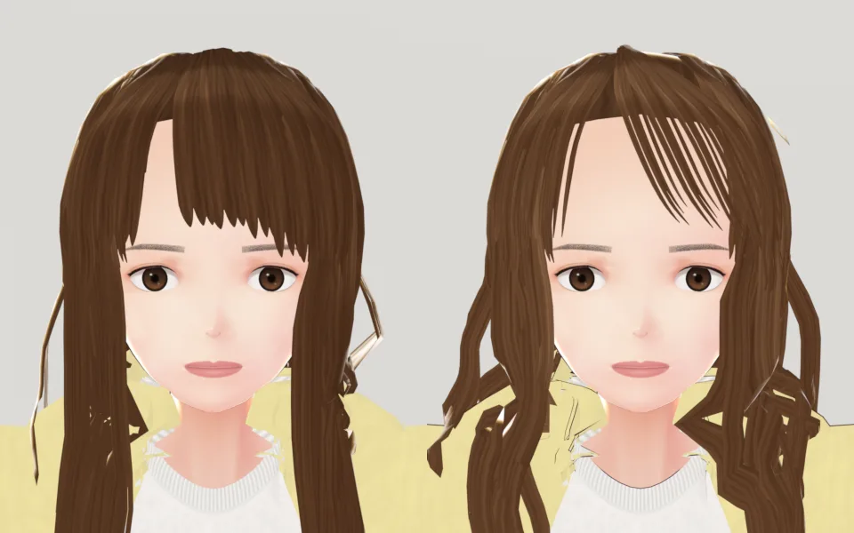

# ART-YU-3D-1018：小語（李語晴，`yu`）3D 人物

LAWWW2-C，2026-10-18。

- 誰派的：LAWWW-C 05:34。照 `characters.js` 的小語＋立繪 `assets/portraits/yu/campus/`、參考圖 `art_reference/yu.webp` 重做；品質至少到路人第五批。
- 狀態：`MODEL_READY`。角色美術由 LAWWW-C 驗收（D59）。

## 交付
- VRM：`assets/models/char/second_ai/bl_yu.vrm`（3.8 MB）。
  - 底模是 VRoid CC0 樣本 Sendagaya Shibu，身高 1.63 m。
  - 頭髮 15.7 千三角形，外套 6.6 千。
- 包：`assets/models/char/second_ai/bag_yu.glb`（4.6 千三角形、0.17 MB）。
  - 黑色尼龍側背包、背帶、登山扣，加三個社團吊飾：天秤、麥克風（紅色蝴蝶結）、吉他。
  - 沒有牌子（D77）。
- 腳本：
  - `tools/blender/char_second/yu.py`、`yu_face.py`、`yu_clothes.py`、`yu_hair.py`；
  - 包：`prop_yu.py`（`--fit <vrm>` 量身體 → `prop_yu_fit.json`，再做 GLB）。
- patch：`docs/art-rebuild/second_ai/patches/char_yu.diff`，對 LAWWW-C 分支 `ba6e9aa4`：
  - `src/assets3d.js`：加 `char.yu`、`prop.bag_yu`；
  - `src/character3d.js`：
    - `CAST` 加 `yu`；
    - `MODEL_PROPS` 加 `'char.yu':['bag_yu']`；
    - 坐下時藏起來的配件清單加 `bag_yu`（同後背包）。
  - `src/props3d.js`：新的 `boneGlb()`，整組 GLB 掛在骨頭底下；`bag_yu` 掛在 upperChest。

## 玩家會看到什麼
- 改之前：小語用的是路人底模 `npc_f2` 換色——馬尾、白襯衫、紅長褲，和立繪完全不像。
- 現在照參考圖：
  - 頭髮：
    - 栗棕色大波浪中長髮；
    - 從人物右邊的分線往左斜撥的空氣瀏海；
    - 左邊一支金色長方形髮夾（中間鏤空）。
  - 衣服：
    - 淡黃／白／灰藍拼色的寬版風衣（敞開）；
    - 白 T 紮進酒紅色高腰中長裙（直褶、腰帶）；
    - 光腳、白色帆布鞋。
  - 包：右肩側背，包在右邊腰臀前面。

## 遊戲內前後（同角度）
Playwright、iPhone 直向 390×844 模擬。校園，週二 08:11。
- 上排：改之前，LAWWW-C 分支 `ba6e9aa4` 原樣。
- 下排：改之後，本 patch＋VRM＋包。
- 左到右：正面、右前方、背面、臉。
- **捷徑**：用 `GAME.spawnCharacter` 把小語放在 (−27, 15) 站著，玩家藏起來。

遊戲渲染器（`test_charlook.html`，第四版＋包；左四張待機：正面、右前、側面、背面，右邊是臉）：

- 第四版和交件的第六版差別：第四版背後多一塊試做的帽子，被頭髮蓋住、看不到。
- 頭髮、衣服、包都一樣。

Blender 臉部算圖（左：第一版，直髮＋齊瀏海；右：交件的第六版）：

## 每一版改了什麼
| 版本 | 問題 | 改法 |
|---|---|---|
| v1 | 直髮、齊瀏海；腿是黑的（樣本貼圖畫了黑長襪）；裙子到小腿中段 | — |
| v2 | 波浪每片隨機相位，亂成鋸齒 | 大波浪（兩個 S、左右＋前後起伏）、光腳（芯慈的 `bare_legs`）、裙子短 4 cm、髮夾 |
| v3 | 瀏海還是一排往下 | 相位跟著方位角慢慢變（一片一片的波浪） |
| v4 | — | 瀏海的髮根都在分線上、片窄、斜撥 30–48°、貼圖稀一點；兩側的髮片轉 38° 朝前（正面看不是細線）；不再把兩側硬收到包絡線（會變鋸齒） |
| v5 | 帽子試做：被頭髮蓋住、形狀皺成一片 | 拿掉 |
| v6（交件） | — | v4 的頭髮＋沒有帽子的衣服 |

包：
- 第一次量身體用 T 字姿勢：外套前襟往前翹，包離身體 8 cm；遊戲裡背帶浮在肩膀上 3–5 cm。
- 改成手放下來（待機姿勢）量。包的位置只看身體、T 恤、裙子；背帶從手臂後面繞過去。

## 測試
- 遊戲內 5 個鏡頭都沒有 JS 錯誤。`post` 確認小語用的是 `char.yu`。
- 遊戲渲染器：待機、走路都看過。
- 沒測：
  - 坐姿（包坐下時藏起來是照後背包的程式，沒有截圖確認）；
  - iPhone 實機；
  - 劇情流程。

## 還沒做到的（誠實列出）
- 背後的帽子沒做。參考圖背面有（淡黃、中間一道灰藍），現在用淡黃立領代替。
- 走路時右手會穿過包的外側，偶爾也會穿過背帶。動畫沒有「手拉著背帶」的姿勢。
- 外套背後下擺在側面看有點蓬（和第一版一樣，沒改）。
- 臉是平常的表情；表情照遊戲的 `setExpr`。
- 頭髮側面偶爾有一小段亮的髮絲：側著的髮片。
