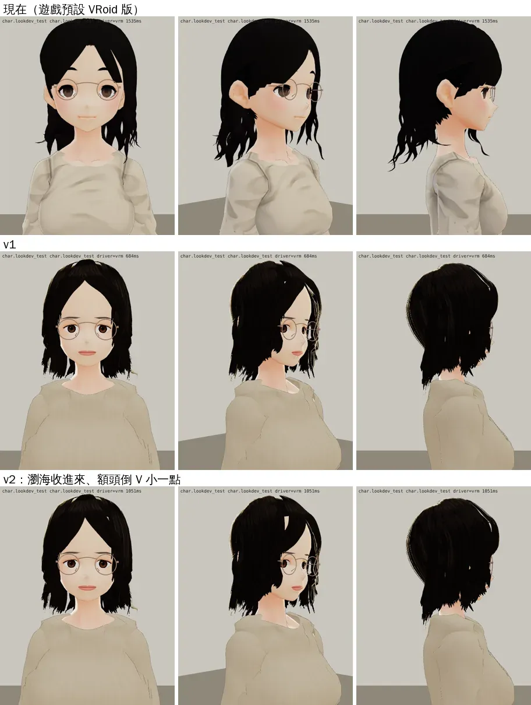
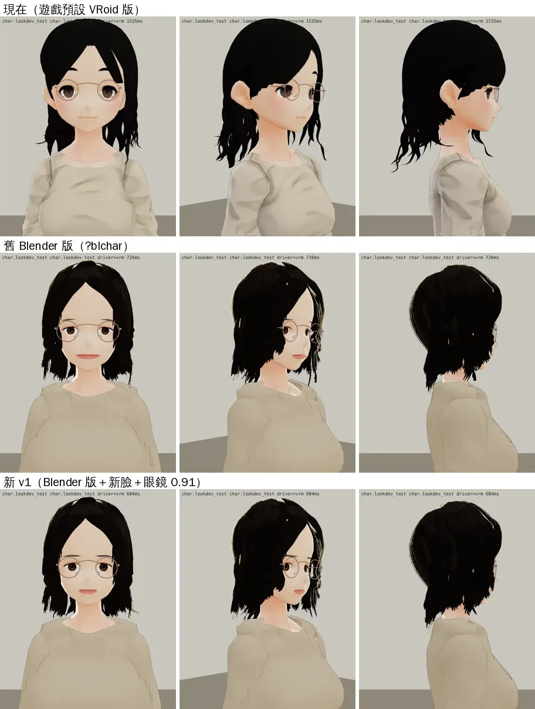
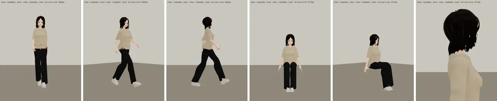
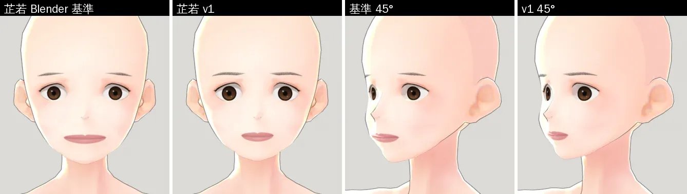

# 林芷若 3D：改用 Blender 版，臉和瀏海重調（使用者「林芷若3d好憨」）

帳號 A 的 LAWWW2，2026-10-22 04:0x～04:4x UTC。

- **狀態**：臉 LAWWW 驗收通過（10-22 04:4x，D100 第 6 點），已接進開發分支 `7e00ad05`；頭髮另開 `ART-ZR-HAIR-1022`。
- **起因**：使用者 10-22 04:0x 直接說「林芷若3d好憨 沛珊也是」（UA-LAWWW2-1022-01）。
  - 使用者 10-17 暫停了人物修改；這件是使用者自己提的，所以這兩位解除暫停。
  - 名字、身高 161 cm、黑色及肩微捲髮、淺色細圓框眼鏡、米色亞麻上衣、黑色寬褲照參考圖 06，不動。

## 為什麼看起來憨

遊戲現在預設的是 10-10 的 **VRoid 加工版**（`vroid_heroine_02.vrm`）：

- 動畫式的大圓眼、兩眼分得開；
- 臉頰一大塊粉紅腮紅；
- 小 V 下巴、鼻子一個點、嘴一條線——是小孩的臉；
- 粗眉毛高高掛在眼鏡上面。

同一天另外做的 **Blender 版**（`bl_heroine_02.vrm`，只在 `?blchar` 才用）是成人比例，但也憨：

- 內眼角距離＝眼寬的 1.28 倍；
- 嘴寬 4.8 cm 又低（人中長）、下巴長；
- 中分瀏海離中線 23°，額頭露出一個很大的倒 V。

## 改了什麼（走 Blender 製作線 `tools/blender/char/heroine_02.py`）

### 臉（`p02_face.py` 的 `LIN`）

| 參數 | 10-10 | 現在 |
|---|---|---|
| `EYE_IN` | 0.0028 | 0.0075（內眼角距離＝眼寬 1.09 倍） |
| `EYE_SX`／`EYE_SZ` | 1.02／0.66 | 1.06／0.74 |
| `IRIS_FRAC` | 0.50 | 0.54 |
| `BROW_DROP` | 0.0045 | 0.0060 |
| `MOUTH_K` | 1.65 | 1.25 |
| `MOUTH_DOWN` | 0.0020（預設） | 0.0003 |
| `D_CHIN` | 0.007 | 0.002 |
| `FACE_NARROW` | 0.96 | 0.945 |

腮紅照舊拿掉七成（`CHEEK_TINT_K` 0.7）。

### 瀏海（`p02_hair.py`）

- 八字瀏海越過額頭的位置：離中線 23° → **16°**、眉毛上方 1.4 → **0.8 cm**。
- 額頭的倒 V 小一點、臉不那麼長。

### 眼鏡（`glasses_zhiruo.py`）

- 芷若那一副的鏡片中心距 84 → **76.6 mm**：眼睛往中間 3.4 mm，眼鏡要跟著。
- 魏教授那一副（同一支腳本 `--style wei`）照舊 84 mm。

### 試參數的方式

- `FACE_OVERRIDE`、`ZR_V_A`、`ZR_V_Z` 環境變數，同鏡頭比。
- 用寫回預設值的腳本重建，VRM、眼鏡 GLB 都和試出來的那一版**逐位元組相同**。

## 前後（遊戲渲染器 `test_charlook.html`；Playwright＋SwiftShader，不是 iPhone）

上：遊戲現在的預設（VRoid 加工版）；中：v1（新的臉）；下：v2（再把瀏海收進來）＝**這次交的版本**。

上：現在的預設；中：10-10 的 Blender 版（`?blchar`）；下：v1：

走路、坐下（戴眼鏡、耳環）：

Blender 光頭算圖：10-10 的臉、v1 的臉（正面、45°）：

## 接法（LAWWW）

1. `git apply docs/art-rebuild/second_ai/patches/zhiruo_default_bl.diff`
   - `src/assets3d.js` 一行：`char.heroine_02` 的 `url` 換成 `bl_heroine_02.vrm`（和 `blUrl` 相同），`source` 改寫。
   - 對 `c617b2e0`、`6b6ecd80` 都乾淨。
2. 換兩個檔（我的分支）：
   - `assets/models/char/bl_heroine_02.vrm`（3.05 MB）
   - `assets/models/char/second_ai/glasses_zhiruo.glb`（＋`.json`）
3. **三樣要一起接**：只換眼鏡，舊的 VRoid 版會對不準；只換 VRM、不換眼鏡，也會對不準。
4. 驗收：角色美術由 LAWWW 驗收（D100 第 6 點；D59 已作廢，交件時誤寫成 BB）。
5. 測試裡沒有寫死 `vroid_heroine_02.vrm`（grep 過）。人物相關的回歸請照平常跑：Café 吧台、座位、圍裙。

## 還不到的地方（誠實寫）

- **頭頂的頭髮偏平、偏貼**（像戴著頭盔）。參考圖 06 頭頂有一點蓬度、側分的瀏海一大片蓋過額頭；這一版沒改分線（LAWWW 10-10 第六版試過側分，近看像一排齊瀏海），下一輪再看。
- 換成 Blender 版以後，臉沒有 VRoid 版那種動畫感。這是照「成人比例、不要大眼睛」（CLAUDE.md 美術方向第 7 條）做的取捨。
- 眼睛往中間移了 3.4 mm，但眼球骨頭沒跟著移。眼睛轉動時虹膜繞著舊的中心轉，偏不到 1 mm，還沒在遊戲裡量。
- 表情（笑、驚訝）只看了 VRM 的預設；劇情裡的表情等 LAWWW 接上以後拍。
- 真機沒看過。
