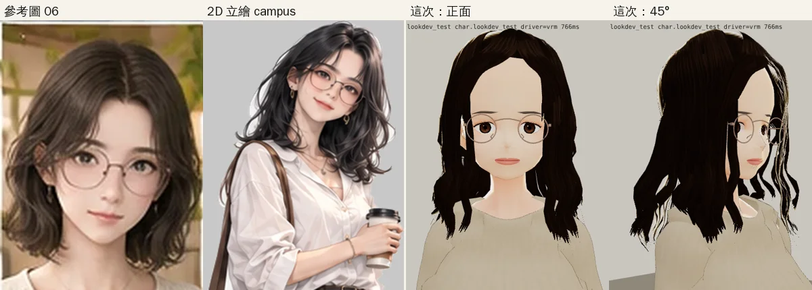
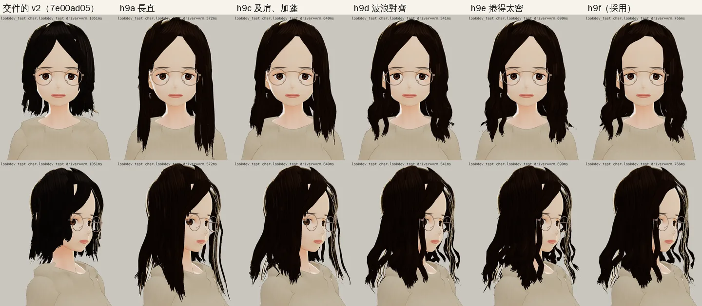
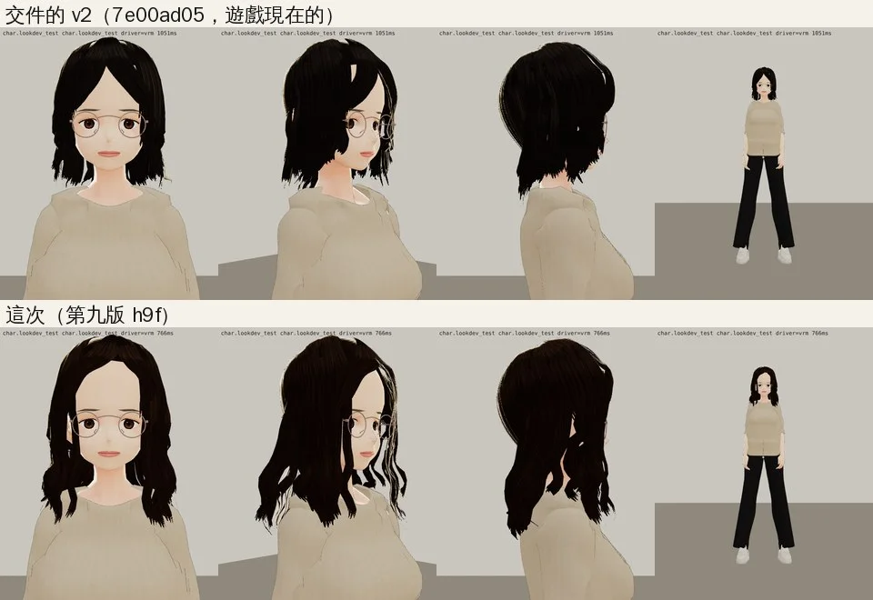
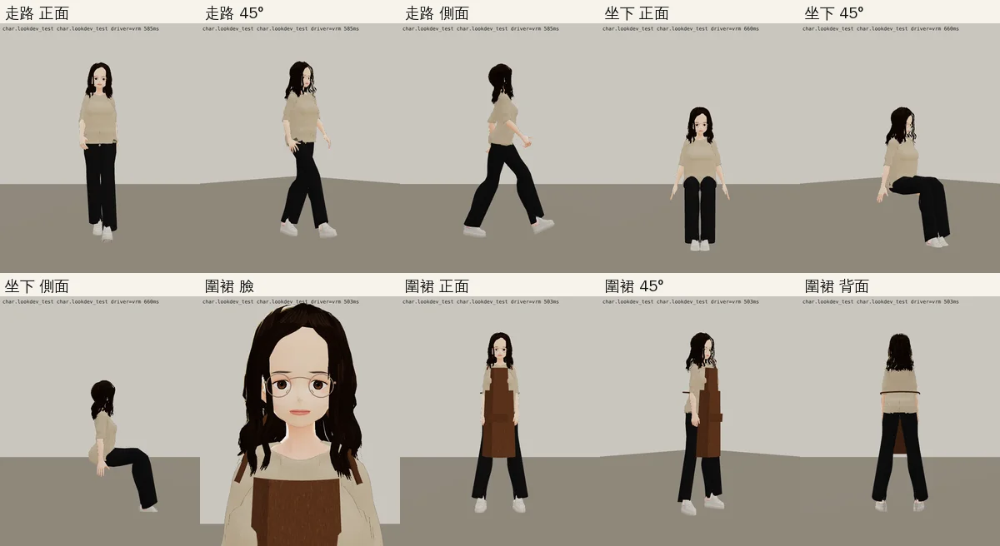

# 林芷若 3D 頭髮第九版（ART-ZR-HAIR-1022）

帳號 A 的 LAWWW2，2026-10-22 04:5x～05:1x UTC。

- **狀態**：已交付，給 LAWWW 驗收（D100 第 6 點）；`READY_FOR_ART_REVIEW`。
- **起因**：使用者 10-22 04:0x「林芷若3d好憨」的下一輪。
  - LAWWW 04:4x 驗收 888831c4：臉通過；頭髮不到參考圖——頭頂平得像頭盔、只到下巴。
  - BB 04:45（BB_221）意見相同：少了「及肩微捲」、頭頂扁平、髮色應該是深咖啡；衣服不用改。
- **不動的**：
  - 臉：和 888831c4 同一張，臉部模組、參數都沒改。
  - 身高 1.61、表情、衣服（米色上衣、黑色寬褲，照參考圖 06）。
  - 配件：`glasses`、`earrings`、`apron` 三個節點名字（props3d），眼鏡 GLB 也不用換。

## 對照參考圖找到的問題

1. **分線左右做反了**。
   - 參考圖 06 的臉部特寫、campus 立繪，分線都在畫面右邊，也就是人物的左手邊；頭髮多、往外撥的那一邊在人物的右邊。
   - 10-10 的第八版是 −4°（人物的右邊）。
2. **短、直、貼著頭**：
   - 頭髮到下巴、頭頂服貼，側面看是一頂圓帽，下緣是一條水平線。
   - 參考圖是及肩（立繪更長），兩側有蓬度，下段微捲、髮尾外翻。
3. **髮色接近純黑**；參考圖 06 是深棕，受光處暖棕。
4. **額頭露出一個窄的倒 V**，臉看起來長。參考圖露出的額頭上面窄、到眉毛變寬。



## 改了什麼（`tools/blender/char/p02_hair.py` 第九版）

| | 第八版（交件的 v2） | 第九版 |
|---|---|---|
| 分線 | −4°（人物的右邊） | **+12°（人物的左邊）**；右邊一大片往外撥、左邊短 |
| 長度 | 前面到下巴、兩側到肩膀上方 | 前面沿著胸前垂到鎖骨、正側面從肩膀後面繞過去、後面到肩膀下 |
| 頭頂 | 最厚 1.8 cm、兩側打 0.55 折 | 最厚 2.2 cm、兩側打 0.85 折（太陽穴旁有蓬度） |
| 波浪 | 每片各自隨機相位、只有左右 | **波峰照高度對齊**（波長 7.5 cm）、內外和左右一起動；髮尾鈍一點、外翻 1.8 倍 |
| 髮色 | 深灰黑 (0.14, 0.12, 0.115) | 深棕 (0.168, 0.120, 0.096)、受光處暖棕 |
| 額頭 | 倒 V：兩邊瀏海的內緣在眉上 1 cm、±16° | 內緣在眉上 2.2～2.4 cm、−26°／+30°，到眉毛再往外 |
| 綁定 | 全部綁頭 | 脖子以上綁頭，往下 12 cm 漸漸換成上胸（同杜可昕）：轉頭時髮尾跟著身體，不會甩進胸口 |

頭髮三角形 12,384（第八版 11,616：主層髮片 48 → 54、外層 34 → 38）。VRM 3.10 MB（第八版 3.05 MB）。

### 試了六個版本（遊戲渲染器）



- **h9a**：只改分線、長度、頭頂、髮色。變成又長又直的兩片窗簾，斜看頭頂翹起一道（分線旁的蓬度和瀏海髮根加在一起）。
- **h9c**：剪到及肩、兩側加蓬、髮尾外翻。不像頭盔了，但還是直髮。
- **h9d**：波浪改成照高度對齊，整頭看得出微捲。
- **h9e**：波長 6 cm、幅度大，捲得太密。
- **h9f（採用）**：h9d 的波浪，加上額頭露出的形狀照參考圖、太陽穴旁蓬一點。

## 前後（遊戲渲染器 `test_charlook.html`；Playwright＋SwiftShader，不是 iPhone）

上：交件的 v2（開發分支 `7e00ad05` 現在的）；下：第九版。



走路、坐下、Café 當班穿圍裙：



## 重建、驗證

- 預設值寫回腳本，不帶任何環境變數、從頭跑完整流程重建，VRM 和試出來的 h9f **逐位元組相同**。
- 建置：

```bash
/opt/blenv/bin/python tools/blender/char/heroine_02.py -- <工作>/raw.vrm --stages stage0,face,clothes,hair
VRM_BASE=Victoria_Rubin python3 tools/blender/char_second/vrm_finish2.py <工作>/raw.vrm assets/models/char/bl_heroine_02.vrm 林芷若 '#3e2c24'
```

- 只重做頭髮（試參數用，這次新加）：
  1. 先存工作檔：`heroine_02.py -- - --stages stage0,face,clothes --blend w.blend`
  2. 再從工作檔重做頭髮：`HAIR_OVERRIDE='{"WAVE":0.016}' heroine_02.py -- v.vrm --from-blend w.blend --stages hair`

## 接法（LAWWW）

- 換一個檔，同檔名，manifest、程式都不用改：`assets/models/char/bl_heroine_02.vrm`。
- 開發分支 `7e00ad05` 已經用 Blender 版當預設。
- 眼鏡 `glasses_zhiruo.glb` 不用換：臉沒動，眼睛的位置一樣。
- 人物相關的回歸照平常跑：Café 吧台、座位、圍裙。

## 還不到的地方（誠實寫）

- 波浪比參考圖規則（同一個波長），近看像燙過的捲。
- 斜看時，遠的那一邊有幾片側著的髮片反光，看起來是一兩條淡色的細線。
- 髮色比參考圖 06 深一點，比較接近 campus 立繪。
- 轉頭、低頭時，頭和上胸之間那一段頭髮會拉伸（綁定是漸層的，沒有彈簧骨）；遊戲的劇情鏡頭還沒看。
- 真機沒看過。
