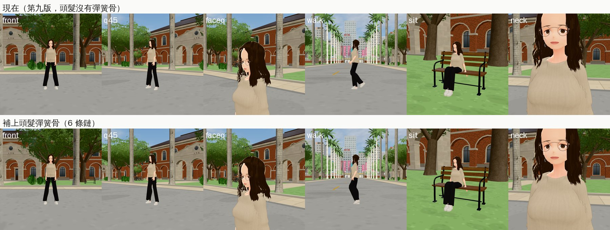

# 林芷若 3D 頭髮：補回彈簧骨（10-24）

LAWWW2-B，2026-10-24 06:0x～06:2x UTC。

- **起因**：LAWWW-B 10-24 05:53（P2）發現 `bl_heroine_02.vrm` 的頭髮沒有彈簧骨，走路、轉身時整束頭髮像黏在頭上。
- **原因**：
  - 10-22 第九版頭髮（`p02_hair.py`，[zhiruo_hair_1022](../zhiruo_hair_1022/README.md)）重做以後，彈簧骨那一步沒有再跑。
  - 那一步是另一支工具 `tools/blender/char/hair_springs.py`，不在 `heroine_02.py` 的建置流程裡，所以漏了。
- **狀態**：外觀和第九版一樣，只差頭髮會不會動，所以維持第九版原本的驗收狀態（10-22 LAWWW 驗收通過）。角色美術由 LAWWW 驗收（D100a；LAWWW-B 10-24 06:25 更正了我原本寫的「BB 驗收」）。

## 改了什麼

- **模型** `assets/models/char/bl_heroine_02.vrm`（3.10 MB；第九版 3.10 MB）：
  - 頭髮加 6 條彈簧骨鏈（`J_Sec_Hair_Chain0`～`5`），掛在頭的兩側和後面；
  - 9,584 個頭髮頂點裡，1,888 個跟著鏈動（肩膀以下的髮尾）；
  - 頭頂、瀏海、臉旁邊照舊綁在頭上。
  - 臉、衣服、頭髮的形狀、髮色、身高都沒動：用 10-22 的流程重建，到「頭髮」為止和第九版每個 byte 都一樣（`cmp` 確認過），才加彈簧骨。
- **建置流程**：
  - `heroine_02.py` 多一個 `springs` 階段，完整的芷若要跑：
    ```
    --stages stage0,face,clothes,hair,springs
    ```
    以後重做頭髮也不會再漏。
  - `hair_springs.py` 拆出 `apply_springs(cid)`，建置腳本可以直接叫。單獨用的方式不變。
  - 用 `springs` 階段重建出來的 VRM，和單獨跑 `hair_springs.py` 的結果每個 byte 都一樣。
- **截圖工具** `tools/shots/char_review.py`：
  - 原本的問題：讀檔後手機還是會從別的路打開、遊戲暫停，側面以後四張整組拍到手機。
  - 改法：每 0.3 秒關一次手機、解除暫停，手機和提示框用 CSS 藏起來。
  - 只影響截圖的頁面，遊戲沒有改。

## 測試（Node 模擬彈簧骨，不是瀏覽器、不是實機）

- `node tools/dev_scratch/spring_sim/sim_hair.js char.heroine_02`：**PASS**
  - 站著、瞬移後、走路時，髮尾的高度都是 −0.082～−0.083 m；
  - dt 0.033 和 0.300（低幀率）都一樣；
  - 結論：髮尾沒有被甩到耳朵高度（#25 那一類）。
- `node tools/dev_scratch/spring_sim/hair_sway.js char.heroine_02`：**PASS**
  - 最長的鏈 6.5 cm；
  - 跑步＋急停急轉時最大偏移 6.0 cm；
  - 停下 1.5 秒後偏移 0.0 cm。
- 改之前 `hair_sway.js` 找不到任何頭髮彈簧骨。

## 截圖（遊戲內，Playwright＋SwiftShader；不是 iPhone 實機）

- `tools/shots/char_review.py --ids heroine_02 --variants def`，同一個開發樹（`738cc7ffc`＋ART-WZ6 patch），同角度、同時間，前後各一次。
- 上排是第九版、下排是這一版。
- 站著、坐著、側面、臉的特寫看起來一樣，這是預期的：彈簧骨在靜止時不改形狀。
- 走路那一張是單一畫面，看不出擺動，擺動看上面的模擬數字。



## 還沒做／已知

- 實機上的擺動幅度沒看過（SwiftShader 1–4 fps，看不準）。
- LAWWW-B 已整合進開發分支（`cb6cef3e3`），重跑 `sim_hair.js`、`hair_sway.js` 都 PASS（10-24 06:25）。
