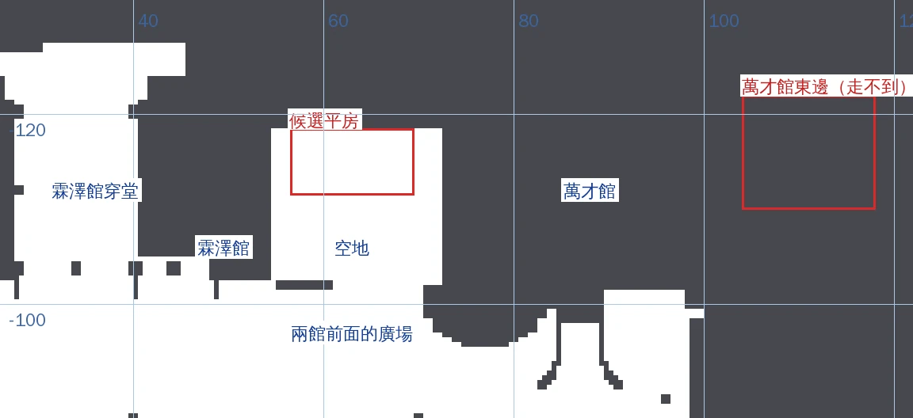
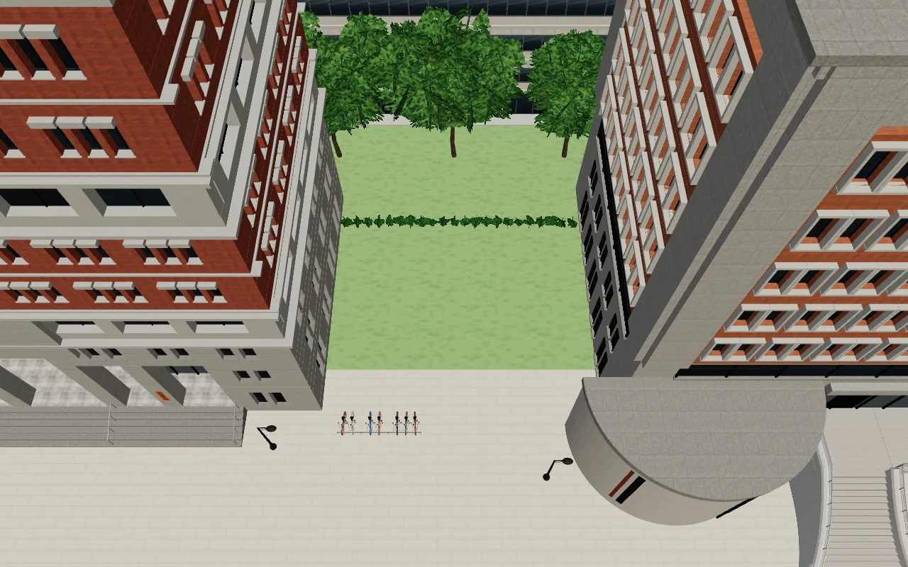
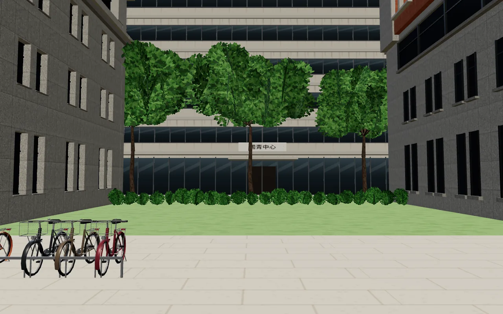
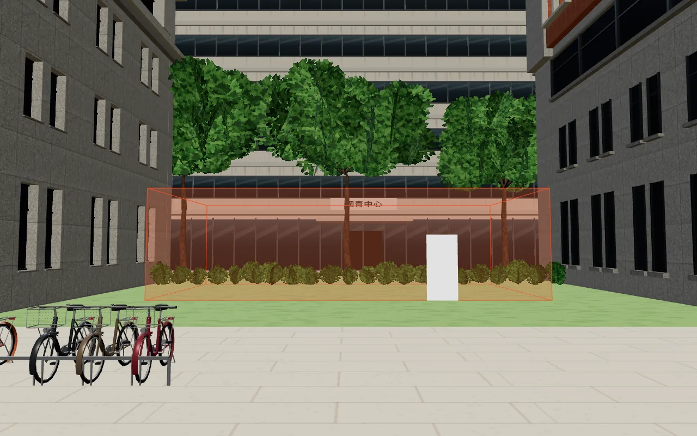
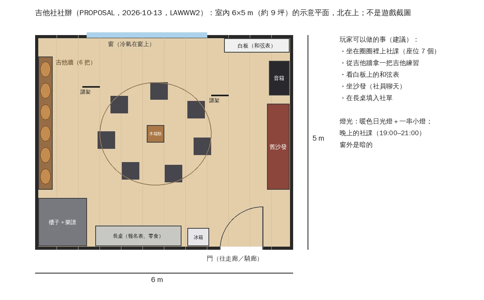

# 吉他社社辦：一頁提案（PROPOSAL；不建模）

LAWWW2，2026-10-13。LAWWW 22:01Z 分派③：企劃（AA_110 6-8，AA 暫定）寫「萬才館旁的社辦」，遊戲暫時用萬才館一樓「多功能教室」（進不去的門）；先給一頁提案：社辦放在哪、大概多大、裡面有什麼。**這份是提案，位置、大小、做不做都等 LAWWW／使用者決定。**

## 1. 現況

- 吉他社社課（`src/data/activities.js` 的 `club_guitar`，AA 暫定）：地點「萬才館 多功能教室」（`door:true`，門進不去），週一、週三 19:00–21:00。
- 萬才館（校園 (88, −112)，30×20 m）：一樓大廳 18×14 m（柱子、沙發、圓桌、公告欄）；「多功能教室」、二樓「研討室 A／B」都只有門。萬才館的室內是 LAWWW 的檔案（`src/wancai3d.js`、`src/data/wancai_layout.js`）。
- 真實參考：一般來說，臺大的社團辦公室多半在學生活動中心；「萬才館旁的社辦」是企劃的設定。沙盒和 WebFetch 都連不到臺大網站，**沒有查證**，也沒有照片。

## 2. 放在哪（三個選項）

用遊戲的導航格看萬才館周圍哪裡有空地（`tools/blender/env_second/shots/nav_map.py`，LAWWW `9884d29`；白＝走得到、深灰＝擋住；紅框＝候選）：

- 萬才館東邊（x 104～118、z −122～−110）整塊在走不到的範圍（法學院後面，D26／D31），放不了。
- **霖澤館和萬才館中間**有一塊走得到的空地：x 54.5～72、z −118.6～−102.5（約 17.5×16 m）；北邊接走不到的範圍（法學院後面），南邊是兩館前面的廣場。
- 候選：在這塊空地的北半邊放一棟一層樓的「社團辦公室」（x 56.5～69.5、z −118.5～−111.5，13×7 m，門朝南），前面留 9 m 接廣場。

遊戲內畫面（LAWWW `9884d29`，本機；**紅色半透明框是候選的平房位置與大小，不是模型**；白色小方塊是門的位置；Playwright＋SwiftShader，不是 iPhone）：

**從上面看：現況**

**從上面看：候選的平房（紅框）**

**從廣場往北看：現況**

**從廣場往北看：候選的平房（紅框）**

看到的事：
- 空地現在是一片草地：北邊一排矮灌木（就在走得到的範圍的北緣 z ≈ −118.6）、灌木後面三棵樹，再後面是國青中心（背景，走不到）。
- 候選平房的北牆剛好落在那排矮灌木上：真的蓋的話，平房範圍裡的灌木拿掉（或留在牆後面），北牆貼著走不到的範圍，**不在牆和灌木中間留窄縫**（窄縫會變成只有一點站得住的小孤島，v9.3 #31）。
- 平房兩側和霖澤館、萬才館的牆之間各留 2–2.5 m（夠寬，人走進去出得來；走到底是灌木，沒有路）；前面留 9 m 接兩館前面的廣場。
- 平房會擋住國青中心一樓的一部分（從廣場看過去）。

| 選項 | 做法 | 好處 | 要注意 |
|---|---|---|---|
| **A（建議）霖澤館與萬才館之間的一層樓「社團辦公室」** | 一棟約 13×7 m 的平房：兩間社辦並排（吉他社開放、另一間關著：門牌寫別的社團）、門朝南、前面有騎廊；放在兩館中間空地的北半邊（候選範圍和導航見上圖） | 照企劃「萬才館旁」（萬才館西牆就在旁邊）；從霖澤館、萬才館走過去都只要幾步；不用動萬才館的室內 | 新的小建築：LAWWW2 做 Blender 外觀＋社辦室內；LAWWW 做入口、區域（或小房間）、導航 |
| B 萬才館一樓「多功能教室」旁邊再開一間 | 在萬才館一樓大廳的牆上多一扇門，進去是社辦 | 不用新建築 | 要改萬才館的配置（LAWWW 的檔案）；大廳已經放滿 |
| C 萬才館地下室 | 加一層 B1 | — | 要加樓梯／電梯的樓層，成本最高；真實萬才館有沒有地下室不清楚 |

## 3. 多大

- **室內 6×5 m（約 9 坪）、天花板 2.8 m**：一般社團辦公室的大小，社課 7–10 人圍一圈坐得下。
- 一扇門（南：往騎廊）、一扇窗（北，窗上有窗型冷氣）。選項 A 的平房：兩間 6×5 m＋1.5 m 騎廊 → 約 13×7 m（兩間加牆）；如果只要一間，6.5×7 m。空地只有 17.5 m 寬，三間（約 19 m）放不下。

## 4. 裡面有什麼（示意平面）

- **吉他牆**：6 把吉他掛在牆上（木吉他 4、電吉他 2）；**音箱**、小喇叭；**白板**（和弦表：C、G、Am、F…、這週的練習曲）。
- **舊沙發**（社員聊天、等社課）；**圍成一圈的折疊椅 7 張**＋中間一個**木箱鼓**；**譜架** 2 個；地上一塊舊地毯。
- **櫃子**（樂譜、移調夾、備用的弦、節拍器）；**長桌**（入社單、零食、飲料）；小冰箱；牆上的社團海報（虛構的成果發表會）、一串小燈。
- 燈光：暖色日光燈＋小燈；社課（19:00–21:00）時窗外是暗的。
- 做法（之後做的話）：Blender 正式模型（`tools/blender/env_second/`）；椅子可以從 `furniture_study.glb` 的 `study_chair`（彎管椅腳、夾板椅面）改成折疊椅，桌上的東西用 `desk_props.glb`；吉他沿用 `club_fair.py` 的吉他造型（攤位的吉他合在攤位網格裡，要另外匯出一把）。

## 5. 玩家可以做的事（建議，劇情與時間由企劃決定）

- 社課時間：坐進圈圈上課（座位 7 個；坐下的動作和教室座位一樣）。
- 其他時間：門可能開著（有社員在）或鎖著（門牌寫社課時間）——**由企劃決定**。
- 互動點（建議）：吉他牆（「拿一把吉他練習」）、白板（看和弦表）、沙發（坐下）、長桌（填入社單，加入吉他社的另一個入口）。

## 6. 分工（照雙 AI 分工）

- LAWWW2：社辦平房外觀（Blender）、社辦室內（Blender GLB）、配置資料（座位、互動點的座標）。
- LAWWW：區域或房間、入口、導航、互動、社課地點（`activities.js` 的 room）、存檔。
- 待決定：選項 A／B／C；社辦什麼時候開；旁邊那一間要不要掛別的社團的門牌（要的話是哪個社團，由企劃決定）。
