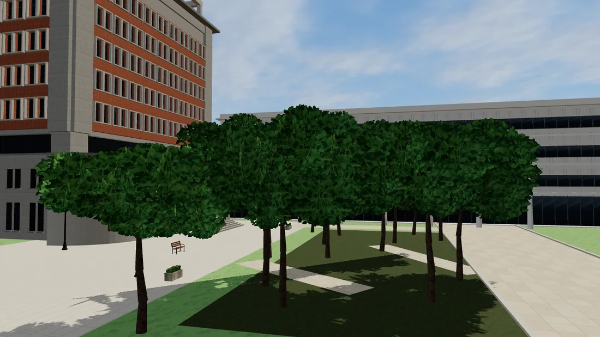
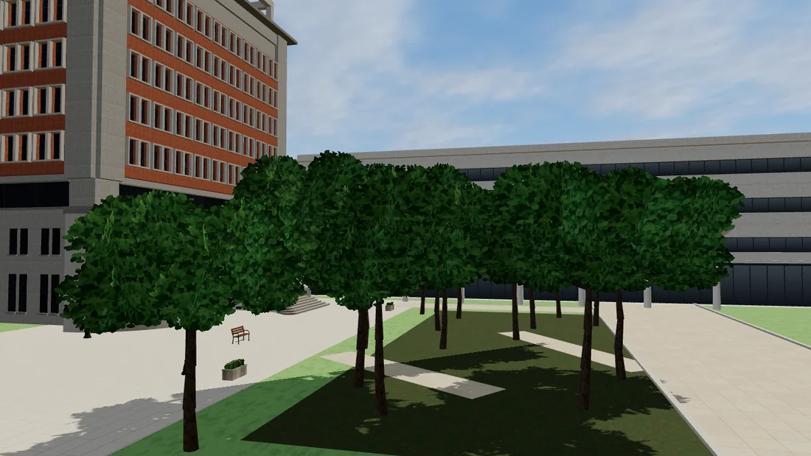
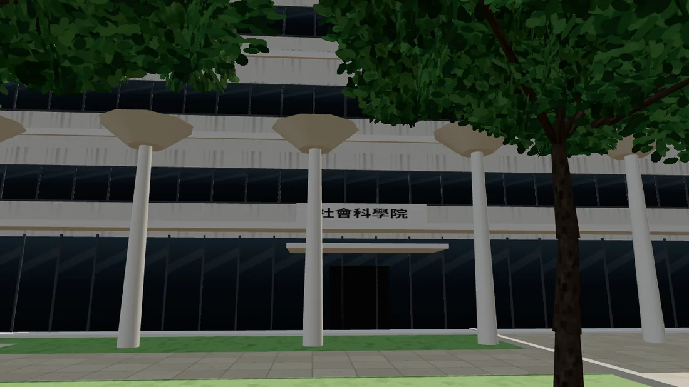
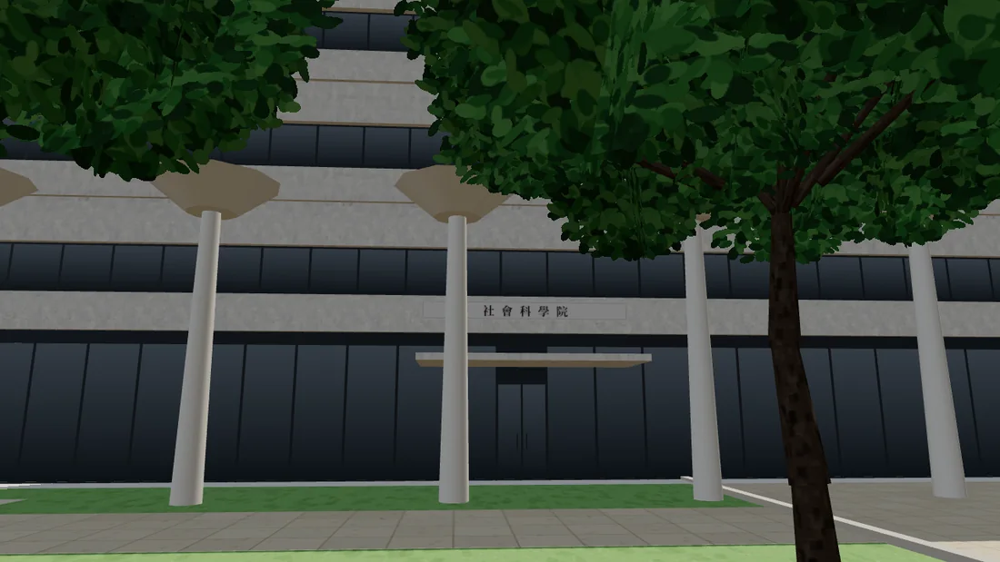
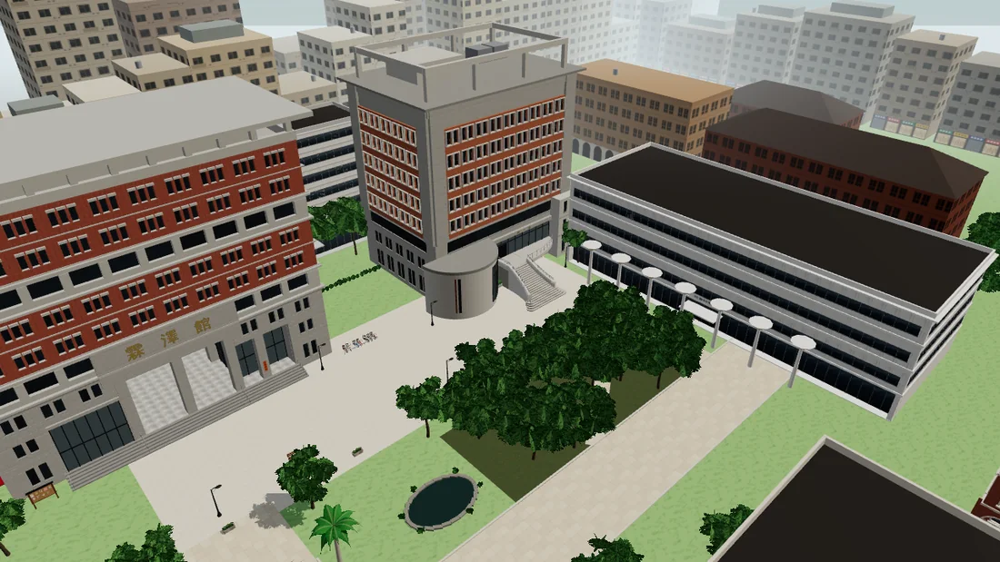
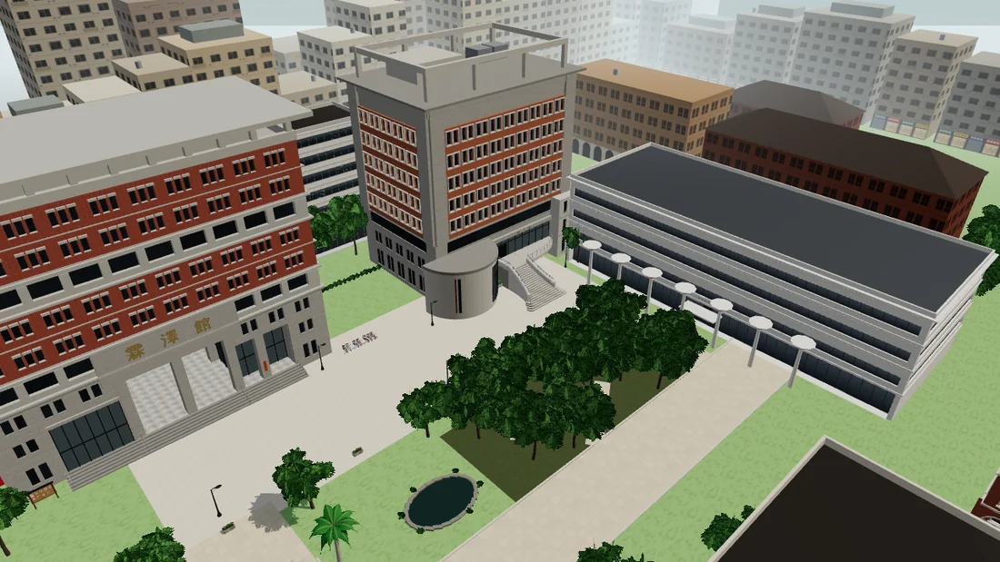
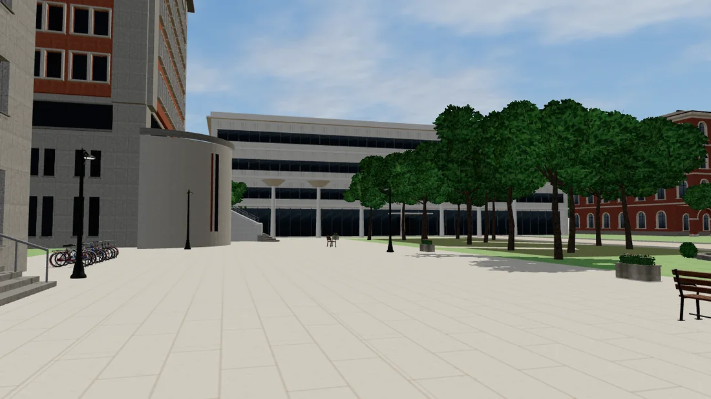
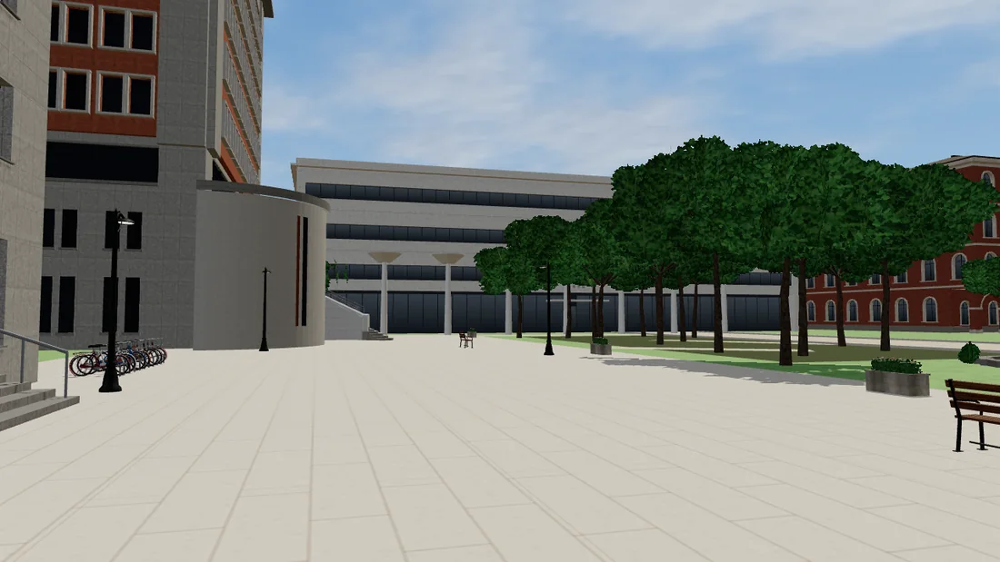

# 新社科院（現代台大平行校園）：參考資料、現況與 Blender 規劃（LAWWW2，2026-10-13，第一版）

需求原文：`docs/art-rebuild/second_ai/requests/2026-10-13_新社科院.md`（使用者 2026-10-13：世界觀正式改成現代台大平行校園；經濟系大一開始時校總區的新社科院已經存在；不做徐州路舊社科院）。
**狀態：PROPOSAL（規劃，還沒有開始建模）**。地圖、導航、區域程式、互動點是 LAWWW 的；這份只提美術與場景的方案，要 LAWWW 和使用者同意才動工。

## 1. 查證方式與限制

- 沙盒**連不到** `ntu.edu.tw`、維基百科、Wikimedia（DNS 失敗或代理拒絕）。下面每一條都是**搜尋引擎讀了原始網頁後回給我的文字摘要**，我沒有親自打開原始文件，**也沒有任何一張照片**。
- 確認程度：**A**＝兩個以上來源一致；**B**＝只有一個來源；**C**＝推測或來源互相矛盾，**不能當成事實**。
- 建築的實際尺寸（主樓長度、圖書館邊長）、立面分割、入口方向、系辦在幾樓，**都還沒查到**。需要照片或官方平面圖（見第 7 節）。

## 2. 查到的事實

| 項目 | 內容 | 確認程度 | 來源（搜尋摘要） |
|---|---|---|---|
| 設計者 | 伊東豐雄（Toyo Ito） | A | Architectural Record；NTU Visitor Center；travel.yam；遠見 2010 |
| 組成 | **八層樓的長條形教學研究大樓**＋**一層樓的圖書館**（辜振甫先生紀念圖書館）；長條大樓在圖書館閱覽室的後面（"fronts the library's single-storey reading room"） | A | Architectural Record（2016）；champ-magazine |
| 位置 | 校總區**北門（辛亥路與復興南路口）西側**，靠近法律系霖澤館；這裡原本是臺大的後門 | A | 中央大學交通資訊 PDF；NTU Visitor Center（"next to the back entrance of the campus on Xinhai Rd."）；遠見 2010 |
| 圖書館的位置 | 在整個建築群的**南側** | B | NTU Visitor Center |
| 圖書館 | 三面落地玻璃；**88 根白色樹狀柱**撐起屋頂（柱子的密度從三個中心往外變疏，像三朵蓮花展開）；約 **6 m** 高的天花板；**約 130 個形狀不一的天窗**；彎曲的竹製書架；屋頂是綠色植栽（從上面看像空中花園、蓮葉） | A（88 根柱）／B（其他） | NTU Visitor Center；Architectural Record；travel.yam；detail.de；bella.tw |
| 外牆 | 清水混凝土（fair-faced concrete）；**有沒有白色塗裝沒查到** | B | detail.de；搜尋摘要「沒有來源說是白色」 |
| 大樓的特徵 | 教學大樓有空中花園、綠建築 | B | travel.yam |
| 啟用 | 2010 年 4 月動土；2014 年 8 月社科院搬到校總區；政治、經濟兩系 2014 年 9 月 15 日開學起在新大樓上課 | A | NTU Spotlight 2014；社科院院務會議紀錄（103 學年） |
| 系所 | 政治學系、經濟學系、社會學系、社會工作學系、國家發展研究所 | A | 社科院簡介（2016） |
| 3 樓 | **梁國樹國際會議廳**在社科院大樓三樓，旁邊是**學生開放空間**；院辦與各系系辦在同一棟 | B | 社科院 108 學年度迎新說明會簡報（2019） |
| 系辦樓層 | 經濟系、政治系系辦在大樓裡，**幾樓沒查到** | C | 同上（簡報有樓層圖，摘要沒有寫） |
| 館名 | 一份校園地圖把社會科學院標成「介宙館」；另一份經濟系文件寫「頤賢介宙政治經濟系館」 | C（來源說法不一，不能當事實） | 校總區地圖 PDF；經濟系簡介 |
| 場地借用 | 社科院有場地設備管理使用規定（院內單位辦的活動可以免費借、學生會辦的活動半價） | B | 社科院場地設備管理使用規定 |

來源連結（都是搜尋結果，沒有親自打開）：
- Architectural Record：<https://architecturalrecord.com/articles/11411-toyo-ito-libraries-in-japan-and-taiwan>
- NTU Visitor Center：<https://visitorcenter.ntu.edu.tw/eng/News_Photo_Content_n_74866_s_82594.html>
- NTU Spotlight 2014：<https://ntuweb.cloud.ntu.edu.tw/oldenglish/spotlight/2014/e140905_1.html>
- detail.de：<https://inspiration.detail.de/en/article/university-library-in-taipei-5007>
- travel.yam：<https://travel.yam.com/article/120519>
- 遠見 2010（動土）：<https://www.gvm.com.tw/article/13804>
- 中央大學交通資訊（位置）：<https://ir.ncu.edu.tw/images/traffic.pdf>
- 社科院迎新說明會簡報（2019）：<https://coss.ntu.edu.tw/001/Upload/4/relfile/19598/50662/52168e50-f2f0-40ee-80fa-9405588b15c8.pdf>
- 社科院簡介：<https://coss.ntu.edu.tw/cossintr/Chineseweb.pdf>
- 社科院院務會議紀錄（103 學年第 1 次）：<https://coss.ntu.edu.tw/meets/1031-1.pdf>
- 社科院場地規定：<https://coss.ntu.edu.tw/rules/VenueEquipmentCharging.pdf>

## 3. 遊戲裡現在的社科院（LAWWW 開發分支 `7e48156`）

- 位置：`src/zones3d.js` 校園「法學院區」：`CK.modern({w:56,d:22,floors:4,gfh:4.4,fh:3.85,sign:'社會科學院'})`、`ckPlace(soc,110,-70,-π/2)`：**4 層**、南北長 56 m（z −98..−42）、東西寬 22 m（x 99..121），**正面朝西**對著法學院廣場（廣場 72×24，中心 (61,−94)）。霖澤館 (34,−112)、萬才館 (88,−112) 在廣場北邊、都朝南。
- 社科院門前（x=96、z −90..−54）有 LAWWW 用圓柱拼的 7 根白色樹狀柱（圖書館柱子的意象，BLOCKOUT）。
- 我之前做過的兩樣：
  - ⑤ `campus_modern.glb`：照套件參數做的**通用白色現代系館**（帶狀長窗、玻璃大廳），**不是照伊東豐雄的新社科院**。載入的程式在我的交付 `451d032`，LAWWW 排在 v9.5 發布後合併（還沒合併）。
  - ⑬ 辜振甫圖書館一樓閱覽室：`soclib_interior.glb`＋`src/data/soclib_layout.js`（交付 `f3212c0`；LAWWW 說「辜振甫要先決定校園位置」才接）。

（遊戲畫面截圖：第 8 節）

## 4. 使用者的五個問題（第一版回答）

1. **目前是否已有社科院模型**：有位置、有通用外觀（⑤）、有圖書館閱覽室（⑬），**沒有新社科院的辨識外觀**；也還沒有可以走進去的大樓室內。
2. **可以沿用的**：位置與朝向的大方向（法學院廣場東側、看得到霖澤館）、⑬ 閱覽室的配置與模型（入口要配合新外觀調整）、材質與窗的做法、教學館的教室模板（LAWWW 的 `teach3d.js`＋配置格式）。⑤ 的外觀不沿用。
3. **需要新增的**：八層長條主樓＋一層圖書館的外觀；主入口；圖書館入口與主樓的視覺關係；一樓大廳；三樓學生開放空間＋梁國樹國際會議廳（活動空間）＋系辦走廊；門前的集會空間。
4. **和現有地圖的衝突**：
   - 樓高：現在 4 層，真實 8 層（霖澤館、萬才館在遊戲裡是 10、9 層的量體）→ 現在的社科院比旁邊矮一半，比例不一致。
   - 圖書館：真實是主樓南側的一層獨立量體；遊戲裡沒有它的佔地（只有門前 7 根白柱）。加上去要新的導航阻擋、門口互動點（LAWWW）。
   - 法學院廣場南邊有「黑森林＋小水池」（D31），圖書館放在哪裡要避開或一起調整。
   - 真實的主樓走向、尺寸還沒查到，佔地要不要改等照片或平面圖。
5. **優先做的可互動空間**（第一階段）：①主入口＋一樓大廳 ②圖書館入口＋閱覽室（⑬ 已有）③三樓學生開放空間＋梁國樹國際會議廳（可以重複使用的活動空間：迎新、演講、系上活動）④經濟系、政治系系辦走廊 ⑤門前廣場（開學、迎新可以站人）。

## 5. Blender 規劃（第一階段，PROPOSAL；照 LAWWW 2026-10-13 16:19Z 的最小方案）

LAWWW 的方案（`docs/campus/SOCSCI_PLAN.md`，LAWWW 會 push；使用者可能改成方案 B）：原地沿用法學院廣場東側這一塊；**辜振甫圖書館**放靠廣場那一半 x 95–125、z −92～−70（30×22、一層、不轉向；我 ⑬ 的室內配置 +z＝南），玻璃牆朝西（廣場、霖澤館）、朝北（萬才館），入口在南牆、面向中庭；**社科院大樓**（清水混凝土）放後面 x 99–123、z −62～−42，入口朝西（往萬才館的小路）＋北邊中庭；中庭 z −70～−62；門前 7 根圓柱拿掉。
**和真實不一樣的地方（要標「遊戲化」）**：真實的圖書館在建築群南側、八層大樓靠辛亥路（北）；這個方案南北對調，是為了讓圖書館面向廣場與霖澤館（LAWWW／使用者決定）。

| 部分 | 內容 | 尺寸／層數（遊戲） | 三角形預算 | 根據／不確定 |
|---|---|---|---|---|
| 圖書館外觀 | 三面落地玻璃（西、北、南；東牆清水混凝土）＋細鋁框；屋頂植栽（Poly Haven `leafy_grass`）＋圓形天窗（照 ⑬ 的 40 個天窗位置）＋薄的混凝土屋簷；從玻璃看進去：白色樹狀柱＋荷葉柱頂（照 ⑬ 的 20 根柱子位置）、低的弧形書架、燈 | 30×22、高約 6 m（⑬ 室內 5.6 m） | 約 0.8 萬 | A：三面玻璃、樹狀柱、天窗、屋頂綠化；遊戲裡柱子 20 根（真實 88 根，比例壓縮） |
| 圖書館入口 | 南牆中段偏西（⑬ 入口在本地 x=−9 → 世界 x≈101），玻璃自動門、小雨遮、名牌「辜振甫先生紀念圖書館」 | — | 含在上面 | ⑬ 配置；真實入口位置待查 |
| 社科院大樓外觀 | 清水混凝土（Poly Haven `concrete_wall_006` 一類，有模板的分割線與螺栓孔，校正成淺灰）；每層樓板外露、帶狀窗＋直的鋁框；一兩處挑空的空中花園（植栽）；屋頂設備 | 建議 8 層（真實 8 層；霖澤館、萬才館在遊戲裡是 10、9 層的量體）；**佔地 24×20 讀起來比較像塔，不像長條**——建議改 30×16（x 95–125、z −58～−42、中庭 z −70～−58），LAWWW 決定 | 約 1.5 萬 | A：八層長條、清水混凝土；立面分割是推測 |
| 大樓入口 | 西面主入口（玻璃門廳＋雨遮＋「社會科學院」名牌、旁邊的系所指標：經濟學系、政治學系、社會學系…）；北面（中庭）次入口 | — | 含在上面 | 推測 |
| 一樓公共空間（室內，配置 JSON＋GLB，像 ⑬） | 大廳：服務台、三面公告欄（院、經濟系、政治系）、沙發與小桌、大螢幕、樓梯與電梯（往上關著或只開到三樓）；開學典禮、迎新、聚會可以站人 | 約 20×14 | 室內合計約 2.5 萬 | 推測（模板） |
| 可重複使用的活動空間 | 平面多功能教室（可以排成講座、迎新、聚會；活動椅）；或照真實做三樓梁國樹國際會議廳（階梯講堂，要上樓） | 約 12×10 | 含在上面 | B：三樓有梁國樹國際會議廳＋學生開放空間 |
| 系辦附近的走廊 | 走廊兩側：經濟學系辦公室、政治學系辦公室、系學會、院辦（門牌、玻璃門、公告欄、信箱、長椅） | 約 20×3 | 含在上面 | C：真實在幾樓沒查到 → 第一階段放一樓（不用上樓），標「需查證」 |
| 渲染 | 圖書館和霖澤館之間的視線（從霖澤館門口、從廣場中間、從圖書館裡往外） | — | — | — |

材質：清水混凝土、玻璃（`ck_glass` 同一套亮燈規則）、白色塗裝（柱子）、綠化屋頂、鋁框、木（書架）；金屬度 ≤ 0.45；夜間：圖書館整面玻璃亮（暖白）、大樓窗約七成亮。

## 6. 需要 LAWWW 決定的（已傳 P1，2026-10-13 15:5x）

a. 社科院室內要不要做成區域、課表／日程／事件會用到哪裡。
b. 佔地／樓高／朝向／門口要不要依查證結果改（我只提方案，不改導航）。
c. 排序：共同外觀（今天交）→ 這份規劃＋現況截圖 → 大一女舍外觀 → 社科院外觀第一版 → 普通、博雅。

## 7. 需要使用者協助（照片）

新社科院：①從霖澤館方向看過去的整體 ②主樓正面與主入口 ③圖書館外觀（玻璃、柱子、屋頂）④圖書館入口 ⑤一樓大廳 ⑥三樓學生開放空間與會議廳門口 ⑦經濟系、政治系系辦走廊。有照片的部分會照照片做，沒有的會標「依文字描述的遊戲化設計」。

## 8. 遊戲畫面（現況，Playwright＋SwiftShader，11:00；不是 iPhone）

左＝現在 LAWWW 開發分支的樣子（套件方盒＋白色圓柱）；右＝把我之前做的 ⑤ `campus_modern.glb` 接上（本機測試；**通用白色系館，不是新社科院，不沿用**），給使用者比較量體與位置。

| 鏡頭 | 現在（套件） | ⑤ 通用系館（參考） |
|---|---|---|
| 法學院廣場西北邊往東看（萬才館、黑森林、社科院） |  |  |
| 社科院正面（門前 7 根白色圓柱＝原型） |  |  |
| 空拍：霖澤館（左）、萬才館（中）、黑森林、社科院（右） |  |  |
| 從霖澤館門口往東看社科院 |  |  |
