# 系籃球場：位置提案（PROPOSAL：位置要使用者確認）＋半場模型（MODEL_READY）

LAWWW2，2026-10-13。LAWWW 22:01Z 分派②：系籃練球（`src/data/activities.js` 的 `dept_basketball`，AA 暫定，週五 17:30–19:00）現在暫放在體育館門口西側 (69.8, 59.0)；照臺大官方地圖找真實球場的大概位置，提一個遊戲裡放得下的位置；模型：半場籃框、場線、場邊長椅；**位置要使用者確認，先給俯視圖和截圖**。

## 1. 真實的球場在哪（查證）

沙盒和 WebFetch 都**連不到 ntu.edu.tw、維基百科**（DNS 解析失敗），官方地圖打不開；下面是**網路搜尋結果的摘要**（沒有打開原頁面，確認程度 B）：

| 地點 | 摘要 | 來源（搜尋結果） |
|---|---|---|
| 舊體育館（國立臺灣大學體育館，門牌 N14，1962 年） | 在**垂葉榕道旁、操場右側**；周邊有**左右兩側的籃球場**、排球場、網球場、戶外游泳池、攀岩場 | 維基百科〈國立臺灣大學體育館〉；一篇報導也提到「舊體兩側籃球場」 |
| 新生籃球場（新生一、二） | 在網球場與**新生車道入口**旁、靠**新生南路** | 臺大體育室場地租借系統〈新生籃球場〉 |
| 綜合體育館（新體） | 新生南路與辛亥路口 | 搜尋摘要 |
| 垂葉榕道 | 椰林大道**往北**到綜合體育館 | 臺大校園道路命名說明 |
| 醉月湖 | 在舊體育館後方 | 臺大訪客中心〈醉月湖〉（LAWWW 的 `docs/campus/TEACHING_BUILDINGS_PLAN.md` 第 1 節引用） |

→ 真實的戶外籃球場在**椰林大道北側**：舊體育館兩側（醉月湖、操場一帶）和新生南路邊。系隊練球常在這些戶外球場。

## 2. 遊戲裡的位置（PROPOSAL）

遊戲的校園是壓縮過的（D25）：操場、舊體育館、綜合體育館都沒有做；醉月湖在 (−36, −112)、博雅在 (−38, −83)、霖澤館在 (34, −112)。現在的「體育館」只是 (74, 59.4) 的一個門口（體育課在那裡上）。

用遊戲的導航格找放得下 17×16 m（場地 15×14 m＋四周 1 m）、又不用拆東西的空地（`tools/blender/env_second/shots/nav_map.py`，在 LAWWW `9884d29`＝方案 A 的校園；白＝走得到、深灰＝擋住、紅框＝候選）：

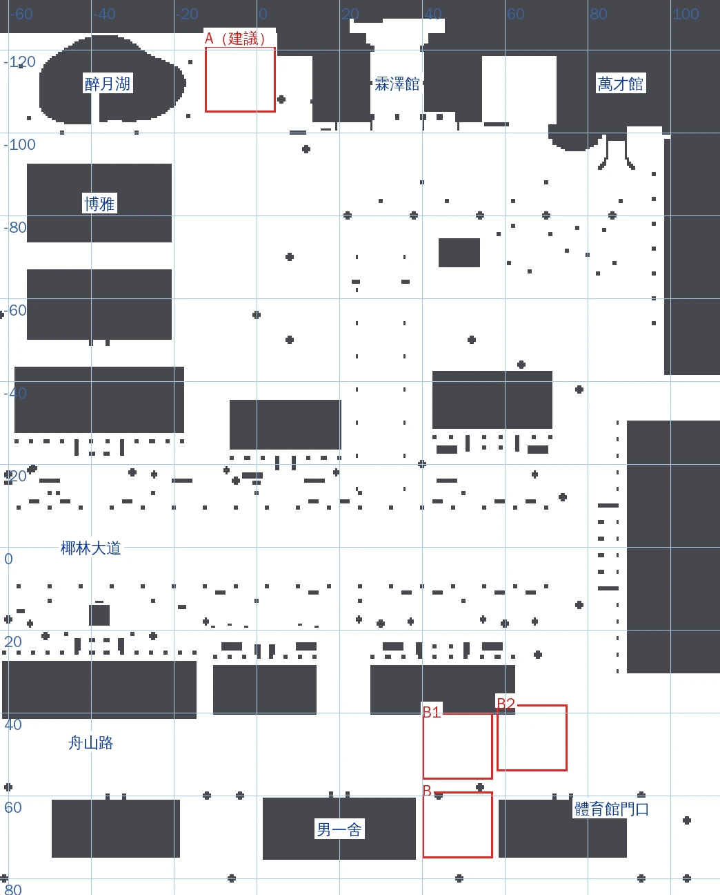

| 選項 | 場地中心（鋪面範圍） | 朝向 | 現在那裡 | 好處 | 要注意 |
|---|---|---|---|---|---|
| **A（建議）醉月湖東側** | (−4, −113)（x −12.5～4.5、z −121～−105） | 籃框在北（−z），中線朝南 | 草地，鋪面範圍內導航格 0% 擋住 | **方向和真實一樣**：真實的戶外球場在椰林大道北側、舊體育館與醉月湖一帶；離霖澤館（法律系）約 30 m，下課走過去就到；湖、湖心亭、博雅當背景 | 北邊走得到的範圍到 z −124（籃架柱子在 z −120.85，後面還有 3 m）；博雅二樓北面窗的窗景（`boya_2f_north`）可能看得到球場一角——接了以後我重拍 |
| B 男一舍與體育館之間 | (48.5, 67)（x 40～57、z 59～75） | 籃框在南（+z），中線朝北（舟山路） | 草地，1% 擋住（場內一棵樹的樹幹） | 離現在的活動點（體育館門口西側 (69.8, 59.0)）約 22 m；體育課、宿舍都在旁邊 | 真實的球場不在舟山路這一側；場內一棵樹要移走；夾在兩棟樓中間；離舟山路南緣 7.5 m |

（另外看過舟山路上的兩塊空地 B1 (40～57, 40～56)、B2 (58～75, 38～54)：在舟山路上，不合用。萬才館東邊 (104～118, −122～−110) 整塊走不到。）

### A：醉月湖東側（建議）

遊戲內原型（**本機注入、不是整合**：LAWWW `9884d29` 的校園，用遊戲的 GLTFLoader 載入 `bball_court.glb` 放在 (−4, −113)；Playwright＋SwiftShader，**不是 iPhone**）：

**從上面看（13:00）**：球場在醉月湖（左）和霖澤館（右）之間的草地上

**從東南邊（腳踏車架旁）看（13:00）**

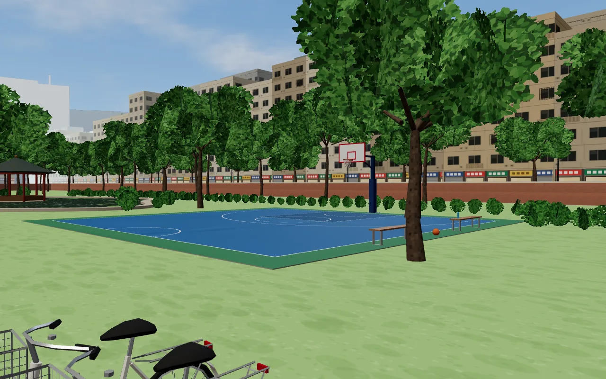

**同一個位置，練球時間 17:45（週五 17:30–19:00）**

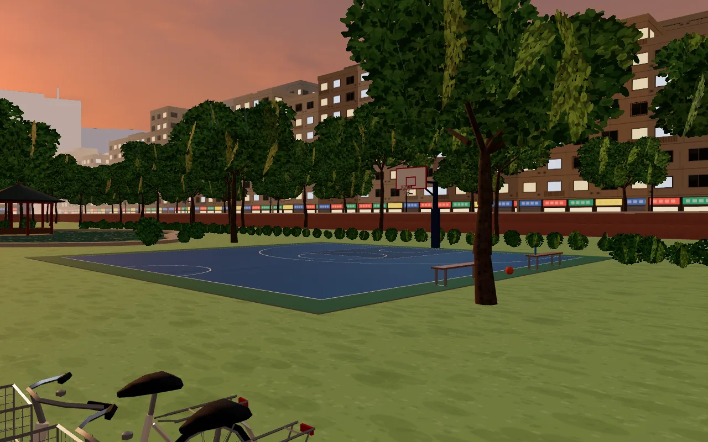

**從醉月湖這邊看過去（13:00）**

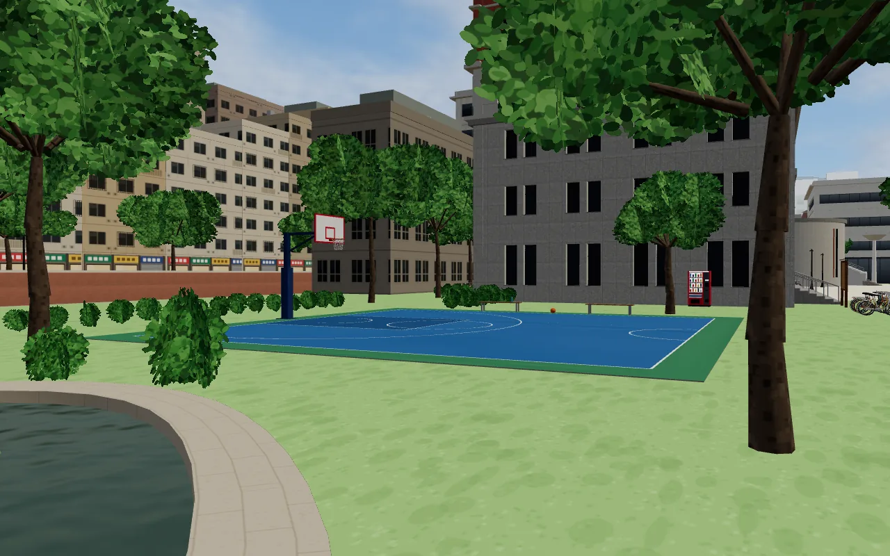

**手機直向 390×844（跟隨鏡頭，有 HUD；站在兩張長椅中間、面向場內＝建議的活動點 (3.3, −112.7)）**

### B：男一舍與體育館之間

**從上面看（13:00，鏡頭朝南）**：下面是舟山路，右邊是男一舍，左邊是體育館門口那一棟；場中間有一棵樹

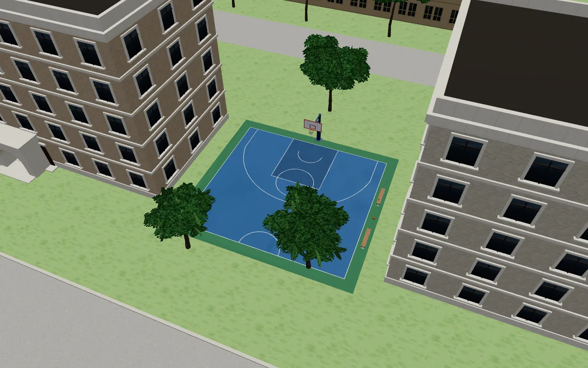

**從舟山路南側的草地往東南看（13:00）**：樹幹在場內

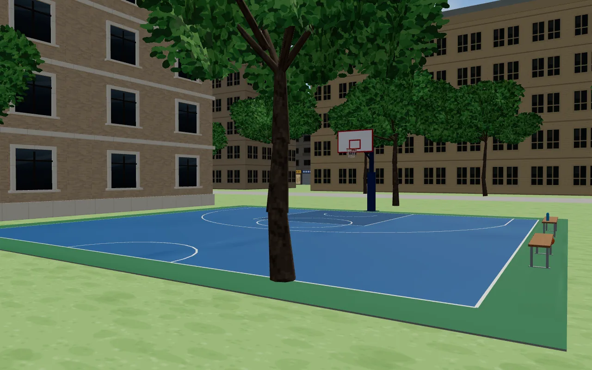

**練球時間 17:45**

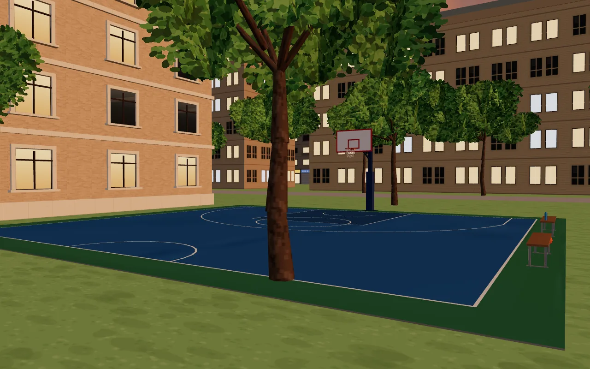

**手機直向（站在兩張長椅中間、面向場內＝建議的活動點 (41.2, 66.7)）**：對面就是體育館門口那一棟的牆

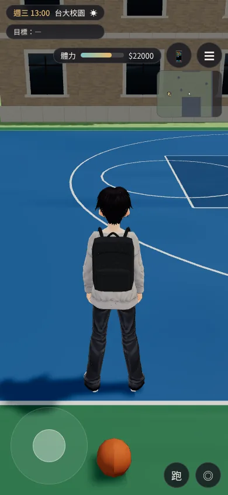

### 原型看到的差別

| | A 醉月湖東側 | B 男一舍與體育館之間 |
|---|---|---|
| 鋪面範圍裡現在有的東西 | **沒有**（導航格 0%；畫面上也看不到東西） | **一棵樹的樹幹在場內**（中圈附近）、西北角外面還有一棵——導航格的 1% 就是這棵樹的樹幹；要放 B 得移走場內那棵樹（連同它的導航阻擋）。原型裡自動找「範圍內的網格」沒有抓到這棵樹（原因沒有查），是看畫面和導航格發現的 |
| 四周 | 西邊醉月湖與湖心亭、東邊霖澤館與販賣機、北邊一排矮灌木和樹（籃架後面）；長椅東邊 2 m 有一棵樹（長椅有樹蔭） | 夾在兩棟五層樓中間（場邊離兩邊的牆各約 3–4 m），北邊隔一片草地是舟山路 |
| 走過去 | 霖澤館下課走約 30 m；博雅也近 | 宿舍、體育館門口都在旁邊 |
| 和真實的關係 | 方向一致（椰林大道北側、醉月湖／舊體一帶） | 不一致（真實的球場不在舟山路這一側） |

**建議 A**：不用拆東西、方向和真實一樣、場地四周空。要決定的只有 A 或 B（或使用者指定別的地方）；兩個位置都不用改模型。

## 3. 模型（`MODEL_READY`）

`tools/blender/env_second/bball_court.py` → `assets/models/env/second_ai/bball_court.glb`：
- **半場**照 FIBA：15 m 寬×14 m 深、三分線半徑 6.75 m（兩邊直線離邊線 0.9 m）、禁區 4.9×5.8 m、罰球圈半徑 1.8 m、中線上的半個中圈、無衝撞區；**場線是網格**（比鋪面高 4 mm），不是貼圖，遠看不會糊。鋪面：場內藍、禁區深藍、外圍 1 m 綠（壓克力球場常見的配色），高 2 cm。
- **籃架**：底線後 0.85 m 的方柱（下面 2 m 包防護墊）＋伸出去的臂、斜撐；**籃板** 1.8×1.05 m（白底紅框、紅色小方框，下緣 2.9 m）；**籃框**高 3.05 m（圓環＋固定片）；**籃網**（白線）。
- **場邊**：兩張鋁腳木椅面的長椅（面向場內）、一顆籃球、一個水壺。
- 三個網格（`court`、`hoop`、`bench`）同一個原點（場地中心、籃框在 −z），一個材質；948 個三角形、66 KB。

規格：GLB **66 KB**（貼圖 512×512 純色格＋128×128 粗糙度／金屬度）、網格 3、材質 1、三角形 948（court 218、hoop 464、bench 266）。

Blender 渲染（Cycles；**不是遊戲畫面**；地面是預覽用的示意）：

**整個半場**

**籃架、籃板、籃框、籃網**

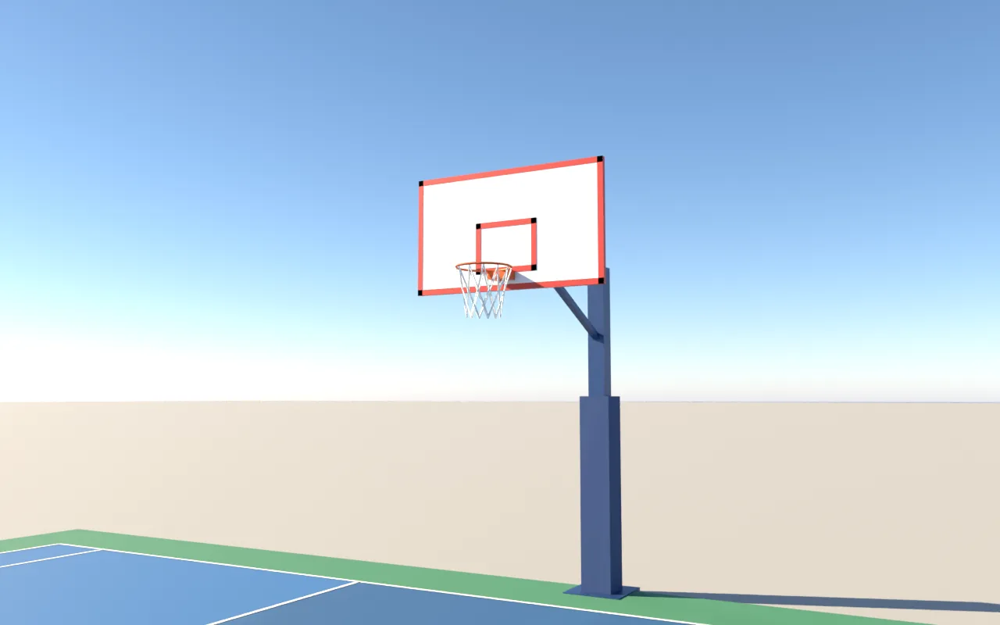

**場邊長椅、籃球、水壺**

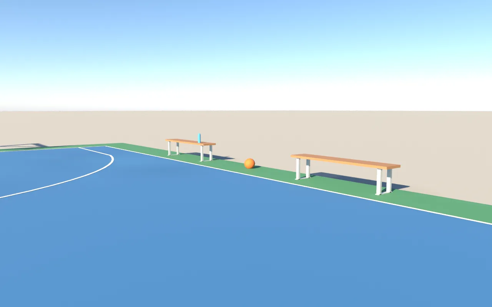

**正上方（場線）**

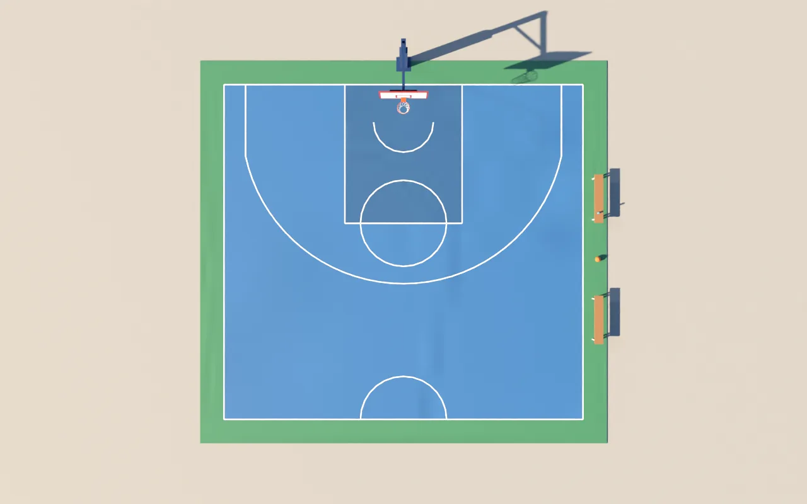

驗收狀態：位置 **PROPOSAL**（等使用者選 A／B 或別的地方）；`bball_court.glb` **`MODEL_READY`**（還沒接）。

還沒達到參考品質的地方（自評）：
1. **沒有照片可以核對**臺大系隊練球的球場（鋪面顏色、籃架款式是一般戶外壓克力球場的樣子）；沙盒打不開臺大網站。
2. 鋪面是純色加細顆粒，沒有磨損、球印、修補過的痕跡；場線很新。
3. 籃網是線框（白色細條），近看比較硬；沒有隨風擺動。
4. 只有半場一個籃架；真實的戶外球場多半是全場或好幾面並排——這裡照分派做半場，要全場可以用同一個模型鏡射一份（另一個籃架＋另外半邊場線，三角形大約加倍）。
5. 球場四周沒有圍網、路燈：晚上練球要亮的話，建議在四角加路燈（`W3.lampPost()`）。

## 4. 接法（LAWWW）

- 放在選定的位置，三個網格（`court`、`hoop`、`bench`）用同一個矩陣；導航：場地可以走（鋪面 2 cm），只擋籃架柱子（0.32×0.32）和兩張長椅（2.0×0.36）。

| | A（−4, −113），`rotation.y = 0` | B（48.5, 67），`rotation.y = π` |
|---|---|---|
| 籃架柱子（擋 0.32×0.32） | (−4, −120.85) | (48.5, 74.85) |
| 長椅（擋 2.0×0.36，長邊沿 z） | (4.05, −115.2)、(4.05, −110.2) | (40.45, 69.2)、(40.45, 64.2) |
| 活動點（站在兩張長椅中間、面向場內） | (3.3, −112.7)，面向西 | (41.2, 66.7)，面向東 |
| 要先處理的 | 沒有 | 場內那棵樹（和它的導航阻擋）要移走 |

- 活動點（`dept_basketball` 的 spot）搬到上表的位置；「投籃練習」「分隊打半場」的 2D 敘述照舊。
- 晚上 17:30–19:00 練球：要的話在球場四角加路燈（`W3.lampPost()`，燈頭位置和其他路燈一樣）。
