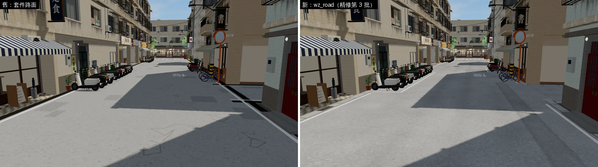
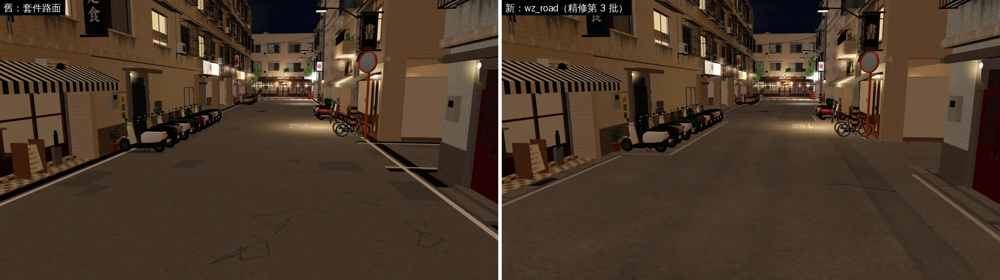
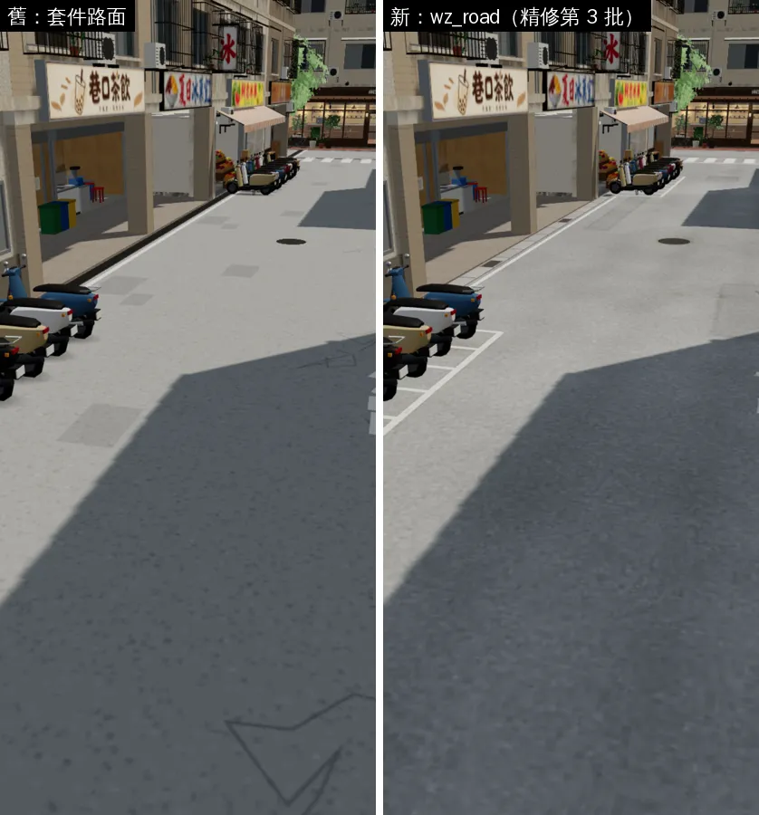
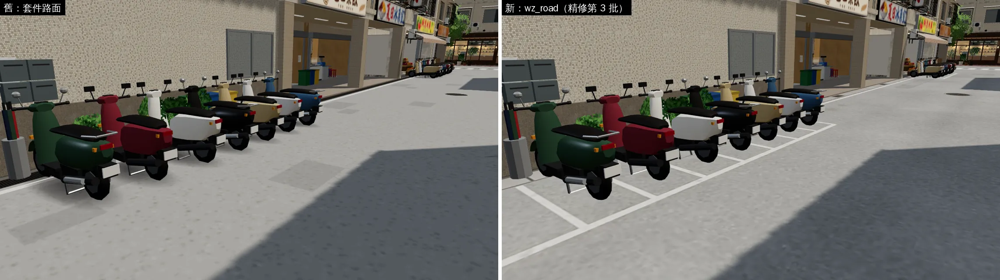

# 示範案例：溫州街路面（精修第 3 批）——照著做的範本

> `ART_SOP.md` 第 5 節的示範案例。支援的 AI（AA-B、BB-B）和接班的 LAWWW2 照這個格式、這個深度做。
> 主要案例是**溫州街路面**：一個區域從「整片重複的貼圖」做到有生活感。第二個是**土地公廟**：方向對，但**還沒到新標準**，用來說明哪裡不夠。

---

## 案例 A：溫州街路面（新標準：通過，2026-10-16）

### 1. 問題（修改前看到什麼）
- 原本是套件 `TK.road`：整片同一個淺灰柏油重複貼。
- 補丁是方形的深色塊，裂縫是折線（像幾何圖形），水溝是一條連續的黑色鐵柵。
- 手機直向時，畫面下半部全是這片地面，看起來像模型展示。

### 2. 參考（先查）
台北巷子實際的樣子：
- 補過很多次的柏油：管線挖補的長條、裂縫的灌縫膠；
- 車輪壓出來的深色帶、停車處的油漬；
- 路邊的混凝土水溝蓋（一節一節）＋鐵柵；
- 白線、禁停紅線、機車停車格、巷口斑馬線；
- 人孔蓋、手孔蓋、靠牆的暗角。

實際尺寸：水溝寬 38 cm、1 m 一節、每 6 m 一塊鐵柵；停車格一格一台。

### 3. 修改前後（遊戲內，同鏡頭、同時段；左舊右新）
主巷往東，11:00：


主巷晚上 21:00（入夜變暗）：


手機直向 390×844，玩家的鏡頭：


機車停車格：


其他鏡頭（Café 前、北巷口、西端巷子、南巷晚上）：`../test_shots/wz_road/README.md`。

### 4. 腳本與指令（照順序跑就重現得出來）
```bash
# ① 畫路面貼圖（系統 python3：numpy＋PIL；不用外部貼圖）
python3 tools/blender/env_second/wz_road_tex.py
#   → tools/blender/env_second/textures/gen/wz_road_atlas.jpg（4096×1200）＋wz_road_atlas.json（每塊的世界範圍、四個角的 UV）
#   → textures/gen/wz_road_grain_nor.png（512×512 柏油顆粒法線，可無縫重複）
# ② 鋪到路面、匯出（Blender）
/opt/blenv/bin/python tools/blender/env_second/wz_props.py
#   → assets/models/env/second_ai/wz_props.glb（路面＝一個網格 wz_road、六個四邊形、y 0.016）
# ③ 遊戲內前後截圖（測試工作樹＝LAWWW-B 的開發分支＋這個 GLB，見 ART_SOP 第 1 節）
python3 tools/blender/env_second/shots/fast_shots.py http://127.0.0.1:8853/index.html <shots.json>                       # 修改後
python3 tools/blender/env_second/shots/fast_shots.py http://127.0.0.1:8853/index.html <shots.json> --block=wz_props.glb  # 修改前（擋掉新檔＝套件路面）
# ④ 整合＋效能測試（LAWWW-B 的測試）
python3 tests/wz_street_integration.py http://127.0.0.1:8853/index.html                                            # 36 項
```

### 5. 做法與重要參數（`wz_road_tex.py`）
| 東西 | 函式 | 參數 |
|---|---|---|
| 柏油底 | 程式產生的顆粒＋大中小三種尺度的深淺 | 底色 #acacaa（D30 淺灰）；主巷每像素約 2 cm |
| 補丁 | `R.patch(pts, dL=-12, seam=-16, seam_w=1.6)` | 只深一點（dL −6～−14）、邊緣不規則、灌縫膠有斷有續。**第一版太深，像「畫上去的深色方塊」，被自己退件改淡** |
| 裂縫 | `R.crack(x, z, ang, length, w=0.035, dL=-48)` | 細、折幾次，不是幾何折線 |
| 油漬、鏽水 | `R.stain(x, z, r, dL=-24, warm=4)` | 停車處 r 0.25～0.6、中間零星滴油 r 0.12～0.25；巷口不放 |
| 靠牆暗角（AO） | `R.ao_edge(dist_wall, width=0.45, dL=-24)` | `dist_wall()`＝每個像素到牆的距離；寬 45 cm 內由暗到原色（曲線 ^1.6）；巷口不畫 |
| 標線 | 熱塑型漆，`wear`＝被磨掉的比例 | 白線、紅線、斑馬線、停止線、「慢」字；斑馬線位置照套件（新路面蓋住了套件那片） |
| 機車停車格 | `BAYS = [(x, 格數, 邊), …]` | **照遊戲裡機車的位置**（`zones3d.js` 溫州街 `scRow`）；停車格那一段沒有邊線、比較髒 |
| 合成 | 一張貼圖集、一個材質 `wz_road` | 主巷 4064×480、Café 前 4064×344、側巷轉 90° 排一列；每塊四周 16 px 邊緣延伸（mipmap 不混到隔壁） |
| 近景凹凸 | `wz_props.py` 的 `road_mat(name, fn, grain=(AW/GP, AH/GP))` | 顆粒法線每公尺重複一次（Blender Mapping 節點 → glTF `KHR_texture_transform`） |

**入夜變暗**：`docs/art-rebuild/second_ai/patches/wz_road_nightdark.patch`。材質 `wz_road` 的貼圖加 `userData.asphalt`，進 `E.roadMats`；anisotropy 8，斜看不糊。

### 6. 八項驗收紀錄（ART_SOP 第 3-2 節）
| 項目 | 結果 | 說明 |
|---|---|---|
| 輪廓與倒角 | 不適用（平面） | 路面是平的；路緣、水溝蓋的立體感用貼圖的明暗和法線做 |
| 材質 | 通過 | 程式畫的整條路（世界座標定位，不重複）＋每公尺重複的顆粒法線；底色照 D30 |
| AO | 通過 | `ao_edge` 靠牆暗角 45 cm；巷口斷開 |
| 磨損 | 通過 | 輪跡、標線磨損（wear）、補丁、灌縫 |
| 生活痕跡 | 通過 | 停車格（和遊戲機車位置一致）、油漬、鏽水、人孔手孔 |
| 比例 | 通過 | 水溝 38 cm、1 m 一節、鐵柵每 6 m；標線寬照實際 |
| 效能 | 通過 | 一個材質、一個網格、+12 三角形；`wz_props.glb` 292 KB → 約 900 KB。溫州街整合測試 ALL PASS 36 項：draw call 291／273／306、三角形 41.7／39.0／41.4 萬（第一版三張貼圖時 arcade 311 次超標，合成一張才過） |
| 遊戲截圖 | 通過 | 9 組前後對照（白天、晚上、手機直向、停車格、巷口） |

**狀態**：READY_FOR_ART_REVIEW（場景美術由使用者標 ART_APPROVED）。LAWWW-B 已整合（26134a0f）。

### 7. 這個案例教的事（照做的重點）
1. **先查真實的樣子**，列成清單，一項一項做（不是「加一點髒」）。
2. **位置要和遊戲對得上**：停車格照機車、暗角照牆、斑馬線照套件。用世界座標畫。
3. **第一版通常太重**：深色方塊、太黑的裂縫。每一版都在遊戲裡同鏡頭比，太假就改淡。
4. **效能要量**：超標就合貼圖、合材質，不是刪細節。

---

## 案例 B：小公園土地公廟（舊標準：通過；新標準：**還沒通過**）

左之前、右之後（遊戲內同鏡頭；`../test_shots/wz_park/README.md` v4，b0077e30）：


**改了什麼（去積木化，`wz_park.py`）**
- 神龕原本是實心方塊，把神桌和金身包在裡面 → 改成暗紅背板，看得到神桌和土地公像；
- 供桌：木桌面＋四隻腳＋紅桌裙＋金邊；
- 牆分上下段：下段石材勒腳、上段紅牆；
- 匾、對聯（常見的土地公廟對聯，`shrine_text.png`）。

**用新標準看，還不夠的地方**（之後要改；改了在這裡記）
1. **金身**：兩個橢球疊起來，像葫蘆。要有坐姿的身體、手、袍子的皺褶（`Mesh.ell` 加 `lathe`，或簡單的雕塑形）。
2. **供桌、神龕**：還是直角方塊，沒有倒角、沒有雕花的邊。要用 `rbox`（r 5～10 mm），桌裙要有布的垂墜。
3. **磨損與生活痕跡不夠**：沒有香灰、供品（水果、茶杯）、紅燭的燭淚、地上的金紙灰燼、香爐外的黑色燻痕。
4. **燈籠**：形狀可以，但沒有骨架的橫紋。

這個案例的用處：**「比之前好」不等於「到標準」**。舊成果先標「舊標準已通過」，排時間照新標準改。
