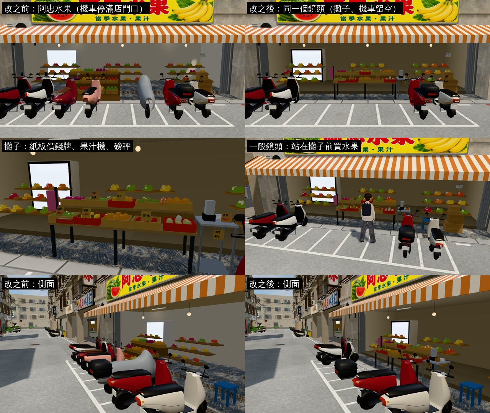
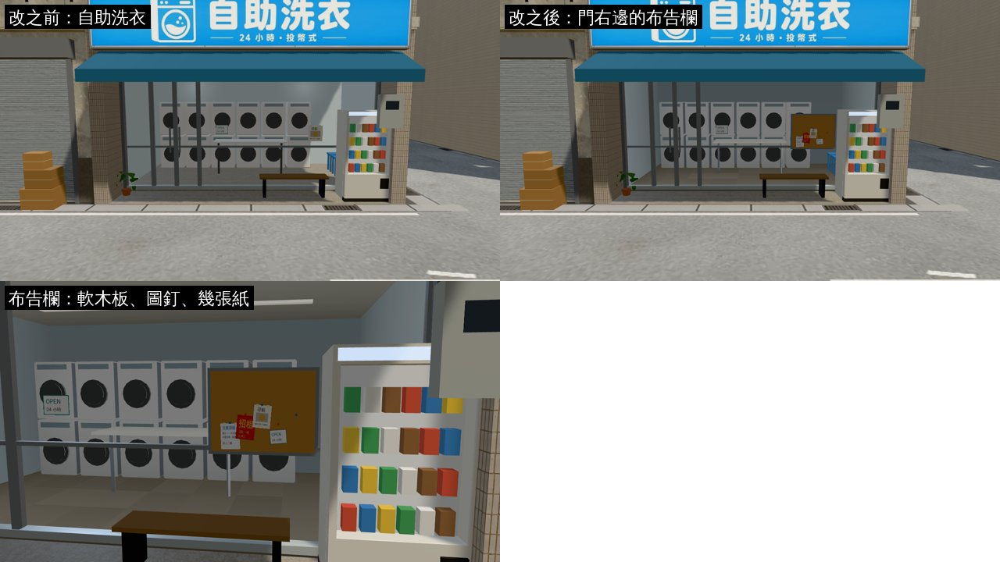
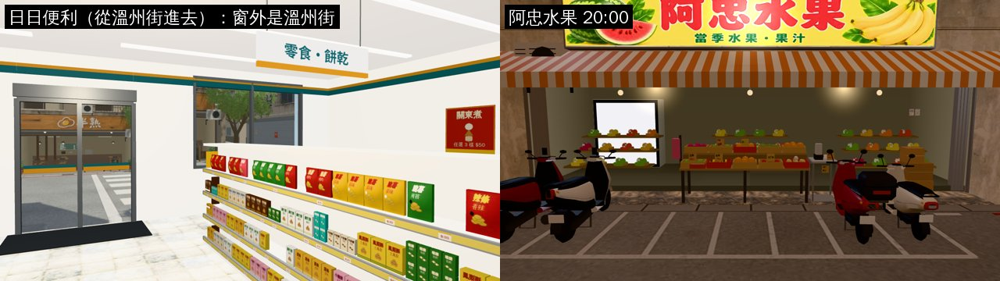

# AA_413 溫州街剩下三家：阿忠水果的攤子、自助洗衣的布告欄、日日便利的窗外

- **企劃**：AA_413 第 5 節第 1 點（企劃線 `9f6a848c`；AA-B 18:4x 告知、LAWWW-B 20:0x 排在總圖 B1 之後）。
  1. 阿忠水果（B6）：騎樓前面一個「買水果」的互動點，老闆站在攤子後面。
  2. 自助洗衣（B2）：門口一個「看布告欄」的互動點；沒有布告欄的模型就貼在門邊的牆上。
  3. 日日便利（A5）：沿用公館便利商店的室內。LAWWW-B 另外提：從溫州街進去時窗外是公館的景，要不要換由我判斷 → **換了**。
- **程式**（營業時間、菜單、招呼、月份的布告）是 LAWWW-B 的，已經在開發分支（`tests/aa413_wz_unit.js`）。
- **做的人**：LAWWW2-B。
- **狀態**：`READY_FOR_ART_REVIEW`。場景美術的 `ART_APPROVED` 只有使用者能標。

## 做了什麼

### 1. 阿忠水果的攤子（Blender：`wz_shopkit.py` 的 `p_fruitstall`）

- **攤子**：B6 門廊前緣，世界 x 33.6～36.2、z −5.8～−5.0，取代原本 x −1.2 的三層木架。
  - 兩層檯（鐵架＋夾板），十箱水果：淺木箱和紅色塑膠籃；芭樂、香蕉、柳丁色、蘋果、套白網的梨、火龍果、木瓜…。
  - **紙板價錢牌**七張（`textures/gen/fruit_price.png`，`shops_tex.py aa413`）：
    - 麥克筆字，每個字大小、角度都不一樣；價錢紅字。照企劃「紙板上用麥克筆寫著價錢，每一張的字都不一樣大」。
    - 只寫一年四季都有的：芭樂 3顆60、香蕉 一串50、木瓜牛奶 55。
    - 其他是不寫品名的：甜！、自己挑、現打果汁、不甜包換。
    - 季節水果（芒果、草莓、柳丁）不立價錢牌，和遊戲照月份的菜單不衝突。
  - 右邊不鏽鋼小桌：果汁機（半杯木瓜牛奶）、疊起來的塑膠杯。左邊一捲粉紅塑膠袋；前層一台小磅秤。
- **店門口的機車留空**（`src/zones3d.js`）：原本 B6 前面整排機車（x 31.5～37.5），買水果的位置 (35, −3.8) 在機車停車格裡。
  - 改成攤子前面 x 32.8～36.2 不停車，留 3.4 m。
  - `scRow` 加一個 `gap` 參數：亂數照樣抽，其他機車的位置、顏色、角度都不變；導航阻擋分成兩段。
- **老闆站的位置**：攤子後面、面向街，`WZS.AA413.fruit.owner` = (34.9, −6.15)，yaw 0。
  - 在門廊裡（建築的導航阻擋範圍內，玩家走不到）。
  - NPC 由 LAWWW-B 放。
- **互動點**（`src/wzshops3d.js` 的 `WZS.AA413`）：
  - 買水果：(35, −3.8) → (35.3, −3.9)；看阿忠水果：(32.8, −3.8) → (33.6, −3.9)。
  - 原本的「看」在機車上。

### 2. 自助洗衣的布告欄（`wz_shopkit.py` 的 `cork_board`）

- 門右邊的玻璃上（B2 店面 x +1.35，世界 x −17.1～−16.2、高 1.0～1.7 m）。
- 鋁框＋軟木板，五張用圖釘釘著的紙（家教、租屋、尋貓、營業時間、空白）。
  - 用玻璃紙條同一張圖集，每張歪一點。
  - 原本貼在玻璃上的尋貓紙條搬到布告欄上。
- 布告欄的字照月份換是遊戲的「看」（LAWWW-B 的程式）。模型上的紙是固定的。
- 「看布告欄」：`boardAt` (−16.4, −3.8) → (−16.65, −3.8)（對準板子中間）。

### 3. 日日便利從溫州街進去的窗外

- 新窗景 `cvs_wz`（`assets/models/env/views/cvs_wz_{day,night}.webp`）：
  - 從 A5 店面玻璃外往溫州街拍：對面是阿忠水果的攤子（機車留空也拍到）、半熟、巷子。
  - `tools/shots/shop_views_layers.py` 拍，景深 10.6 m。6 m 內沒有東西，所以只有一層（不疊近景）。
- `src/zones3d.js` 的 `cvs`：`F.CVS_FROM==='wenzhou'` 時用 `cvs_wz`（景深 10.6），其他照舊公館的 `cvs`。
- AA_413 寫的「換招牌」不用換：便利商店的室內本來就是日日便利的配色和名字（`cvs` 區域的 name、`cvs_interior.py`），公館那一家是同一個牌子。
- 「店員的位置」：照舊（櫃台後面）。要不同的話告訴我。

## 檔案

- 我的分支：
  - `assets/models/env/second_ai/wenzhou_street.{glb,json,props.json}`（重建）。
  - `assets/models/env/views/cvs_wz_{day,night}.webp`（新）。
  - `tools/blender/env_second/wz_shopkit.py`、`shops_tex.py`、`textures/gen/fruit_price.png`、`textures/gen/wz_tiles_wenzhou_*`（重建時重新產生的）。
- patch `docs/art-rebuild/second_ai/patches/aa413_wz_1023.patch`（對開發 `dfc49707c` `git apply --check` 過）：
  - `src/zones3d.js`（機車的 gap、`cvs` 的窗景）。
  - `src/wzshops3d.js`（`WZS.AA413` 的座標、`owner`）。
  - `tools/shots/shop_views_layers.py`、`.json`（`cvs_wz`）。

### 重建溫州街模型的附帶變化

- 開發分支裡的 `wenzhou_street.glb` 是 10-23 06:46 建的，比腳本舊。
  - 09:33 起 `wz_shopkit.py` 加了店裡的商品網格（`sk_goods`，我做公館、118 巷時加的），溫州街一直沒重建。
- 這次重建，溫州街各店的店內也有了商品（便利商店的瓶罐、書店的書…）：

  | | 舊的 GLB | 只有商品（不含這次） | 這次 |
  |---|---|---|---|
  | 三角形 | 8.19 萬 | 9.26 萬 | 9.32 萬 |
  | 材質 | 133 | 131 | 141 |
  | 大小 | 7.77 MB | 7.90 MB | 7.98 MB |

  - 這次的攤子＋布告欄只多 558 個三角形、77 KB。
- 遊戲裡同一個鏡頭（`tests/wz_street_integration.py`）：
  - 改之前：291／273／307 calls、41.8／39.1／41.9 萬三角形。
  - 現在：277／233／279 calls、41.6／34.2／40.8 萬三角形。
  - 都在目標（≤ 310、≤ 42 萬）以內：材質合併更多，draw call 反而少了。

## 截圖（遊戲內，Playwright＋SwiftShader；不是 iPhone 實機）

### 阿忠水果

### 自助洗衣

### 日日便利（從溫州街進去）、阿忠水果晚上

- 從公館進去另外拍了一張（單獨開一個頁面）：窗外照舊是公館的大馬路、校門。

## 測試（開發 `f023a83f1`＋總圖 B1＋5F＋這個 patch，新的溫州街 GLB）

| 測試 | 結果 |
|---|---|
| `tests/wz_street_integration.py` | ALL PASS（含效能） |
| `tests/reachability_all.py --zones wenzhou,cvs` | ALL PASS（34 個互動點、8 個出入口到達點） |
| `node tests/aa413_wz_unit.js` | ALL PASS |
| `wz_shops_unit`、`wz_shops2_unit`、`wz_shops_cam_unit`、`wz_aa364_shops_unit` | ALL PASS |
| 遊戲內截圖 15 張 | 沒有 JS 例外 |

- **沒有跑** `tests/touch_flow_wenzhou.py`（真實觸控流程，發布前必跑）。
  - 機車少了四台、導航格在 B6 前面多了 3.4 m 走得過的地方。
  - 發布前請跑一次。

## 還沒做到的

- 老闆的 NPC 要 LAWWW-B 放（`owner` 座標）。
- 布告欄上的紙是固定的，不會照月份換（換的是「看」的字）。
- iPhone 沒看過。
