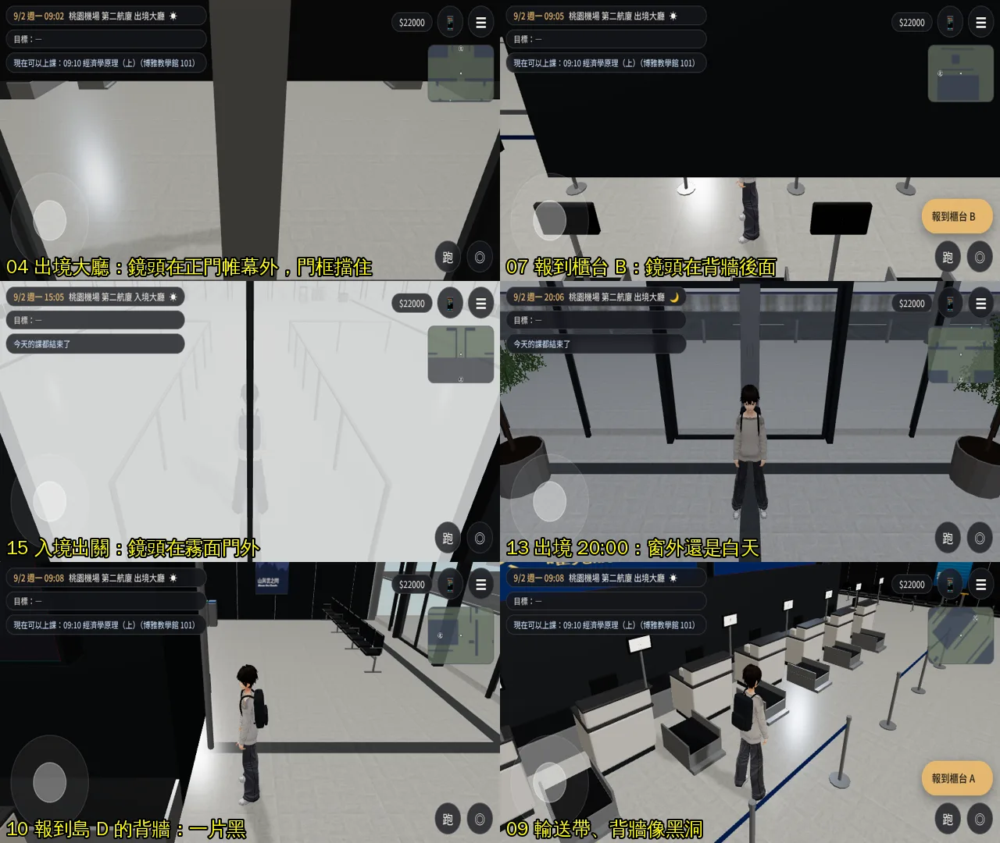
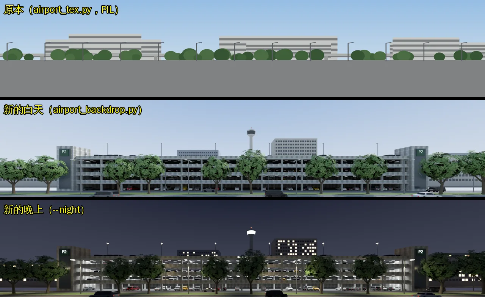
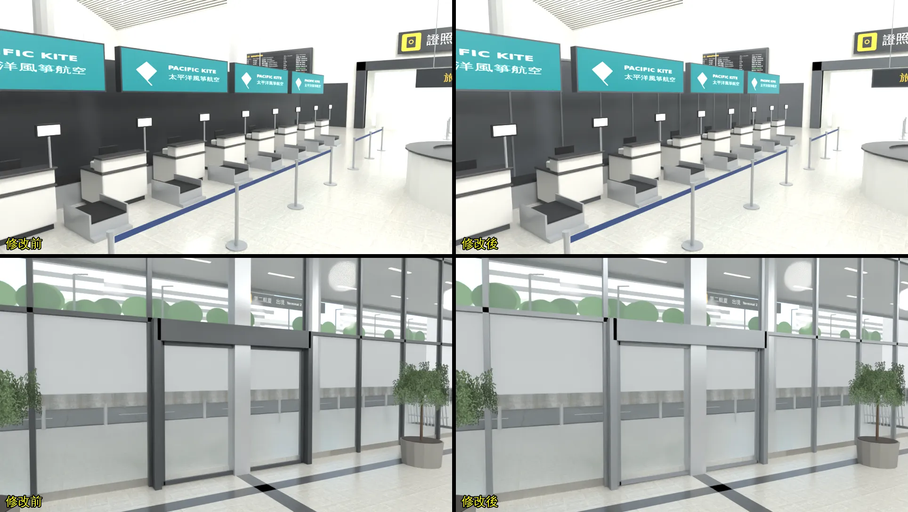
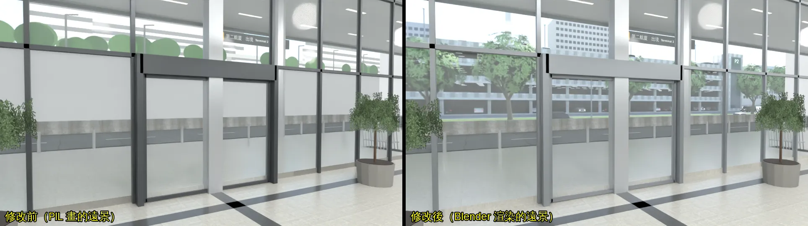
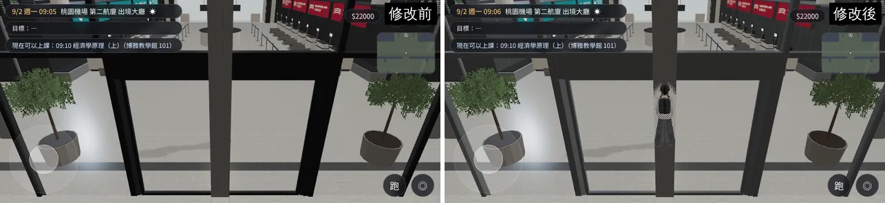
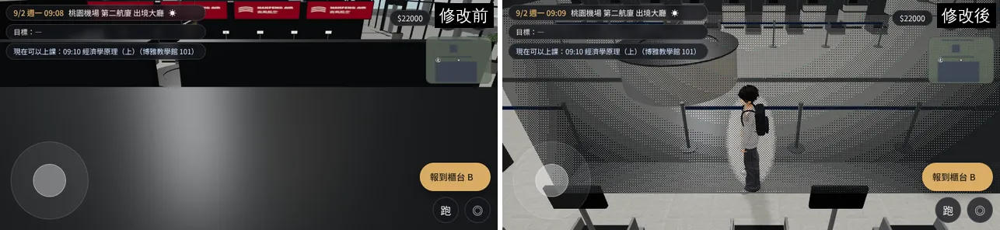
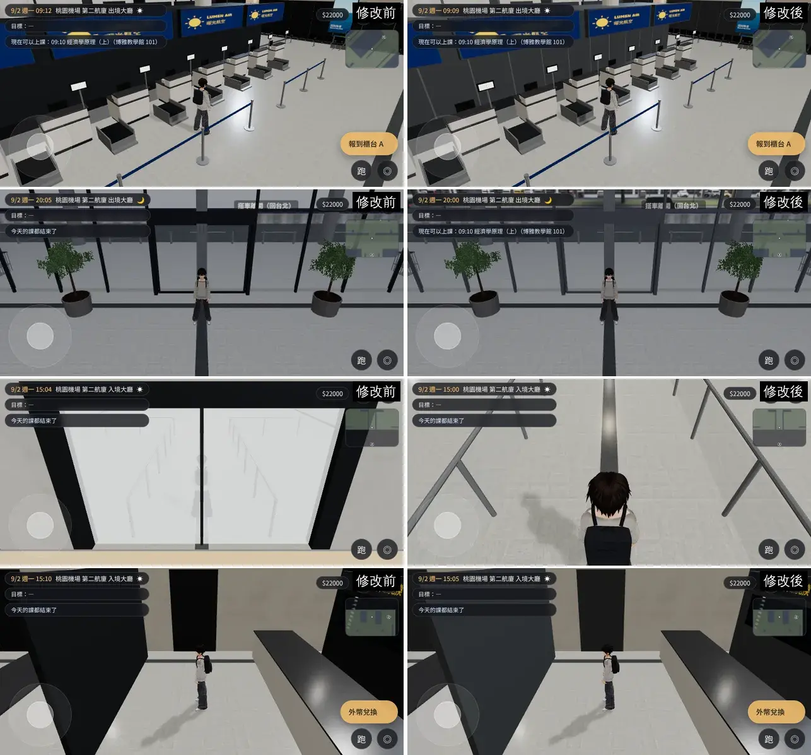

# 桃園機場出境／入境大廳：鏡頭擋住、晚上像白天、報到島黑牆（ART-VAC-AIRPORT-1021）

帳號 A 的 LAWWW2，2026-10-21 21:4x～10-22 04:5x UTC。狀態：**已交付**——第一次遊戲內前後對照（j15）抓到 patch 的一個錯，改成第二版；第二次（j15b）04、07 都修好。

## 為什麼做

- D99：經濟系那一年之後是寒暑假，出國都從機場出發；美國交換的出發和回國也是這兩個區域。
- 巡場景（`$SP/airport`，j6，20 張，經濟系狀態 9/2；**鏡頭距離借用宿舍的，比機場實際的近**）抓到：

| # | 問題 | 優先 |
|---|---|---|
| 1 | 出境大廳：鏡頭退到正門玻璃帷幕外面，自動門中間那支框貼在鏡頭前，整個畫面一根黑柱、看不到人（04） | P1 |
| 2 | 報到櫃台：鏡頭在報到島 3.2 m 背牆後面，只看得到腳（07） | P1 |
| 3 | 入境出關：鏡頭退到霧面自動門外面，畫面整片霧白（15）。**一出關往前走，鏡頭跟在後面就是這個角度** | P1 |
| 4 | 20:00、21:00 從大廳看出去還是白天（13、20） | P2 |
| 5 | 報到島背牆、帷幕框、行李輸送帶在遊戲裡近黑，像挖空的洞（07、09、10、19） | P2 |
| 6 | 出境車道對面只有一面光禿的牆、沒有車；從大廳隔著玻璃看出去是綠色圓球樹、灰方塊（PIL 畫的平面遠景） | P2（這一版做） |

## 原因

1. 機場是室內區域（`indoor:true`），鏡頭只照範圍夾住；正式模型的牆特意不淡出（挑高大廳）。帷幕、出關門、報到島背牆都沒有鏡頭碰撞，也沒有網點透空。
2. 窗外的遠景（`GLOW_ap_outside`，白天的天空和停車大樓）是自發光，跟著燈箱一起調：白天乘 0.75、晚上乘 1——晚上反而更亮。
3. 背牆 `#3a3e42`＋金屬度 0.2、帷幕框 `#4a4e52`＋金屬度 0.35、輸送帶 `#1c1d1f`。遊戲沒有環境貼圖，金屬面只剩一點點漫射，看起來接近黑色。

## 改法

### `patches/airport_cam_night.diff`（`src/us3d.js`＋新測試；第二版，對開發分支 `be8c1b0e` 乾淨，和 `us_lamp_pools.diff` 一起套也乾淨）

- **鏡頭牆**（`apCamCols`）：和公寓、教學館同一套 `zone.camCols`——引擎的 `followCam` 擋到就拉近、抬高，`autoSwing` 轉向空的那一邊。
  - 出境：正門帷幕（扣掉五個入口的門洞；門洞 2.6 m 以上照樣擋）、四座報到島的背牆（3.2 m 高）。
  - 入境：出關門那一面（整面）、出口那一面（扣掉三個出口）。
  - 玩家走得過的門洞，鏡頭也可以過（和公寓、教學館的規則一樣）。
- **網點透空**（`apSeeThru`）：機場兩區開 `seeThru`；帷幕和門的框、背牆和燈箱框、柱子、不鏽鋼（護樁、欄杆柱、雨遮柱）、出關的霧面玻璃、航空公司燈箱。擋在玩家前面、或離鏡頭 1.7 m 內時網點透空。
- **晚上的窗外**（`apOutside`）：7～17 點照原本；17～19 點、5～7 點慢慢變；晚上基本色和自發光乘深藍（剩一成多的亮度）。入境門外的地面一起變暗。白天的亮度和原本一樣。

### `tools/blender/env_second/airport_t2.py`（`ab8544f6`）

- 背牆、燈箱框：烤漆深灰 `#575c61`、粗糙 0.55、不帶金屬。
- 背牆加鋁收邊：每 1.2 m 一道直的、頂邊一道，沿用帷幕框的材質，不加 draw call。
- 帷幕、門的框：陽極鋁灰 `#8a8f94`、金屬 0.3。
- 輸送帶：深橡膠灰 `#2c2e31`。
- 重建：出境 75,810 → 77,106 個三角形（收邊）；網格 33 個、材質數不變。入境三角形不變。
- 用原本的腳本重建，和 repo 裡的 GLB 只差 `ap_props` 這一個網格的頂點順序（腳本用 Python `set` 走訪面，每次不同），JSON（含每個 accessor 的範圍）完全一樣。

### 窗外遠景換成 Blender 渲染（`tools/blender/env_second/airport_backdrop.py`，新）

- 原本的遠景是 `airport_tex.py` 用 PIL 畫的平面圖：綠色圓球當樹、灰色長方塊當停車場、地平線的位置也不對。從出境大廳隔著整片玻璃帷幕看出去就是它。
- 改成在 Blender 搭一個 3D 場景、照遊戲的位置渲染：
  - 外側車道（幾台車）、中央分隔島（`street_trees.glb` 的樟樹、雙臂路燈）；
  - 五層停車大樓 P2：白色樓板邊、清水混凝土矮牆、柱子、天花的燈管、裡面停著 `us_cars.glb` 的車（車色每台隨機，含少數黃色計程車）、兩端的樓梯電梯塔；
  - 遠處的高架道路、飯店、辦公大樓、塔台、天空。
  - 名字、標誌都是虛構的（「P2」「第二航廈停車場」）。
- 投影：攝影機放在大廳中間 (0, 4, 0)、往外看，透視投影剛好對準遊戲裡的遠景平面（出境 z 60、x ±90、y −2～34；入境 z 42、x ±70、y −2～26，都是 5:1，共用一張圖）。
- `--night` 出夜景：停車場各層、路燈、窗戶、塔台的燈亮著，天空深藍。
- `airport_t2.py` 每區多一塊夜景平面 `GLOW_ap_outside_night`（在白天那塊後面 0.5 m、照比例放大，從大廳看蓋住同一個範圍）。遊戲晚上（18:18～5:42）藏起白天那塊、露出夜景；沒接 `us3d.js` 的版本白天那塊在前面擋住，看不到夜景那塊。
- `airport_tex.py` 預設不再重畫 `ap_outside.png`（加 `--legacy-outside` 才畫），免得蓋掉渲染的圖。
- GLB：出境 5.60 → 5.77 MB、入境 1.55 → 1.72 MB（貼圖匯出成 WebP）；三角形各 +2。

貼圖（原本、新的白天、新的晚上）：

## Blender 前後對照（D38 第 12.8 節 ⑤，不是遊戲畫面）

報到島（背牆加鋁收邊）、正門（帷幕框改鋁灰）：

正門玻璃看出去（遠景）：

## 測試

### Node 單元測試

`tests/airport_cam_unit.js`（新）：修改前 **13 FAIL**（第一版；第二版多一項，`c617b2e0` 上沒套 patch 是 16 FAIL）、修改後 **ALL PASS**。

- 在 Node 建出遊戲真正的兩個區域，每 1 m 一點（人站得住）、8 個方向，照引擎的跟隨鏡頭（出境 6.0 m、入境 5.2 m，俯角 0.38）算鏡頭位置。
- 擋鏡頭的牆照配置自己算，不拿 `camCols` 來量。
- 結果：

| | 取樣 | 修改前的公式被擋住 | 修改後 |
|---|---|---|---|
| 出境 | 13,344 | 13.1% | 0 |
| 入境 | 8,888 | 10.0% | 0 |

- 巡場景的位置：07、15 修改前被擋住、修改後鏡頭在牆前；04 的視線走正中間的入口門洞，擋住的是門框（網點透空）。
- 材質（用假的正式模型）：該透空的六種有標、地板／牆／玻璃／招牌／窗外沒有；窗外中午和原本一樣、21:00 剩兩成以下、18:00 在中間、回到中午會還原；招牌照舊；入境門外的地面晚上變暗。

會建機場或美國區域的 11 支 Node 測試，修改前後結果相同：`aa370_us`、`exch_min`、`nav_us`、`r2y3b_events`、`r2y4a_events`、`r2y4b_events`、`room_y4`、`us_cam_walls`、`us_life`、`y34b_events` 都 ALL PASS；`us_season` 前後都是 1 FAIL（稀疏工作樹沒有 `us_community.glb`，和這次修改無關）。

### 遊戲內前後對照

#### 第一次（j15，第一版 patch，10-22 03:29～03:36）

- 修改前：開發分支 `80af0168`；修改後：同一個工作樹套第一版 patch、換 GLB。
- 鏡頭距離用機場區域的 `camDist`（第一次巡場景借用宿舍的距離）。同 j6 的 20 個位置、時段。

| # | 結果 |
|---|---|
| 15 入境出關 | **修好**：鏡頭停在霧面門前面，看得到人和入境大廳 |
| 09 報到島背牆 | **修好**：深灰烤漆、看得出鋁收邊，不再像挖空的黑洞 |
| 10、19 帷幕框、背牆的背光面 | **一半**：帷幕框變成鋁灰；背牆背光那一面比原本亮，但還是偏深（遊戲沒有環境貼圖，背光面只剩補光） |
| 13、20 晚上 | **修好**：窗外是夜景（停車場的燈），不再是白天 |
| 02 車道 | 遠景換成渲染的停車大樓（玻璃外面看得到車和樓板） |
| 04 正門 | **沒變**：自動門中間那支框還是貼在鏡頭前、一根黑柱——該網點透空卻沒有 |
| 07 報到島 | **一半**：鏡頭回到背牆前面（看得到人），但畫面還是被深色的東西佔掉一大塊 |

**04 沒透空的原因（第一版 patch 的錯）**：`seeThru` 寫在區域的**定義**上（`Z3.ZONES.airport_dep`），引擎的 `updateSeeThrough` 看的是區域**實體**（`build()` 回傳、放進 `E.zone` 的那個物件），所以材質有標、網點從來沒開。宿舍、兩點半 Café 以前是同一個錯（10-22 修過）。Node 測試只檢查材質有沒有標，沒檢查開關在哪裡，所以第一版測試是 ALL PASS。

#### 第二版 patch（10-22 03:3x）

- `src/us3d.js`：`seeThru: true` 改寫在 `build()` 回傳的區域實體上（一行）。
- `tests/airport_cam_unit.js` 多一項：「區域實體開了 `seeThru`」——第一版 patch 這一項 **FAIL**、第二版 **PASS**；其他檢查和第一版相同。
- 在 `be8c1b0e` 上：`airport_cam_unit` ALL PASS；會建機場或美國區域的 11 支 Node 測試和修改前結果相同。
- 第一版留在 `$SP/airport/airport_cam_night_v1.diff`（不交）。

#### 第二次（j15b，第二版 patch，10-22 03:59～04:07）

- 修改前：`be8c1b0e`；修改後：`be8c1b0e`＋第二版 patch＋換 GLB；同樣 20 個位置。
- 這次記下每張的鏡頭座標（`airport_patrol2.py` 寫進 `shots.json`）：07 修改前鏡頭在 (−9.67, 3.88, −2)＝報到島中間背牆的後面；修改後在 (−7.32, 3.27, −2)＝背牆前面、離人 3.2 m。

| # | 結果 |
|---|---|
| 04 正門 | **修好**：自動門中間那支框網點透空，看得到門後的人 |
| 07 報到櫃台 | **修好**：鏡頭在背牆前，從櫃台裡面看得到人（人身上也有網點，因為櫃台的燈箱框在鏡頭和人中間） |
| 09 報到島背牆 | 修好：深灰烤漆＋鋁收邊 |
| 13 晚上 | 修好：窗外是停車場的夜景 |
| 15 入境出關 | 修好：不再整片霧白；鏡頭停在霧面門前、離人很近（牆就在人背後） |
| 19 換匯 | 背光面比原本亮一點，還是偏暗（遊戲沒有環境貼圖，背光面只剩補光）——下一輪再看要不要把那面牆的顏色調淺 |

09、13、15、19：

## 接法（LAWWW）

1. `git apply docs/art-rebuild/second_ai/patches/airport_cam_night.diff`（第二版；對 `be8c1b0e`、`c617b2e0`、`6b6ecd80` 都乾淨，和 `us_lamp_pools.diff` 一起套也乾淨）。
2. 換 `assets/models/env/second_ai/airport_dep.glb`、`airport_arr.glb`（＋`.json`）（我的分支 `bc5b08a8`；腳本 `airport_t2.py` 在 `ab8544f6`；窗外遠景兩張圖在 GLB 裡）。
3. 跑 `node tests/airport_cam_unit.js`（沒套 patch 16 FAIL（10-22 在 `c617b2e0` 量）、套了 ALL PASS）和會建機場或美國區域的那 11 支。

## 還不到的地方（誠實寫）

- 遠景是一張平面圖：在大廳中間看最準，走到大廳兩端、或站在車道上抬頭看，透視會有一點偏（平面離鏡頭 30～60 m，偏得不多）。
- 遠景裡的車、樹不會動。
- 真機沒看過。
