# VAC-A2 桃園機場第二航廈：出境大廳＋下車處（`airport_dep`）、入境大廳（`airport_arr`）（LAWWW2-C 2026-10-17；狀態 MODEL_READY → READY_FOR_ART_REVIEW）

規格：AA-C 2026-10-17 05:56 的回覆（AA_199 Q4 改成 3D、AA_201）。第二航廈；要走得到：①出境層外的下車處 ②出境大廳（報到櫃台）③出境安檢門口的道別點 ④入境大廳接機處；不做登機口、管制區。
用到的時間：2026-08-24 阿凱那團去日本（最早）、8/28 回國；2028-03-25 日本路線出發；2028-07-19 學姊出發（下車處，BCG-31）；2028-08-02 美國路線出發；2028-08-05、12-16（BCG-34）、12-23 入境。
**航空公司、店名全部虛構**（D77：曜光航空 LUMEN AIR、太平洋風箏航空 PACIFIC KITE、南風航空 NANFENG AIR、港灣捷運航空 HARBOR JET；日日便利、雲端咖啡、旅人書店）；看板上的城市是真的地名，航班號碼是虛構代碼。
**還沒有對照真實照片**：沙盒查不到第二航廈出境、入境大廳的照片與尺寸，這一版照一般機場的配置做；使用者給照片後再對（天花板、柱子、櫃台、指標的樣子）。場景美術的 `ART_APPROVED` 只有使用者能標。

## 交件
- 模型：`assets/models/env/second_ai/airport_dep.glb`（5.5 MB、75,810 三角形、33 個物件）、`airport_arr.glb`（1.5 MB、17,476 三角形、23 個物件）；同材質合併。
- 配置：`assets/models/env/second_ai/airport_t2.layout.json`（`dep`、`arr` 兩個區域；`tools/blender/env_second/airport_layout_gen.py` 產生，自我檢查：出生點、道別點、下車處、接機處、互動點不在阻擋裡）。
- 貼圖：`tools/blender/env_second/airport_tex.py` → `textures/gen/ap_*`（中英指標、航空公司燈箱、出發與抵達看板、店家招牌、燈箱廣告、鋁格柵天花板＋法線、航廈外遠景）；地面 Poly Haven `granite_tile`、牆 `white_plaster_02`、檯面 `granite_tile_03`、柏油 `asphalt_02`、水泥 `concrete_wall_006`、木作 `walnut_veneer`（CC0）。
- 腳本：`python3 tools/blender/env_second/airport_layout_gen.py` → `python3 tools/blender/env_second/airport_tex.py` → `/opt/blenv/bin/python tools/blender/env_second/airport_t2.py -- --area dep`（再 `--area arr`）。

## 空間（layout.json；區域座標 x 往東、z 往南、y 往上）
### 出境 `dep`
| 東西 | 位置 | 說明 |
|---|---|---|
| 大廳 | x −36～36、z −18～12 | 弧形挑高天花板（屋簷 10.5 m、中間 15 m）、鋁格柵＋兩條天窗、筒燈；圓柱在報到島的背牆裡 |
| 正面 | z＝12 | 整面玻璃帷幕（鋼柱每 9 m）、五組自動門（x −32、−18、0、18、32） |
| 報到島 | A～D：x −27、−9、9、27，z −11～5 | 中間深灰背牆＋行李輸送帶，兩側櫃台每 1.9 m 一格（工作檯、高檯、螢幕、標籤印表機、號碼燈、磅秤輸送帶）；上方航空公司燈箱；櫃台前伸縮帶排隊欄；島尾小看板 |
| 出境安檢入口 | 北牆正中 x −6～6 | 深灰門框、上方「證照查驗 Passport Control」、門後毛玻璃隔間、兩座查驗台；門前空地＝**道別點** `farewell` |
| 服務台 | (0, −4) | 圓環形櫃台＋「旅客服務 INFORMATION」 |
| 看板 | 北牆兩塊大的、每座島尾一塊小的 | 出發看板（虛構航班） |
| 店面 | 西牆：便利商店、咖啡；東牆：外幣兌換、書店 | 玻璃櫥窗、招牌燈箱、裡面發光的層架 |
| 候機椅 | 北牆前兩組×2、正面兩端各一組 | 鋼樑連座；`seats` 66 個 |
| 下車處 | 正面外：人行道 z 12～19、車道 z 19～27 | 大雨遮（鋼柱、白色底板、燈）、不鏽鋼護樁、「第二航廈 出境」指標；`spawn_curb`、`dropoff`（BCG-31） |
### 入境 `arr`
| 東西 | 位置 | 說明 |
|---|---|---|
| 大廳 | x −28～28、z −12～12、天花板 5.6 m | 鋁格柵＋燈帶 |
| 出關門 | 北牆正中 | 毛玻璃自動門、上方「入境 Arrivals」；`spawn_customs`（出來的人） |
| 接機欄杆 | 走道 x −1.6～1.6、z −12～−3，往兩側打開 | 不鏽鋼立柱＋扶手＋玻璃欄板；`meet`、`spawn_wait`（等人的人，BCG-34） |
| 等候椅 | 北牆前四組、中間兩組 | `seats` 54 個 |
| 櫃台 | 外幣兌換、旅客服務、電信門市 | 招牌燈箱、匯率看板 |
| 咖啡店 | 東南角 | 吧台、三張桌子 |
| 出口 | 南牆玻璃、三組自動門 | 外面是車道的遠景 |

- **發光** `GLOW_*`：筒燈、天窗、看板、指標、航空公司燈箱、店家招牌、燈箱廣告、毛玻璃、遠景；晚上由遊戲調亮度。
- **會淡出的牆** `WALL_ap_walls`。

## 圖（Blender Cycles，Standard、曝光 −1.0～−1.3，天花板加補光；**不是遊戲內截圖**）
### 出境
從中間的自動門進來（報到島、遠處的安檢入口、服務台）：
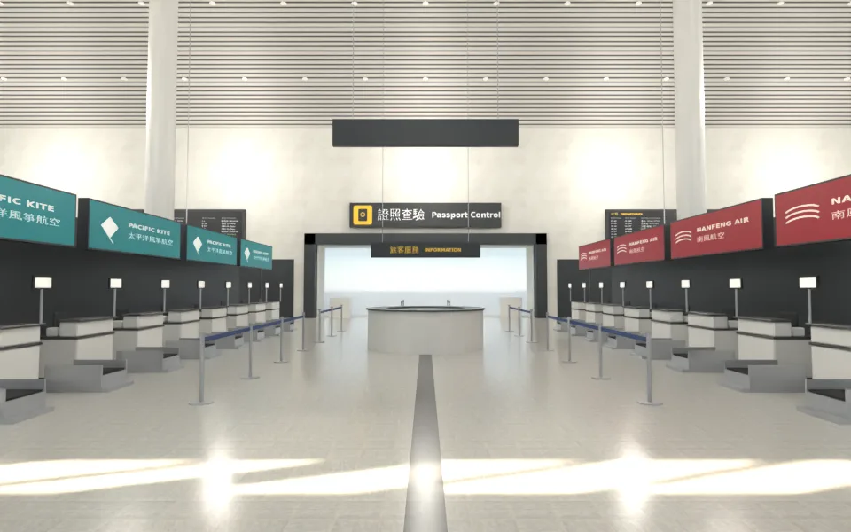
道別點（出境安檢入口「證照查驗」）：
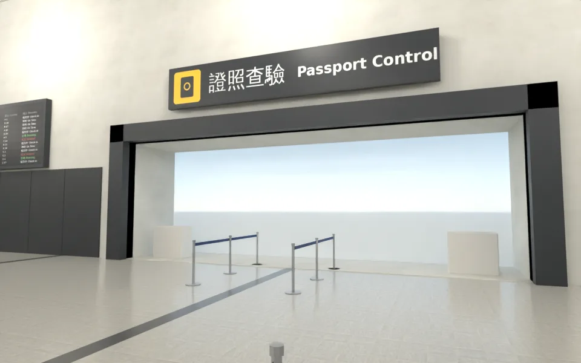
報到島與排隊欄：
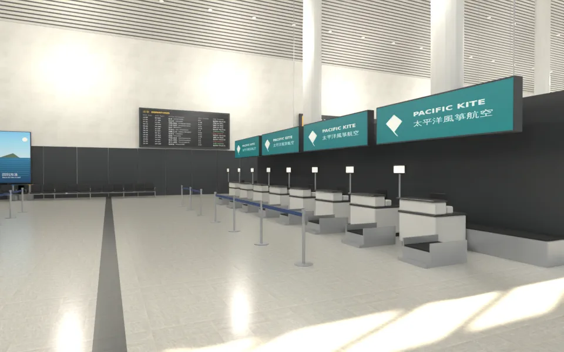
報到櫃台近看（客人那側的高檯、號碼燈、磅秤輸送帶；上方航空公司燈箱）：
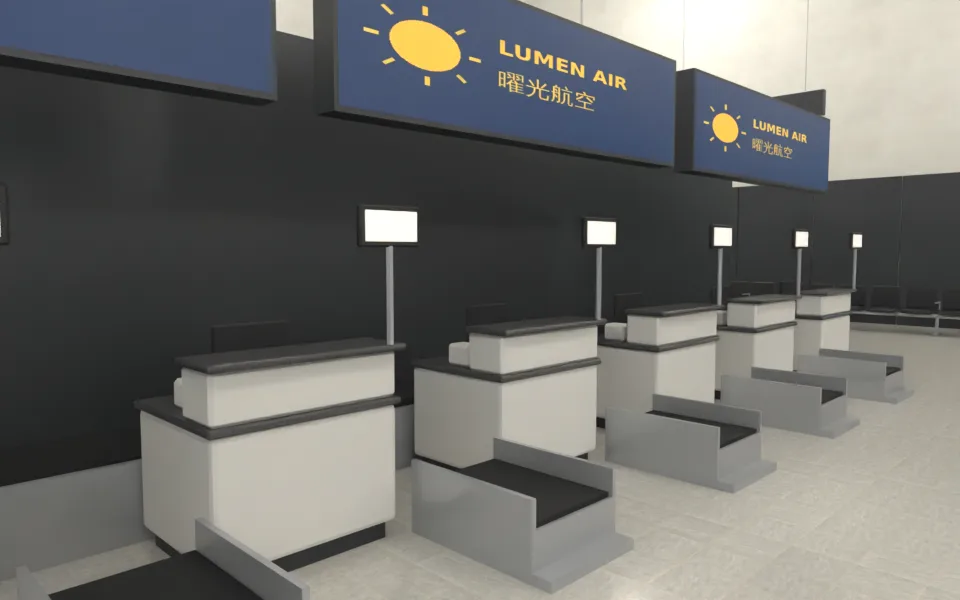
從東南角上方看整個大廳（弧形格柵天花板、天窗、柱子、玻璃帷幕、牆面金屬板、燈箱廣告）：
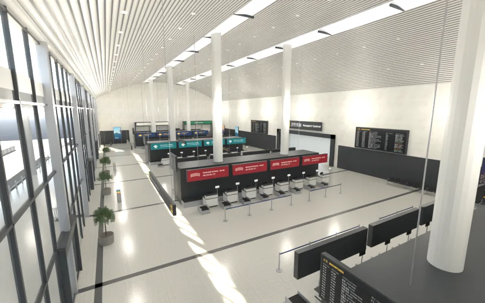
航廈外的下車處（雨遮、護樁、車道；BCG-31 的位置）：
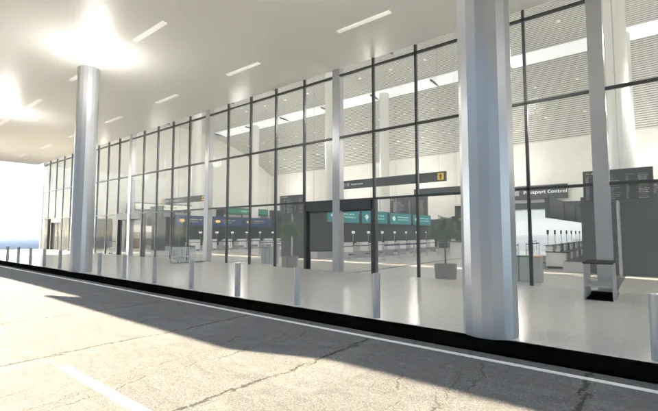
西牆的店面（咖啡、便利商店）：
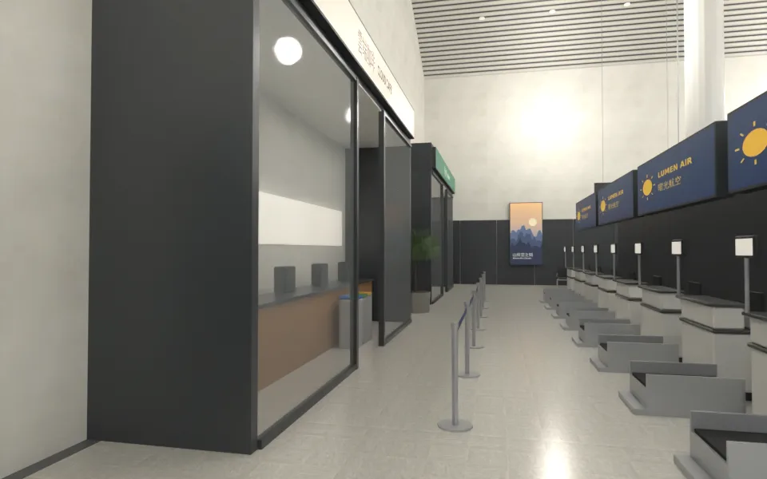
### 入境
接機處（出關門、接機欄杆、抵達看板；BCG-34 的位置）：
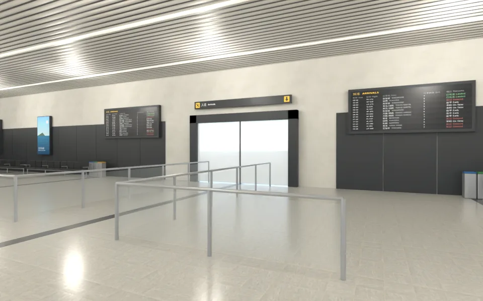
從出關門出來看：
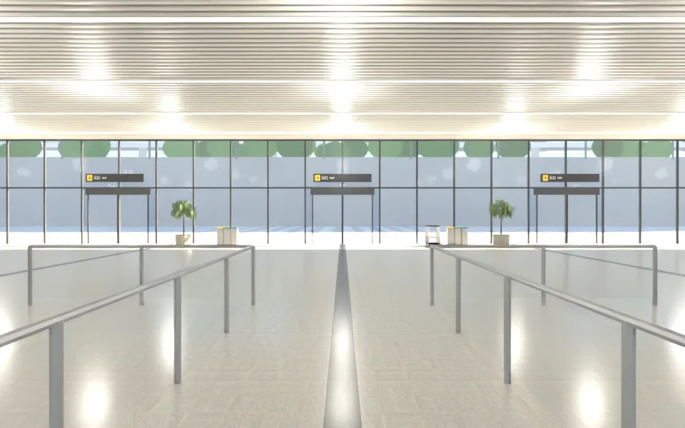
整個入境大廳：
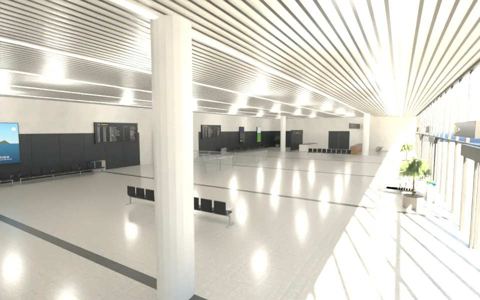
咖啡店：
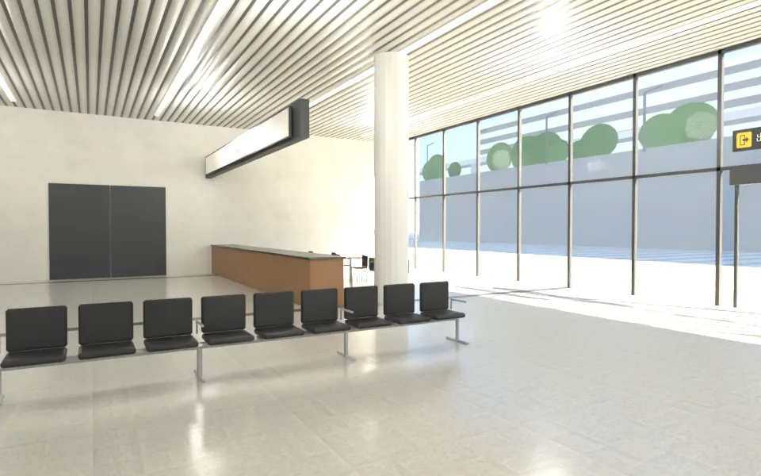
### 貼圖
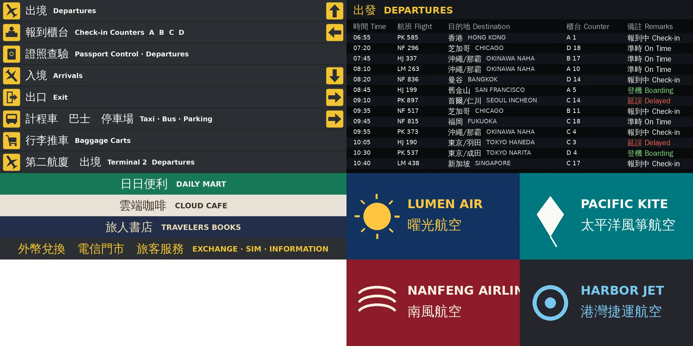
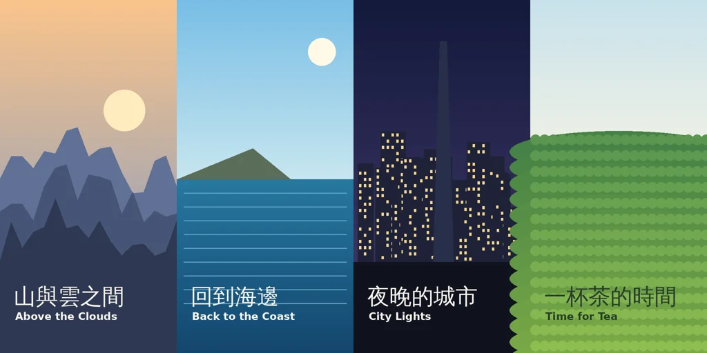

### 版本（自己退件的）
- 第一版（`v1_dep_counter.webp`）：報到櫃台是白色方塊、磅秤是灰色方塊；吊掛指標朝錯方向（走進來的人看到「出口」）；牆面整片白、大廳空。這一版：櫃台改成員工工作檯＋客人高檯＋內縮踢腳＋螢幕、鍵盤、標籤印表機＋號碼燈桿，磅秤加不鏽鋼擋板與斜坡；指標朝向改正；牆下半部金屬板、燈箱廣告、分類回收桶。

## 八項（ART_SOP 3-2）
| 項目 | 結果 | 說明 |
|---|---|---|
| 輪廓與倒角 | 通過 | 櫃台、檯面、回收桶、咖啡店吧台倒角；圓柱、弧形天花板、圓環服務台；指標與燈箱有深灰外框 |
| 材質 | 通過 | 石材地面＋深色分隔帶、檯面石材、柏油、水泥是 Poly Haven CC0；天花板是鋁格柵貼圖＋法線；指標、看板、燈箱是程式畫的貼圖（發光）；金屬度 ≤0.45 |
| AO | 部分 | 牆下半部深色金屬板、踢腳；沒有烘焙 AO |
| 磨損 | 未做 | 地面、櫃台沒有磨損（機場很乾淨，優先度低） |
| 生活痕跡 | 部分 | 排隊欄、行李推車、回收桶、盆栽、燈箱廣告、店面；**人（旅客、地勤）由遊戲的 NPC 補**，模型裡沒有人 |
| 比例 | 通過 | 出境大廳屋簷 10.5 m／中間 15 m、櫃台 1.05～1.1 m、伸縮帶 0.95 m、候機椅座高 0.45 m、雨遮 8.5 m、入境天花板 5.6 m |
| 效能 | 通過 | 出境 7.6 萬、入境 1.7 萬三角形；出境的筒燈 300 多個可以在低畫質合併成燈帶 |
| 遊戲截圖 | **沒有** | 要等 LAWWW 接成區域；接好後我拍白天、晚上、手機直向 |

## 還沒做／已知
- **還沒對照第二航廈的真實照片**（見最上面）。
- 下車處的車道沒有車（遊戲放車；可以用 `us_cars.glb` 的車上色，或之後做台灣的計程車、轎車）。
- 登機口、管制區不做（規格）。CG-22 登機口只在 CG。
