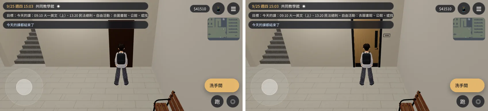
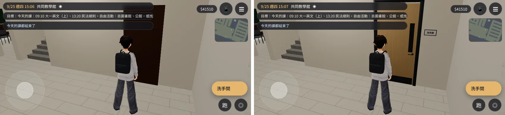
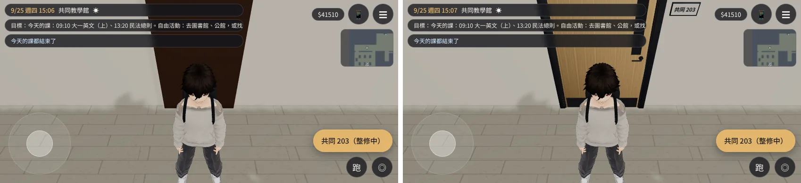
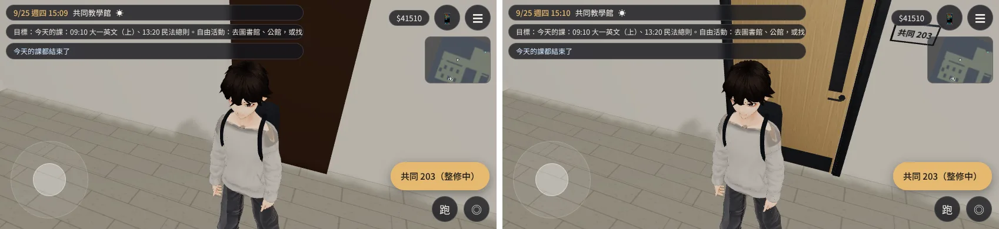
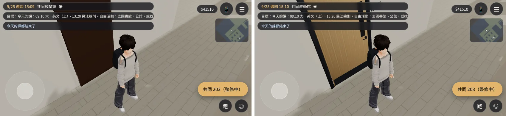

# 共同教學館關著的門換成門模組（ART-02）——已交件

帳號 A 的 LAWWW2，2026-10-21 18:4x UTC。狀態：**已交件**，交 LAWWW 整合。READY_FOR_ART_REVIEW（不標 ART_APPROVED）。

## 問題

共同教學館（`gongtong`）沒有正式室內模型，關著的房間用程序化備用模型的門。那個門是一塊深色木板，沒有門框、把手、門牌，看起來像牆上貼了一個黑色長方形。

換門的有三扇：
- 1F 兩間洗手間；
- 2F 203（整修中）。

## 改法：`docs/art-rebuild/second_ai/patches/art02_gongtong_doors.diff`

對開發分支 `15f3c677` git apply 乾淨。改 `src/teach3d.js`，加一支測試。

- 關著、寬 1.2 m 的門換成 `furniture_study.glb` 的門模組，用 InstancedMesh：
  - 門框；
  - 關著的門片（木紋、兩面把手、觀景窗）；
  - 門牌，字由遊戲畫：「洗手間」「共同 203」。
- 牆沒有開口：
  - 門片貼著走廊那一面；
  - 門框往走廊移 4.75 cm，門片凹進門框 1.5 cm（不插進牆、不浮在空中）。
- 原本的木板移進 `door_fallback` 群組：門模組載入後藏起來；載入失敗就照舊用木板。
- 都放在備用模型群組裡：博雅、普通的正式室內殼載入後，跟著一起藏（那兩棟的門在正式模型裡）。
- 導航、互動點、門的標籤都沒動。

## 測試

### Node 單元測試 `tests/teach_doors_unit.js`（修改前 FAIL、修改後 ALL PASS）

做法：自己解析 GLB，照實例矩陣算出門框、門片、門牌在世界座標的範圍，再和牆比。

檢查：
- 三扇門都換了，木板藏起來；
- 門片不插進牆、不浮在空中；
- 門框貼牆，門牌在門旁邊的牆上；
- 導航、互動點不變。

其他教學館測試也 ALL PASS：`nav_teach`、`teach_cam_walls`、`teach_class`、`teach_perf`、`boya_lecture`。

### 遊戲內前後對照（`doors_check.py`）

- 環境：Playwright 手機橫向 844×390、`?turbo`。**不是 iPhone。**
- 基準：開發分支 `15f3c677`；修改後＝同一個 worktree 套上 patch。
- [前置／捷徑]：讀使用者 9/25 存檔；`GAME.enter('gongtong')` 15:00；`E.placeAt` 搬玩家（含樓層）；設鏡頭方向和距離。
- 結果：修改前 `doorsGLB:false`、修改後 `doorsGLB:true`；JS 例外 0。
- 每張圖左邊是修改前、右邊是修改後：

| 角度 | 修改前 | 修改後 |
|---|---|---|
| 1F 洗手間，正面 | 黑色長方形 | 門框、木門片、觀景窗、把手；右邊門牌「洗手間」 |
| 1F 洗手間，貼近 | 同上 | 門框、門把、門牌看得清楚 |
| 2F 203，正面 | 深咖啡色長方形 | 木門片；右上門牌「共同 203」 |
| 2F 203，貼近、斜看 | 同上 | 門框有厚度，門片凹進門框 |

## 還不到的地方（誠實寫）

- 門牌的字是遊戲畫的平面字，貼近時有一點模糊（256×112 的貼圖）。
- 只拍了 15:00 白天。
- 共同教學館還是沒有正式室內模型（牆、地板、樓梯仍是程序化）。這次只換門。

## 接法（LAWWW）

1. `git apply docs/art-rebuild/second_ai/patches/art02_gongtong_doors.diff`：`src/teach3d.js`＋新測試 `tests/teach_doors_unit.js`。
2. 不用加資產：門模組在已整合的 `assets/models/env/second_ai/furniture_study.glb` 裡。
3. 跑 `node tests/teach_doors_unit.js`、`node tests/nav_teach_unit.js`、`node tests/teach_cam_walls_unit.js`。
