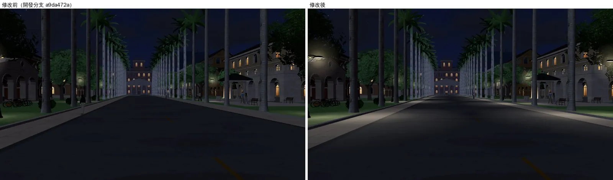
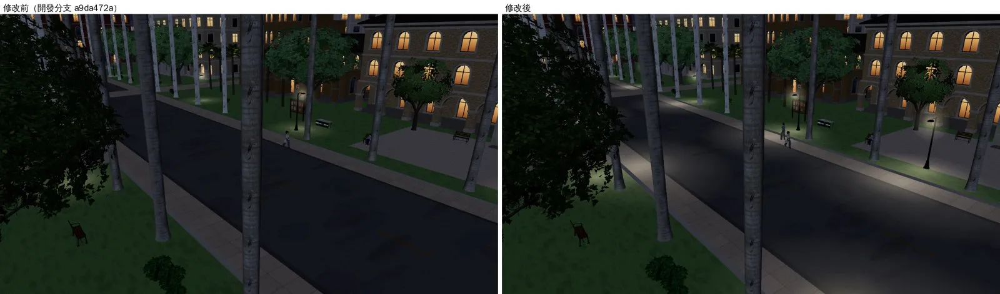
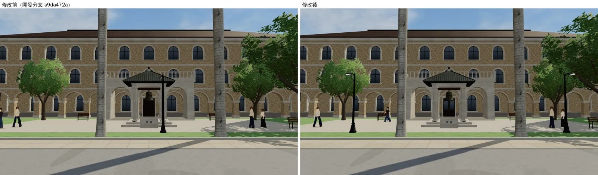
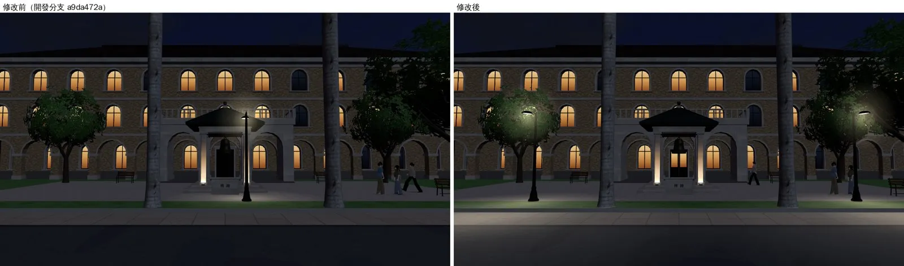

# 椰林大道晚上的路燈＋路燈柱擋不住人（ART-ECON-3D-GAP-1021／BUG-NAV-LAMPPOST-1021）

帳號 A 的 LAWWW2，2026-10-21 20:3x UTC。狀態：**WIP**——遊戲內畫面已確認；燈柱導航的瀏覽器回歸（reachability_all、campus_layout_nav、gongguan_layout_nav、p0_movement）還在排隊，跑完才交件。

## 問題

經濟系、法律系晚上都走椰林大道。巡場景（`ART_DIRECTOR_PATROL.md` 第 1 節）抓到三件事：

| # | 問題 | 優先 | 原因 |
|---|---|---|---|
| 1 | 20:00 大道路面整條是黑的，路燈只照亮燈下一小圈 | P2 | 兩排路燈的燈臂背對大道（朝兩側的樹牆），燈下的地面光圈在燈的背面 |
| 2 | 傅鐘正前方有一支路燈，擋在鐘亭正中間 | P3 | 大道每 22 m 一盞，剛好排到鐘亭前面 |
| 3 | 路燈的燈柱，人可以直接走過去 | P1 | 見下面 |

第 3 件是做第 1 件時發現的：
- 路燈的導航阻擋是 `nav.blockCircle(x, z, 0.25)`。
- 導航格是 0.5 m 一格，只看格子中心。燈柱剛好在格子的角上（大道兩排都是整數座標）時，四個格子中心都在 0.354 m 外，一格都沒擋到。
- 不在格角的燈柱也只擋到一兩格，斜著走會貼進燈柱。
- 不只大道：校園、公館、118 巷、溫州街小公園的路燈都是同一個寫法。

## 改法

兩份 patch，**先套 `lamppost_nav.diff`，再套 `campus_avenue_lamps.diff`**（第二份動到同一行）。都對開發分支 `a9da472a` 乾淨；和其他待整合的 patch 一起套也乾淨。

### `patches/lamppost_nav.diff`（BUG-NAV-LAMPPOST-1021）

- 燈柱的阻擋半徑改成 0.5 m：柱座半徑 0.23＋半格。燈柱剛好在格子中心時擋十字五格，斜著走也進不去。
- 改的地方：
  - `src/zones3d.js`：校園的大道、長椅旁、法學院、系籃球場、醉月湖的路燈；公館兩排；118 巷；
  - `src/data/wz_park_layout.js`：溫州街小公園兩盞（0.2 → 0.5）。
- 新測試 `tests/lamppost_nav_unit.js`。

### `patches/campus_avenue_lamps.diff`（第三版）

- 大道兩排路燈轉向，燈臂伸向路面（燈頭位置照 `W3.lampPost` 的約定，只是轉向）。
- 每一盞燈下加一圈暖色路面光圈：
  - 離燈 4.5 m、半徑 6.5 m、沿路拉長 1.3 倍；
  - 不透明度 0.38（第一版 0.2，遊戲裡量到路面只亮三成）；
  - 和其他區域的地面光圈同一套 `E.lampGlows`，入夜才開。
- 傅鐘前那一盞改成鐘亭兩側各一盞（x −46.25、−31.25，都在兩棵椰子中間）。新的兩盞也用 0.5 m 的阻擋。
- 新測試 `tests/campus_lamps_unit.js`。

## 測試

### Node 單元測試

| 測試 | 修改前 | 修改後 |
|---|---|---|
| `campus_lamps_unit.js`：燈臂朝大道、每一盞有路面光圈（白天藏著）、鐘亭正前方沒有路燈 | 3 FAIL | ALL PASS |
| `lamppost_nav_unit.js`：校園、公館、溫州街、118 巷每一盞有導航的路燈，人物中心在燈柱 0.4 m 內都站不住 | 4 FAIL（校園 28／28 盞、公館 16／16、小公園 2／3、118 巷 4／4 站得進燈柱，多數是正中間） | ALL PASS（校園 29 盞） |

- 燈柱附近有沒有「只有一點站得住」的小孤島：用和 `tools/dev_scratch/nav_islands.py` 一樣的做法（0.1 m 取樣），修改前後都是 0。
- 會建這四區的 16 支 Node 測試，修改前後結果相同（`bike`、`campus_bikes`、`campus_public`、`crowd`、`follow_buddy`、`lane118_walkers`、`nav_buildings`、`quick_travel`、`seat_reach`、`socsci_place`、`street_trees`、`wz_cat`、`wz_park`、`wz_shops`、`zone_dispose`、`v0_a6`）。
- 燈柱離人物最近站得住的距離：修改前大多是 0（站在燈柱正中間）；修改後 0.52～0.72 m。

### 瀏覽器回歸（排隊中）

`reachability_all.py --zones campus,gongguan,wenzhou,lane118`、`campus_layout_nav.py`、`gongguan_layout_nav.py`、`p0_movement.py`，修改前後各跑一次。結果出來再補。

### 遊戲內前後對照

- 環境：`tools/shots/scene_shot.py`，1280×720。Playwright＋SwiftShader，**不是 iPhone**。
- 修改前：開發分支 `a9da472a`；修改後：同一個工作樹套上路燈 patch。
- 拍攝設定：[`shots_before.json`](shots_before.json)、[`shots_after.json`](shots_after.json)（固定鏡頭、藏起玩家）。
- 每張圖左邊是修改前、右邊是修改後。

**大道 20:00，人的高度**：路兩側照亮了，看得出路面；路中間還是比邊緣暗。

**大道 20:00，高處**：每一盞燈前面一圈路面光。

**傅鐘 15:00**：鐘亭正前方的路燈拿掉，改成兩側各一盞。

**傅鐘 20:00**：兩側的燈照著鐘亭前的廣場和人行道。後面行政大樓的門晚上透光（四棟拱廊大門那一項的修改，同一批截圖）。

## 還不到的地方（誠實寫）

- 路中間（離兩邊的燈各 6 m）比邊緣暗；要再亮得加燈，或讓光圈更寬。這一版先不加。
- 燈柱導航的瀏覽器回歸還沒跑完。
- 真機沒看過。

## 接法（LAWWW）

1. `git apply docs/art-rebuild/second_ai/patches/lamppost_nav.diff`
2. `git apply docs/art-rebuild/second_ai/patches/campus_avenue_lamps.diff`
3. 跑 `node tests/lamppost_nav_unit.js`、`node tests/campus_lamps_unit.js`。改了導航，照規則再跑 `tests/reachability_all.py`、`tests/campus_layout_nav.py`、`tests/gongguan_layout_nav.py`。
