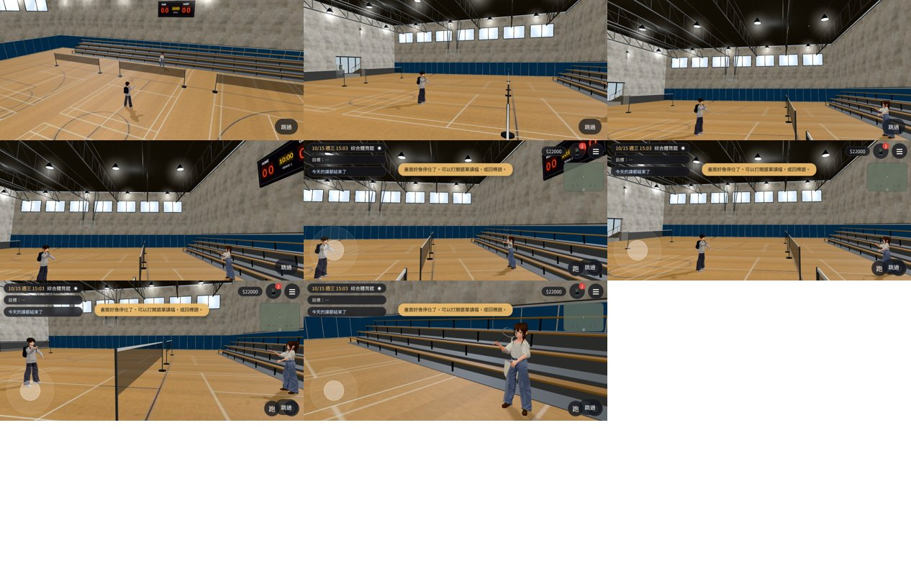
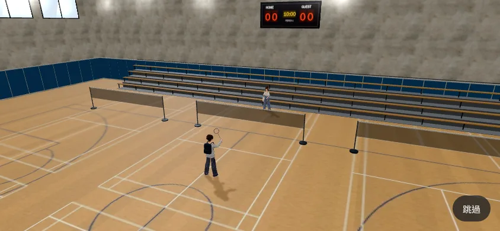
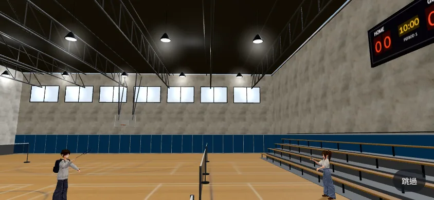
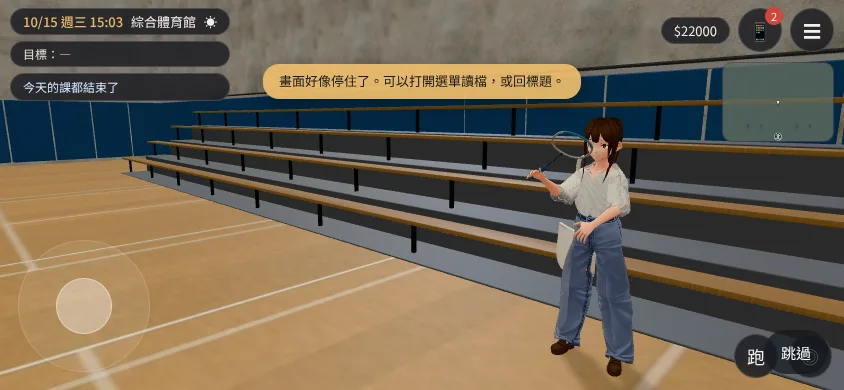

# BADMINTON-CLIP-1027（X106）：一起打羽球的小短片（LAWWW2-C 2026-10-27）

- **使用者**（10-27 試玩）：「跟陳羽彤打羽球也只是對話帶過? 不能做個小短片?」。**演出**：AA_485 第 2 節（企劃線 5aaa71d6a）——每個人共用一套三個鏡頭，最後一個鏡頭照人換；第一次演完整版、之後只演鏡頭 2；可以跳過；動作只要發球、高遠球、殺球；不比分。
- **分工**（LAWWW-C 20:44Z）：我做揮拍動作、球拍、羽球弧線、網、鏡頭；接在 `invites3d.js` 羽球邀約的哪一句之間由 LAWWW-C 接。
- **對**：開發 `fb8d27888` 做、最新開發 `c9ed80184` `git apply --check` 過。

## 和 AA 規格不一樣的地方（請 LAWWW-C、AA-C 確認）

- **場地在新體育館 1F 的羽球場，不是 3F 主球場**：遊戲裡打羽球本來就在 1F（`gym_layout.js` 的 `courts.badminton` 六面羽球場、網都在；`gym3d.js` 的「打羽球」、邀約地點「新體育館羽球場」都是 1F）；3F 主球場是籃球／排球的木地板，沒有羽球網。在 1F 拍不用換區域（換區域要黑畫面、載入），AA 要的「旁邊幾面場地」本來就在畫面裡。**一定要 3F 的話告訴我**，我在 3F 放網和場地線、改機位。
- 「旁邊幾面場地有別人在打」：網都在，**人還沒有**（我沒有生路人；LAWWW-C 那邊的人流有的話會在畫面裡）。

## 三個鏡頭（`BADCLIP.play(GM,{who,full})`）

| 鏡頭 | 長度（真機） | 畫面 |
|---|---|---|
| 1 | 約 3 秒 | 遠景：場地南邊、兩面場地之間的上方（高 5.8 m）。她（他）在發球線發球，你回一拍高遠球。 |
| 2 | 約 6 秒 | 側面中景：四拍高遠球（兩個人輪流、同一個揮拍動作），鏡頭跟著球左右移、看的點跟著球。 |
| 3 | 約 4 秒 | 照人換（AA_485 的表）：以安——你打高遠球、她平抽回來、你伸拍來不及，鏡頭轉到她；語彤——她發球掛網（網前落地）；芷若——她放小球貼網落下、你衝上去伸拍沒接到；子晴——你打過去、她揮空、球落在她腳邊；學姊——她發一個漂亮的球、你回過去、她伸拍沒接到；沛珊——你殺球、她撲過去、坐在地上；可昕——她殺球、你漏接；其他人（男生朋友）——你殺球、他漏接、拍子垂下來。 |

| 鏡頭 1 | 鏡頭 2 | 鏡頭 3（以安） |
|---|---|---|
|  |  |  |

- 跳過：右下角「跳過」按鈕（44 px 以上、避開 safe-area），或點畫面任何地方。
- 台詞：短片裡不說話；以安「替補也是校隊。」、語彤「……你說不笑的。」、學姊「發球我練過。後面的沒有。」、沛珊「欸，剛剛那球怎麼打的？再一次！」放在 `BADCLIP.LINES[id]`，LAWWW-C 接在短片後面（AA：子晴的輪流句照舊接在後面）。
- 播完：兩個人回到原本的位置和姿勢、球拍和球拿掉、鏡頭回到跟隨（`E.endCinematic`）；她原本不在場就臨時生出來、播完拿掉。`opts.full===false`＝只演鏡頭 2。

## 做法

- **揮拍**：程式驅動骨頭——`character3d.js` 加一個「疊加姿勢」掛勾 `u.overlay`（動畫片段算完以後，把右上臂、前臂、手、胸、左臂轉到指定角度；和 `SIT_VRM` 同一套角度、x／z 乘 sx，k＝比例；坐下、騎車不受影響）。`badminton_clip3d.js` 有準備、引拍、擊球、收拍、發球三段、殺球、平抽、伸拍、拍子垂下；揮拍＝這幾個姿勢之間平滑內插（發球、高遠球、殺球、平抽、放小球、揮空、伸拍）。任何 VRM（祐廷、七位、路人底模）都能套，不用重定向動畫。腳照舊待機。
- **球拍、羽球、球網**：Blender bpy（`tools/blender/env_second/badminton_props.py` → `badminton_props.glb`，3,632 三角形、124 KB）：球拍兩支（深藍；白框淺藍線），握把纏帶、拍桿、T 頭、超橢圓拍框扁管、線床（程式畫的編織線、alpha）；羽球（白皮軟木頭＋16 片羽毛裙、兩圈綁線）；球網（網目貼圖、白色上緣布帶、網柱＋配重底座；這一版沒用到，1F 的網是原本的）。球拍掛在右手骨：用手骨、中指、拇指的位置算手的方向，所以 VRM 0.x／1.0 都對；拍面平行手掌。
- **球**：程式算的弧線——往上衝得快、落下陡（水平進度先快後慢），軟木頭朝前；擊球那一刻和揮拍的「擊球」同步。
- **鏡頭**：`E.cinematic`＋直接切（不慢慢轉）；鏡頭 2 跟著球。
- 時間軸用真實時間（`requestAnimationFrame`，一格最多算 0.25 秒）：手機卡的時候也不會拖很久。

## 測試

- 新 `tests/badminton_clip_unit.js`（Node）：**改前 FAILED 3、改後 ALL PASS（16 項）**——揮拍種類齊全、頭尾是準備姿勢、擊球那一刻是擊球姿勢；弧線起終點、中間高、水平不倒退、往上衝得快；七位各一種結尾、台詞照 AA、短片裡不說話；場地和遠景機位在 1F 球場裡；`character3d.js` 掛勾、`index.html`、manifest、GLB 的物件。寫測試抓到一個錯：弧線函式在進度稍微超過 1 時算出 NaN（短片裡有夾住，函式本身沒夾）——已修。
- 會載入 `character3d.js` 的 10 支 Node 測試 ALL PASS（掛勾不影響原本的動作）。
- 瀏覽器實際播放（`tools/shots/badminton_clip_run.py`，SwiftShader 手機模擬，1F 體育館 15:00）：以安、語彤兩個版本**從頭播到尾、沒有 JS 例外**；播完鏡頭回到跟隨、球拍拿掉、疊加姿勢清掉、玩家回到原位。SwiftShader 一格超過 0.25 秒，整段拉長到 16～18 秒（真機約 13 秒）。
  - 第一版遠景機位撞到大廳的隔牆（`clip_heroine03_v1_wallcam.jpg`，前兩張只看到牆）→ 換到北排中間那面場地、機位移到場地南邊，第二版正常（`clip_heroine01.jpg`）。
- 揮拍姿勢截圖（`tools/shots/badminton_pose_shots.py`，側面＋背面）：`poses.jpg`（第一版）、`poses_v2_ready_back.jpg`（準備姿勢改成拍子舉在胸前）。
- 沒跑：其他五位（芷若、子晴、學姊、沛珊、可昕）、男生朋友的結尾只在程式裡，**沒有截圖看過**；BB 的瀏覽器流程（接上邀約以後）；手機實機。

## 還沒達到的地方（誠實）

- **引拍**：拍子沒有垂到頭後面（還是朝上），像「舉拍」而不是「引拍」；擊球、收拍、伸拍、發球看得懂。下一輪調手腕的角度。
- **腳不動**：兩個人站在原地揮拍（不滑步；AA 沒要求跑動）。殺球、伸拍的身體前傾只有胸口。
- **球很小**：側面中景裡羽球只有幾個像素，看得到在飛但不明顯（真機解析度高一點）。
- 沛珊「撲過去坐在地上」用現成的坐下動作（AA 允許），坐下前沒有撲的動作。
- 截圖裡的 HUD、「畫面好像停住了」提示是 SwiftShader 太慢觸發的卡住偵測，真機不會出現；短片開始時 `GM.sceneBegin` 會收 HUD，但偵測的提示會蓋上來——LAWWW-C 可以考慮短片期間不偵測。
- 美術狀態：`READY_FOR_ART_REVIEW`。

## 檔案（我的分支 `claude/focused-cray-c9uwvw`）

- patch：`docs/art-rebuild/second_ai/patches/badminton_clip_1027.patch`（`src/character3d.js` 掛勾 2 行、新 `src/badminton_clip3d.js`、`src/assets3d.js` 一行、`index.html` 一行、新 `tests/badminton_clip_unit.js`）。
- 正式模型：`assets/models/env/second_ai/badminton_props.glb`＋`.json`；原始檔 `tools/blender/env_second/badminton_props.py`、`textures/gen/badminton_*.png`。
- 工具：`tools/shots/badminton_pose_shots.py`、`tools/shots/badminton_clip_run.py`。
