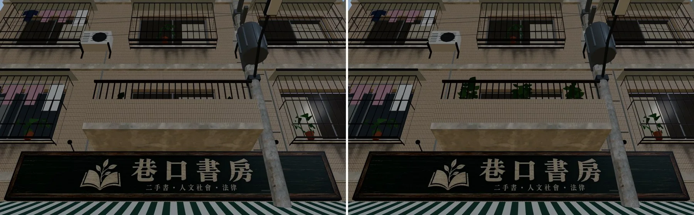
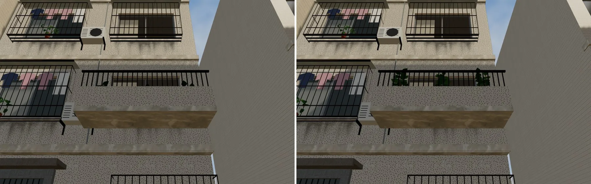
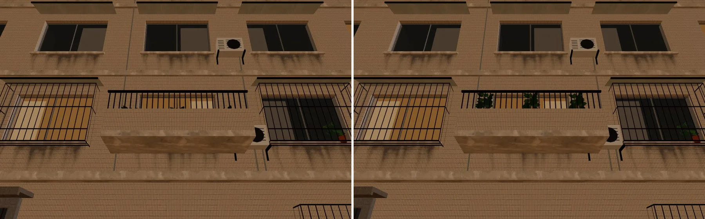
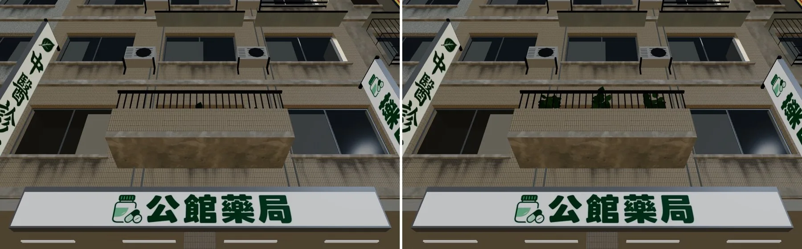
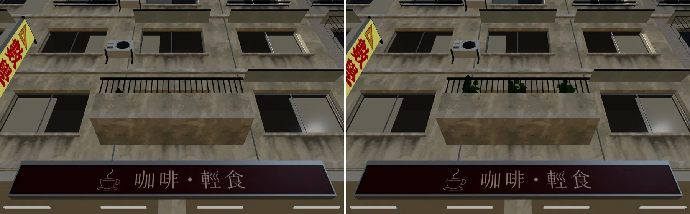
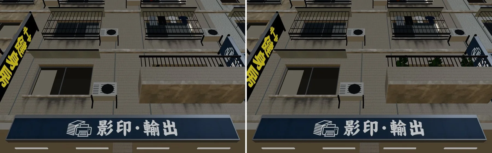

# ART-BALCONY-POTS：陽台盆栽從街上看得到（溫州街＋公館）

帳號 A 的 LAWWW2，2026-10-21 17:0x UTC。狀態：**已交件**（溫州街、公館都做完，遊戲內前後對照都拍了）。READY_FOR_ART_REVIEW（不標 ART_APPROVED）。

## 問題

二樓陽台的大葉盆栽放在陽台地上，女兒牆擋住，從街上只看到幾片黑色葉尖（巡場景的 BACKLOG A5；HANDOFF「衍生 ART-BALCONY-POTS」）。

## 改法（`tools/blender/env_second/wz_street.py` 的陽台那一段；溫州街、公館、118 巷共用這支腳本）

1. **鐵花架**：盆栽放到靠欄杆的鐵花架上（架面高 36 cm、深 30 cm、兩端和中間各一對腳、下面一根橫撐）。台北老公寓陽台常見的做法。
2. **葉子調亮**：陽台在陰影裡，原本的深綠在畫面上像黑色剪影。
   - 改成 `leaf_dark` `#3d6a3a`、`leaf_mid` `#55894a`。
   - 只改這個原型（`broad_proto`）的材質，別的植物不動。
3. 葉子現在露出欄杆上緣；盆子本身還是被女兒牆擋住（從街上本來就看不到盆子）。

## 規格

| GLB | 物件 | 材質 | 三角形 | 檔案大小 |
|---|---|---|---|---|
| `wenzhou_street.glb` 原本 | 1017 | 131 | 81,165 | 7,740,072 |
| `wenzhou_street.glb` 這一版 | 1017 | 131 | **81,453**（花架 +288） | 7,767,148 |
| `gongguan_shops.glb` 原本 | 1074 | 113 | 41,731 | 4,419,652 |
| `gongguan_shops.glb` 這一版 | 1074 | 113 | **42,211**（+480） | 4,464,772 |

- 物件數、材質數不變：花架用欄杆的鐵件材質，併進同一個網格；盆栽照舊是 instancing。
- **重建前先確認舊版重建得出來**：
  - 公館：用開發分支的腳本（`a836808`）重建，和遊戲裡的 `gongguan_shops.glb`（`a93f7fc9`）**逐位元組相同**。所以新版和舊版的差別只有這次改的東西。
  - 溫州街：用舊腳本重建，大小、物件、三角形都相同，但有少數位元組不同（約 1.6 萬個位元組，0.2%）。這是腳本原本就有的不確定性。BUG-WZFLICKER-2 的重建就有過，和這次的改動無關。
- 118 巷（`lane118_street.glb`）也用這支腳本，但這次**沒有重建**：118 巷的陽台另外排，沒拍沒測的不交。

## 接法（LAWWW）

**只換 GLB，不用改程式**：
- 換 `assets/models/env/second_ai/wenzhou_street.glb`＋`.json`（`efc1730d`）。
- 換 `gongguan_shops.glb`＋`.json`（本 commit）。

導航、碰撞、互動點都不變：花架在陽台上，玩家走不到。

## 遊戲內前後對照（溫州街）

- 環境：Playwright＋SwiftShader，桌機 1280×800。**不是手機實機。**
- 基準：開發分支 `5845667e`，只在本機 worktree 換 GLB。
- 時間：15:00；W0 是 17:36。
- 鏡頭：劇情鏡頭放在路人眼睛的高度（1.6 m），往上看二樓陽台；玩家藏起來。設定在 `shots.json`，用 `tools/shots/scene_shot.py` 拍。
- JS 例外 0。
- 每張圖左邊是修改前、右邊是修改後。

| 位置 | 修改前 | 修改後 |
|---|---|---|
| A3 巷口書房樓上 | 欄杆後面看不到植物 | 三盆大葉植物露出欄杆 |
| C2（巷底轉角、陰影面） | 只露出幾片黑色葉尖 | 綠色的葉子露出欄杆，陰影裡還是偏暗 |
| W0（西端、17:36 斜陽） | 幾片黑色葉尖 | 三盆綠色植物 |

## 遊戲內前後對照（公館）

- 同樣的環境；基準：開發分支 `5845667e`，只在本機 worktree 換 `gongguan_shops.glb`。
- 15:00。鏡頭：從羅斯福路的人行道（z 13.8）、眼睛高度往上看二樓陽台；玩家藏起來。設定在 `shots_gongguan.json`。JS 例外 0。
- 有陽台的是 G01、G04、G07、G10、G13（每三棟一棟）和巷口轉角 G15；拍了 G04（公館藥局樓上）、G07（咖啡・輕食）、G10（影印・輸出）。
- 修改前三棟都只露出一兩片葉尖或什麼都沒有；修改後三盆綠色植物露出欄杆。

## 自評（還不到參考品質的地方）

- 葉子是模型葉片，近看邊緣有點硬。陰影面（C2）的葉子還是偏暗，再亮會和陽光面不一致，先停在這裡。
- 每個陽台都是三盆同一種植物（隨機轉角度），沒有混種。
- 只拍了白天和黃昏，晚上沒拍；晚上陽台在暗處，影響不大。
