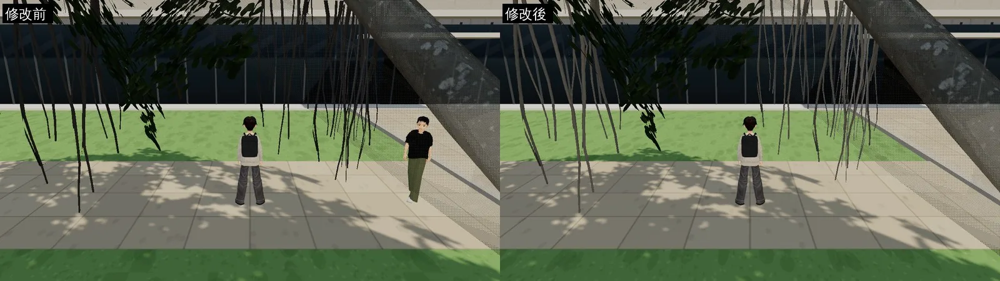
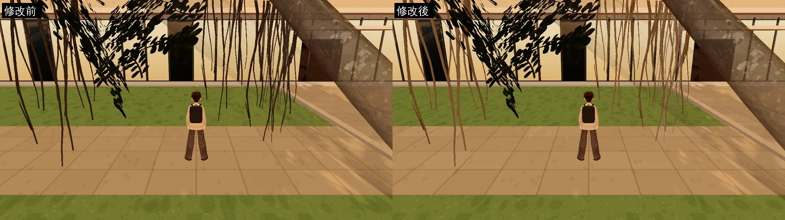
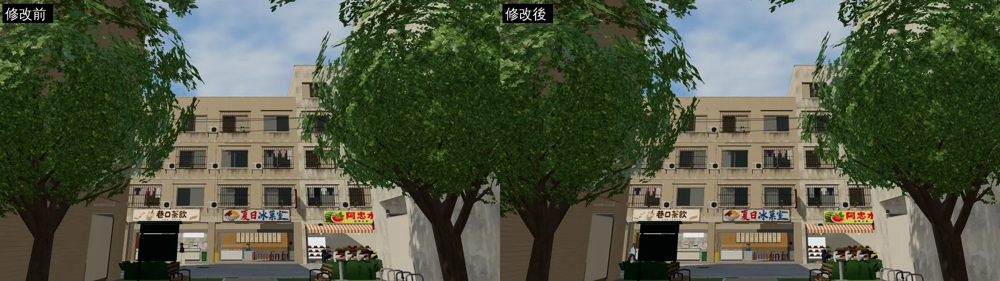
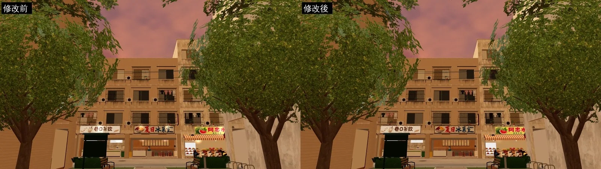

# 榕樹的氣根不再是一條條黑線（ART-ECON-3D-GAP-1021）

帳號 A 的 LAWWW2，2026-10-21 20:5x UTC。狀態：**READY_FOR_ART_REVIEW**（只換 GLB 和貼圖，沒有改程式）。

## 問題

- 巡場景（`ART_DIRECTOR_PATROL.md` 第 1 節）列為 P2：社科院前、法學院附近的榕樹，垂下來的氣根在畫面上是一條條黑線。
- 原因：氣根垂在樹冠下面，遊戲裡在陰影中只吃到環境光。
  - 貼圖上氣根那一格原本的平均顏色約 (127,120,112)；
  - 乘上陰影裡的光，就剩一條條黑線。

## 改法（`f858b47c`）

- `tools/blender/env_second/tree_atlas.py --lift-roots`：只調亮貼圖上氣根那一格（768–895 × 512–1023）。
  - 照比例調亮到平均 (212,200,184)；
  - 透明度不變，可以重複執行；
  - 0.35% 的像素到頂。
- `street_trees.glb` 重建：
  - 三角形 5,962、材質 5 個，都不變；
  - 953,696 → 955,736 bytes；
  - 用修改前的腳本重建，和原本的 GLB 逐位元組相同。
- `street_trees.glb` 是校園、溫州街、公館共用的，所有榕樹一起變。

## 遊戲內前後對照

- 環境：`tools/shots/scene_shot.py`，1280×720，Playwright＋SwiftShader，**不是 iPhone**。
- 修改前：開發分支 `a9da472a`；修改後：同一個工作樹換上新的 `street_trees.glb`。
- 拍攝設定：[`shots_before.json`](shots_before.json)、[`shots_after.json`](shots_after.json)。
- 每張圖左邊是修改前、右邊是修改後。
- 路人每次出現的位置不一樣，不是這次修改造成的。

**社科院前 15:00**：黑線變成灰褐色的根。

**社科院前 17:30（黃昏）**：根接到斜陽，是暖褐色。

**溫州街 15:00**：同一個模型檔裡的行道樹，看不出差別（沒有變壞）。

**溫州街 17:30**：一樣看不出差別。

## 還不到的地方（誠實寫）

- 鏡頭前面最近的那幾片葉子，在逆光時還是很暗、接近黑色。這是樹冠葉片卡的問題，和氣根無關；這一版沒有動。
- 真機沒看過。

## 接法（LAWWW）

- 換 `assets/models/env/second_ai/street_trees.glb`、`street_trees.json`（我的分支 `claude/second-ai-env-art`）。
- 不用改程式。
