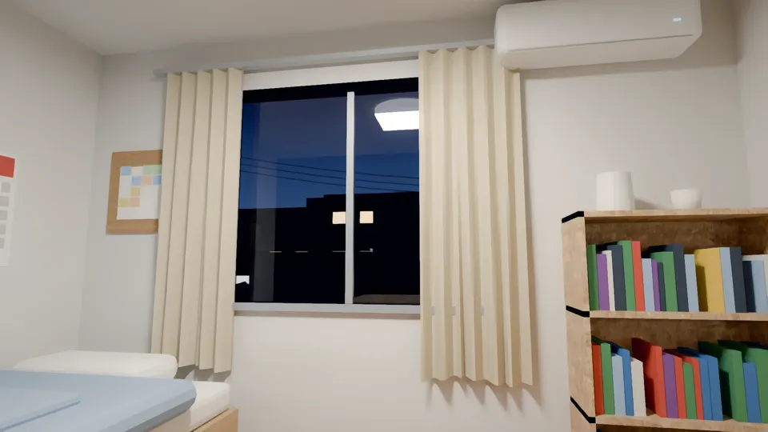
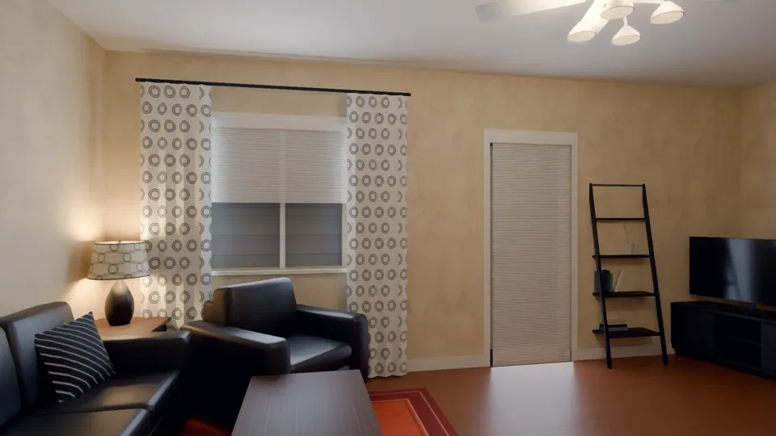
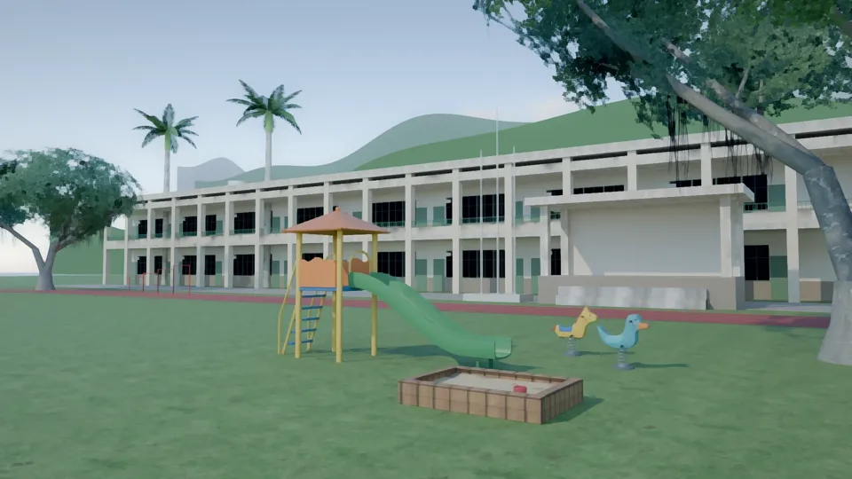
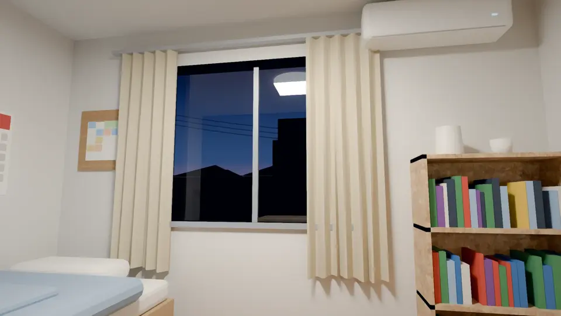
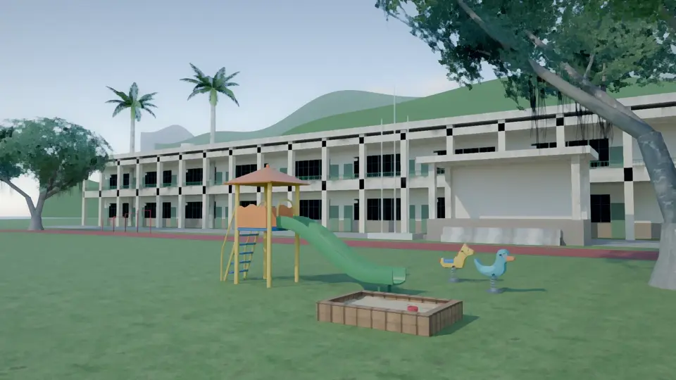

# ART-BG-AA185 三張 2D 背景｜LAWWW2-C 2026-10-17｜READY_FOR_ART_REVIEW

AA-C AA_185 要的三張（第四張「公館機車行」已刪：模擬法庭整段刪除，AA-C AA_252 確認只有模 2 用到）。

| 檔案 | 劇情 | 腳本 |
|---|---|---|
| `assets/bg/video_far_us.webp`（1672×941） | 主線 8「遠方」：台灣 2028-03-16 19:30 麵店打視訊，美國那邊 07:30，天剛亮、外面還有雪（AA_185 1-2） | `bg_video_far.py us`＋`bg_paint.py` |
| `assets/bg/video_far_jp.webp`（1672×941） | 同一場，日本那邊 20:30：國際學生宿舍的單人房（AA_145 3-6） | `bg_video_far.py jp`＋`bg_paint.py` |
| `assets/bg/old_school_playground.webp`（1672×941） | 大二春假小旅行第一站：沛珊選的老國小（AA_185 3-5、AA_143 2-4：「教室都鎖著」「阿哲坐在溜滑梯上」） | `bg_playground.py`＋`bg_paint.py` |

- 鏡頭：視訊的兩張是他桌上筆電的鏡頭（高 1.1 m），人物站的位置（畫面中間）留空，立繪疊上去。
- 後製：`bg_paint.py` 的繪畫感，和遊戲裡已通過的手繪風底圖放在一起不突兀。
- 不放任何字、校名、品牌（D77）。

## 日本宿舍單人房（晚上）

- 白牆、鋁窗、米色窗簾半拉、日本樣式的壁掛冷氣、書架（書背只有色塊）、軟木板上的課表（色塊）、床的一角。
- 窗外：大學城的兩層房子、亮著的窗、電線；玻璃上有吸頂燈的反光。

## 美國公寓的客廳（早上）

## 老國小的操場

- 兩層樓的長條教室（走廊柱子、綠色窗框、乳白磁磚）、司令台、旗桿、褪色紅跑道、草地、單槓、溜滑梯、搖搖馬、沙坑、大榕樹、校舍後面的山。
- 教室的窗是暗的（教室都鎖著）。

## 自己退件的版本
| 版本 | 問題 | 改法 |
|---|---|---|
| 日本 v1 | 窗是整片黑：玻璃的底色是深藍，Cycles 的透射被染成黑 | 玻璃改近白＋透射；窗外天空用漸層材質；房子三層；月光 |
| 老國小 v1 | 走廊的柱子正面和樓板、矮牆的正面同一個面，Cycles 裡一格一格黑方塊 | 柱子凸出 3 cm |

日本 v1：

老國小 v1：

## 還沒達到的
- 老國小：草地是平的一片綠、後面的山是平面的色塊，近看不夠細。
- 日本：窗外的房子是剪影，亮著的窗只有兩扇。
- 沒有接進遊戲（建議 S.BG key＝檔名）；沒有使用者的參考照片。
