# BG-19 公館・二輪戲院、BG-14 永康街・咖哩店｜LAWWW2-C 2026-10-17｜READY_FOR_ART_REVIEW

> **第五版精修（20:xx UTC）**：同樣的檔名、同樣的鏡頭，直接換檔就好（遊戲端不用改）。改了什麼、修改前後的對照在最下面「第五版精修」。

ART-17 總表裡最後兩張還沒有圖的 2D 背景：事件已經在用，現在遊戲裡是黑底。兩張都在大一下。

| 檔案 | key（字幕） | 事件 | 腳本 |
|---|---|---|---|
| `assets/bg/gongguan_cinema.webp`（1920×1080） | gongguan_cinema（公館・二輪戲院） | ev_zhiruo_early_show「東京物語的早場」：週六 10:00，芷若（交往中是三個人），看完去豆漿店 | `bg_cinema.py`＋`bg_paint.py` |
| `assets/bg/yongkang_curry.webp`（1920×1080） | yongkang_curry（永康街・咖哩店） | ev_family_dinner「家族聚餐」：第 4 週週五 18:30，學姊「（看菜單三十秒）兩件事。」 | `bg_curry.py`＋`bg_paint.py` |

- 兩家店都是虛構的（D77）：不放店名、標誌、真實電影的海報、真實的菜單。
- 畫面上沒有人：人物用 ADV 立繪疊上去，中間留空。
- 後製：`bg_paint.py` 的繪畫感，和遊戲裡已經通過的手繪風底圖放在一起不突兀。
- 接進遊戲：`src/outings3d.js` 的 `S.BG.gongguan_cinema`、`S.BG.yongkang_curry` 目前 `image:null`，填檔名就好（LAWWW-C 的檔案）。

## 公館・二輪戲院的大廳（上午十點）
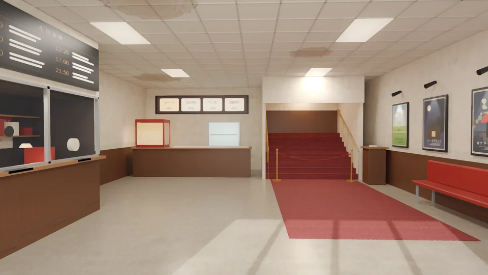

- 左邊：
  - 售票口：玻璃窗、對講孔、找錢的凹槽；亭子裡有層架、票卷、印票機、一盞桌燈；
  - 上面是場次板「今日放映」：只有時間看得清楚，片名是看不清楚的線；
  - 旁邊牆上一張票價表「一票兩片／全票 130／學生 110／早場 100」（虛構的價錢）。
- 後面：
  - 爆米花機（亮著）、展示櫃、飲料冰箱、價目燈箱「爆米花 60／熱狗 45／汽水 30／咖啡 40」；
  - 右半邊往二樓影廳的紅地毯樓梯：銅扶手、踏面的銅條、平台上的壁燈、「影廳 2F ↑」；
  - 樓梯口有紅色絨繩、兩支銅柱（還沒開放進場），旁邊是驗票台。
- 右邊：
  - 海報牆五張虛構的海報：海、電車、雨傘、老屋和月亮、腳踏車；每張上面一盞小投射燈；
  - 下面一張紅色人造皮長椅、一個垃圾桶。
- 地上：磨石子，加一條往樓梯的紅地毯；上午的陽光從身後的大門照進來，地上看得到門框的影子。

## 永康街・咖哩店（晚上 18:30）
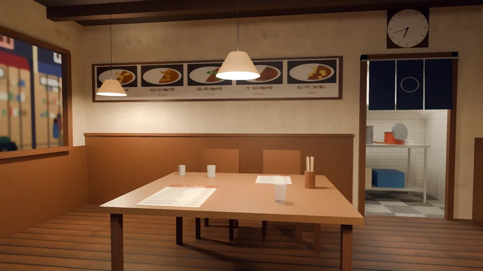

- 鏡頭坐在桌邊（眼睛 1.2 m），看對面的座位（學姊坐的位置）：
  - 前景：自己這邊攤開的菜單、對面那份菜單、兩個水杯、筷子筒、湯匙筒。
- 後面的牆：
  - 下半木作、上半米色灰泥；
  - 一排照片價目板：雞肉、豬排、蔬菜、牛筋咖哩、起司加點，照片是畫的；
  - 時鐘 18:42（聚餐 18:30，Kevin 遲到七分鐘）。
- 右邊：廚房入口，掛著深藍布簾（只有一個白圓，不放字），後面的不鏽鋼工作台暗暗的亮著。
- 左邊：木框窗，窗外是晚上的永康街（對面亮著的店面、二樓的窗、行道樹，模糊）。
- 三盞布燈罩的吊燈（暖色）、天花板的木樑、深色木地板。

## 自己退件的版本
| 版本 | 問題 | 改法 |
|---|---|---|
| 戲院 v1 | 售票口的兩扇窗是兩片灰板：亭子裡做成實心的方塊，把窗後面擋住了 | 亭子改成後牆＋天花板＋側牆＋層架＋印票機＋燈 |
| 戲院 v1～v2 | 地上沒有陽光：門外街景那一片擋住太陽；太陽太弱（3.2），比不過室內燈 | 街景不擋影子、太陽 9、天花板燈調暗 |
| 戲院 v1 | 樓梯上面是一塊純黑；整體太新 | 平台後面的牆＋壁燈；加驗票台、垃圾桶，磨石子調舊 |
| 咖哩 v1 | 鏡頭太近，只拍到後牆；桌面的木紋太粗，像合板；燈罩是一個發亮的白圓錐 | 鏡頭往後拉、廣一點；桌面改胡桃木；燈罩不自己發亮 |
| 咖哩 v2～v3 | 窗外是一片灰藍：鏡頭斜看窗外，視線超出了街景那一片的範圍，看到的是天空底色（一開始以為是玻璃反射，拿掉玻璃也沒變） | 街景往後延長到 18 m |

戲院 v1：
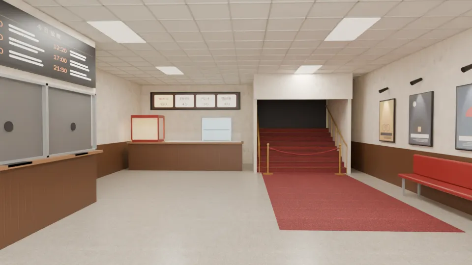

咖哩 v1、v2：
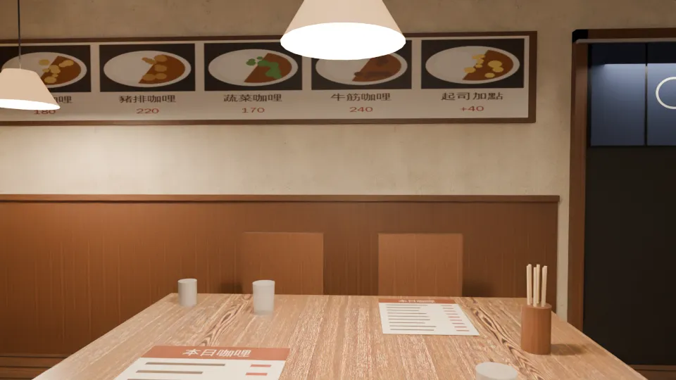
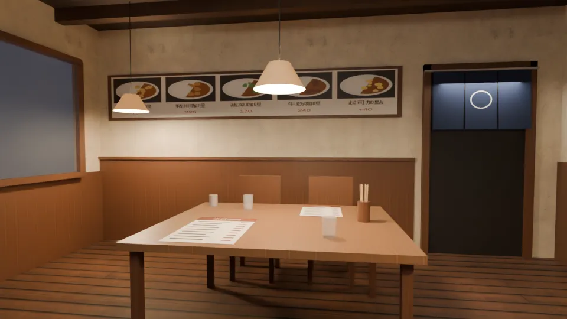

## 還沒達到的
- 戲院（第四版時；第五版都改了，見下面）：
  - ~~天花板、牆面很乾淨，老戲院的舊痕跡（污漬、磨損、貼過又撕掉的膠帶）還沒有~~；
  - ~~海報是簡單的色塊~~；
  - ~~售票口右邊那扇窗偏灰（亭子裡加了燈，還是被玻璃的反光蓋住大半）~~。
- 咖哩店：
  - ~~窗外的店面是大色塊~~（第五版改了）；
  - 右牆的香料架在畫面外（鏡頭看不到）；
  - ~~廚房入口的布簾後面很暗，工作台看不太出來~~（第五版改了）。
- 兩張都沒有使用者的參考照片；場景美術要使用者看過才標 `ART_APPROVED`。
- 還沒接進遊戲（等 LAWWW-C）。

## 第五版精修（2026-10-17 20:xx UTC；上面「還沒達到的」那幾點）
同樣的檔名、同樣的鏡頭（換檔就好）；兩張都照舊是 `bg_cinema.py`／`bg_curry.py` 算圖（Cycles）＋`bg_paint.py`。

### 戲院
- **海報**（原本是簡單的色塊）：
  - 改成一層一層畫的插圖：天空漸層、遠景、主體、前景，加上筆刷寫的「看不清楚的片名」（不是字）；
  - 紙的白邊、邊緣發黃、四角磨損。
  - 五張還是虛構的（海、電車、雨傘、老屋和月亮、腳踏車），沒有真實電影（D77）。
- **售票口右邊那扇窗**（原本一片灰）：
  - 玻璃更透明（反光 0.10 → 0.04）、亭子的燈 22；
  - 遠的那一半多了月曆、小電扇、零錢盤、深灰的辦公椅背、第二盞燈。
- **老戲院的痕跡**（原本很乾淨）：
  - 天花板的水漬；
  - 海報牆上「換過海報」的淡印子和沒撕乾淨的膠帶；
  - 牆裙上緣手摸、椅背靠的髒印；
  - 地上往樓梯那條的磨損、踢腳的刮痕。

修改前（左，第四版）／後（右）：
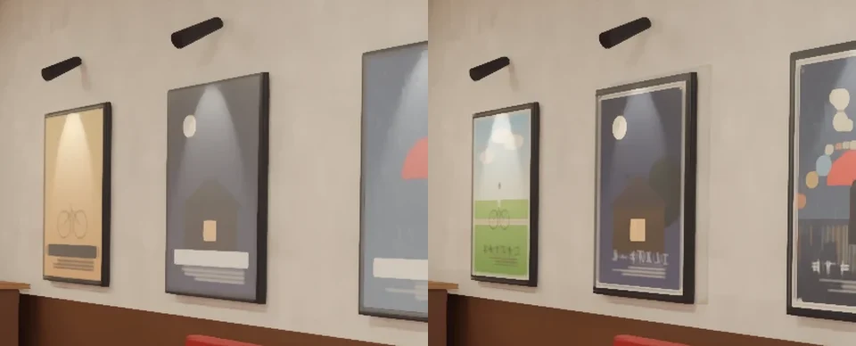
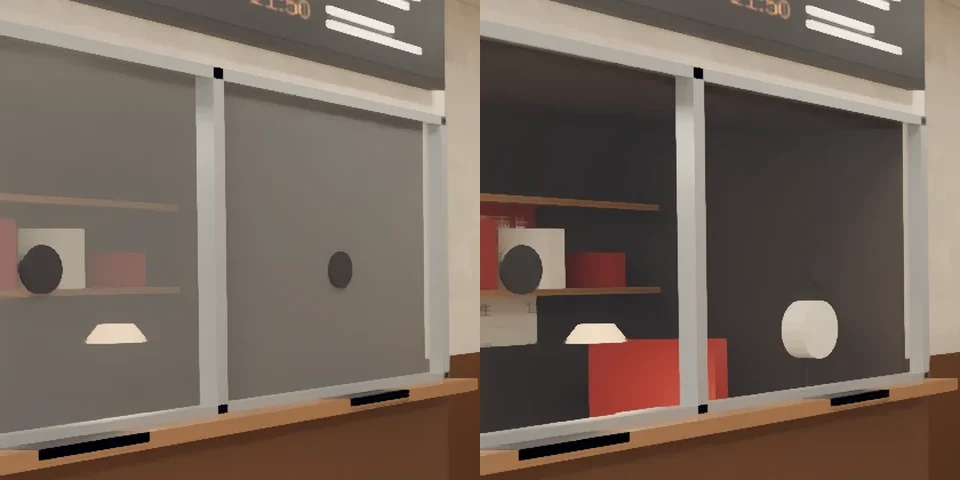
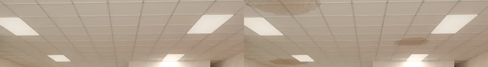

第四版整張：
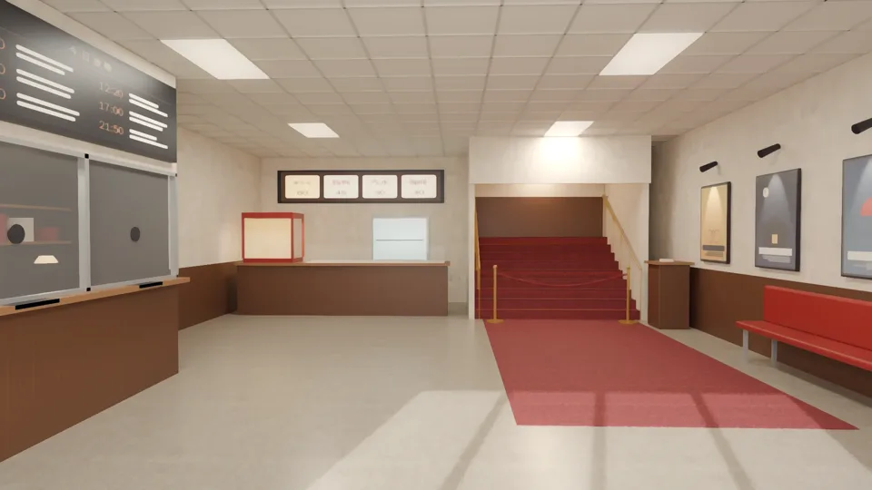

### 咖哩店
- **布簾後面**（原本一片深灰）：
  - 後牆開了真的門洞，後面蓋一個小廚房：淺色長條磁磚的牆、黑白格子地磚、淺色天花板、一盞暖光；
  - 不鏽鋼工作台（檯面、四隻腳、下層架放米袋和藍色塑膠籃）；
  - 檯面上一個鋼鍋、一個紅色琺瑯鍋（鍋蓋斜靠著）、勺子、砧板、一疊盤子；碗架在布簾上面（被擋住）。
- **窗外**（原本幾大塊色塊）：
  - 對面的街照真的比例放到 8 m 外：店面 4～7 m 寬、一樓 3 m 高（原本 4 m 外、整條街只有 4.6 m 高，店面像模型，從窗戶看一整塊一整塊）；
  - 店裡：三層層架上的東西、菜單板、吊燈、櫃台後面的店員、靠窗坐著的客人；
  - 落地窗的門框、騎樓的柱子、門口的立牌；二、三樓的窗加鐵窗和冷氣機（台北的公寓）；
  - 店面整體暗一點、暖一點（原本有冷白的店面，看起來像白天）。

修改前（左，第四版）／後（右）：
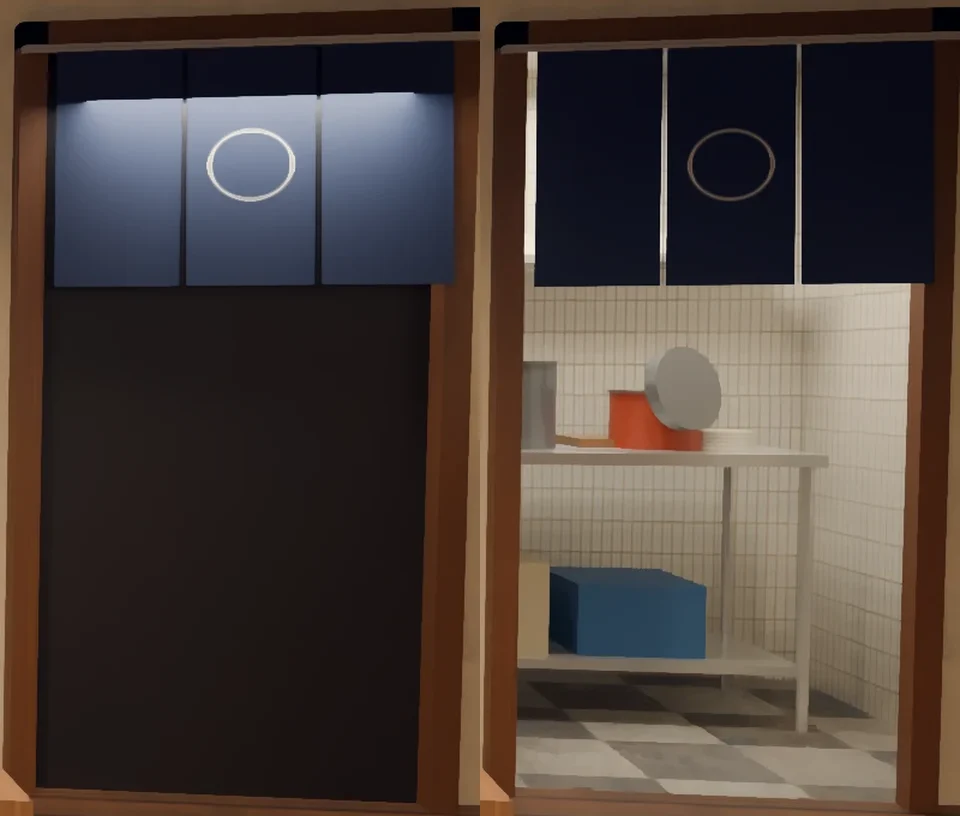
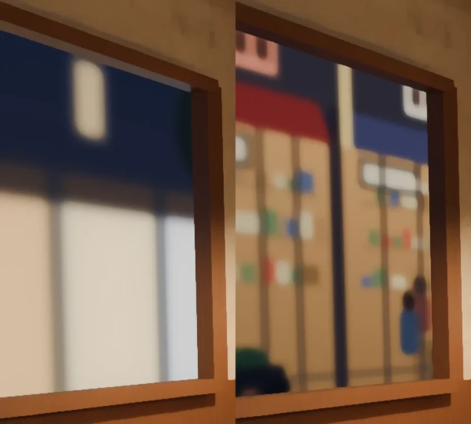

第四版整張：
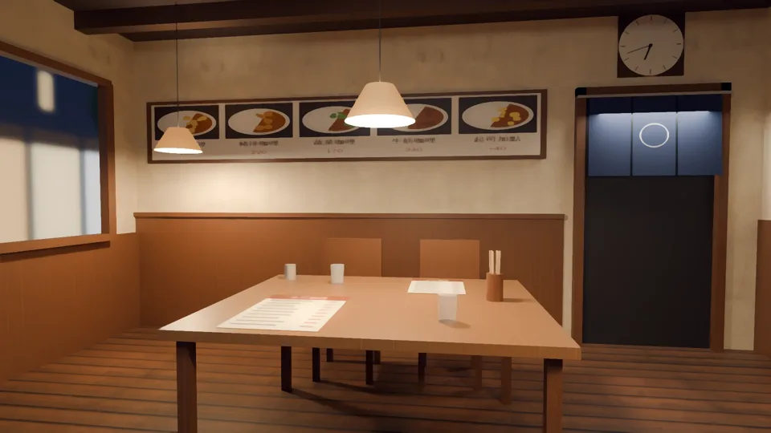

### 第五版還沒達到的
- 戲院：亭子裡的東西在玻璃後面，還是偏簡單（印票機、零錢盤是方塊）；
- 咖哩店：
  - 廚房的藍色塑膠籃、米袋是平的方塊，鍋蓋是一片灰圓盤；在布簾後面的中景，還看得出是簡單的形狀；
  - 窗外的店是畫的貼圖（景深外、模糊），近看是平面。
- 兩張都沒有使用者的參考照片；**場景美術要使用者看過才標 `ART_APPROVED`**。
