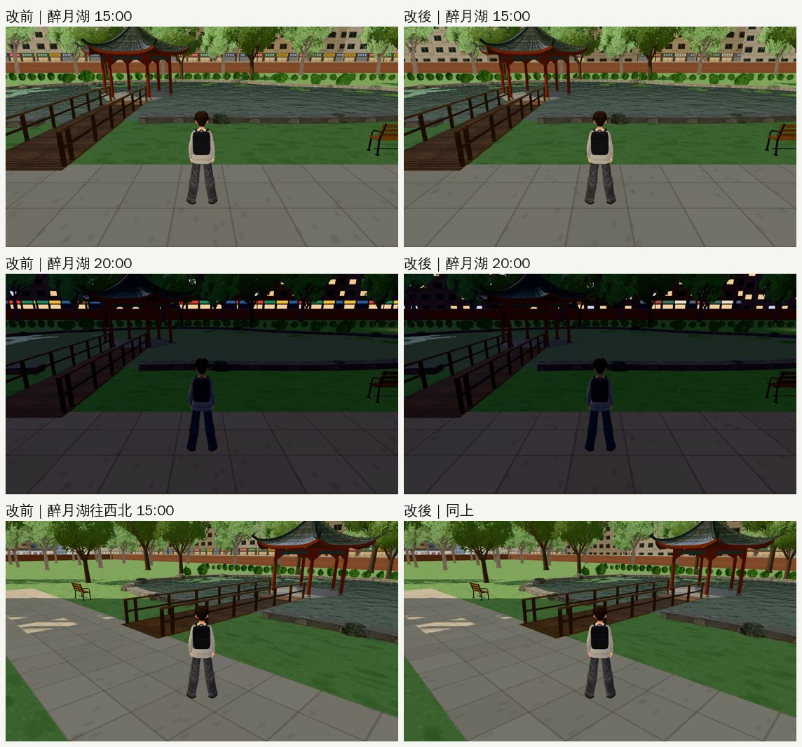

# 醉月湖北邊那排遠景店面不像布景（2026-10-24，LAWWW2-B）

- **派工**：LAWWW-B 16:29，巡查③的 P3「改得小就可以做」。**放到 v9.10.9 之後整合**。
- **對**：開發 `0d3125c88`。
- **環境**：Playwright＋SwiftShader 手機模擬（1280×720），不是 iPhone 實機。
- **狀態**：`READY_FOR_ART_REVIEW`。場景的 `ART_APPROVED` 只有使用者能標。

## 問題

- 從醉月湖（E12 等可昕的位置）往北看，圍牆後面辛亥路對面那一排（`zones3d.js` 校園背景 `city` 北側第一排，z −171，x −260～262）每一棟一樓都是店面。
- 店面貼圖（`townkit3d.js` 的 `bgGroundTex('city')`）每家一塊滿版的正紅、正綠、正黃、正藍招牌，每 14.4 m 重複一次。
- 結果：白天是一條 500 m 長的彩色帶子；晚上招牌和店裡的燈連成一整排，像舞台布景。

## 改法（兩處，各一兩行）

| 檔案 | 改了什麼 |
|---|---|
| `src/zones3d.js` | 北側第一排加 `shop:H(x,21)<0.4`：37 棟裡 15 棟有店面，其他一樓也是窗（辛亥路對面多是住宅大樓） |
| `src/townkit3d.js` | 遠景店面的招牌顏色壓低彩度（磚紅、墨綠、米白底深色字、石板灰；彩度 ≤ 0.37）；拉下鐵捲門那一家的招牌只有一半寬 |

- 招牌貼圖是遠景共用的，所以校園東、南兩排遠景和公館遠景的備用方盒也一起變淡。這幾個都是遠景，畫面上只是顏色比較沉。
- 沒有新的物件、貼圖檔或模型；導航、碰撞不受影響（背景在邊界外、走不到）。
- **數字**（遊戲內，同一個鏡頭）：
  - draw call 一樣，148／152／91；
  - 三角形少 308（不開店的樓少一片店面）。

## 改前、改後（同一個鏡頭）

- **15:00**：一條連續的彩色帶子 → 大部分是住宅一樓的窗，中間幾家店，招牌顏色沉。
- **20:00**：一整排發光的紅綠黃藍 → 零星幾家店亮著，其他是住家的窗。
- 法學院前往北看（60, −104）被國青中心擋住，看不到這一排，改前改後一樣。

## 測試

- **新測試 `tests/bg_city_awnings_unit.js`**：修改前 FAIL 4，修改後 ALL PASS。
  1. 北側第一排只有 30%～50% 有店面；
  2. 招牌四種顏色彩度 ≤ 0.45、至少一塊米白底；
  3. 鐵捲門那一家的招牌不是滿版。
- **套 patch 的情況**：
  - 對 `0d3125c88` 原樣：`git apply --check` 乾淨；
  - 對套了 ENGINE-SEASON-DUSK-1024（A＋B）的樹：也乾淨。
- **沒測**：整套回歸、手機實機。

## 交件

- `patches/bg_city_awnings_1024.patch`：`src/zones3d.js`、`src/townkit3d.js`，新增 `tests/bg_city_awnings_unit.js`。
