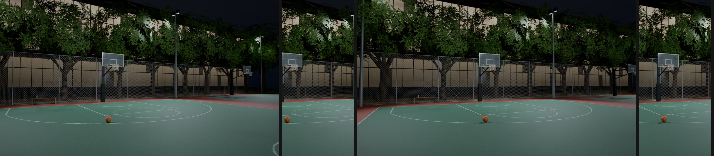
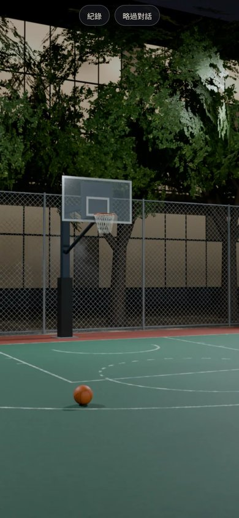
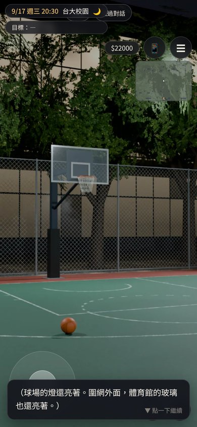
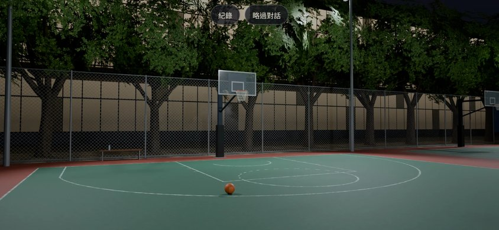
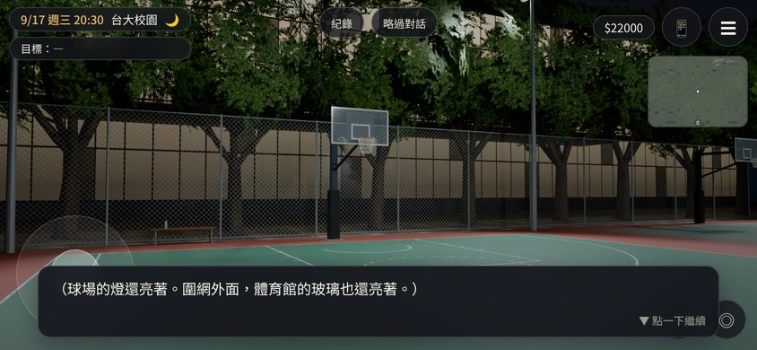

# ART-BG-COURT：`ntu_court_night`（新體育館旁的戶外籃球場，晚上）

- **用在哪裡**：`ev_zhe_court_y2`（哲 2，AA_177 第 5 節）。
  - 開發分支的 `outings3d.js` 已經登記 `S.BG.ntu_court_night`，`image:null`。
  - 圖放好以後，LAWWW-B 把 `image` 填上 `assets/bg/ntu_court_night.webp`。
- **檔案**：`assets/bg/ntu_court_night.webp`，1920×1080，約 290 KB。
- **怎麼做的**：Blender Cycles，腳本 `tools/blender/env_second/bg_court.py`（64 samples）。
  - 指令：`/opt/blenv/bin/python tools/blender/env_second/bg_court.py -- <輸出.png> --res 1920x1080 --samples 64`。
  - 算一張約 5 分鐘。
- **畫面內容**
  - 兩面綠色 PU 球場，外圈紅色緩衝區。
  - 球場線照 FIBA 規格：
    - 罰球圈靠球場中間那一半是實線，禁區裡那一半是虛線；
    - 三分線半徑 6.75 m，兩側是直線段；
    - 籃框下有半徑 1.25 m 的無撞人區半圓；禁區兩側有站位線。
  - 籃架：鋼管和懸臂，壓克力籃板（白框和小方框），籃框高 3.05 m，舊籃網。
  - 照明：兩支 10 m 高桿燈，白光。
  - 場邊：鐵絲圍網、一張長椅、一瓶沒有標籤的水；場上一顆籃球。
  - 背景：樟樹，樹後面是體育館的玻璃立面（室內亮燈，有直櫺和樓板）。
  - **沒有人、沒有字、沒有標誌**：體育館外牆沒有館名，水瓶沒有標籤，籃板沒有字。
- **構圖（手機優先）**
  - ADV 背景是 `cover`、置中。手機直向只看得到中間約 26% 的寬度。
  - 第一版籃框在畫面約 40% 的位置，直向只露出半塊籃板。
  - 第二版鏡頭往左轉 6°，籃框移到約 47%，直向看得到整塊籃板、籃框和球。

**第一版和第二版**（各兩張：整張圖，旁邊是手機直向會看到的部分）

**遊戲內 ADV 截圖**
- 測試工作樹是開發分支 a17e9b6b 加上這張圖。
- 用 `ADV.begin({background:{image:'assets/bg/ntu_court_night.webp'}})` 開 ADV，時間 20:30。
- 手機模擬（Playwright，dpr 2）。截圖縮成一半存放。

| 390×844 只有背景 | 390×844 對話中 |
|---|---|
|  |  |

| 844×390 只有背景 | 844×390 對話中 |
|---|---|
|  |  |

- 對話那句是截圖用的旁白，不是劇情文字。
- 截圖用的是 `tools/blender/env_second/shots/fast_shots.py`，畫面上的 HUD 照遊戲原本的樣子。

**狀態**
- `READY_FOR_ART_REVIEW`。
- BB-B 驗收三點：沒有人；沒有字和標誌；籃板和罰球線正確。
- 場景美術最後由使用者決定，LAWWW2-B 不標 `ART_APPROVED`。

**沒有做的**
- 只有晚上一版（AA_177：晚上、路燈、一個籃框）。
- 真機沒有看過。
