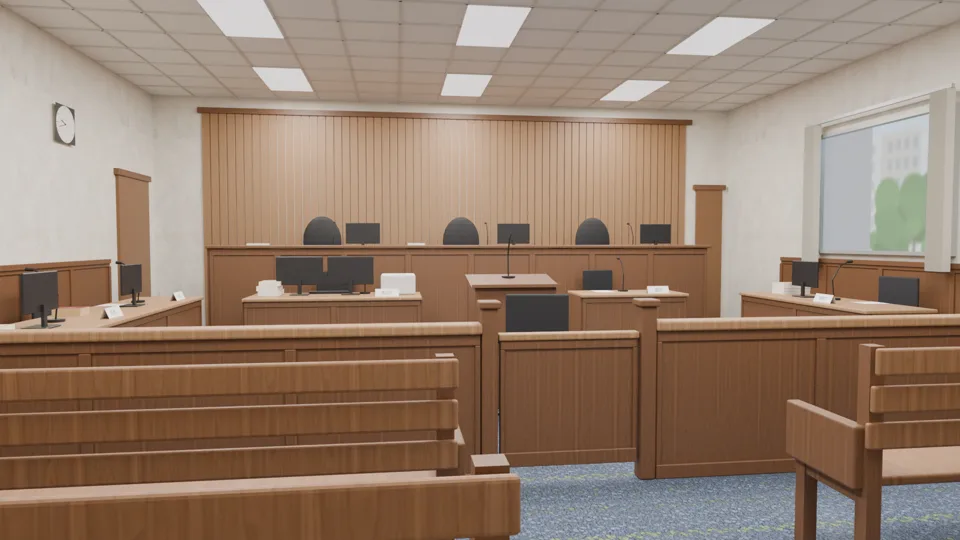
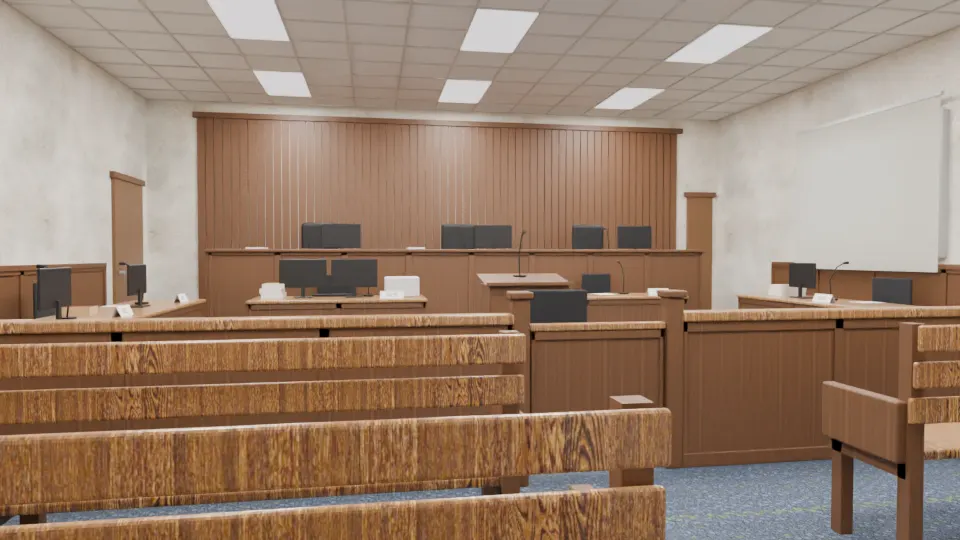
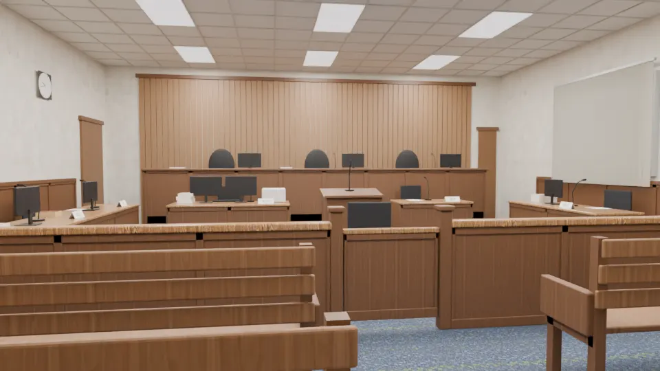
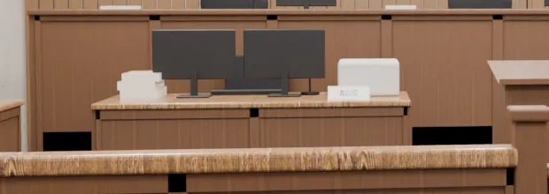
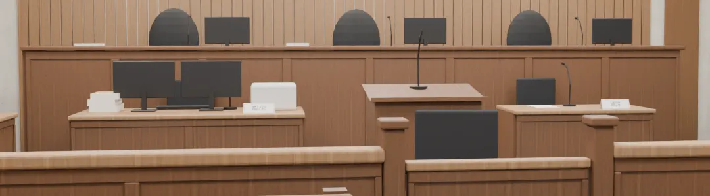
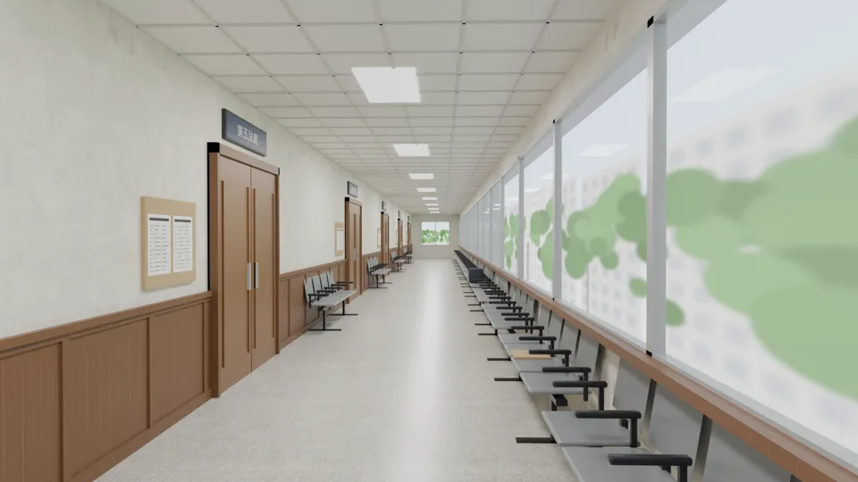
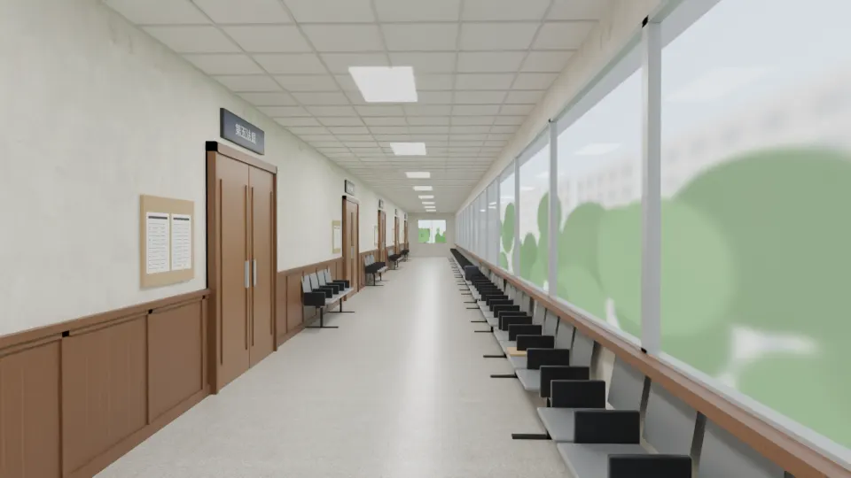
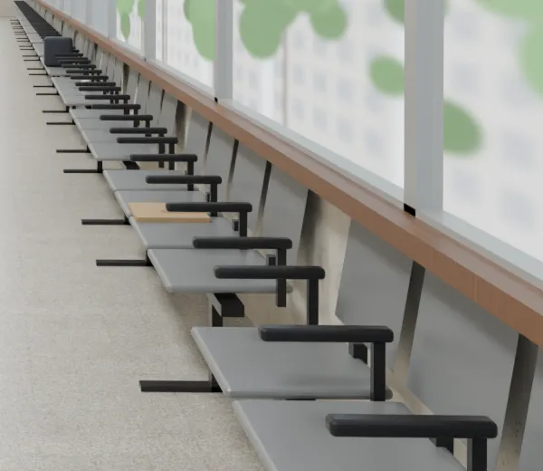

# BG-24 地方法院（法庭旁聽席、走廊）｜LAWWW2-C 2026-10-17｜PROPOSAL

## 來由
- 使用者 2026-10-17：
  - 10:5x「刪除模擬法庭」「整個劇情都刪掉，這不符合我在臺大法律的回憶」；
  - 11:xx「模擬法庭做的東西，你可以留給可能某一堂課需要去法院旁聽，你就做成真的法院」。
- AA-C AA_252：大四下「法律專題研究」第 6 週週四上午，全班去**地方法院**旁聽一場刑事審理。
  - 需要兩張 2D：法院走廊（長椅坐滿等開庭的人）、法庭旁聽席（三排，前面是法官席、檢察官、辯護人、被告背影）。
  - 不寫真實法院名、案號、當事人。
- AA-C、LAWWW-C 原本寫「等使用者給參考圖」。使用者直接叫我做，所以先用公開資料做 **PROPOSAL**；使用者給照片再照照片改。LAWWW-C 11:11 同意先做。

## 檔案
| 檔案 | 說明 |
|---|---|
| `assets/bg/court_gallery.webp` | 法庭旁聽席，1920×1080，從最後一排靠走道往前看 |
| `assets/bg/court_corridor.webp` | 法院走廊，1920×1080，站在走廊一頭往裡面看 |
| `assets/models/env/second_ai/court_props.glb`＋`.json` | 刑事法庭道具組，1.0 MB，13,710 三角形；`.json` 的 `layout` 是一間 9 × 11 m 小法庭的擺法 |
| `tools/blender/env_second/court_props.py` | 道具組腳本（由已刪除的模擬法庭道具組 183aa717 改作） |
| `tools/blender/env_second/bg_courthouse.py` | 背景腳本：`--scene room｜corridor` |

## 席位（公開資料）
- 法檯高起 45 cm，三位法官。法檯前面低處是書記官（左）、通譯（右）。
- 從旁聽席看，檢察官在右邊、辯護人和被告在左邊，兩邊相對。各法院不一定，有的地院相反。
- 應訊台在中間、面向法檯，後面一張椅子：被告、證人坐，背對旁聽席。AA_252 寫「被告坐在前面，背對著你們」。
- 欄杆和小門隔開旁聽席；旁聽席三排木頭長椅。
- 各席有筆錄螢幕、鵝頸麥克風、桌牌（審判長、法官、書記官、通譯、檢察官、辯護人、被告）。
- 台灣的法庭沒有法槌，所以沒放。
- 不放國徽（美術規則：不放徽章、標誌），法檯後面是整面直條木作。
- 參考：
  - 法律百科：https://www.legis-pedia.com/article/lawABC/1256
  - 司法院：https://www.judicial.gov.tw/tw/cp-2368-618296-6878c-5.html
  - 鏡週刊法庭報導：https://www.mirrormedia.mg/story/amp/20220406inv001

## 法庭旁聽席（最新）

- 上午：右邊的窗百葉收在兩端，看得到外面的樹和建築；天花板是輕鋼架加平板燈。
- 左牆有時鐘（09:42，沒有品牌）和往候審室的門；法檯右後方是法官進出的門。
- 對話框蓋住的下面四分之一是前兩排長椅；人物站在中間時，背後是應訊台和法檯。

## 自己退件的版本
| 版本 | 問題 | 改法 |
|---|---|---|
| v1 | 右邊的窗是一整片白（像白板）；前景長椅用 wood_table_001，近看像合板；牆面斑駁；視角 1.22 m 太低，前兩排擋住應訊台和兩造的桌子 | 下面幾版 |
| v2 | 法官椅是方板，從旁聽席看和螢幕並排，像六台螢幕；法檯和後牆同一個木色融在一起 | 椅背改成上緣圓的高背；螢幕移到旁邊；後牆的木作淺一點 |
| v3 | 窗還是白的：從旁聽席斜看那面牆，垂直百葉疊成一面白牆 | 百葉收到窗的兩端（v4） |
| v4 | 放大看有黑方塊（木作的框條、壓條、平台、側板疊在同一個面，Cycles 裡變黑）；欄杆扶手的木紋太粗，像軟木塞板 | `check_coplanar.py`：「一定會閃」50 處修到 0（框條夾在上下框中間、平台縮進正面板、側板停在擋板後面、門柱、長椅橫撐）；扶手和桌面改胡桃木 |

v1：

v3：

v4 的黑方塊 → v5 修好：

## 法院走廊（最新）

- 左邊：
  - 一間一間法庭的雙開木門，門上深藍底白字的門牌「第五法庭」～「第九法庭」（虛構的庭號）；
  - 門右邊的公告板貼庭期表（只有表格和看不清楚的線，沒有案號、人名）；
  - 牆下半是木作框板，門和門中間有靠牆的候審椅。
- 右邊：
  - 整排大窗，上午的光，窗外是樹和對面的建築；
  - 窗下一整排鋼板沖孔的候審連排椅（四人座）。
- 走廊盡頭一扇窗；地上是磨石子；天花板是輕鋼架加平板燈。
- 座位上留了一個公文袋、一杯紙杯咖啡、一個包包（AA_252「椅子上坐滿了等開庭的人」：人用 ADV 立繪疊）。

| 版本 | 問題 | 改法 |
|---|---|---|
| v1 | 候審椅的扶手是實心的板子，整排看起來是一塊一塊黑色的板 | 細支柱＋扶手墊（v2） |
| v2 | 窗外的樹是 26 個大圓，像色塊 | 90 個小一點、深淺不一的樹冠＋樹幹 |

v1：

v3 的扶手：

## 驗收狀態
- `READY_FOR_ART_REVIEW`（PROPOSAL）：等使用者看；場景美術只有使用者能標 `ART_APPROVED`。
- 沒做：沒有接進遊戲（建議 key：`court_gallery`、`court_corridor`；等 LAWWW-C 的 S.BG 和事件）；沒有參考照片比對（等使用者）。
- 已知不足：
  - 畫面上沒有人，AA_252 寫的「長椅坐滿等開庭的人」「被告背影」要靠 ADV 立繪或之後加剪影；
  - 窗外是程式畫的模糊樹和建築。
