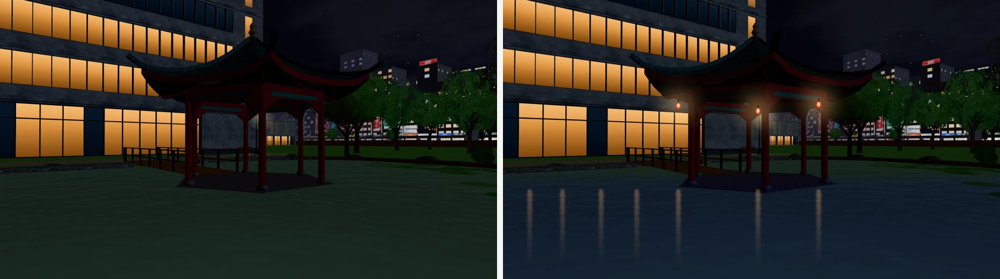
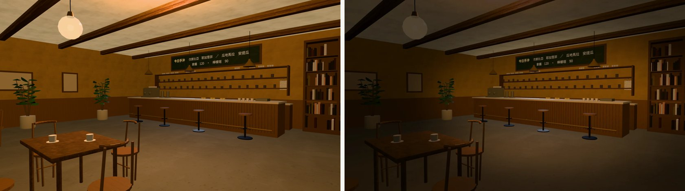
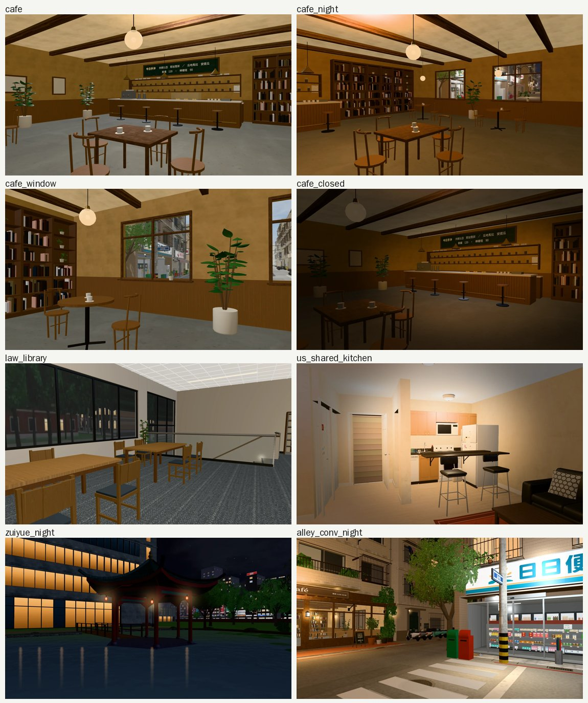
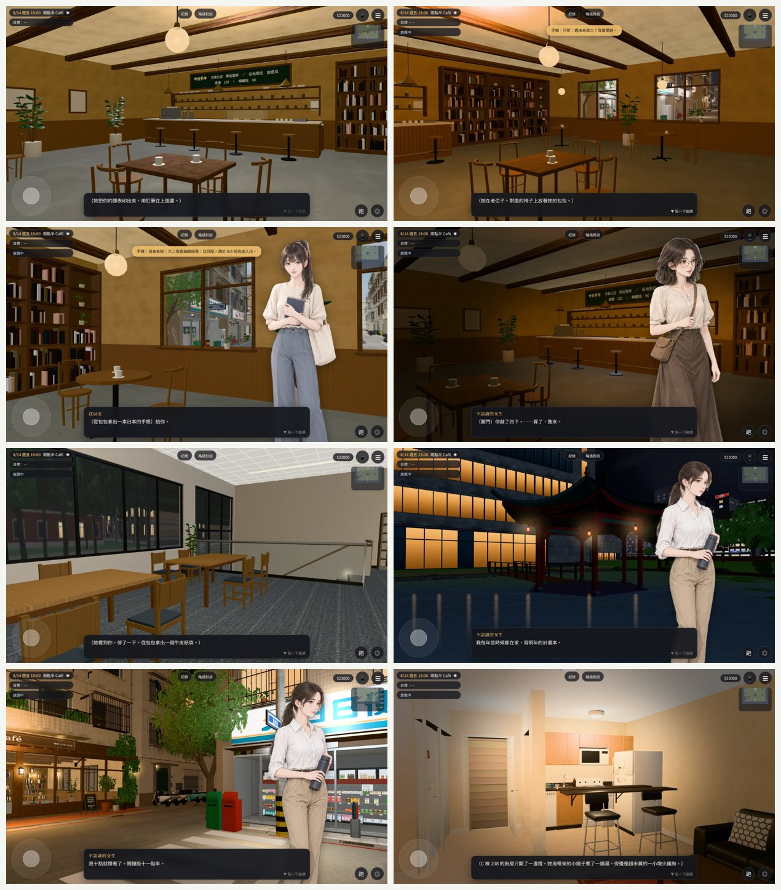
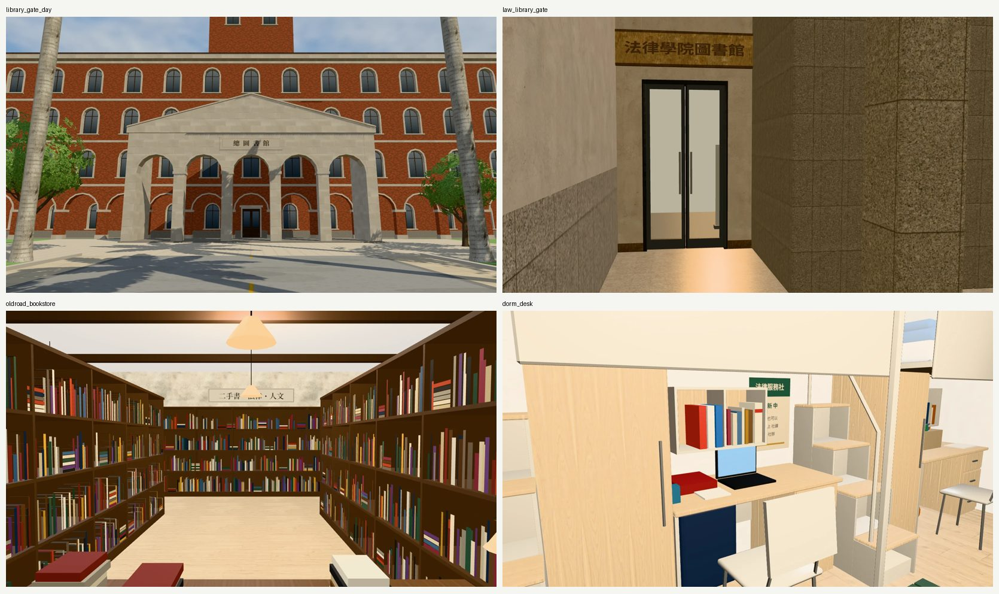
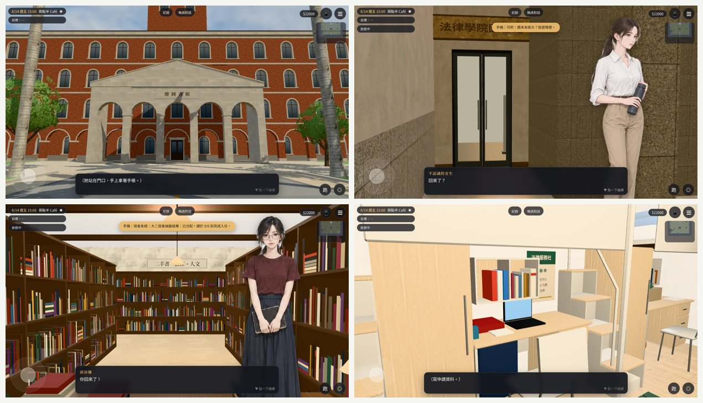

# 劇情對話變黑底的 8 個場景：從遊戲的 3D 拍成 2D 背景（BG-DARK-SCENES-1024）

- **來源**：
  - 路線巡查①找到 13 段黑底（`research/dark_bg_scenes_1024.md`）。
  - LAWWW-B 12:57 派工：從 3D 拍 cafe、cafe_night、cafe_window、cafe_closed、law_library、zuiyue_night、alley_conv_night、us_shared_kitchen 八張。規格 1672×941、和現有的一樣；交 webp＋要加進 `OUT.BG` 的鍵。
  - 其他（community_room、botanical_lotus、ntu_library_rain、us_club_lawn）BB 跟使用者要圖。
- **做的人**：LAWWW2-B。
- **狀態**：`READY_FOR_ART_REVIEW`。場景美術的 `ART_APPROVED` 只有使用者能標。

## 交付

- `assets/bg/<鍵>.webp` 八張：1672×941、webp q86，每張 58～221 KB，合計 836 KB。
- 調光：`tools/blender/env_second/shots/bg_dark_scenes_post.py`。
- 要加進 `OUT.BG`（`src/outings3d.js`）的八行。label 照場景字幕寫：

```js
cafe:{label:'兩點半 Café',image:'assets/bg/cafe.webp'},
cafe_night:{label:'兩點半 Café',image:'assets/bg/cafe_night.webp'},
cafe_window:{label:'兩點半 Café・窗邊',image:'assets/bg/cafe_window.webp'},
cafe_closed:{label:'兩點半 Café（店休）',image:'assets/bg/cafe_closed.webp'},
law_library:{label:'法圖・二樓',image:'assets/bg/law_library.webp'},
zuiyue_night:{label:'醉月湖',image:'assets/bg/zuiyue_night.webp'},
alley_conv_night:{label:'巷口的便利商店前',image:'assets/bg/alley_conv_night.webp'},
us_shared_kitchen:{label:'C 棟 208',image:'assets/bg/us_shared_kitchen.webp'},
```

## 每一張：台詞、拍法

- **怎麼拍的**：
  - 遊戲畫面，開發 `6fd1eda5f`，Playwright＋SwiftShader。
  - 1672×941，垂直視角 50°，藏起玩家和路人。
  - 用固定鏡頭（`cam.pos`／`cam.look`）。
- **時間怎麼定的**：拍之前先讀台詞。

| 鍵 | 事件 | 台詞決定的樣子 | 區域、時間、鏡頭 |
|---|---|---|---|
| `cafe` | 學姊幫你排課（`ev_sis_course_y2`） | 白天，桌上攤著課表 | `cafe` 15:00；(1.6,1.35,3.6)→(−2.6,1.3,−3.0)：從門口看吧檯 |
| `cafe_night` | 學姊在老位子（`ev_sis_ex_2`） | 晚上，十點收書 | `cafe` 21:30；(−2.2,1.45,3.8)→(4.8,1.3,−1.6)：看窗邊的座位，窗外是夜裡的溫州街 |
| `cafe_window` | 以安送手帳（`ev_an_notebook`） | 窗邊的位子 | `cafe` 15:00；(2.4,1.25,−0.2)→(6.5,1.3,−2.4)：坐著的高度看窗 |
| `cafe_closed` | 芷若的十二張點單（`ev_zhiruo_twelve_slips`） | 店休的**下午**，窗簾拉下來，只開吧檯燈 | `cafe` 20:30；(2.6,1.4,2.6)→(−2.6,1.2,−3.3)；調光見下面 |
| `law_library` | 學姊還你筆記本（`ev_sis_ex_1`） | 法圖二樓 | `lawlib` 二樓 19:30；(3.6,5.5,3.4)→(−1.2,4.95,6.4)：南側的長桌、欄杆、窗外 |
| `zuiyue_night` | 跨年夜在湖邊（`ev_sis_nye_y2`） | 深夜，聽得到椰林大道在倒數 | `campus` 12/31 23:30；(−33,1.3,−119.5)→(−39.5,1.4,−110.5)：從北岸看湖心亭，後面是博雅的亮窗；調光見下面 |
| `alley_conv_night` | 跨年夜在巷口（`ev_sis_nye_y4`） | 23:30 以後，樓上的電視在倒數 | `wenzhou` 12/31 23:39；(43.5,1.6,−2.5)→(50,1.9,6.5)：日日便利為主，左邊是兩點半的店面 |
| `us_shared_kitchen` | 感恩節的湯（`us_life_events.js`） | 廚房只開了一盞燈 | `us_shared` 2028-11-23 18:00；(−1.2,1.45,−2.6)→(−3.0,1.2,2.2)；調光見下面 |

### 修過的鏡頭

- **law_library**：
  - 前兩個角度：鏡頭在書架裡；
  - 從上面往下看：只看得到地毯；
  - 改成南側長桌，看得到欄杆和窗外。
- **us_shared_kitchen**：第一個角度被牆柱擋住，換位置。
- **zuiyue_night**：
  - 從南岸拍：只看得到色帶，看不出是水；
  - 改從北岸拍，在調光時補燈和倒影（見下面）。
- **cafe_night**：第一版看吧檯；改看窗邊，窗外的夜景才看得出是晚上。
- **alley_conv_night**：重拍了兩個角度，想少拍一點 Café，結果 Café 反而更多，還是用第一版。

## 調光（`bg_dark_scenes_post.py`）

只改光、不加東西，醉月湖除外。

- **cafe_closed**：
  - 在晚上拍，吧檯以外乘 0.32（橢圓遮罩，中心在畫面 66%、53%）。
  - 看不到窗：分不出白天晚上，不會和「一個下午」衝突。
- **us_shared_kitchen**：廚房以外乘 0.45。
- **zuiyue_night**：
  - 遊戲裡的湖心亭晚上沒有燈；湖面是深綠色，看不出是水。
  - 在截圖上補了：水面調成深藍；亭子三盞紅燈籠；燈籠和對面博雅亮窗在水面的倒影。
  - **這是畫上去的，不是遊戲裡的樣子**。3D 湖心亭要加燈，得改 `campus_lake.py`（燈籠）和 `zones3d.js` 的 `attachLakeGLB`（夜間發光材質登記，LAWWW 的檔案），另外提。




## 八張



## 遊戲裡的對話畫面（Playwright＋SwiftShader，不是 iPhone 實機）

- **怎麼測的**：
  - 在測試樹（開發 `6fd1eda5f`）執行時登記這八個 `OUT.BG`。
  - 用 `EVENTS.runLines` 跑「場景＋事件裡的第一句」，點對話框往下。
  - 8 個場景都是 `#adv.image`，沒有退回深色底。
  - 立繪、對話框擋到的地方都可以接受。
- 「不認識的女生」是因為測試存檔還沒認識學姊，和背景無關。
- 測完已經把圖從測試樹拿掉。



## 另外發現：回國那天的重逢，有三段也是黑底，`cafe` 登記以後會變白天

- **我之前寫錯了**：`research/dark_bg_scenes_1024.md` 寫 `vac_activities.js` 的回國重逢「是走進 3D 區域」。
  - 實際上 `vac3d.js` 的 `S.key` 是 `ADV.begin({background:OUT.bg(k.bg)})`，查不到也是深色底。
  - 已更正那份文件。

| 誰 | 時間、地點 | 寫的鍵 | 現在 | 建議 |
|---|---|---|---|---|
| 芷若 | 21:00 兩點半 Café，「把最後一張椅子倒扣在桌上」 | `cafe` | 深色底；`cafe` 登記以後變成**白天**的店 | 改寫 `cafe_closed`（吧檯燈、其他暗）；或 `cafe_night` |
| 語彤 | 21:00 麵店，「把一碗乾麵放在你前面」 | `noodle` | 深色底 | 改寫現成的 `noodle_table`（阿鳳麵店・長桌） |
| 以安 | 15:00 總圖門口 | `campus` | 深色底 | 沒有白天的總圖門口（只有 `library_gate_night`）；可以從 3D 拍一張 |
| 學姊 | 17:05 法圖門口 | `wancai` | 深色底 | 沒有法圖門口；可以從 3D 拍一張 |
| 沛珊 | 14:00 舊路書房 | `bookstore` | 深色底（另外三個叫 `bookstore` 的——台中、台南、舊金山——在別的表裡，不在 `OUT.BG`） | 舊路書房的 3D 室內可以拍一張 |

- 改 `vac_activities.js` 的鍵，是 LAWWW-B 的事。
- 後面三張要不要拍，等 LAWWW-B 排。

## 第二批（LAWWW-B 13:50 派工）：回國重逢、出國申請

- **背景**：
  - LAWWW-B 已整合第一批（`64397615a`）。
  - 芷若 21:00 那段改用 `cafe_night`，語彤那段改用 `noodle_table`。
  - 剩下沒有圖的三段由我拍，另外加出國申請「宿舍書桌」那一步。
- **交付**：
  - `assets/bg/` 四張，1672×941，webp q86；
  - 調光：`tools/blender/env_second/shots/bg_dark_scenes2_post.py`；
  - 開發 `45f1cd9e6`，Playwright＋SwiftShader。

```js
library_gate_day:{label:'總圖門口',image:'assets/bg/library_gate_day.webp'},
law_library_gate:{label:'法圖門口',image:'assets/bg/law_library_gate.webp'},
oldroad_bookstore:{label:'舊路書房',image:'assets/bg/oldroad_bookstore.webp'},
dorm_desk:{label:'宿舍書桌',image:'assets/bg/dorm_desk.webp'},
```

| 鍵 | 誰、哪一段 | 區域、時間、鏡頭 | 要知道的 |
|---|---|---|---|
| `library_gate_day` | 以安 15:00 總圖門口（回國重逢，原本 `campus`） | `campus` 15:00；(56,1.6,0)→(92,9,0)：從大道看總圖的門廊，兩邊大王椰子 | 現成的 `library_gate_night` 是畫的插圖、這張是 3D 截圖，**兩張風格不一樣** |
| `law_library_gate` | 學姊 17:05 法圖門口（原本 `wancai`） | `wancai` 一樓 17:05；(−3.6,1.5,6.2)→(−8.9,1.25,5.6)：大廳西南角、大樓梯底下凹處的玻璃門＋「法律學院圖書館」招牌 | 左邊 13% 是正面玻璃的黑框，**裁掉後放大 1.15 倍**（`law_library_gate_tries.jpg`：第一次鏡頭對著樓梯底、第二次有黑框、最後裁好的） |
| `oldroad_bookstore` | 沛珊 14:00 舊路書房（原本 `bookstore`） | `bookstore` 14:00；(0,1.6,4.2)→(0,1.3,−4)：門口往裡看的走道 | 吊燈擋住招牌「二手書・法律・人文」中間兩個字 |
| `dorm_desk` | 出國申請「寫申請資料／申請書／申請表」（原本 `dorm`，lines 是空的） | `dorm`（203）20:00；(−0.7,1.4,0.9)→(−2.8,0.95,−0.45)：祐廷的書桌（L2，上舖底下）、筆電、書架 | 大三、大四住別的房間（312／507／409／412），書桌是同一組家具，牆上的東西不一樣 |



- **遊戲內對話畫面**：
  - 測試環境：開發 `279341128`（LAWWW-B 已整合 `7a7c4391b`），用遊戲裡真的 `OUT.BG` 登記，不是我臨時加的；Playwright＋SwiftShader，不是實機。
  - 測法：`EVENTS.runLines` 跑四個場景＋第一句；四個都是 `#adv.image`，沒有退回深色底。
  - 「不認識的女生」是測試存檔還沒認識學姊。法圖那張上面的手機提示是測試存檔的，和背景無關。


