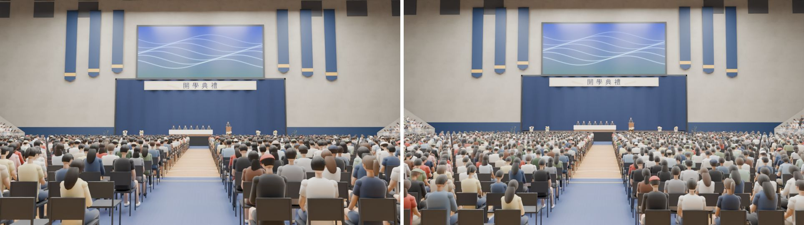
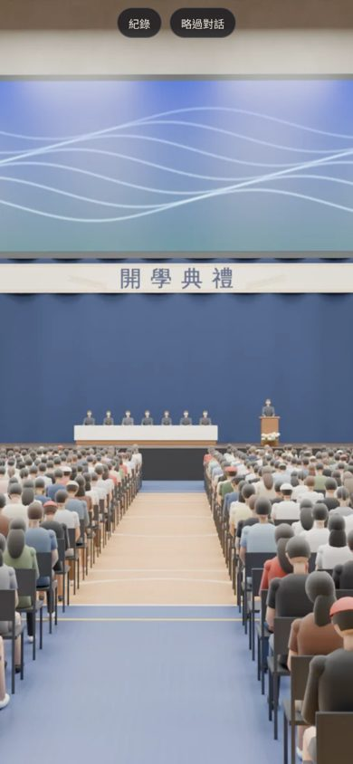
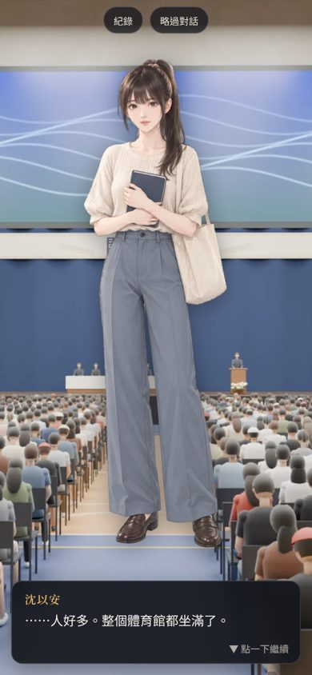
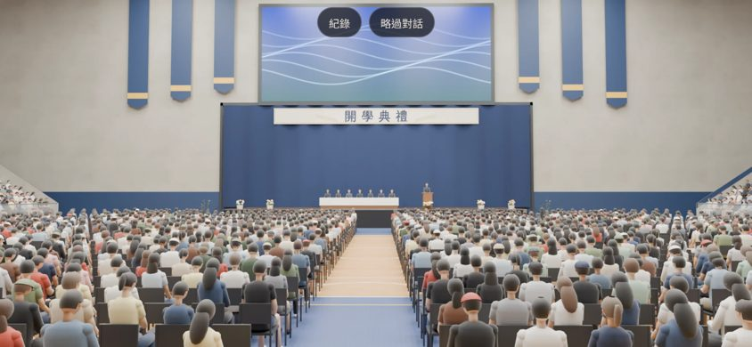
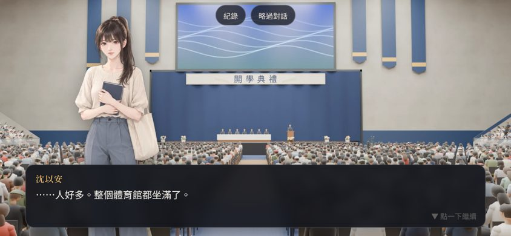

# ART-GYM-BG1：`ntu_gym_ceremony`（新體育館 3F 主球場的典禮，白天）

- **用在哪裡**：
  - 8/31 開學典禮（新遊戲第三天，Y1S1 第 0 週）。
  - 開發分支 tasks.json 的 ART-GYM-BG1：圖好以前遊戲用 `ntu_avenue` 模糊背景＋日期卡＋旁白。
  - 之後大四畢業典禮 CG-9 也用同一個場景：換橫幅、換人群的衣服（學士服），**這次沒做**。
- **檔案**：`assets/bg/ntu_gym_ceremony.webp`，1920×1080，約 145 KB。
- **做的人**：LAWWW2-B。
- **狀態**：`READY_FOR_ART_REVIEW`（場景美術的 `ART_APPROVED` 由使用者決定）。

## 怎麼做的
- Blender Cycles，腳本 `tools/blender/env_second/bg_gym_ceremony.py`，96 samples，算一張約 9 分鐘。
- 指令：
  ```
  /opt/blenv/bin/python tools/blender/env_second/bg_gym_ceremony.py -- <輸出.png> --res 1920x1080 --samples 96 --lens 24 --eye 0.35,2.3,17.4 --look 0,3.8,-21
  ```
- **場景**：遊戲裡同一個 3F 主球場模型 `gym_arena.glb`（f1d23fd4，疊面修過）。
  - 打開舞台＋典禮布置；藏起演講、演唱會布置。
  - 和遊戲裡的典禮是同一套舞台、布幕、盆花、來賓桌、講台、折疊椅。
- **背板長布**：寫「開學典禮」（`--text` 可以換字；畢業典禮換「畢業典禮」）。
  - 不寫校名、不放校徽（D77）。
  - 兩側月桂枝線條。
- **人群**：4,029 個坐著的人。
  - 場地折疊椅坐約 93%，下層看台坐約 7～9 成（越後面越少），上層看台（家長）坐 45%。
  - 座位位置照 `gym_arena.py` 的算法，和模型裡的椅子同一組座標。
  - 28 款身形：男女肩寬不同。
    - 髮型：短髮、長髮、馬尾、鮑伯、棒球帽。
    - 姿勢：坐正、低頭看手機、轉頭、手放腿上、往前傾。
    - 上衣：短袖、長袖；下身：長褲、短褲、裙子。
  - 顏色每個人不同：皮膚、髮色、上衣、褲裙、鞋子、配件，用 Cycles 的 Object Info → Random 查色表。
    - 色表是 8 月底台北的大學生：白、黑、灰、藏青、淺色居多。
  - **不畫五官**：從後面看是頭髮；看台上的人臉很小，只是膚色，看不出是誰。
- **舞台**：七位來賓坐在來賓桌後面，一位在講台致詞；深色西裝，上衣、褲子成套。
- **光**：屋頂 16 盞面光源＋看台上方 4 盞（白天室內、偏暖白），舞台前兩盞暖色投射燈。
- **鏡頭**：站在南看台第一排前面（眼睛 2.3 m 高），中央走道正對舞台，24 mm，對焦在舞台（f/5.6）。

## 構圖（手機優先）
- ADV 背景是 `cover`、置中。手機直向只看得到中間約 26% 的寬度：背板「開學典禮」、舞台、講台都在中間。
- 第一版鏡頭（左）在場地上（眼睛 1.65 m）：
  - 最近的幾排頭很大，簡化的人物看得太清楚；
  - 兩側看台幾乎拍不到。
- 第二版（右，採用）站在看台第一排前面：
  - 最近的頭離鏡頭約 5 m；
  - 整片人群像一片海，兩側看台露出來。



## 遊戲內 ADV 截圖
- 測試工作樹：開發分支 `dd24edbb`＋這張圖。
- 用 `ADV.begin({background:{image:'assets/bg/ntu_gym_ceremony.webp'}})` 開 ADV。
- 對話是測試用的一句，立繪是沈以安。
- 手機模擬（Playwright，dpr 2），**不是真機**。截圖縮成一半。

| 390×844 只有背景 | 390×844 對話中 |
|---|---|
|  |  |

| 844×390 只有背景 | 844×390 對話中 |
|---|---|
|  |  |

## 八項驗收紀錄（ART_SOP 第 3-2 節）
| 項目 | 結果 | 說明 |
|---|---|---|
| 輪廓與倒角 | 部分 | 場館、舞台、椅子沿用 3F 主球場模型（倒角、皺褶布幕）。人物是放樣的軀幹、橢球頭、管狀手腳，近看是簡化的公仔感。 |
| 材質 | 通過 | 衣服、褲子有布紋凹凸；頭髮有細的髮絲凹凸；皮膚有一點次表面散射。 |
| AO | 通過 | Cycles 光線追蹤。 |
| 磨損 | 不適用 | 新體育館、典禮布置。 |
| 生活痕跡 | 部分 | 有人低頭看手機、轉頭、戴帽子、往前傾。<br>還沒有：手上的典禮手冊、後背包、水瓶，空位上放的東西。 |
| 比例 | 通過 | 椅子 0.47 m 座高、人坐下頭頂約 1.3 m。舞台 1.2 m 高、背板長布 16×1.25 m，和遊戲模型相同。 |
| 效能 | 不適用 | 2D 背景（WebP 145 KB）。 |
| 遊戲截圖 | 通過 | ADV 直向、橫向各兩張（上面）。 |

## 還沒到的地方
1. **近處的人是簡化的公仔感**：頭髮是光滑的一片、手臂是管子。
   - 直向畫面最下面三分之一看得出來；
   - 橫向大部分被對話框蓋住。
   - 下一版可以給最近幾排換比較細的人物（有髮束、衣服皺褶），或在後製把最近幾排再糊一點。
2. 大螢幕是待機畫面（藍色波紋），很亮。典禮時通常會轉播舞台或打出標題，要不要改請 BB-B／使用者決定。
3. 畢業典禮版本（CG-9）沒做：要換「畢業典禮」橫幅、人群換學士服、帽子。
4. 只算了白天，沒有晚上。
