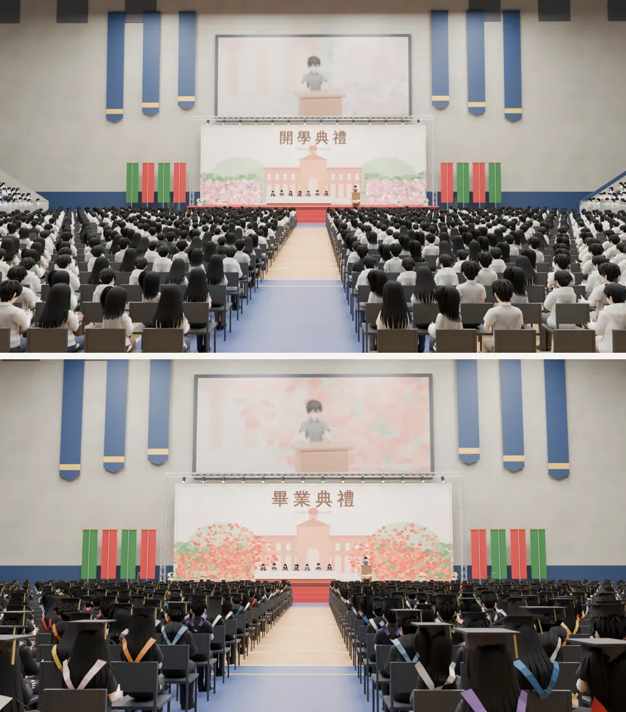
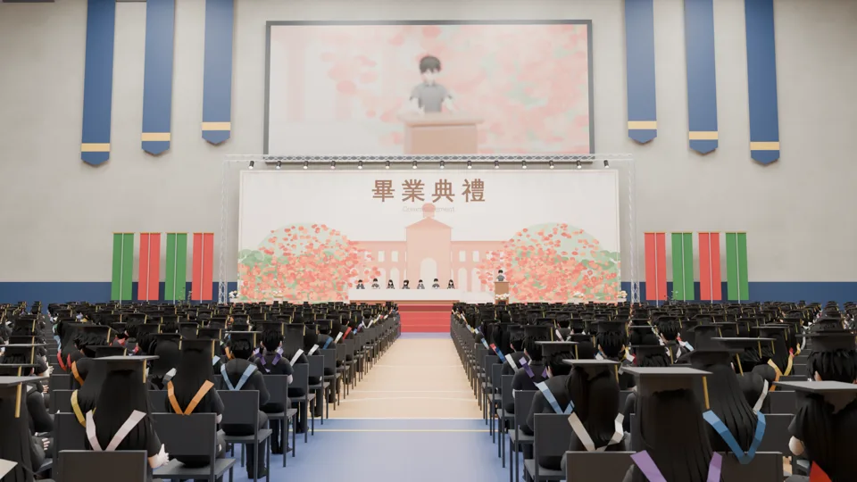
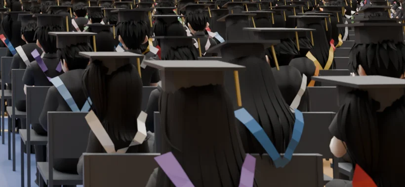
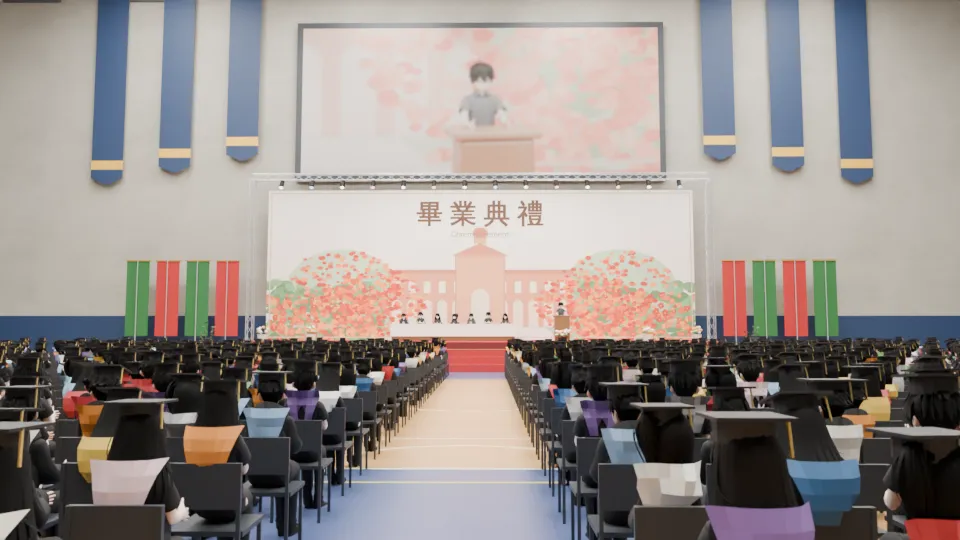

# BG-25 `ntu_gym_graduation`：新體育館的畢業典禮（白天）｜LAWWW2-C 2026-10-17｜READY_FOR_ART_REVIEW

- **用在哪裡**：G6 畢業典禮（大四下 6/2，校級典禮 09:00～10:30；`AA_13` G6、SCN-V5-02）。
  - 法律學院的典禮在霖澤館一樓大禮堂（這張沒做）；傅鐘、椰林大道是典禮後拍照的地方（遊戲校園）。
- **檔案**：`assets/bg/ntu_gym_graduation.webp`，1920×1080、120 KB。
- **怎麼做的**：開學典禮那張（BG-23，使用者「開學典禮可以!!!」）同一個場景、同一個鏡頭，`bg_gym_ceremony.py` 加 `--grad`：
  - 背板「畢業典禮／Commencement」；
  - 六月：杜鵑花換成鳳凰花（紅橙），後面的樹冠上一團團的花；
  - 學生：
    - 黑色學士服（衣服、褲子全黑）；
    - 方帽（帽身＋帽板＋金色流蘇），跟著低頭的角度；
    - 背上的披肩是 V 形的彩色滾邊，顏色每個人不同：校級典禮是全校各學院，不照真實的學院配色；
  - 上層看台坐一部分家長（便服）：畢業典禮家長會來（開學典禮被退件的是「一堆家長」）。這個鏡頭幾乎看不到上層看台。
  - 一共 3,733 人；舞台上七位來賓、講台致詞的人照舊（西裝）。
- **不寫校名、不放校徽**（D77）；插畫的建築和開學典禮那張一樣是虛構的。

## 畫面
開學典禮（上，已通過）和畢業典禮（下）：

畢業典禮：

前排右邊放大（方帽、流蘇、披肩）：

## 自己退件的版本
| 版本 | 問題 | 改法 |
|---|---|---|
| v1 | 披肩是一整塊填色的梯形，近看像背了一塊牌子 | 改成從兩肩往背中間收的 V 形滾邊，V 裡面就是黑色的學士服 |

v1：

## 接進遊戲（LAWWW-C）
- `S.BG` 加一筆 `ntu_gym_graduation`（字幕例：「台大・新體育館（畢業典禮）」），G6 校級典禮的事件用。

## 還沒做到的
- 法律學院的典禮（霖澤館一樓大禮堂）、大禮堂外的大廳：霖澤館室內目前沒有大禮堂，要另外做。
- 學士服只有上衣、褲子變黑，沒有做袍子的下襬和寬袖子（坐著看不太出來）。
- 背板的英文字被插畫的塔樓擋住一半（開學典禮那張也是）。
- 場景美術要使用者看過才標 `ART_APPROVED`。
