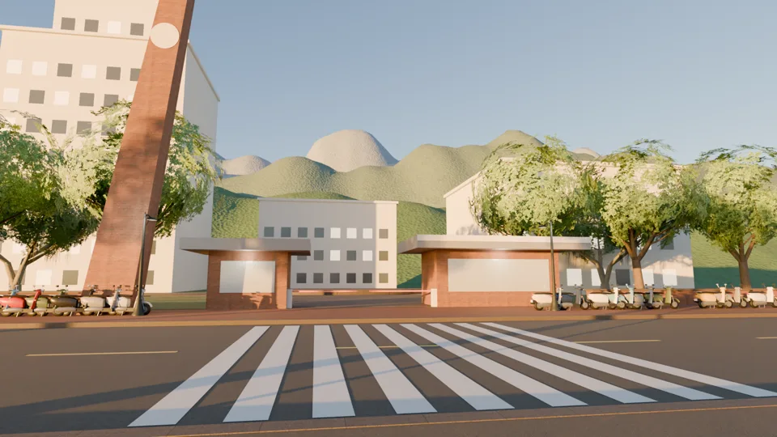
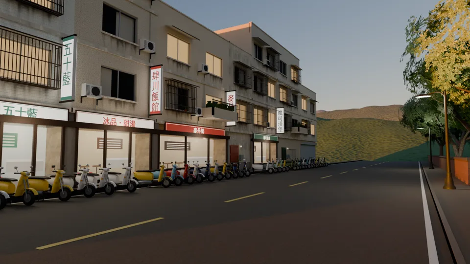

# 2D 背景：政大校門口、政大山下的小吃街（READY_FOR_ART_REVIEW；LAWWW2-B 2026-10-16）

- 需求：使用者試玩 v9.7 第 11 項「去政大找可昕完全沒有畫面」；LAWWW-B 23:34Z 分派 B。
- 使用者 10-16 的三個指示：
  - 「附近有麥當勞、學生主要去的店要實際查，不要虛構」。
  - 校門提供了實景照片。
  - 「店名為了不侵權要取諧音或替代」。
- 檔案：`assets/bg/nccu_gate.webp`、`assets/bg/nccu_food.webp`，1920×1080，畫面上沒有人。
- 縮圖： 
- **範圍（使用者 10-16）**：「政大不用做的跟台大一樣完整，主要校園、宿舍」；已做完的保留；宿舍是自強十舍。
  - 這兩張之後，只再做「政大・宿舍（自強十舍）」，已經向使用者要照片。
  - nccu_river、nccu_lib、nccu_park 不做；圖書館（達賢）的場景草稿留在 `bg_nccu.py`。
- 接法：`src/outings3d.js` 的 `S.BG.nccu_gate.image`、`nccu_food.image` 填路徑，做法同 noodle_table（LAWWW-B 的檔案，我沒改）。
- 時間：傍晚（店和路燈已經亮了，天空還有一點亮）。下午出發（K1 導遊）和晚上 19:30（K1b）都說得通。
- 腳本：
  - `tools/blender/env_second/bg_nccu.py`。
  - 小吃街的建築用 `tools/blender/env_second/wz_street.py --set nccu_food`，和溫州街、公館、118 巷同一套台北老公寓。
- 工具：Blender 5.2＋Cycles 64 samples＋降噪。
- 用到的模型（都是 LAWWW2 的正式 GLB）：機車 `scooter.glb`（每台不同顏色）、行道樹 `street_trees.glb`、路燈 `street_props.glb`。
- 貼圖：Poly Haven CC0（紅磚、花崗石、混凝土）。

## 照什麼畫（查證：`docs/art-rebuild/second_ai/research/nccu_real_shops.md`）

### 校門口（照使用者給的實景照片）

- 照片裡有、背景也做了的：
  - 左邊很高、往右傾的紅磚斜塔。照片上方的圓形牌是校徽，這裡只做素面圓盤。
  - 兩座一層樓的紅磚門房，灰色厚平屋頂、深屋簷；右邊那座比較大，有白色飾帶。
  - 兩座門房中間的車道和柵欄。
  - 紅磚人行道、斑馬線、左後方很高的白色大樓、四周的樹、後面的指南山。
- 查證補上的：指南路雙向約 12 m；門內的石材廣場、四維堂（量體推估）。
- 沒放的：校名、校徽（照 LAWWW-B 的規則）。

### 山下的小吃街

位置：指南路二段 57～67 號，在政大側門「麥側」斜對面，是學生人流最多的一段。店的位置、種類照查證，**店名改成諧音**：

| 真實店家 | 遊戲招牌 |
|---|---|
| 敏忠小吃 | 明中小吃 |
| 迷客夏 | 米可夏 |
| 50嵐 | 五十藍 |
| 一樓甜品店 ＋ 二樓四川飯館 | 冰品・甜湯 ＋ 直立招牌「肆川飯館」 |
| 麥當勞（三層） | 麥丹勞（深紅底米白字，不用紅底黃 M） |
| 摩斯漢堡（中間夾一棟鐵門公寓） | 魔司漢堡 |

- 空間：對街是政大的矮牆、側門、樹、指南山；路邊停滿機車。
- 查不到的門面：只放住家鐵門、鐵捲門，不編店名。

## 還不到參考品質的地方（誠實寫）

- 只有校門有實景照片；小吃街的店面寬度、樓層、外觀是推估（沒看到照片）。
- 斜塔、門房的比例是照一張 400 px 的小照片估的；細部（窗、門、屋頂收邊）簡化了。
- 白色大樓、四維堂是簡單量體，窗戶是規則格子。
- 山是程序化地形加森林材質，近看沒有一棵一棵的樹。
- 店裡的景深卡是畫的示意（燈、菜單板、櫃台），沒有真的室內。
- 只在 Blender 算圖看過，**還沒在遊戲 ADV 畫面、手機上看過**（LAWWW-B 接上後拍）。

---

# 第三張：政大・校園裡的路 `nccu_campus`（READY_FOR_ART_REVIEW；LAWWW2-B 2026-10-16 01:4x UTC）

- **需求**：LAWWW-B 00:56Z 佇列。AA-B 決定（AA_137 7-1）K1b 的河堤改成「政大校園裡的路」（散步）；屬於使用者說的「主要校園」範圍。
- **檔案**：`assets/bg/nccu_campus.webp`（1920×1080，畫面上沒有人）。縮圖：
- **接法**：`outings3d.js` 的 `S.BG.nccu_campus.image`。LAWWW-B 已經留好位置。
- **照什麼畫**（查證：`docs/art-rebuild/second_ai/research/nccu_campus_path.md`）：
  - 醉夢溪（指南溪流進校園的那一段）沿岸的濱溪步道，政大人叫「情人道」。溪上有好幾座橋，溪岸種楓香，護岸是近自然工法，校園緊貼著指南山。
  - **沒有看到照片**：路寬、鋪面、護岸與欄杆、橋的造型、溪邊建築都是推估。**使用者如果有照片，照照片改**（和校門那張一樣）。
- **畫面**：
  - 站在溪邊步道靠溪那一側往北看。
  - 左邊兩三排大樹、路燈（亮著）、長椅。
  - 右邊是矮牆＋金屬欄杆，往下是長草的土坡，坡腳一排大石頭（近自然工法），溪水倒映天空和對岸。
  - 遠處一座跨溪的平板橋；對岸步道、樹、白色系館（窗戶亮幾格）。
  - 後面是長滿樹的指南山（三層，越遠越藍）。
- **時間**：傍晚（天空還亮、路燈已經亮了；K1b 19:30 也說得通）。不寫校名、橋名，不放校徽。
- **腳本**：`bg_nccu.py -- campus - <輸出.png>`。
  - 模型：`street_trees.glb`（樟樹、榕樹）、`street_props.glb`（路燈、長椅）。
  - 貼圖：Poly Haven CC0（花崗石鋪面、混凝土）。
  - 山：程序化地形，上面種約 6,700 片樹卡（`street_trees.py` 的遠景卡片，樟樹、榕樹，每片面向鏡頭、腳踩在坡面上）。前兩版只用材質凹凸，看起來像光禿的沙丘或揉皺的紙，不採用。
  - 草坡：Blender 的雜訊材質。

## 這一張還不到參考品質的地方

- 沒有照片，整張的配置是推估的。真的醉夢溪可能比較窄、彎，護岸也可能不一樣。
- 溪是直的，像整理過的渠道；真的溪比較彎。
- 楓香用樟樹的模型代替（遊戲裡沒有楓香），秋天會變紅的特徵沒有表現。
- 山上的樹是卡片：遠看是森林，鏡頭貼近會看出是平的；樹種只有樟樹、榕樹兩種。
- 只在 Blender 算圖看過，**還沒在遊戲 ADV 畫面、手機上看過**。

## nccu_campus 交付（2026-10-16 04:2x，ART-11／BG-03）

- 主圖 `assets/bg/nccu_campus.webp`：**夜晚**（1920×1080）。依據 AA_147：K1b 是十月平日 21:30，祐廷和可昕走在政大校園裡的路上。
- 指令：`bg_nccu.py campus - <out> --samples 64 --time night`。
- **傍晚版（變體）還沒交**：v6 傍晚的山被暖光、偏灰的樹色混成土黃色，像岩壁。v8 已改（樹綠一點、霧偏藍、光暖得少一點），算圖中。

| 版本 | 圖 | 問題／改法 |
|---|---|---|
| v5 傍晚 | `campus_v5_dusk.webp` | 山太亮、太黃綠，像近處的一團灌木；山頂禿一塊 |
| v6 夜晚 | `campus_v6_night.webp` | 太暗：山和樹黑成一片，看不出稜線；前景步道幾乎全黑 |
| v6 傍晚 | `campus_v6_dusk.webp` | 山變成岩石的土黃色 |
| **v7 夜晚（交付）** | `campus_v7_night.webp` | 天邊被城市照亮，山的稜線出來了；月光加強；路燈加強；曝光加 0.7；系館的窗亮 55% |

**v7 的改法**（`bg_nccu.py`）：
- 夜晚的天：漸層，天邊 (0.060,0.064,0.085) 往上到 (0.007,0.011,0.028)。
- 月光：0.09。
- 路燈：420 W，傍晚版照舊 260。
- 曝光：+0.7。
- 空氣透視：霧色 (0.040,0.045,0.062)、maxk 0.55。
- 山頂第三層補了樹卡（v5 山頂露出地面）。

**還不夠的地方**：
- 右邊的系館只是白色方塊加窗，晚上看不太出來，近看會單調。
- 前景左下比較暗，但那裡會被對話框蓋住。
- 沒有照片，外觀都是推估：醉夢溪畔步道、欄杆、橋（查證見 `research/nccu_campus_path.md`）。

**狀態**：READY_FOR_ART_REVIEW（使用者驗收）。
